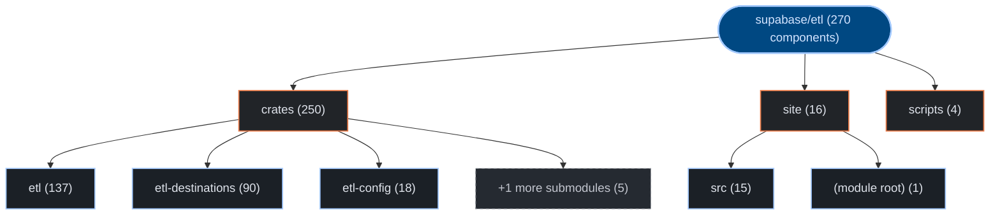
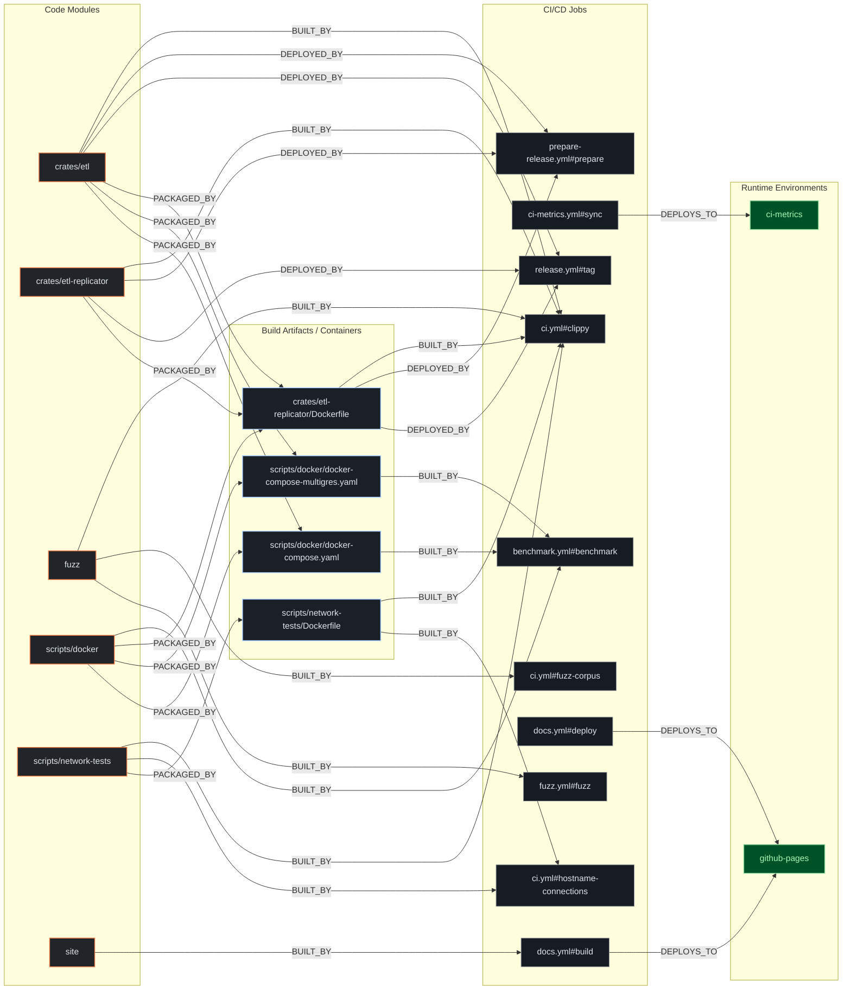

# Repository Architecture Analysis: supabase/etl

## Metadata
- **SHA**: `8c27b92d378f66b5d79165b60e43dc4bc5eb01a8`
- **Primary Ecosystem**: Rust

## Quality Metrics
- **ast_engine**: tree-sitter
- **avg_cognitive_complexity**: 2.58
- **avg_cyclomatic_complexity**: 3.38
- **component_count**: 270
- **dead_code_count**: 0
- **dead_code_symbols**: 0 entry(ies)
- **duplication_pct**: 0.81
- **file_complexities**: 25 entry(ies)
- **files_analyzed**: 408
- **fitness_passed**: False
- **fitness_violation_count**: 2
- **framework**: Axum / Actix / Rocket
- **import_edges**: 100 entry(ies)
- **loc**: 202567
- **max_cognitive_complexity**: 44
- **max_cyclomatic_complexity**: 60
- **sloc**: 154280
- **test_file_count**: 81

# Architecture: supabase/etl

## Context
- **Repository**: `supabase/etl`
- **SHA**: `8c27b92d378f66b5d79165b60e43dc4bc5eb01a8`
- **Ecosystem**: Rust
- **Framework**: Axum / Actix / Rocket

## Building Block View

## Component Details

Showing top 60 representative components out of 270 across 3 module group(s):

- **Module `crates`** (250 components — module: 250)
- **Module `site`** (16 components — UI_COMPONENT: 14, MODULE: 1, API_ROUTE: 1)
- **Module `scripts`** (4 components — module: 4)

- **@supabase/etl-docs** (`site/package.json`): MODULE
- **API_search_route** (`site/src/app/api/search/route.ts`): API_ROUTE
- **AgentActions** (`site/src/components/agent-actions.tsx`): UI_COMPONENT
- **Brand** (`site/src/components/brand.tsx`): UI_COMPONENT
- **DocumentationLayout** (`site/src/app/(docs)/layout.tsx`): UI_COMPONENT
- **EtlMark** (`site/src/components/brand.tsx`): UI_COMPONENT
- **EtlSearchDialog** (`site/src/components/search.tsx`): UI_COMPONENT
- **HomeNav** (`site/src/components/home-nav.tsx`): UI_COMPONENT
- **HomePage** (`site/src/app/page.tsx`): UI_COMPONENT
- **Mermaid** (`site/src/components/mermaid.tsx`): UI_COMPONENT
- **NotFound** (`site/src/app/(docs)/not-found.tsx`): UI_COMPONENT
- **OpenGraphImage** (`site/src/app/opengraph-image.tsx`): UI_COMPONENT
- **PipelinesMark** (`site/src/components/brand.tsx`): UI_COMPONENT
- **Provider** (`site/src/components/provider.tsx`): UI_COMPONENT
- **ReplicationFlow** (`site/src/components/replication-flow.tsx`): UI_COMPONENT
- **RootLayout** (`site/src/app/layout.tsx`): UI_COMPONENT
- **activity** (`crates/etl/src/activity.rs`): module
- **async_result** (`crates/etl/src/destination/async_result.rs`): module
- **auth** (`crates/etl-destinations/src/snowflake/auth.rs`): module
- **auth** (`crates/etl-destinations/tests/snowflake/auth.rs`): module
- **backoff** (`crates/etl-destinations/src/retry/backoff.rs`): module
- **base** (`crates/etl-config/src/shared/base.rs`): module
- **base** (`crates/etl/src/destination/base.rs`): module
- **base** (`crates/etl/src/store/schema/base.rs`): module
- **base** (`crates/etl/src/store/state/base.rs`): module
- **batch_memory_governor** (`crates/etl/src/runtime/batch_memory_governor.rs`): module
- **batches** (`crates/etl-destinations/src/ducklake/batches.rs`): module
- **bool** (`crates/etl/src/postgres/codec/bool.rs`): module
- **buffer** (`crates/etl-destinations/src/snowflake/streaming/batch/buffer.rs`): module
- **cache** (`crates/etl/src/store/cache.rs`): module
- **capabilities** (`crates/etl/src/destination/capabilities.rs`): module
- **capabilities** (`crates/etl/src/store/capabilities.rs`): module
- **cdc_property** (`crates/etl-destinations/tests/clickhouse/cdc_property.rs`): module
- **cdc_workload** (`crates/etl/src/test_utils/cdc_workload.rs`): module
- **cell** (`crates/etl/src/data/cell.rs`): module
- **channel** (`crates/etl-destinations/src/snowflake/streaming/channel.rs`): module
- **child** (`crates/etl/src/postgres/client/child.rs`): module
- **classify** (`crates/etl-destinations/src/retry/classify.rs`): module
- **clickhouse** (`crates/etl-config/src/clickhouse.rs`): module
- **client** (`crates/etl-destinations/src/bigquery/client.rs`): module
- **client** (`crates/etl-destinations/src/clickhouse/client.rs`): module
- **client** (`crates/etl-destinations/src/ducklake/client.rs`): module
- **client** (`crates/etl-destinations/src/snowflake/client.rs`): module
- **common** (`crates/etl-benchmarks/src/common.rs`): module
- **common** (`crates/etl-destinations/tests/snowflake/common.rs`): module
- **compose** (`scripts/network-tests/compose.yaml`): module
- **config** (`crates/etl-destinations/src/ducklake/config.rs`): module
- **config** (`crates/etl-destinations/src/snowflake/config.rs`): module
- **config** (`crates/etl/src/config.rs`): module
- **connection** (`crates/etl-config/src/shared/connection.rs`): module
- **constants** (`crates/etl/src/constants.rs`): module
- **copy** (`crates/etl/src/replication/table_sync/copy.rs`): module
- **copy_cdc_differential** (`crates/etl/tests/copy_cdc_differential.rs`): module
- **core** (`crates/etl-destinations/src/bigquery/core.rs`): module
- **core** (`crates/etl-destinations/src/clickhouse/core.rs`): module
- **core** (`crates/etl-destinations/src/ducklake/core.rs`): module
- **core** (`crates/etl-destinations/src/snowflake/core.rs`): module
- **crash_replay** (`crates/etl-destinations/tests/bigquery/crash_replay.rs`): module
- **crash_replay** (`crates/etl-destinations/tests/ducklake/crash_replay.rs`): module
- **crash_replay** (`crates/etl-destinations/tests/snowflake/crash_replay.rs`): module

## 6-Dimension Repository Scorecard

- **Overall Grade**: `F` (48.65/100)
- **Technical Debt Score**: 51.35
- **Estimated Remediation Effort**: 67.50h

| Dimension | Grade | Score | Weight | Details |
| :--- | :---: | :---: | :---: | :--- |
| Code Quality | `C` | 72.27 | 0.20 | avg_cc=3.38, max_cc=60, duplication=0.81%, dead_code=0 |
| Dependency Health | `A` | 100.00 | 0.15 | dependencies=1689, outdated=0, vulnerable=0, has_lockfile=True |
| Maintainability | `F` | 58.00 | 0.15 | avg_cognitive=2.58, max_cognitive=44, fitness_violations=2, oversized_files=1 |
| Pipeline Health | `F` | 0.00 | 0.15 | workflows=16, operational_antipatterns=17, parallel_branches=True |
| Security | `F` | 0.00 | 0.20 | vulnerabilities=0, secrets=4, pipeline_security_findings=11 |
| Test Coverage | `C` | 70.00 | 0.15 | coverage=unavailable, ci_test_job=True, test_files_detected=True |

## Architecture Fitness & Workspace Boundaries

- **[MEDIUM] `ATRUSS-ARCH-005` (COMPLEXITY_THRESHOLD)**: Repository max_cognitive_complexity (44.0) exceeds policy threshold (25.0).
- **[MEDIUM] `ATRUSS-ARCH-005` (COMPLEXITY_THRESHOLD)**: Repository max_cyclomatic_complexity (60.0) exceeds policy threshold (20.0).

### Workspace Packages
- **etl** (`crates/etl`, rust, cargo) -> internal deps: `etl-config, etl-postgres, etl-telemetry`
- **etl-benchmarks** (`crates/etl-benchmarks`, rust, cargo) -> internal deps: `etl, etl-config, etl-destinations, etl-postgres, etl-telemetry`
- **etl-config** (`crates/etl-config`, rust, cargo)
- **etl-destinations** (`crates/etl-destinations`, rust, cargo) -> internal deps: `etl, etl-config, etl-maintenance, etl-postgres, etl-telemetry`
- **etl-examples** (`crates/etl-examples`, rust, cargo) -> internal deps: `etl, etl-config, etl-destinations`
- **etl-maintenance** (`crates/etl-maintenance`, rust, cargo) -> internal deps: `etl, etl-config`
- **etl-postgres** (`crates/etl-postgres`, rust, cargo) -> internal deps: `etl-config`
- **etl-replicator** (`crates/etl-replicator`, rust, cargo) -> internal deps: `etl, etl-config, etl-destinations, etl-maintenance, etl-telemetry`
- **etl-telemetry** (`crates/etl-telemetry`, rust, cargo) -> internal deps: `etl-config`
- **xtask** (`crates/xtask`, rust, cargo) -> internal deps: `etl-config`

## Supply Chain Dependencies, Vulnerabilities & Secrets

- **Dependencies Parsed**: 1689 | **Vulnerabilities**: 0 | **Secrets**: 4

### Secret Findings (Redacted)
- **[CRITICAL] `ATRUSS-SEC-004`** at `crates/etl-destinations/src/snowflake/README.md:200` (`-----BEGIN ... PRIVATE KEY----- [REDACTED]`)
- **[CRITICAL] `ATRUSS-SEC-004`** at `crates/etl-destinations/src/snowflake/README.md:214` (`-----BEGIN ... PRIVATE KEY----- [REDACTED]`)
- **[CRITICAL] `ATRUSS-SEC-004`** at `crates/etl-destinations/src/snowflake/auth.rs:357` (`-----BEGIN ... PRIVATE KEY----- [REDACTED]`)
- **[CRITICAL] `ATRUSS-SEC-004`** at `crates/etl/src/postgres/client/raw.rs:1003` (`-----BEGIN ... PRIVATE KEY----- [REDACTED]`)

### Inventory Sample
- `anyhow` `*` (cargo, `crates/etl-benchmarks/Cargo.toml`)
- `anyhow` `*` (cargo, `crates/xtask/Cargo.toml`)
- `async-trait` `*` (cargo, `crates/etl-destinations/Cargo.toml`)
- `async-trait` `*` (cargo, `crates/etl-maintenance/Cargo.toml`)
- `aws-lc-rs` `*` (cargo, `crates/etl-destinations/Cargo.toml`)
- `aws-lc-rs` `*` (cargo, `crates/etl-postgres/Cargo.toml`)
- `axum` `*` (cargo, `crates/etl-replicator/Cargo.toml`)
- `axum` `*` (cargo, `crates/etl-telemetry/Cargo.toml`)
- `base64` `*` (cargo, `crates/etl-destinations/Cargo.toml`)
- `byteorder` `*` (cargo, `crates/etl-postgres/Cargo.toml`)
- `bytes` `*` (cargo, `crates/etl-destinations/Cargo.toml`)
- `bytes` `*` (cargo, `crates/etl-postgres/Cargo.toml`)
- `bytes` `*` (cargo, `crates/etl/Cargo.toml`)
- `chrono` `*` (cargo, `crates/etl-destinations/Cargo.toml`)
- `chrono` `*` (cargo, `crates/etl-maintenance/Cargo.toml`)
- `chrono` `*` (cargo, `crates/etl-postgres/Cargo.toml`)
- `chrono` `*` (cargo, `crates/etl/Cargo.toml`)
- `chrono` `*` (cargo, `crates/xtask/Cargo.toml`)
- `clap` `*` (cargo, `crates/etl-benchmarks/Cargo.toml`)
- `clap` `*` (cargo, `crates/etl-examples/Cargo.toml`)
- `clap` `*` (cargo, `crates/xtask/Cargo.toml`)
- `clickhouse` `*` (cargo, `crates/etl-benchmarks/Cargo.toml`)
- `clickhouse` `*` (cargo, `crates/etl-destinations/Cargo.toml`)
- `config` `*` (cargo, `crates/etl-config/Cargo.toml`)
- `configcat` `*` (cargo, `crates/etl-replicator/Cargo.toml`)
- `const-oid` `*` (cargo, `crates/etl-postgres/Cargo.toml`)
- `duckdb` `*` (cargo, `crates/etl-destinations/Cargo.toml`)
- `duckdb` `*` (cargo, `crates/etl-maintenance/Cargo.toml`)
- `etl` `*` (cargo, `crates/etl-benchmarks/Cargo.toml`)
- `etl` `*` (cargo, `crates/etl-destinations/Cargo.toml`)
- ... (+1659 more dependencies)

## Section 7: Code-to-Cloud Deployment Traceability

- `ci-metrics.yml#sync` (ci_job) --[DEPLOYS_TO]--> `ci-metrics` (environment)
- `docs.yml#build` (ci_job) --[DEPLOYS_TO]--> `github-pages` (environment)
- `docs.yml#deploy` (ci_job) --[DEPLOYS_TO]--> `github-pages` (environment)
- `crates/etl` (code_module) --[BUILT_BY]--> `ci.yml#clippy` (ci_job)
- `crates/etl` (code_module) --[DEPLOYED_BY]--> `prepare-release.yml#prepare` (ci_job)
- `crates/etl` (code_module) --[DEPLOYED_BY]--> `release.yml#tag` (ci_job)
- `crates/etl` (code_module) --[PACKAGED_BY]--> `crates/etl-replicator/Dockerfile` (container)
- `crates/etl` (code_module) --[PACKAGED_BY]--> `scripts/docker/docker-compose-multigres.yaml` (container)
- `crates/etl` (code_module) --[PACKAGED_BY]--> `scripts/docker/docker-compose.yaml` (container)
- `crates/etl-replicator` (code_module) --[BUILT_BY]--> `ci.yml#clippy` (ci_job)
- `crates/etl-replicator` (code_module) --[DEPLOYED_BY]--> `prepare-release.yml#prepare` (ci_job)
- `crates/etl-replicator` (code_module) --[DEPLOYED_BY]--> `release.yml#tag` (ci_job)
- `crates/etl-replicator` (code_module) --[PACKAGED_BY]--> `crates/etl-replicator/Dockerfile` (container)
- `fuzz` (code_module) --[BUILT_BY]--> `ci.yml#clippy` (ci_job)
- `fuzz` (code_module) --[BUILT_BY]--> `ci.yml#fuzz-corpus` (ci_job)
- `fuzz` (code_module) --[BUILT_BY]--> `fuzz.yml#fuzz` (ci_job)
- `scripts/docker` (code_module) --[BUILT_BY]--> `benchmark.yml#benchmark` (ci_job)
- `scripts/docker` (code_module) --[PACKAGED_BY]--> `crates/etl-replicator/Dockerfile` (container)
- `scripts/docker` (code_module) --[PACKAGED_BY]--> `scripts/docker/docker-compose-multigres.yaml` (container)
- `scripts/docker` (code_module) --[PACKAGED_BY]--> `scripts/docker/docker-compose.yaml` (container)
- `scripts/network-tests` (code_module) --[BUILT_BY]--> `ci.yml#clippy` (ci_job)
- `scripts/network-tests` (code_module) --[BUILT_BY]--> `ci.yml#hostname-connections` (ci_job)
- `scripts/network-tests` (code_module) --[PACKAGED_BY]--> `scripts/network-tests/Dockerfile` (container)
- `site` (code_module) --[BUILT_BY]--> `docs.yml#build` (ci_job)
- `crates/etl-replicator/Dockerfile` (container) --[BUILT_BY]--> `ci.yml#clippy` (ci_job)
- `crates/etl-replicator/Dockerfile` (container) --[DEPLOYED_BY]--> `prepare-release.yml#prepare` (ci_job)
- `crates/etl-replicator/Dockerfile` (container) --[DEPLOYED_BY]--> `release.yml#tag` (ci_job)
- `scripts/docker/docker-compose-multigres.yaml` (container) --[BUILT_BY]--> `benchmark.yml#benchmark` (ci_job)
- `scripts/docker/docker-compose.yaml` (container) --[BUILT_BY]--> `benchmark.yml#benchmark` (ci_job)
- `scripts/network-tests/Dockerfile` (container) --[BUILT_BY]--> `ci.yml#clippy` (ci_job)
- `scripts/network-tests/Dockerfile` (container) --[BUILT_BY]--> `ci.yml#hostname-connections` (ci_job)

## CI/CD Pipeline Topology

```mermaid
graph TD;
  classDef atlasRoot fill:#004882,stroke:#a3c9ff,stroke-width:2px,color:#d3e4ff
  classDef atlasCategory fill:#212428,stroke:#E87A48,stroke-width:1.5px,color:#dfe3eb
  classDef atlasWorkflow fill:#1b2026,stroke:#a3c9ff,stroke-width:1.5px,color:#dfe3eb
  classDef atlasJob fill:#171c22,stroke:#8d9199,stroke-width:1px,color:#dfe3eb
  classDef atlasTarget fill:#005227,stroke:#8bd99b,stroke-width:1.5px,color:#a7f6b6
  classDef atlasAlert fill:#93000a,stroke:#ffb4ab,stroke-width:1.5px,color:#ffdad6
  classDef atlasMore fill:#252a31,stroke:#8d9199,stroke-dasharray:4 4,color:#c3c6cf
  pipeline_root(["supabase/etl (16 workflows)"]):::atlasRoot
  grp_0_Scheduled___Manual["Scheduled & Manual (9 workflows · 24 jobs)"]:::atlasCategory
  pipeline_root --> grp_0_Scheduled___Manual
  wf_0_Benchmark["Benchmark (2 jobs)"]:::atlasWorkflow
  grp_0_Scheduled___Manual --> wf_0_Benchmark
  job_0_plan["plan"]:::atlasJob
  job_0_benchmark["benchmark"]:::atlasJob
  wf_0_Benchmark --> job_0_plan
  job_0_plan --> job_0_benchmark
  wf_3_CI["CI (13 jobs)"]:::atlasWorkflow
  grp_0_Scheduled___Manual --> wf_3_CI
  job_3_format["format"]:::atlasJob
  job_3_clippy["clippy"]:::atlasJob
  job_3_tls["tls"]:::atlasJob
  wf_3_CI --> job_3_format
  wf_3_CI --> job_3_clippy
  wf_3_CI --> job_3_tls
  wf_6_Docs["Docs (2 jobs)"]:::atlasWorkflow
  grp_0_Scheduled___Manual --> wf_6_Docs
  job_6_build["build"]:::atlasJob
  job_6_deploy["deploy"]:::atlasJob
  wf_6_Docs --> job_6_build
  job_6_build --> job_6_deploy
  wf_10_Property_tests["Property tests (2 jobs)"]:::atlasWorkflow
  grp_0_Scheduled___Manual --> wf_10_Property_tests
  job_10_test_build["test-build"]:::atlasJob
  job_10_test["test"]:::atlasJob
  wf_10_Property_tests --> job_10_test_build
  job_10_test_build --> job_10_test
  grp_1_Release___Deploy["Release & Deploy (4 workflows · 11 jobs)"]:::atlasCategory
  pipeline_root --> grp_1_Release___Deploy
  wf_11_Publish_image["Publish image (3 jobs)"]:::atlasWorkflow
  grp_1_Release___Deploy --> wf_11_Publish_image
  job_11_route["route"]:::atlasJob
  job_11_image["image"]:::atlasJob
  job_11_release["release"]:::atlasJob
  wf_11_Publish_image --> job_11_route
  job_11_route --> job_11_image
  job_11_route --> job_11_release
  wf_12_Release["Release (3 jobs)"]:::atlasWorkflow
  grp_1_Release___Deploy --> wf_12_Release
  job_12_tag["tag"]:::atlasJob
  job_12_image["image"]:::atlasJob
  job_12_release["release"]:::atlasJob
  wf_12_Release --> job_12_tag
  job_12_tag --> job_12_image
  job_12_tag --> job_12_release
  job_12_image --> job_12_release
  wf_13_Publish_image__reusable_["Publish image (reusable) (4 jobs)"]:::atlasWorkflow
  grp_1_Release___Deploy --> wf_13_Publish_image__reusable_
  job_13_prepare["prepare"]:::atlasJob
  wf_13_Publish_image__reusable_ --> job_13_prepare
  grp_2_Security___Governance["Security & Governance (2 workflows · 2 jobs)"]:::atlasCategory
  pipeline_root --> grp_2_Security___Governance
  wf_4_CodeQL["CodeQL (1 jobs)"]:::atlasWorkflow
  grp_2_Security___Governance --> wf_4_CodeQL
  wf_5_Dependency_audit["Dependency audit (1 jobs)"]:::atlasWorkflow
  grp_2_Security___Governance --> wf_5_Dependency_audit
  grp_3_CI___Verification["CI & Verification (1 workflows · 1 jobs)"]:::atlasCategory
  pipeline_root --> grp_3_CI___Verification
  wf_14_Tests__reusable_["Tests (reusable) (1 jobs)"]:::atlasWorkflow
  grp_3_CI___Verification --> wf_14_Tests__reusable_
  wf_more["+6 more workflows"]:::atlasMore
  pipeline_root --> wf_more
```

