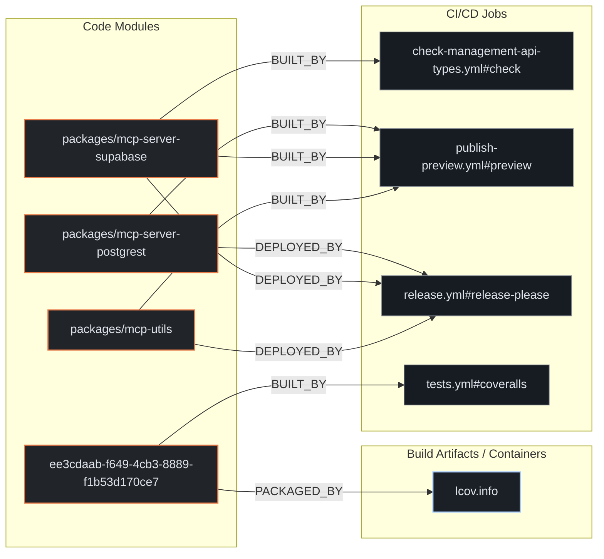
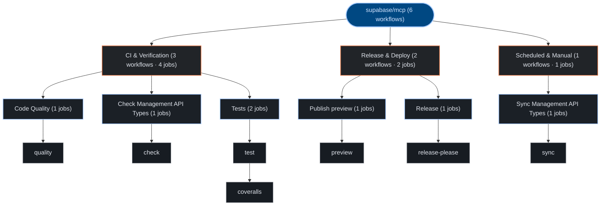

# Repository Architecture Analysis: supabase/mcp

## Metadata
- **SHA**: `9092ab9055509fcdfbedcb75edf02d9412feed37`
- **Primary Ecosystem**: JavaScript/TypeScript

## Quality Metrics
- **ast_engine**: tree-sitter
- **avg_cognitive_complexity**: 4.44
- **avg_cyclomatic_complexity**: 3.26
- **component_count**: 5
- **dead_code_count**: 0
- **dead_code_symbols**: 0 entry(ies)
- **duplication_pct**: 88.62
- **file_complexities**: 25 entry(ies)
- **files_analyzed**: 123
- **fitness_passed**: False
- **fitness_violation_count**: 3
- **framework**: Express / Node API
- **import_edges**: 100 entry(ies)
- **loc**: 58441
- **max_cognitive_complexity**: 127
- **max_cyclomatic_complexity**: 73
- **sloc**: 49151
- **test_file_count**: 51

# Architecture: supabase/mcp

## Context
- **Repository**: `supabase/mcp`
- **SHA**: `9092ab9055509fcdfbedcb75edf02d9412feed37`
- **Ecosystem**: JavaScript/TypeScript
- **Framework**: Express / Node API

## Building Block View

```mermaid
graph TD;
  classDef atlasRoot fill:#004882,stroke:#a3c9ff,stroke-width:2px,color:#d3e4ff
  classDef atlasCategory fill:#212428,stroke:#E87A48,stroke-width:1.5px,color:#dfe3eb
  classDef atlasWorkflow fill:#1b2026,stroke:#a3c9ff,stroke-width:1.5px,color:#dfe3eb
  classDef atlasJob fill:#171c22,stroke:#8d9199,stroke-width:1px,color:#dfe3eb
  classDef atlasTarget fill:#005227,stroke:#8bd99b,stroke-width:1.5px,color:#a7f6b6
  classDef atlasAlert fill:#93000a,stroke:#ffb4ab,stroke-width:1.5px,color:#ffdad6
  classDef atlasMore fill:#252a31,stroke:#8d9199,stroke-dasharray:4 4,color:#c3c6cf
    ee3cdaab_f649_4cb3_8889_f1b53d170ce7["ee3cdaab-f649-4cb3-8889-f1b53d170ce7 : MODULE"]:::atlasJob
    _supabase_mcp_server_postgrest["@supabase/mcp-server-postgrest : MODULE"]:::atlasJob
    _supabase_mcp_server_supabase["@supabase/mcp-server-supabase : MODULE"]:::atlasJob
    _supabase_mcp_utils["@supabase/mcp-utils : MODULE"]:::atlasJob
    GraphQLClient["GraphQLClient : SERVICE"]:::atlasJob
    repo_root(["supabase/mcp"]):::atlasRoot
    repo_root --> GraphQLClient
    repo_root --> _supabase_mcp_server_postgrest
    repo_root --> _supabase_mcp_server_supabase
    repo_root --> _supabase_mcp_utils
    repo_root --> ee3cdaab_f649_4cb3_8889_f1b53d170ce7
```

## Component Details
- **ee3cdaab-f649-4cb3-8889-f1b53d170ce7** (`package.json`): MODULE
- **@supabase/mcp-server-postgrest** (`packages/mcp-server-postgrest/package.json`): MODULE
- **@supabase/mcp-server-supabase** (`packages/mcp-server-supabase/package.json`): MODULE
- **@supabase/mcp-utils** (`packages/mcp-utils/package.json`): MODULE
- **GraphQLClient** (`packages/mcp-server-supabase/src/content-api/graphql.ts`): SERVICE

## 6-Dimension Repository Scorecard

- **Overall Grade**: `F` (51.24/100)
- **Technical Debt Score**: 48.76
- **Estimated Remediation Effort**: 64.91h

| Dimension | Grade | Score | Weight | Details |
| :--- | :---: | :---: | :---: | :--- |
| Code Quality | `F` | 48.96 | 0.20 | avg_cc=3.26, max_cc=73, duplication=88.62%, dead_code=0 |
| Dependency Health | `A` | 100.00 | 0.15 | dependencies=449, outdated=0, vulnerable=0, has_lockfile=True |
| Maintainability | `F` | 37.00 | 0.15 | avg_cognitive=4.44, max_cognitive=127, fitness_violations=3, oversized_files=8 |
| Pipeline Health | `F` | 32.00 | 0.15 | workflows=6, operational_antipatterns=12, parallel_branches=False |
| Security | `F` | 28.00 | 0.20 | vulnerabilities=0, secrets=3, pipeline_security_findings=2 |
| Test Coverage | `C` | 70.00 | 0.15 | coverage=unavailable, ci_test_job=True, test_files_detected=True |

## Architecture Fitness & Workspace Boundaries

- **[MEDIUM] `ATRUSS-ARCH-005` (COMPLEXITY_THRESHOLD)**: Repository duplication_pct (88.62) exceeds policy threshold (15.0).
- **[MEDIUM] `ATRUSS-ARCH-005` (COMPLEXITY_THRESHOLD)**: Repository max_cognitive_complexity (127.0) exceeds policy threshold (25.0).
- **[MEDIUM] `ATRUSS-ARCH-005` (COMPLEXITY_THRESHOLD)**: Repository max_cyclomatic_complexity (73.0) exceeds policy threshold (20.0).

### Workspace Packages
- **@supabase/mcp-server-postgrest** (`packages/mcp-server-postgrest`, react_ts_js, pnpm) -> internal deps: `@supabase/mcp-utils`
- **@supabase/mcp-server-supabase** (`packages/mcp-server-supabase`, react_ts_js, pnpm) -> internal deps: `@supabase/mcp-utils`
- **@supabase/mcp-utils** (`packages/mcp-utils`, react_ts_js, pnpm)

## Supply Chain Dependencies, Vulnerabilities & Secrets

- **Dependencies Parsed**: 449 | **Vulnerabilities**: 0 | **Secrets**: 3

### Secret Findings (Redacted)
- **[HIGH] `ATRUSS-SEC-005`** at `packages/mcp-server-supabase/src/management-api/types.ts:3770` (`password_required_characters: "abcd***REDACTED***" | "abcdefghijklmnopqrstuvwxyz:ABCDEFGH...`)
- **[HIGH] `ATRUSS-SEC-005`** at `packages/mcp-server-supabase/src/platform/feedback.ts:9` (`key: 'sb_p***REDACTED***',`)
- **[HIGH] `ATRUSS-SEC-005`** at `packages/mcp-server-supabase/src/platform/feedback.ts:13` (`key: 'sb_p***REDACTED***',`)

### Inventory Sample
- `@ai-sdk/anthropic` `*` (npm, `packages/mcp-server-supabase/package.json`)
- `@ai-sdk/anthropic` `3.0.47` (npm, `pnpm-lock.yaml`)
- `@ai-sdk/mcp` `*` (npm, `packages/mcp-server-supabase/package.json`)
- `@ai-sdk/mcp` `1.0.21` (npm, `pnpm-lock.yaml`)
- `@biomejs/biome` `1.9.4` (npm, `package.json`)
- `@biomejs/biome` `1.9.4` (npm, `pnpm-lock.yaml`)
- `@electric-sql/pglite` `0.2.17` (npm, `packages/mcp-server-supabase/package.json`)
- `@electric-sql/pglite` `0.2.17` (npm, `pnpm-lock.yaml`)
- `@mjackson/multipart-parser` `0.10.1` (npm, `packages/mcp-server-supabase/package.json`)
- `@mjackson/multipart-parser` `0.10.1` (npm, `pnpm-lock.yaml`)
- `@modelcontextprotocol/client` `*` (npm, `packages/mcp-server-postgrest/package.json`)
- `@modelcontextprotocol/client` `*` (npm, `packages/mcp-server-supabase/package.json`)
- `@modelcontextprotocol/client` `*` (npm, `packages/mcp-utils/package.json`)
- `@modelcontextprotocol/client` `2.0.0` (npm, `pnpm-lock.yaml`)
- `@modelcontextprotocol/node` `*` (npm, `packages/mcp-server-supabase/package.json`)
- `@modelcontextprotocol/node` `2.0.0` (npm, `pnpm-lock.yaml`)
- `@modelcontextprotocol/server` `*` (npm, `packages/mcp-server-postgrest/package.json`)
- `@modelcontextprotocol/server` `*` (npm, `packages/mcp-server-supabase/package.json`)
- `@modelcontextprotocol/server` `*` (npm, `packages/mcp-utils/package.json`)
- `@modelcontextprotocol/server` `2.0.0` (npm, `pnpm-lock.yaml`)
- `@supabase/auth-js` `2.67.3` (npm, `packages/mcp-server-postgrest/package.json`)
- `@supabase/auth-js` `2.71.1` (npm, `pnpm-lock.yaml`)
- `@supabase/mcp-utils` `*` (npm, `packages/mcp-server-postgrest/package.json`)
- `@supabase/mcp-utils` `*` (npm, `packages/mcp-server-supabase/package.json`)
- `@supabase/sql-to-rest` `0.1.8` (npm, `packages/mcp-server-postgrest/package.json`)
- `@supabase/sql-to-rest` `0.1.8` (npm, `pnpm-lock.yaml`)
- `@total-typescript/tsconfig` `1.0.4` (npm, `packages/mcp-server-postgrest/package.json`)
- `@total-typescript/tsconfig` `1.0.4` (npm, `packages/mcp-server-supabase/package.json`)
- `@total-typescript/tsconfig` `1.0.4` (npm, `packages/mcp-utils/package.json`)
- `@total-typescript/tsconfig` `1.0.4` (npm, `pnpm-lock.yaml`)
- ... (+419 more dependencies)

## Section 7: Code-to-Cloud Deployment Traceability

- `ee3cdaab-f649-4cb3-8889-f1b53d170ce7` (code_module) --[BUILT_BY]--> `tests.yml#coveralls` (ci_job)
- `ee3cdaab-f649-4cb3-8889-f1b53d170ce7` (code_module) --[PACKAGED_BY]--> `lcov.info` (container)
- `packages/mcp-server-postgrest` (code_module) --[BUILT_BY]--> `publish-preview.yml#preview` (ci_job)
- `packages/mcp-server-postgrest` (code_module) --[DEPLOYED_BY]--> `release.yml#release-please` (ci_job)
- `packages/mcp-server-supabase` (code_module) --[BUILT_BY]--> `check-management-api-types.yml#check` (ci_job)
- `packages/mcp-server-supabase` (code_module) --[BUILT_BY]--> `publish-preview.yml#preview` (ci_job)
- `packages/mcp-server-supabase` (code_module) --[DEPLOYED_BY]--> `release.yml#release-please` (ci_job)
- `packages/mcp-utils` (code_module) --[BUILT_BY]--> `publish-preview.yml#preview` (ci_job)
- `packages/mcp-utils` (code_module) --[DEPLOYED_BY]--> `release.yml#release-please` (ci_job)

## CI/CD Pipeline Topology

