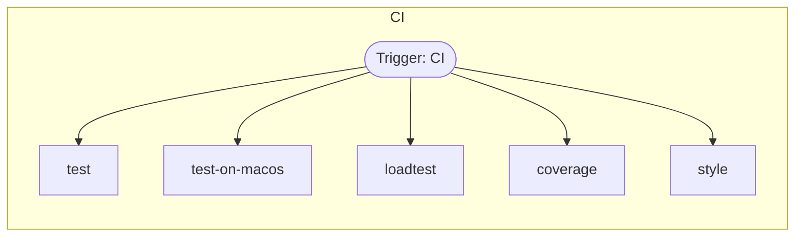

# Repository Architecture Analysis: supabase/pg_net

## Metadata
- **SHA**: `ce4470b41bd53312b05e34bbd047cde24bee6760`
- **Primary Ecosystem**: Python

## Quality Metrics
- **ast_engine**: tree-sitter
- **avg_cognitive_complexity**: 0.25
- **avg_cyclomatic_complexity**: 1.22
- **component_count**: 0
- **dead_code_count**: 0
- **dead_code_symbols**: 0 entry(ies)
- **duplication_pct**: 83.21
- **file_complexities**: 20 entry(ies)
- **files_analyzed**: 20
- **fitness_passed**: False
- **fitness_violation_count**: 1
- **framework**: Unknown
- **import_edges**: 100 entry(ies)
- **loc**: 3307
- **max_cognitive_complexity**: 4
- **max_cyclomatic_complexity**: 4
- **sloc**: 2483
- **test_file_count**: 24

## 6-Dimension Repository Scorecard

- **Overall Grade**: `B` (83.45/100)
- **Technical Debt Score**: 16.55
- **Estimated Remediation Effort**: 27.78h

| Dimension | Grade | Score | Weight | Details |
| :--- | :---: | :---: | :---: | :--- |
| Code Quality | `C` | 75.00 | 0.20 | avg_cc=1.22, max_cc=4, duplication=83.21%, dead_code=0 |
| Dependency Health | `A` | 90.00 | 0.15 | dependencies=0 (no manifests parsed) |
| Maintainability | `B` | 89.00 | 0.15 | avg_cognitive=0.25, max_cognitive=4, fitness_violations=1, oversized_files=1 |
| Pipeline Health | `A` | 90.00 | 0.15 | workflows=1, operational_antipatterns=5, parallel_branches=True |
| Security | `B` | 88.00 | 0.20 | vulnerabilities=0, secrets=0, pipeline_security_findings=1 |
| Test Coverage | `C` | 70.00 | 0.15 | coverage=unavailable, ci_test_job=True, test_files_detected=True |

## Architecture Fitness & Workspace Boundaries

- **[MEDIUM] `ATRUSS-ARCH-005` (COMPLEXITY_THRESHOLD)**: Repository duplication_pct (83.21) exceeds policy threshold (15.0).

## CI/CD Pipeline Topology

