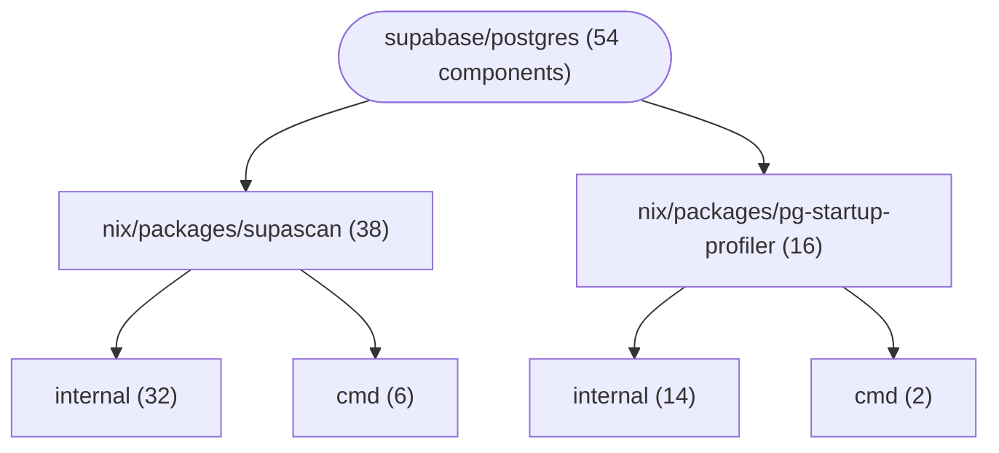
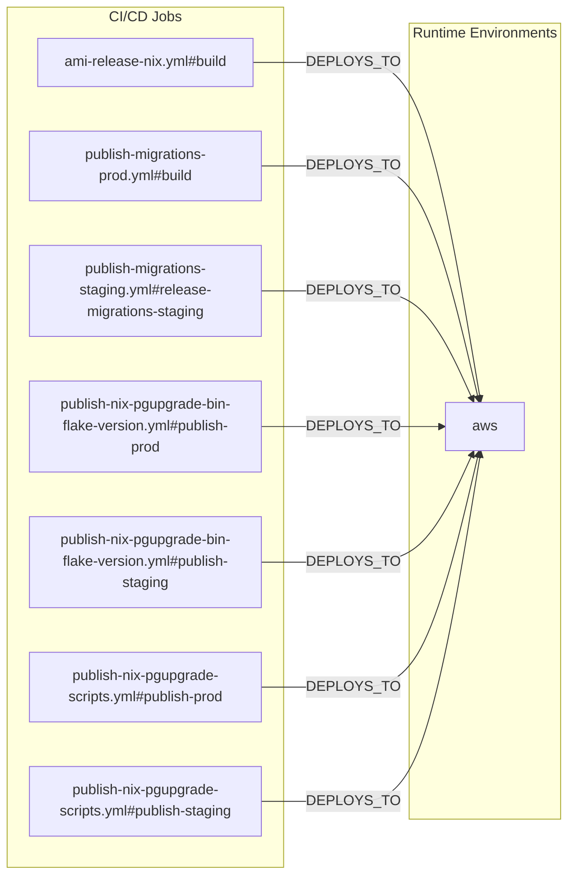
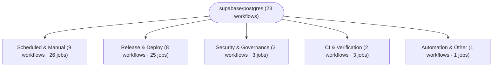

# Repository Architecture Analysis: supabase/postgres

## Metadata
- **SHA**: `6fbb60ff60cae62c89ad1b8b4003f879ea98e939`
- **Primary Ecosystem**: Go

## Quality Metrics
- **ast_engine**: fallback
- **avg_cognitive_complexity**: 0.0
- **avg_cyclomatic_complexity**: 0.0
- **component_count**: 54
- **dead_code_count**: 0
- **dead_code_symbols**: 0 entry(ies)
- **duplication_pct**: 0.0
- **file_complexities**: 0 entry(ies)
- **files_analyzed**: 54
- **fitness_passed**: True
- **fitness_violation_count**: 0
- **framework**: Go Service
- **import_edges**: 0 entry(ies)
- **loc**: 6318
- **max_cognitive_complexity**: 0
- **max_cyclomatic_complexity**: 0
- **sloc**: 4702
- **test_file_count**: 299

# Architecture: supabase/postgres

## Context
- **Repository**: `supabase/postgres`
- **SHA**: `6fbb60ff60cae62c89ad1b8b4003f879ea98e939`
- **Ecosystem**: Go
- **Framework**: Go Service

## Building Block View

## Component Details
- **main** (`nix/packages/pg-startup-profiler/cmd/pg-startup-profiler/main.go`): module
- **profile** (`nix/packages/pg-startup-profiler/cmd/pg-startup-profiler/profile.go`): module
- **client** (`nix/packages/pg-startup-profiler/internal/docker/client.go`): module
- **client_test** (`nix/packages/pg-startup-profiler/internal/docker/client_test.go`): module
- **tracer** (`nix/packages/pg-startup-profiler/internal/ebpf/tracer.go`): module
- **tracer_stub** (`nix/packages/pg-startup-profiler/internal/ebpf/tracer_stub.go`): module
- **logger** (`nix/packages/pg-startup-profiler/internal/logger/logger.go`): module
- **parser** (`nix/packages/pg-startup-profiler/internal/logs/parser.go`): module
- **parser_test** (`nix/packages/pg-startup-profiler/internal/logs/parser_test.go`): module
- **json** (`nix/packages/pg-startup-profiler/internal/report/json.go`): module
- **table** (`nix/packages/pg-startup-profiler/internal/report/table.go`): module
- **timeline** (`nix/packages/pg-startup-profiler/internal/report/timeline.go`): module
- **timeline_test** (`nix/packages/pg-startup-profiler/internal/report/timeline_test.go`): module
- **default** (`nix/packages/pg-startup-profiler/internal/rules/default.go`): module
- **rules** (`nix/packages/pg-startup-profiler/internal/rules/rules.go`): module
- **rules_test** (`nix/packages/pg-startup-profiler/internal/rules/rules_test.go`): module
- **genspec** (`nix/packages/supascan/cmd/supascan/genspec.go`): module
- **main** (`nix/packages/supascan/cmd/supascan/main.go`): module
- **split** (`nix/packages/supascan/cmd/supascan/split.go`): module
- **split_test** (`nix/packages/supascan/cmd/supascan/split_test.go`): module
- **validate** (`nix/packages/supascan/cmd/supascan/validate.go`): module
- **validate_test** (`nix/packages/supascan/cmd/supascan/validate_test.go`): module
- **defaults** (`nix/packages/supascan/internal/config/defaults.go`): module
- **loader** (`nix/packages/supascan/internal/config/loader.go`): module
- **loader_test** (`nix/packages/supascan/internal/config/loader_test.go`): module
- **logger** (`nix/packages/supascan/internal/logger/logger.go`): module
- **commands** (`nix/packages/supascan/internal/scanners/commands.go`): module
- **commands_test** (`nix/packages/supascan/internal/scanners/commands_test.go`): module
- **files** (`nix/packages/supascan/internal/scanners/files.go`): module
- **files_test** (`nix/packages/supascan/internal/scanners/files_test.go`): module
- **groups** (`nix/packages/supascan/internal/scanners/groups.go`): module
- **groups_test** (`nix/packages/supascan/internal/scanners/groups_test.go`): module
- **kernel_params** (`nix/packages/supascan/internal/scanners/kernel_params.go`): module
- **kernel_params_test** (`nix/packages/supascan/internal/scanners/kernel_params_test.go`): module
- **mounts** (`nix/packages/supascan/internal/scanners/mounts.go`): module
- **mounts_test** (`nix/packages/supascan/internal/scanners/mounts_test.go`): module
- **packages** (`nix/packages/supascan/internal/scanners/packages.go`): module
- **packages_test** (`nix/packages/supascan/internal/scanners/packages_test.go`): module
- **ports** (`nix/packages/supascan/internal/scanners/ports.go`): module
- **ports_test** (`nix/packages/supascan/internal/scanners/ports_test.go`): module
- **processes** (`nix/packages/supascan/internal/scanners/processes.go`): module
- **processes_test** (`nix/packages/supascan/internal/scanners/processes_test.go`): module
- **scanner** (`nix/packages/supascan/internal/scanners/scanner.go`): module
- **scanner_test** (`nix/packages/supascan/internal/scanners/scanner_test.go`): module
- **services** (`nix/packages/supascan/internal/scanners/services.go`): module
- **services_test** (`nix/packages/supascan/internal/scanners/services_test.go`): module
- **users** (`nix/packages/supascan/internal/scanners/users.go`): module
- **users_test** (`nix/packages/supascan/internal/scanners/users_test.go`): module
- **test_helpers** (`nix/packages/supascan/internal/spec/test_helpers.go`): module
- **types** (`nix/packages/supascan/internal/spec/types.go`): module
- **writer** (`nix/packages/supascan/internal/spec/writer.go`): module
- **writer_test** (`nix/packages/supascan/internal/spec/writer_test.go`): module
- **validator** (`nix/packages/supascan/internal/validator/validator.go`): module
- **validator_test** (`nix/packages/supascan/internal/validator/validator_test.go`): module

## 6-Dimension Repository Scorecard

- **Overall Grade**: `F` (58.25/100)
- **Technical Debt Score**: 41.75
- **Estimated Remediation Effort**: 166.44h

| Dimension | Grade | Score | Weight | Details |
| :--- | :---: | :---: | :---: | :--- |
| Code Quality | `A` | 100.00 | 0.20 | avg_cc=0.00, max_cc=0, duplication=0.00%, dead_code=0 |
| Dependency Health | `B` | 85.00 | 0.15 | dependencies=70, outdated=0, vulnerable=0, has_lockfile=False |
| Maintainability | `A` | 100.00 | 0.15 | avg_cognitive=0.00, max_cognitive=0, fitness_violations=0, oversized_files=0 |
| Pipeline Health | `F` | 0.00 | 0.15 | workflows=23, operational_antipatterns=68, parallel_branches=True |
| Security | `F` | 0.00 | 0.20 | vulnerabilities=0, secrets=12, pipeline_security_findings=49 |
| Test Coverage | `C` | 70.00 | 0.15 | coverage=unavailable, ci_test_job=True, test_files_detected=True |

## Supply Chain Dependencies, Vulnerabilities & Secrets

- **Dependencies Parsed**: 70 | **Vulnerabilities**: 0 | **Secrets**: 12

### Secret Findings (Redacted)
- **[HIGH] `ATRUSS-SEC-005`** at `.github/actions/nix-install-ephemeral/action.yml:53` (`trusted-public-keys = nix-***REDACTED*** cache.nixos.org-1:6NCHdD59X431o0gWypbMrAURkbJ16ZPMQFGspcDShjY=`)
- **[HIGH] `ATRUSS-SEC-005`** at `ansible/files/admin_api_scripts/pg_upgrade_scripts/initiate.sh:310` (`extra-trusted-public-keys = nix-***REDACTED***`)
- **[HIGH] `ATRUSS-SEC-005`** at `ebssurrogate/scripts/qemu-bootstrap-nix.sh:90` (`extra-trusted-public-keys = nix-***REDACTED***`)
- **[HIGH] `ATRUSS-SEC-005`** at `nix/packages/cli-config/supabase-postgres-init.sh:68` (`GETKEY_SCRIPT="$BUN***REDACTED***"`)
- **[HIGH] `ATRUSS-SEC-005`** at `nix/tests/expected/z_15_pgjwt.out:18` (`token := 'eyJh***REDACTED***',`)
- **[HIGH] `ATRUSS-SEC-005`** at `nix/tests/sql/z_15_pgjwt.sql:16` (`token := 'eyJh***REDACTED***',`)
- **[HIGH] `ATRUSS-SEC-005`** at `scripts/nix-provision.sh:35` (`extra-trusted-public-keys = nix-***REDACTED***`)
- **[HIGH] `ATRUSS-SEC-005`** at `testinfra/test_ami_nix.py:146` (`anon_key = "eyJh***REDACTED***"`)
- **[HIGH] `ATRUSS-SEC-005`** at `testinfra/test_ami_nix.py:147` (`service_role_key = "eyJh***REDACTED***"`)
- **[HIGH] `ATRUSS-SEC-005`** at `testinfra/test_ami_nix.py:148` (`supabase_admin_key = "eyJh***REDACTED***"`)
- **[HIGH] `ATRUSS-SEC-005`** at `user-data-cloudimg:6` (`hashed_passwd: "$6$c***REDACTED***"`)
- **[HIGH] `ATRUSS-SEC-005`** at `user-data-cloudimg:9` (`hashed_passwd: "$6$c***REDACTED***"`)

### Inventory Sample
- `github.com/charmbracelet/log` `0.4.2` (golang, `nix/packages/pg-startup-profiler/go.mod`)
- `github.com/charmbracelet/log` `0.4.2` (golang, `nix/packages/supascan/go.mod`)
- `github.com/containerd/errdefs` `1.0.0` (golang, `nix/packages/pg-startup-profiler/go.mod`)
- `github.com/moby/moby/api` `1.54.2` (golang, `nix/packages/pg-startup-profiler/go.mod`)
- `github.com/moby/moby/client` `0.4.1` (golang, `nix/packages/pg-startup-profiler/go.mod`)
- `github.com/shirou/gopsutil/v3` `3.24.5` (golang, `nix/packages/supascan/go.mod`)
- `github.com/spf13/cobra` `1.8.1` (golang, `nix/packages/pg-startup-profiler/go.mod`)
- `github.com/spf13/cobra` `1.8.1` (golang, `nix/packages/supascan/go.mod`)
- `gopkg.in/yaml.v3` `3.0.1` (golang, `nix/packages/pg-startup-profiler/go.mod`)
- `gopkg.in/yaml.v3` `3.0.1` (golang, `nix/packages/supascan/go.mod`)
- `github.com/Microsoft/go-winio` `0.6.2` (golang, `nix/packages/pg-startup-profiler/go.mod`)
- `github.com/aymanbagabas/go-osc52/v2` `2.0.1` (golang, `nix/packages/pg-startup-profiler/go.mod`)
- `github.com/aymanbagabas/go-osc52/v2` `2.0.1` (golang, `nix/packages/supascan/go.mod`)
- `github.com/cespare/xxhash/v2` `2.3.0` (golang, `nix/packages/pg-startup-profiler/go.mod`)
- `github.com/charmbracelet/colorprofile` `0.2.3-0.20250311203215-f60798e515dc` (golang, `nix/packages/pg-startup-profiler/go.mod`)
- `github.com/charmbracelet/colorprofile` `0.2.3-0.20250311203215-f60798e515dc` (golang, `nix/packages/supascan/go.mod`)
- `github.com/charmbracelet/lipgloss` `1.1.0` (golang, `nix/packages/pg-startup-profiler/go.mod`)
- `github.com/charmbracelet/lipgloss` `1.1.0` (golang, `nix/packages/supascan/go.mod`)
- `github.com/charmbracelet/x/ansi` `0.8.0` (golang, `nix/packages/pg-startup-profiler/go.mod`)
- `github.com/charmbracelet/x/ansi` `0.8.0` (golang, `nix/packages/supascan/go.mod`)
- `github.com/charmbracelet/x/cellbuf` `0.0.13-0.20250311204145-2c3ea96c31dd` (golang, `nix/packages/pg-startup-profiler/go.mod`)
- `github.com/charmbracelet/x/cellbuf` `0.0.13-0.20250311204145-2c3ea96c31dd` (golang, `nix/packages/supascan/go.mod`)
- `github.com/charmbracelet/x/term` `0.2.1` (golang, `nix/packages/pg-startup-profiler/go.mod`)
- `github.com/charmbracelet/x/term` `0.2.1` (golang, `nix/packages/supascan/go.mod`)
- `github.com/containerd/errdefs/pkg` `0.3.0` (golang, `nix/packages/pg-startup-profiler/go.mod`)
- `github.com/distribution/reference` `0.6.0` (golang, `nix/packages/pg-startup-profiler/go.mod`)
- `github.com/docker/go-connections` `0.7.0` (golang, `nix/packages/pg-startup-profiler/go.mod`)
- `github.com/docker/go-units` `0.5.0` (golang, `nix/packages/pg-startup-profiler/go.mod`)
- `github.com/felixge/httpsnoop` `1.0.4` (golang, `nix/packages/pg-startup-profiler/go.mod`)
- `github.com/go-logfmt/logfmt` `0.6.0` (golang, `nix/packages/pg-startup-profiler/go.mod`)
- ... (+40 more dependencies)

## Section 7: Code-to-Cloud Deployment Traceability

- `ami-release-nix.yml#build` (ci_job) --[DEPLOYS_TO]--> `aws` (environment)
- `publish-migrations-prod.yml#build` (ci_job) --[DEPLOYS_TO]--> `aws` (environment)
- `publish-migrations-staging.yml#release-migrations-staging` (ci_job) --[DEPLOYS_TO]--> `aws` (environment)
- `publish-nix-pgupgrade-bin-flake-version.yml#publish-prod` (ci_job) --[DEPLOYS_TO]--> `aws` (environment)
- `publish-nix-pgupgrade-bin-flake-version.yml#publish-staging` (ci_job) --[DEPLOYS_TO]--> `aws` (environment)
- `publish-nix-pgupgrade-scripts.yml#publish-prod` (ci_job) --[DEPLOYS_TO]--> `aws` (environment)
- `publish-nix-pgupgrade-scripts.yml#publish-staging` (ci_job) --[DEPLOYS_TO]--> `aws` (environment)

## CI/CD Pipeline Topology

