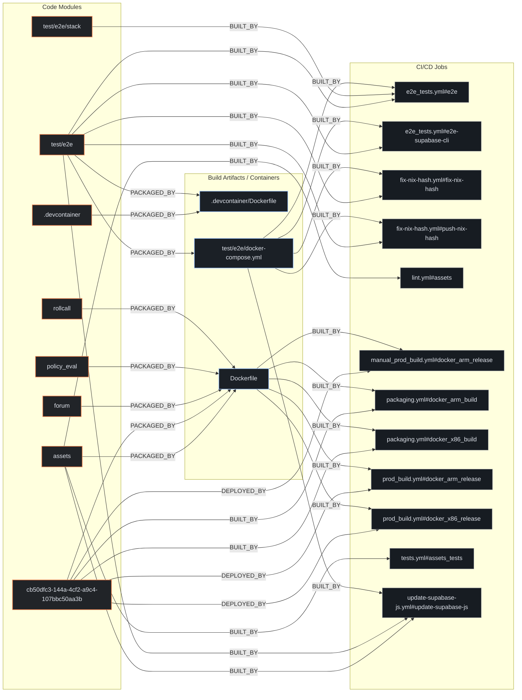

# Repository Architecture Analysis: supabase/realtime

## Metadata
- **SHA**: `da941e1a64a2937a4d06147172c2d3b6f6d2f2a9`
- **Primary Ecosystem**: Elixir

## Quality Metrics
- **ast_engine**: tree-sitter
- **avg_cognitive_complexity**: 3.5
- **avg_cyclomatic_complexity**: 3.89
- **component_count**: 253
- **dead_code_count**: 12
- **dead_code_symbols**: 12 entry(ies)
- **duplication_pct**: 2.11
- **file_complexities**: 25 entry(ies)
- **files_analyzed**: 689
- **fitness_passed**: False
- **fitness_violation_count**: 2
- **framework**: Phoenix
- **import_edges**: 100 entry(ies)
- **loc**: 141173
- **max_cognitive_complexity**: 38
- **max_cyclomatic_complexity**: 30
- **sloc**: 108814
- **test_file_count**: 425

# Architecture: supabase/realtime

## Context
- **Repository**: `supabase/realtime`
- **SHA**: `da941e1a64a2937a4d06147172c2d3b6f6d2f2a9`
- **Ecosystem**: Elixir
- **Framework**: Phoenix

## Building Block View

```mermaid
graph TD;
  classDef atlasRoot fill:#004882,stroke:#a3c9ff,stroke-width:2px,color:#d3e4ff
  classDef atlasCategory fill:#212428,stroke:#E87A48,stroke-width:1.5px,color:#dfe3eb
  classDef atlasWorkflow fill:#1b2026,stroke:#a3c9ff,stroke-width:1.5px,color:#dfe3eb
  classDef atlasJob fill:#171c22,stroke:#8d9199,stroke-width:1px,color:#dfe3eb
  classDef atlasTarget fill:#005227,stroke:#8bd99b,stroke-width:1.5px,color:#a7f6b6
  classDef atlasAlert fill:#93000a,stroke:#ffb4ab,stroke-width:1.5px,color:#ffdad6
  classDef atlasMore fill:#252a31,stroke:#8d9199,stroke-dasharray:4 4,color:#c3c6cf
    repo_root(["supabase/realtime (253 components)"]):::atlasRoot
    subgraph sg_dir_0_lib["lib (212)"]
      direction TB
      dir_0_lib["lib (212)"]:::atlasCategory
      sub_0_0_realtime["realtime (198)"]:::atlasWorkflow
      dir_0_lib --> sub_0_0_realtime
      sub_0_1_extensions["extensions (10)"]:::atlasWorkflow
      dir_0_lib --> sub_0_1_extensions
      sub_0_2__module_root_["(module root) (2)"]:::atlasWorkflow
      dir_0_lib --> sub_0_2__module_root_
      sub_0_more["+1 more submodules (2)"]:::atlasMore
      dir_0_lib --> sub_0_more
    end
    repo_root --> dir_0_lib
    subgraph sg_dir_1_forum["forum (21)"]
      direction TB
      dir_1_forum["forum (21)"]:::atlasCategory
      sub_1_0_lib["lib (11)"]:::atlasWorkflow
      dir_1_forum --> sub_1_0_lib
      sub_1_1_test["test (7)"]:::atlasWorkflow
      dir_1_forum --> sub_1_1_test
      sub_1_2__module_root_["(module root) (2)"]:::atlasWorkflow
      dir_1_forum --> sub_1_2__module_root_
      sub_1_more["+1 more submodules (1)"]:::atlasMore
      dir_1_forum --> sub_1_more
    end
    repo_root --> dir_1_forum
    dir_2_dev["dev (7)"]:::atlasCategory
    repo_root --> dir_2_dev
    dir_3_config["config (5)"]:::atlasCategory
    repo_root --> dir_3_config
    dir_4__root_["(root) (4)"]:::atlasCategory
    repo_root --> dir_4__root_
    dir_other_modules["+3 more modules (4)"]:::atlasMore
    repo_root --> dir_other_modules
```

## Component Details

Showing top 60 representative components out of 253 across 8 module group(s):

- **Module `lib`** (212 components — module: 212)
- **Module `forum`** (21 components — module: 21)
- **Module `dev`** (7 components — module: 7)
- **Module `config`** (5 components — module: 5)
- **Module `(root)`** (4 components — module: 4)
- **Module `test`** (2 components — MODULE: 1, module: 1)
- **Module `assets`** (1 components — MODULE: 1)
- **Module `bench`** (1 components — module: 1)

- **.credo** (`.credo.exs`): module
- **.dialyzer_ignore** (`.dialyzer_ignore.exs`): module
- **.formatter** (`.formatter.exs`): module
- **.formatter** (`forum/.formatter.exs`): module
- **20211116024918_create_realtime_subscription_table** (`lib/realtime/tenants/repo/migrations/20211116024918_create_realtime_subscription_table.ex`): module
- **20211116045059_create_realtime_check_filters_trigger** (`lib/realtime/tenants/repo/migrations/20211116045059_create_realtime_check_filters_trigger.ex`): module
- **20211116050929_create_realtime_quote_wal2json_function** (`lib/realtime/tenants/repo/migrations/20211116050929_create_realtime_quote_wal2json_function.ex`): module
- **20211116051442_create_realtime_check_equality_op_function** (`lib/realtime/tenants/repo/migrations/20211116051442_create_realtime_check_equality_op_function.ex`): module
- **20211116212300_create_realtime_build_prepared_statement_sql_function** (`lib/realtime/tenants/repo/migrations/20211116212300_create_realtime_build_prepared_statement_sql_function.ex`): module
- **20211116213355_create_realtime_cast_function** (`lib/realtime/tenants/repo/migrations/20211116213355_create_realtime_cast_function.ex`): module
- **20211116213934_create_realtime_is_visible_through_filters_function** (`lib/realtime/tenants/repo/migrations/20211116213934_create_realtime_is_visible_through_filters_function.ex`): module
- **20211116214523_create_realtime_apply_rls_function** (`lib/realtime/tenants/repo/migrations/20211116214523_create_realtime_apply_rls_function.ex`): module
- **20211122062447_grant_realtime_usage_to_authenticated_role** (`lib/realtime/tenants/repo/migrations/20211122062447_grant_realtime_usage_to_authenticated_role.ex`): module
- **20211124070109_enable_realtime_apply_rls_function_postgrest_9_compatibility** (`lib/realtime/tenants/repo/migrations/20211124070109_enable_realtime_apply_rls_function_postgrest_9_compatibility.ex`): module
- **20211202204204_update_realtime_subscription_check_filters_function_security** (`lib/realtime/tenants/repo/migrations/20211202204204_update_realtime_subscription_check_filters_function_security.ex`): module
- **20211202204605_update_realtime_build_prepared_statement_sql_function_for_compatibility_with_all_types** (`lib/realtime/tenants/repo/migrations/20211202204605_update_realtime_build_prepared_statement_sql_function_for_compatibility_with_all_types.ex`): module
- **20211210212804_enable_generic_subscription_claims** (`lib/realtime/tenants/repo/migrations/20211210212804_enable_generic_subscription_claims.ex`): module
- **20211228014915_add_wal_payload_on_errors_in_apply_rls_function** (`lib/realtime/tenants/repo/migrations/20211228014915_add_wal_payload_on_errors_in_apply_rls_function.ex`): module
- **20220107221237_update_change_timestamp_to_iso_8601_zulu_format** (`lib/realtime/tenants/repo/migrations/20220107221237_update_change_timestamp_to_iso_8601_zulu_format.ex`): module
- **20220228202821_update_subscription_check_filters_function_dynamic_table_name** (`lib/realtime/tenants/repo/migrations/20220228202821_update_subscription_check_filters_function_dynamic_table_name.ex`): module
- **20220312004840_update_apply_rls_function_to_apply_iso_8601** (`lib/realtime/tenants/repo/migrations/20220312004840_update_apply_rls_function_to_apply_iso_8601.ex`): module
- **20220603231003_add_quoted_regtypes_support** (`lib/realtime/tenants/repo/migrations/20220603231003_add_quoted_regtypes_support.ex`): module
- **20220603232444_add_output_for_data_less_than_equal_64_bytes_when_payload_too_large** (`lib/realtime/tenants/repo/migrations/20220603232444_add_output_for_data_less_than_equal_64_bytes_when_payload_too_large.ex`): module
- **20220615214548_add_quoted_regtypes_backward_compatibility_support** (`lib/realtime/tenants/repo/migrations/20220615214548_add_quoted_regtypes_backward_compatibility_support.ex`): module
- **20220712093339_recreate_realtime_build_prepared_statement_sql_function** (`lib/realtime/tenants/repo/migrations/20220712093339_recreate_realtime_build_prepared_statement_sql_function.ex`): module
- **20220908172859_null_passes_filters_recreate_is_visible_through_filters** (`lib/realtime/tenants/repo/migrations/20220908172859_null_passes_filters_recreate_is_visible_through_filters.ex`): module
- **20220916233421_update_apply_rls_function_to_pass_through_delete_events_on_filter** (`lib/realtime/tenants/repo/migrations/20220916233421_update_apply_rls_function_to_pass_through_delete_events_on_filter.ex`): module
- **20230119133233_millisecond_precision_for_walrus** (`lib/realtime/tenants/repo/migrations/20230119133233_millisecond_precision_for_walrus.ex`): module
- **20230128025114_add_in_op_to_filters** (`lib/realtime/tenants/repo/migrations/20230128025114_add_in_op_to_filters.ex`): module
- **20230128025212_enable_filtering_on_delete_record** (`lib/realtime/tenants/repo/migrations/20230128025212_enable_filtering_on_delete_record.ex`): module
- **20230227211149_update_subscription_check_filters_for_in_filter_non_text_types** (`lib/realtime/tenants/repo/migrations/20230227211149_update_subscription_check_filters_for_in_filter_non_text_types.ex`): module
- **20230228184745_convert_commit_timestamp_to_utc** (`lib/realtime/tenants/repo/migrations/20230228184745_convert_commit_timestamp_to_utc.ex`): module
- **20230308225145_output_full_record_when_unchanged_toast** (`lib/realtime/tenants/repo/migrations/20230308225145_output_full_record_when_unchanged_toast.ex`): module
- **20230328144023_create_list_changes_function** (`lib/realtime/tenants/repo/migrations/20230328144023_create_list_changes_function.ex`): module
- **20231018144023_create_channels** (`lib/realtime/tenants/repo/migrations/20231018144023_create_channels.ex`): module
- **20231204144023_set_required_grants** (`lib/realtime/tenants/repo/migrations/20231204144023_set_required_grants.ex`): module
- **20231204144024_create_rls_helper_functions** (`lib/realtime/tenants/repo/migrations/20231204144024_create_rls_helper_functions.ex`): module
- **20231204144025_enable_channels_rls** (`lib/realtime/tenants/repo/migrations/20231204144025_enable_channels_rls.ex`): module
- **20240108234812_add_channels_column_for_write_check** (`lib/realtime/tenants/repo/migrations/20240108234812_add_channels_column_for_write_check.ex`): module
- **20240109165339_add_update_grant_to_channels** (`lib/realtime/tenants/repo/migrations/20240109165339_add_update_grant_to_channels.ex`): module
- **20240227174441_add_broadcast_permissions_table** (`lib/realtime/tenants/repo/migrations/20240227174441_add_broadcast_permissions_table.ex`): module
- **20240311171622_add_insert_and_delete_grant_to_channels** (`lib/realtime/tenants/repo/migrations/20240311171622_add_insert_and_delete_grant_to_channels.ex`): module
- **20240321100241_add_presences_permissions_table** (`lib/realtime/tenants/repo/migrations/20240321100241_add_presences_permissions_table.ex`): module
- **20240401105812_create_realtime_admin_and_move_ownership** (`lib/realtime/tenants/repo/migrations/20240401105812_create_realtime_admin_and_move_ownership.ex`): module
- **20240418121054_remove_check_columns** (`lib/realtime/tenants/repo/migrations/20240418121054_remove_check_columns.ex`): module
- **20240523004032_redefine_authorization_tables** (`lib/realtime/tenants/repo/migrations/20240523004032_redefine_authorization_tables.ex`): module
- **20240618124746_fix_walrus_role_handling** (`lib/realtime/tenants/repo/migrations/20240618124746_fix_walrus_role_handling.ex`): module
- **20240801235015_unlogged_messages_table** (`lib/realtime/tenants/repo/migrations/20240801235015_unlogged_messages_table.ex`): module
- **20240805133720_logged_messages_table** (`lib/realtime/tenants/repo/migrations/20240805133720_logged_messages_table.ex`): module
- **20240827160934_filter_delete_postgres_changes** (`lib/realtime/tenants/repo/migrations/20240827160934_filter_delete_postgres_changes.ex`): module
- **20240919163303_add_payload_to_messages** (`lib/realtime/tenants/repo/migrations/20240919163303_add_payload_to_messages.ex`): module
- **20240919163305_change_messages_id_type** (`lib/realtime/tenants/repo/migrations/20240919163305_change_messages_id_type.ex`): module
- **20241019105805_uuid_auto_generation** (`lib/realtime/tenants/repo/migrations/20241019105805_uuid_auto_generation.ex`): module
- **20241030150047_messages_partitioning** (`lib/realtime/tenants/repo/migrations/20241030150047_messages_partitioning.ex`): module
- **20241108114728_messages_using_uuid** (`lib/realtime/tenants/repo/migrations/20241108114728_messages_using_uuid.ex`): module
- **20241121104152_fix_send_function_** (`lib/realtime/tenants/repo/migrations/20241121104152_fix_send_function_.ex`): module
- **20241130184212_recreate_entity_index_using_btree** (`lib/realtime/tenants/repo/migrations/20241130184212_recreate_entity_index_using_btree.ex`): module
- **20241220035512_fix_send_function_partition_creation** (`lib/realtime/tenants/repo/migrations/20241220035512_fix_send_function_partition_creation.ex`): module
- **20241220123912_realtime_send_handle_exceptions_remove_partition_creation** (`lib/realtime/tenants/repo/migrations/20241220123912_realtime_send_handle_exceptions_remove_partition_creation.ex`): module
- **20241224161212_realtime_send_sets_config** (`lib/realtime/tenants/repo/migrations/20241224161212_realtime_send_sets_config.ex`): module

## 6-Dimension Repository Scorecard

- **Overall Grade**: `F` (43.60/100)
- **Technical Debt Score**: 56.40
- **Estimated Remediation Effort**: 175.02h

| Dimension | Grade | Score | Weight | Details |
| :--- | :---: | :---: | :---: | :--- |
| Code Quality | `F` | 50.77 | 0.20 | avg_cc=3.89, max_cc=30, duplication=2.11%, dead_code=12 |
| Dependency Health | `A` | 100.00 | 0.15 | dependencies=130, outdated=0, vulnerable=0, has_lockfile=True |
| Maintainability | `F` | 53.00 | 0.15 | avg_cognitive=3.50, max_cognitive=38, fitness_violations=2, oversized_files=2 |
| Pipeline Health | `F` | 0.00 | 0.15 | workflows=22, operational_antipatterns=43, parallel_branches=True |
| Security | `F` | 0.00 | 0.20 | vulnerabilities=0, secrets=10, pipeline_security_findings=64 |
| Test Coverage | `C` | 70.00 | 0.15 | coverage=unavailable, ci_test_job=True, test_files_detected=True |

## Architecture Fitness & Workspace Boundaries

- **[MEDIUM] `ATRUSS-ARCH-005` (COMPLEXITY_THRESHOLD)**: Repository max_cognitive_complexity (38.0) exceeds policy threshold (25.0).
- **[MEDIUM] `ATRUSS-ARCH-005` (COMPLEXITY_THRESHOLD)**: Repository max_cyclomatic_complexity (30.0) exceeds policy threshold (20.0).

## Supply Chain Dependencies, Vulnerabilities & Secrets

- **Dependencies Parsed**: 130 | **Vulnerabilities**: 0 | **Secrets**: 10

### Secret Findings (Redacted)
- **[HIGH] `ATRUSS-SEC-005`** at `compose.tests.yml:80` (`SECRET_KEY_BASE: UpNV***REDACTED***`)
- **[HIGH] `ATRUSS-SEC-005`** at `compose.yml:32` (`SECRET_KEY_BASE: UpNV***REDACTED***`)
- **[HIGH] `ATRUSS-SEC-005`** at `config/dev.exs:46` (`secret_key_base: "ktyW***REDACTED***",`)
- **[HIGH] `ATRUSS-SEC-005`** at `config/test.exs:117` (`secret_key_base: "ktyW***REDACTED***"`)
- **[HIGH] `ATRUSS-SEC-005`** at `dev/bench/secrets.exs:7` (`jwt_secret = "d3v_***REDACTED***"`)
- **[HIGH] `ATRUSS-SEC-005`** at `test/e2e/stack/compose.yml:59` (`SECRET_KEY_BASE: UpNV***REDACTED***`)
- **[HIGH] `ATRUSS-SEC-005`** at `test/e2e/stack/run.sh:32` (`anon_key=eyJh***REDACTED***`)
- **[HIGH] `ATRUSS-SEC-005`** at `test/e2e/stack/run.sh:33` (`service_key=eyJh***REDACTED***`)
- **[HIGH] `ATRUSS-SEC-005`** at `test/integration/tests.ts:11` (`const serviceRoleKey = "eyJh***REDACTED***"`)
- **[HIGH] `ATRUSS-SEC-005`** at `test/integration/tests.ts:12` (`const apiKey = "eyJh***REDACTED***";`)

### Inventory Sample
- `benchee` `1.5.1` (hex, `mix.exs`)
- `cachex` `4.0` (hex, `mix.exs`)
- `corsica` `2.0` (hex, `mix.exs`)
- `credo` `1.7` (hex, `mix.exs`)
- `credo` `1.7` (hex, `policy_eval/mix.exs`)
- `credo` `1.7` (hex, `rollcall/mix.exs`)
- `db_connection` `2.10` (hex, `mix.exs`)
- `dialyxir` `1.4` (hex, `mix.exs`)
- `dialyxir` `1.4` (hex, `policy_eval/mix.exs`)
- `dialyxir` `1.4` (hex, `rollcall/mix.exs`)
- `ecto_psql_extras` `0.8` (hex, `mix.exs`)
- `ecto_sql` `3.11` (hex, `mix.exs`)
- `esbuild` `0.4` (hex, `mix.exs`)
- `ex_crap` `0.1` (hex, `mix.exs`)
- `ex_hash_ring` `6.0` (hex, `forum/mix.exs`)
- `ex_json_schema` `0.11` (hex, `mix.exs`)
- `excoveralls` `0.18` (hex, `mix.exs`)
- `floki` `0.30.0` (hex, `mix.exs`)
- `gettext` `1.0` (hex, `mix.exs`)
- `jason` `1.3` (hex, `mix.exs`)
- `joken` `2.6` (hex, `mix.exs`)
- `lazy_html` `0.1.0` (hex, `mix.exs`)
- `libcluster` `3.3` (hex, `mix.exs`)
- `libcluster_postgres` `0.2` (hex, `mix.exs`)
- `logflare_logger_backend` `0.11` (hex, `mix.exs`)
- `mimic` `2.0` (hex, `forum/mix.exs`)
- `mimic` `2.0` (hex, `mix.exs`)
- `mint` `1.4` (hex, `mix.exs`)
- `mint_web_socket` `1.0` (hex, `mix.exs`)
- `mix_test_watch` `1.0` (hex, `forum/mix.exs`)
- ... (+100 more dependencies)

## Section 7: Code-to-Cloud Deployment Traceability

- `.devcontainer` (code_module) --[PACKAGED_BY]--> `.devcontainer/Dockerfile` (container)
- `assets` (code_module) --[BUILT_BY]--> `lint.yml#assets` (ci_job)
- `assets` (code_module) --[BUILT_BY]--> `tests.yml#assets_tests` (ci_job)
- `assets` (code_module) --[BUILT_BY]--> `update-supabase-js.yml#update-supabase-js` (ci_job)
- `assets` (code_module) --[PACKAGED_BY]--> `Dockerfile` (container)
- `cb50dfc3-144a-4cf2-a9c4-107bbc50aa3b` (code_module) --[BUILT_BY]--> `packaging.yml#docker_arm_build` (ci_job)
- `cb50dfc3-144a-4cf2-a9c4-107bbc50aa3b` (code_module) --[BUILT_BY]--> `packaging.yml#docker_x86_build` (ci_job)
- `cb50dfc3-144a-4cf2-a9c4-107bbc50aa3b` (code_module) --[DEPLOYED_BY]--> `manual_prod_build.yml#docker_arm_release` (ci_job)
- `cb50dfc3-144a-4cf2-a9c4-107bbc50aa3b` (code_module) --[DEPLOYED_BY]--> `prod_build.yml#docker_arm_release` (ci_job)
- `cb50dfc3-144a-4cf2-a9c4-107bbc50aa3b` (code_module) --[DEPLOYED_BY]--> `prod_build.yml#docker_x86_release` (ci_job)
- `cb50dfc3-144a-4cf2-a9c4-107bbc50aa3b` (code_module) --[PACKAGED_BY]--> `Dockerfile` (container)
- `forum` (code_module) --[PACKAGED_BY]--> `Dockerfile` (container)
- `policy_eval` (code_module) --[PACKAGED_BY]--> `Dockerfile` (container)
- `rollcall` (code_module) --[PACKAGED_BY]--> `Dockerfile` (container)
- `test/e2e` (code_module) --[BUILT_BY]--> `e2e_tests.yml#e2e` (ci_job)
- `test/e2e` (code_module) --[BUILT_BY]--> `e2e_tests.yml#e2e-supabase-cli` (ci_job)
- `test/e2e` (code_module) --[BUILT_BY]--> `fix-nix-hash.yml#fix-nix-hash` (ci_job)
- `test/e2e` (code_module) --[BUILT_BY]--> `fix-nix-hash.yml#push-nix-hash` (ci_job)
- `test/e2e` (code_module) --[BUILT_BY]--> `update-supabase-js.yml#update-supabase-js` (ci_job)
- `test/e2e` (code_module) --[PACKAGED_BY]--> `.devcontainer/Dockerfile` (container)
- `test/e2e` (code_module) --[PACKAGED_BY]--> `test/e2e/docker-compose.yml` (container)
- `test/e2e/stack` (code_module) --[BUILT_BY]--> `e2e_tests.yml#e2e` (ci_job)
- `Dockerfile` (container) --[BUILT_BY]--> `manual_prod_build.yml#docker_arm_release` (ci_job)
- `Dockerfile` (container) --[BUILT_BY]--> `packaging.yml#docker_arm_build` (ci_job)
- `Dockerfile` (container) --[BUILT_BY]--> `packaging.yml#docker_x86_build` (ci_job)
- `Dockerfile` (container) --[BUILT_BY]--> `prod_build.yml#docker_arm_release` (ci_job)
- `Dockerfile` (container) --[BUILT_BY]--> `prod_build.yml#docker_x86_release` (ci_job)
- `test/e2e/docker-compose.yml` (container) --[BUILT_BY]--> `e2e_tests.yml#e2e` (ci_job)
- `test/e2e/docker-compose.yml` (container) --[BUILT_BY]--> `e2e_tests.yml#e2e-supabase-cli` (ci_job)
- `test/e2e/docker-compose.yml` (container) --[BUILT_BY]--> `fix-nix-hash.yml#fix-nix-hash` (ci_job)
- `test/e2e/docker-compose.yml` (container) --[BUILT_BY]--> `fix-nix-hash.yml#push-nix-hash` (ci_job)
- `test/e2e/docker-compose.yml` (container) --[BUILT_BY]--> `update-supabase-js.yml#update-supabase-js` (ci_job)

## CI/CD Pipeline Topology

```mermaid
graph TD;
  classDef atlasRoot fill:#004882,stroke:#a3c9ff,stroke-width:2px,color:#d3e4ff
  classDef atlasCategory fill:#212428,stroke:#E87A48,stroke-width:1.5px,color:#dfe3eb
  classDef atlasWorkflow fill:#1b2026,stroke:#a3c9ff,stroke-width:1.5px,color:#dfe3eb
  classDef atlasJob fill:#171c22,stroke:#8d9199,stroke-width:1px,color:#dfe3eb
  classDef atlasTarget fill:#005227,stroke:#8bd99b,stroke-width:1.5px,color:#a7f6b6
  classDef atlasAlert fill:#93000a,stroke:#ffb4ab,stroke-width:1.5px,color:#ffdad6
  classDef atlasMore fill:#252a31,stroke:#8d9199,stroke-dasharray:4 4,color:#c3c6cf
  pipeline_root(["supabase/realtime (22 workflows)"]):::atlasRoot
  subgraph sg_grp_0_CI___Verification["CI & Verification (13 workflows · 30 jobs)"]
    direction TB
    subgraph sg_wf_8_Lint["Lint (5 jobs)"]
      direction TB
      wf_8_Lint(["Trigger: Lint"]):::atlasWorkflow
      job_8_lint["lint"]:::atlasJob
      job_8_assets["assets"]:::atlasJob
      job_8_actionlint["actionlint"]:::atlasJob
      wf_8_Lint --> job_8_lint
      wf_8_Lint --> job_8_assets
      wf_8_Lint --> job_8_actionlint
    end
    pipeline_root --> wf_8_Lint
    subgraph sg_wf_11_Packaging["Packaging (3 jobs)"]
      direction TB
      wf_11_Packaging(["Trigger: Packaging"]):::atlasWorkflow
      job_11_docker_x86_build["docker_x86_build"]:::atlasJob
      job_11_docker_arm_build["docker_arm_build"]:::atlasJob
      job_11_nix_build["nix_build"]:::atlasJob
      wf_11_Packaging --> job_11_docker_x86_build
      wf_11_Packaging --> job_11_docker_arm_build
      wf_11_Packaging --> job_11_nix_build
    end
    pipeline_root --> wf_11_Packaging
    subgraph sg_wf_13_Build_Production["Build Production (6 jobs)"]
      direction TB
      wf_13_Build_Production(["Trigger: Build Production"]):::atlasWorkflow
      job_13_release["release"]:::atlasJob
      job_13_docker_x86_release["docker_x86_release"]:::atlasJob
      job_13_docker_arm_release["docker_arm_release"]:::atlasJob
      wf_13_Build_Production --> job_13_release
      job_13_release --> job_13_docker_x86_release
      job_13_release --> job_13_docker_arm_release
    end
    pipeline_root --> wf_13_Build_Production
    subgraph sg_wf_18_Tests["Tests (4 jobs)"]
      direction TB
      wf_18_Tests(["Trigger: Tests"]):::atlasWorkflow
      job_18_tests["tests"]:::atlasJob
      job_18_assets_tests["assets_tests"]:::atlasJob
      job_18_coverage["coverage"]:::atlasJob
      wf_18_Tests --> job_18_tests
      wf_18_Tests --> job_18_assets_tests
      job_18_tests --> job_18_coverage
    end
    pipeline_root --> wf_18_Tests
  end
  subgraph sg_grp_1_Scheduled___Manual["Scheduled & Manual (6 workflows · 9 jobs)"]
    direction TB
    subgraph sg_wf_0_Bump_DB_images["Bump DB images (1 jobs)"]
      direction TB
      wf_0_Bump_DB_images(["Trigger: Bump DB images"]):::atlasWorkflow
      job_0_bump["bump"]:::atlasJob
      wf_0_Bump_DB_images --> job_0_bump
    end
    pipeline_root --> wf_0_Bump_DB_images
    subgraph sg_wf_5_Flaky_Test_Digest["Flaky Test Digest (2 jobs)"]
      direction TB
      wf_5_Flaky_Test_Digest(["Trigger: Flaky Test Digest"]):::atlasWorkflow
      job_5_collect["collect"]:::atlasJob
      job_5_notify["notify"]:::atlasJob
      wf_5_Flaky_Test_Digest --> job_5_collect
      job_5_collect --> job_5_notify
    end
    pipeline_root --> wf_5_Flaky_Test_Digest
    subgraph sg_wf_9_Manual_Build_Production["Manual Build Production (3 jobs)"]
      direction TB
      wf_9_Manual_Build_Production(["Trigger: Manual Build Production"]):::atlasWorkflow
      job_9_docker_x86_release["docker_x86_release"]:::atlasJob
      wf_9_Manual_Build_Production --> job_9_docker_x86_release
    end
    pipeline_root --> wf_9_Manual_Build_Production
  end
  subgraph sg_grp_2_Automation___Other["Automation & Other (1 workflows · 1 jobs)"]
    direction TB
    wf_17_Reusable_Slack_Notification["Reusable Slack Notification (1 jobs)"]:::atlasWorkflow
    pipeline_root --> wf_17_Reusable_Slack_Notification
  end
  subgraph sg_grp_3_Release___Deploy["Release & Deploy (1 workflows · 1 jobs)"]
    direction TB
    wf_2_Dispatch_Deploy["Dispatch Deploy (1 jobs)"]:::atlasWorkflow
    pipeline_root --> wf_2_Dispatch_Deploy
  end
  subgraph sg_grp_4_Security___Governance["Security & Governance (1 workflows · 2 jobs)"]
    direction TB
    wf_15_Security_Advisories["Security Advisories (2 jobs)"]:::atlasWorkflow
    pipeline_root --> wf_15_Security_Advisories
  end
  wf_more["+12 more workflows"]:::atlasMore
  pipeline_root --> wf_more
```

