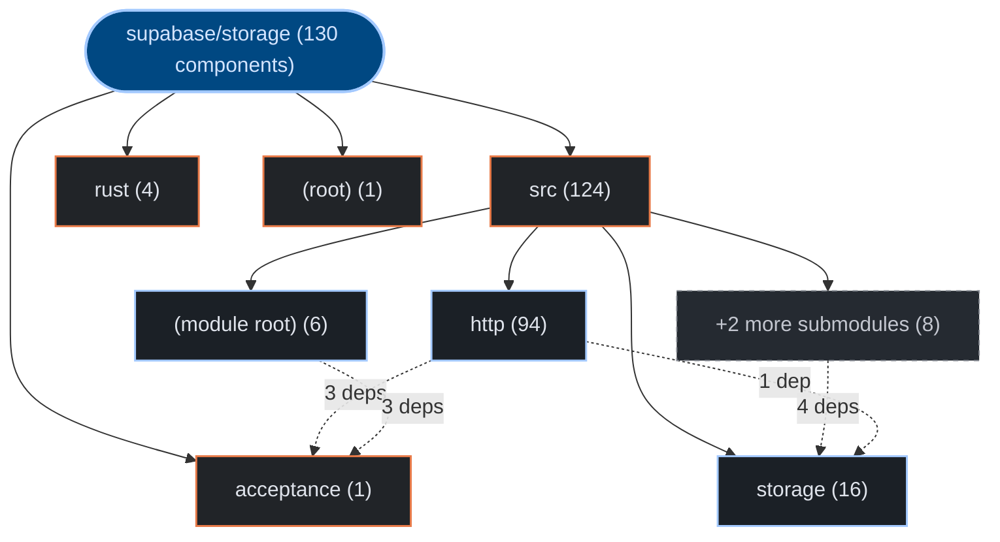
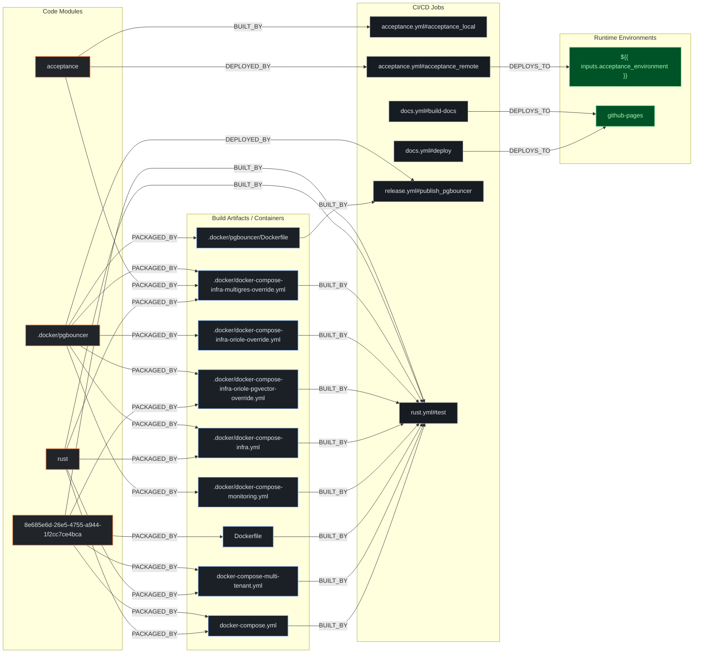

# Repository Architecture Analysis: supabase/storage

## Metadata
- **SHA**: `be3cecb4f4ef844be55183bd59f04986f14f4b54`
- **Primary Ecosystem**: JavaScript/TypeScript

## Quality Metrics
- **ast_engine**: tree-sitter
- **avg_cognitive_complexity**: 2.54
- **avg_cyclomatic_complexity**: 2.95
- **component_count**: 130
- **dead_code_count**: 94
- **dead_code_symbols**: 50 entry(ies)
- **duplication_pct**: 85.51
- **file_complexities**: 25 entry(ies)
- **files_analyzed**: 701
- **fitness_passed**: False
- **fitness_violation_count**: 3
- **framework**: Express / Node API
- **import_edges**: 100 entry(ies)
- **loc**: 196787
- **max_cognitive_complexity**: 143
- **max_cyclomatic_complexity**: 114
- **sloc**: 169610
- **test_file_count**: 299

# Architecture: supabase/storage

## Context
- **Repository**: `supabase/storage`
- **SHA**: `be3cecb4f4ef844be55183bd59f04986f14f4b54`
- **Ecosystem**: JavaScript/TypeScript
- **Framework**: Express / Node API

## Building Block View

## Component Details

Showing top 60 representative components out of 130 across 4 module group(s):

- **Module `src`** (124 components — API_ROUTE: 109, SERVICE: 15)
- **Module `rust`** (4 components — module: 4)
- **Module `(root)`** (1 components — MODULE: 1)
- **Module `acceptance`** (1 components — SERVICE: 1)

- **PgShardStore** (`src/internal/sharding/pg.ts`): SERVICE (deps: FileStore, ProfileStore, S3Store)
- **CollectingStore** (`src/storage/protocols/tus/splitter-workaround.test.ts`): SERVICE (deps: S3Store)
- **ConcurrentStore** (`src/storage/protocols/tus/splitter-workaround.test.ts`): SERVICE (deps: S3Store)
- **GET_.well-known_jwks.json** (`src/app.ts`): API_ROUTE (deps: AcceptanceHttpClient)
- **GET_download** (`src/storage/uploader.test.ts`): API_ROUTE (deps: FileStore)
- **GET_metrics** (`src/admin-app.ts`): API_ROUTE (deps: AcceptanceHttpClient)
- **GET_objects_:bucket** (`src/http/plugins/metrics.test.ts`): API_ROUTE (deps: GET_metrics)
- **GET_status** (`src/admin-app.ts`): API_ROUTE (deps: AcceptanceHttpClient)
- **GET_status** (`src/app.ts`): API_ROUTE (deps: AcceptanceHttpClient)
- **GET_version** (`src/admin-app.ts`): API_ROUTE (deps: AcceptanceHttpClient)
- **GET_version** (`src/app.ts`): API_ROUTE (deps: AcceptanceHttpClient)
- **MultiPartStore** (`src/storage/protocols/tus/splitter-workaround.test.ts`): SERVICE (deps: S3Store)
- **PATCH_upload_file** (`src/test/tus-timeout.test.ts`): API_ROUTE (deps: S3Store)
- **POST_objects_:bucket** (`src/http/plugins/metrics.test.ts`): API_ROUTE (deps: GET_metrics)
- **PausedStore** (`src/test/tus-timeout.test.ts`): SERVICE (deps: S3Store)
- **ResumeStore** (`src/storage/protocols/tus/splitter-workaround.test.ts`): SERVICE (deps: S3Store)
- **TestS3Store** (`src/storage/protocols/tus/s3-store.test.ts`): SERVICE (deps: S3Store)
- **TestStore** (`src/storage/protocols/tus/splitter-workaround.test.ts`): SERVICE (deps: S3Store)
- **AcceptanceHttpClient** (`acceptance/support/http.ts`): SERVICE
- **AsyncAbortController** (`src/internal/concurrency/async-abort-controller.ts`): API_ROUTE
- **DELETE_*** (`src/http/routes/tus/index.ts`): API_ROUTE
- **DELETE_active** (`src/http/routes/admin/migrations.ts`): API_ROUTE
- **DELETE_iceberg_orphan-catalogs** (`src/http/routes/admin/iceberg-admin.ts`): API_ROUTE
- **DELETE_objects** (`src/storage/backend/s3/adapter.test.ts`): API_ROUTE
- **FakePgPoolClient** (`src/internal/database/pg-connection.test.ts`): SERVICE
- **FileStore** (`src/storage/protocols/tus/file-store.ts`): SERVICE
- **GET_:Bucket** (`src/http/routes/s3/router.test.ts`): API_ROUTE
- **GET_:Bucket_*** (`src/http/plugins/signature-v4.test.ts`): API_ROUTE
- **GET_:Bucket_*** (`src/http/routes/s3/router.test.ts`): API_ROUTE
- **GET_:Bucket_*?list-type=2** (`src/http/routes/s3/router.test.ts`): API_ROUTE
- **GET_:Bucket_*?list-type=2&*** (`src/http/routes/s3/router.test.ts`): API_ROUTE
- **GET_:Bucket_*?uploads** (`src/http/routes/s3/router.test.ts`): API_ROUTE
- **GET_aborted** (`src/storage/renderer/image.test.ts`): API_ROUTE
- **GET_active** (`src/http/routes/admin/migrations.ts`): API_ROUTE
- **GET_blob** (`src/http/plugins/blob-response.test.ts`): API_ROUTE
- **GET_blob** (`src/storage/renderer/image.test.ts`): API_ROUTE
- **GET_bucket_:bucket** (`src/http/plugins/log-request.test.ts`): API_ROUTE
- **GET_bucket_:bucket_object_:name** (`src/http/plugins/log-request.test.ts`): API_ROUTE
- **GET_buffer** (`src/http/plugins/blob-response.test.ts`): API_ROUTE
- **GET_context** (`src/http/plugins/request-context.test.ts`): API_ROUTE
- **GET_download** (`src/http/error-handler.test.ts`): API_ROUTE
- **GET_error-probe** (`src/http/routes/vector/index.test.ts`): API_ROUTE
- **GET_fail** (`src/http/error-handler.test.ts`): API_ROUTE
- **GET_health** (`src/http/error-handler.connection.test.ts`): API_ROUTE
- **GET_heap-snapshot** (`src/http/routes/admin/pprof.ts`): API_ROUTE
- **GET_iceberg** (`src/http/plugins/request-scoped-pg-executor.test.ts`): API_ROUTE
- **GET_iceberg_orphan-catalogs** (`src/http/routes/admin/iceberg-admin.ts`): API_ROUTE
- **GET_internal-error** (`src/http/error-handler.test.ts`): API_ROUTE
- **GET_json** (`src/http/plugins/blob-response.test.ts`): API_ROUTE
- **GET_jwks_generate-all-missing** (`src/http/routes/admin/jwks.ts`): API_ROUTE
- **GET_lifecycle** (`src/http/plugins/xml.test.ts`): API_ROUTE
- **GET_metadata-log** (`src/http/plugins/log-request.test.ts`): API_ROUTE
- **GET_metrics** (`src/http/plugins/metrics.ts`): API_ROUTE
- **GET_missing** (`src/http/error-handler.test.ts`): API_ROUTE
- **GET_missing** (`src/storage/renderer/image.test.ts`): API_ROUTE
- **GET_node-stream** (`src/http/plugins/blob-response.test.ts`): API_ROUTE
- **GET_object** (`src/storage/renderer/renderer.test.ts`): API_ROUTE
- **GET_outside-vector** (`src/http/routes/vector/index.test.ts`): API_ROUTE
- **GET_probe** (`src/http/plugins/tenant-feature.test.ts`): API_ROUTE
- **GET_probe** (`src/http/plugins/vector.test.ts`): API_ROUTE

## 6-Dimension Repository Scorecard

- **Overall Grade**: `F` (37.05/100)
- **Technical Debt Score**: 62.95
- **Estimated Remediation Effort**: 128.34h

| Dimension | Grade | Score | Weight | Details |
| :--- | :---: | :---: | :---: | :--- |
| Code Quality | `F` | 30.00 | 0.20 | avg_cc=2.95, max_cc=114, duplication=85.51%, dead_code=94 |
| Dependency Health | `A` | 100.00 | 0.15 | dependencies=1255, outdated=0, vulnerable=0, has_lockfile=True |
| Maintainability | `F` | 37.00 | 0.15 | avg_cognitive=2.54, max_cognitive=143, fitness_violations=3, oversized_files=20 |
| Pipeline Health | `F` | 0.00 | 0.15 | workflows=8, operational_antipatterns=15, parallel_branches=True |
| Security | `F` | 0.00 | 0.20 | vulnerabilities=0, secrets=10, pipeline_security_findings=2 |
| Test Coverage | `C` | 70.00 | 0.15 | coverage=unavailable, ci_test_job=True, test_files_detected=True |

## Architecture Fitness & Workspace Boundaries

- **[MEDIUM] `ATRUSS-ARCH-005` (COMPLEXITY_THRESHOLD)**: Repository duplication_pct (85.51) exceeds policy threshold (15.0).
- **[MEDIUM] `ATRUSS-ARCH-005` (COMPLEXITY_THRESHOLD)**: Repository max_cognitive_complexity (143.0) exceeds policy threshold (25.0).
- **[MEDIUM] `ATRUSS-ARCH-005` (COMPLEXITY_THRESHOLD)**: Repository max_cyclomatic_complexity (114.0) exceeds policy threshold (20.0).

## Supply Chain Dependencies, Vulnerabilities & Secrets

- **Dependencies Parsed**: 1255 | **Vulnerabilities**: 0 | **Secrets**: 10

### Secret Findings (Redacted)
- **[HIGH] `ATRUSS-SEC-005`** at `.env.acceptance.sample:44` (`ACCEPTANCE_AUTHENTICATED_KEY=eyJh***REDACTED***`)
- **[HIGH] `ATRUSS-SEC-005`** at `.env.acceptance.sample:45` (`ACCEPTANCE_ANON_KEY=eyJh***REDACTED***`)
- **[HIGH] `ATRUSS-SEC-005`** at `.env.acceptance.sample:46` (`ACCEPTANCE_SERVICE_KEY=eyJh***REDACTED***`)
- **[HIGH] `ATRUSS-SEC-005`** at `.env.test.sample:1` (`AUTHENTICATED_KEY=eyJh***REDACTED***`)
- **[HIGH] `ATRUSS-SEC-005`** at `.env.test.sample:2` (`ANON_KEY=eyJh***REDACTED***`)
- **[HIGH] `ATRUSS-SEC-005`** at `.env.test.sample:3` (`SERVICE_KEY=eyJh***REDACTED***`)
- **[HIGH] `ATRUSS-SEC-005`** at `monitoring/prometheus/prometheus.yml:37` (`bearer_token: "eyJh***REDACTED***"`)
- **[HIGH] `ATRUSS-SEC-005`** at `src/scripts/pprof-client.test.ts:176` (`key: 'v1/a***REDACTED***',`)
- **[HIGH] `ATRUSS-SEC-005`** at `src/scripts/pprof-client.test.ts:189` (`key: 'v1/a***REDACTED***',`)
- **[HIGH] `ATRUSS-SEC-005`** at `src/scripts/pprof-client.test.ts:253` (`key: 'v1/m***REDACTED***',`)

### Inventory Sample
- `aws-sdk-sqs` `*` (cargo, `rust/crates/queue/Cargo.toml`)
- `thiserror` `*` (cargo, `rust/crates/queue/Cargo.toml`)
- `tokio` `*` (cargo, `rust/crates/queue/Cargo.toml`)
- `@aws-sdk/client-ecs` `3.1164.0` (npm, `package-lock.json`)
- `@aws-sdk/client-ecs` `3.1164.0` (npm, `package.json`)
- `@aws-sdk/client-s3` `3.1070.0` (npm, `package-lock.json`)
- `@aws-sdk/client-s3` `3.1070.0` (npm, `package.json`)
- `@aws-sdk/client-s3vectors` `3.1152.0` (npm, `package-lock.json`)
- `@aws-sdk/client-s3vectors` `3.1152.0` (npm, `package.json`)
- `@aws-sdk/lib-storage` `3.1070.0` (npm, `package-lock.json`)
- `@aws-sdk/lib-storage` `3.1070.0` (npm, `package.json`)
- `@aws-sdk/s3-presigned-post` `3.1070.0` (npm, `package-lock.json`)
- `@aws-sdk/s3-presigned-post` `3.1070.0` (npm, `package.json`)
- `@aws-sdk/s3-request-presigner` `3.1070.0` (npm, `package-lock.json`)
- `@aws-sdk/s3-request-presigner` `3.1070.0` (npm, `package.json`)
- `@biomejs/biome` `2.6.2` (npm, `package-lock.json`)
- `@biomejs/biome` `2.6.2` (npm, `package.json`)
- `@fastify/accepts` `5.0.7` (npm, `package-lock.json`)
- `@fastify/accepts` `5.0.7` (npm, `package.json`)
- `@fastify/multipart` `10.1.0` (npm, `package-lock.json`)
- `@fastify/multipart` `10.1.0` (npm, `package.json`)
- `@fastify/otel` `0.21.2` (npm, `package-lock.json`)
- `@fastify/otel` `0.21.2` (npm, `package.json`)
- `@fastify/rate-limit` `11.2.0` (npm, `package-lock.json`)
- `@fastify/rate-limit` `11.2.0` (npm, `package.json`)
- `@fastify/swagger` `9.9.1` (npm, `package-lock.json`)
- `@fastify/swagger` `9.9.1` (npm, `package.json`)
- `@fastify/swagger-ui` `6.1.1` (npm, `package-lock.json`)
- `@fastify/swagger-ui` `6.1.1` (npm, `package.json`)
- `@kubernetes/client-node` `2.0.0` (npm, `package-lock.json`)
- ... (+1225 more dependencies)

## Section 7: Code-to-Cloud Deployment Traceability

- `acceptance.yml#acceptance_remote` (ci_job) --[DEPLOYS_TO]--> `${{ inputs.acceptance_environment }}` (environment)
- `docs.yml#build-docs` (ci_job) --[DEPLOYS_TO]--> `github-pages` (environment)
- `docs.yml#deploy` (ci_job) --[DEPLOYS_TO]--> `github-pages` (environment)
- `.docker/pgbouncer` (code_module) --[DEPLOYED_BY]--> `release.yml#publish_pgbouncer` (ci_job)
- `.docker/pgbouncer` (code_module) --[PACKAGED_BY]--> `.docker/docker-compose-infra-multigres-override.yml` (container)
- `.docker/pgbouncer` (code_module) --[PACKAGED_BY]--> `.docker/docker-compose-infra-oriole-override.yml` (container)
- `.docker/pgbouncer` (code_module) --[PACKAGED_BY]--> `.docker/docker-compose-infra-oriole-pgvector-override.yml` (container)
- `.docker/pgbouncer` (code_module) --[PACKAGED_BY]--> `.docker/docker-compose-infra.yml` (container)
- `.docker/pgbouncer` (code_module) --[PACKAGED_BY]--> `.docker/docker-compose-monitoring.yml` (container)
- `.docker/pgbouncer` (code_module) --[PACKAGED_BY]--> `.docker/pgbouncer/Dockerfile` (container)
- `8e685e6d-26e5-4755-a944-1f2cc7ce4bca` (code_module) --[BUILT_BY]--> `rust.yml#test` (ci_job)
- `8e685e6d-26e5-4755-a944-1f2cc7ce4bca` (code_module) --[PACKAGED_BY]--> `.docker/docker-compose-infra-oriole-pgvector-override.yml` (container)
- `8e685e6d-26e5-4755-a944-1f2cc7ce4bca` (code_module) --[PACKAGED_BY]--> `Dockerfile` (container)
- `8e685e6d-26e5-4755-a944-1f2cc7ce4bca` (code_module) --[PACKAGED_BY]--> `docker-compose-multi-tenant.yml` (container)
- `8e685e6d-26e5-4755-a944-1f2cc7ce4bca` (code_module) --[PACKAGED_BY]--> `docker-compose.yml` (container)
- `acceptance` (code_module) --[BUILT_BY]--> `acceptance.yml#acceptance_local` (ci_job)
- `acceptance` (code_module) --[DEPLOYED_BY]--> `acceptance.yml#acceptance_remote` (ci_job)
- `acceptance` (code_module) --[PACKAGED_BY]--> `.docker/docker-compose-infra-multigres-override.yml` (container)
- `rust` (code_module) --[BUILT_BY]--> `rust.yml#test` (ci_job)
- `rust` (code_module) --[PACKAGED_BY]--> `.docker/docker-compose-infra-multigres-override.yml` (container)
- `rust` (code_module) --[PACKAGED_BY]--> `.docker/docker-compose-infra.yml` (container)
- `rust` (code_module) --[PACKAGED_BY]--> `docker-compose-multi-tenant.yml` (container)
- `rust` (code_module) --[PACKAGED_BY]--> `docker-compose.yml` (container)
- `.docker/docker-compose-infra-multigres-override.yml` (container) --[BUILT_BY]--> `rust.yml#test` (ci_job)
- `.docker/docker-compose-infra-oriole-override.yml` (container) --[BUILT_BY]--> `rust.yml#test` (ci_job)
- `.docker/docker-compose-infra-oriole-pgvector-override.yml` (container) --[BUILT_BY]--> `rust.yml#test` (ci_job)
- `.docker/docker-compose-infra.yml` (container) --[BUILT_BY]--> `rust.yml#test` (ci_job)
- `.docker/docker-compose-monitoring.yml` (container) --[BUILT_BY]--> `rust.yml#test` (ci_job)
- `.docker/pgbouncer/Dockerfile` (container) --[BUILT_BY]--> `release.yml#publish_pgbouncer` (ci_job)
- `Dockerfile` (container) --[BUILT_BY]--> `rust.yml#test` (ci_job)
- `docker-compose-multi-tenant.yml` (container) --[BUILT_BY]--> `rust.yml#test` (ci_job)
- `docker-compose.yml` (container) --[BUILT_BY]--> `rust.yml#test` (ci_job)

## CI/CD Pipeline Topology

```mermaid
graph TD;
  classDef atlasRoot fill:#004882,stroke:#a3c9ff,stroke-width:2px,color:#d3e4ff
  classDef atlasCategory fill:#212428,stroke:#E87A48,stroke-width:1.5px,color:#dfe3eb
  classDef atlasWorkflow fill:#1b2026,stroke:#a3c9ff,stroke-width:1.5px,color:#dfe3eb
  classDef atlasJob fill:#171c22,stroke:#8d9199,stroke-width:1px,color:#dfe3eb
  classDef atlasTarget fill:#005227,stroke:#8bd99b,stroke-width:1.5px,color:#a7f6b6
  classDef atlasAlert fill:#93000a,stroke:#ffb4ab,stroke-width:1.5px,color:#ffdad6
  classDef atlasMore fill:#252a31,stroke:#8d9199,stroke-dasharray:4 4,color:#c3c6cf
  pipeline_root(["supabase/storage (8 workflows)"]):::atlasRoot
  subgraph sg_grp_0_Scheduled___Manual["Scheduled & Manual (5 workflows · 14 jobs)"]
    direction TB
    subgraph sg_wf_0_Acceptance["Acceptance (3 jobs)"]
      direction TB
      wf_0_Acceptance(["Trigger: Acceptance"]):::atlasWorkflow
      job_0_node_version["node_version"]:::atlasJob
      job_0_acceptance_local["acceptance_local"]:::atlasJob
      job_0_acceptance_remote["acceptance_remote"]:::atlasJob
      wf_0_Acceptance --> job_0_node_version
      job_0_node_version --> job_0_acceptance_local
      job_0_node_version --> job_0_acceptance_remote
    end
    pipeline_root --> wf_0_Acceptance
    subgraph sg_wf_1_CI["CI (7 jobs)"]
      direction TB
      wf_1_CI(["Trigger: CI"]):::atlasWorkflow
      job_1_lint_build["lint_build"]:::atlasJob
      job_1_test_unit["test_unit"]:::atlasJob
      job_1_test_postgres_versions["test_postgres_versions"]:::atlasJob
      wf_1_CI --> job_1_lint_build
      job_1_lint_build --> job_1_test_unit
      job_1_lint_build --> job_1_test_postgres_versions
    end
    pipeline_root --> wf_1_CI
    subgraph sg_wf_3_Docs["Docs (2 jobs)"]
      direction TB
      wf_3_Docs(["Trigger: Docs"]):::atlasWorkflow
      job_3_build_docs["build-docs"]:::atlasJob
      job_3_deploy["deploy"]:::atlasJob
      wf_3_Docs --> job_3_build_docs
      job_3_build_docs --> job_3_deploy
    end
    pipeline_root --> wf_3_Docs
    subgraph sg_wf_4_Mirror_Image["Mirror Image (1 jobs)"]
      direction TB
      wf_4_Mirror_Image(["Trigger: Mirror Image"]):::atlasWorkflow
      job_4_mirror["mirror"]:::atlasJob
      wf_4_Mirror_Image --> job_4_mirror
    end
    pipeline_root --> wf_4_Mirror_Image
    subgraph sg_wf_7_Rust["Rust (1 jobs)"]
      direction TB
      wf_7_Rust(["Trigger: Rust"]):::atlasWorkflow
      job_7_test["test"]:::atlasJob
      wf_7_Rust --> job_7_test
    end
    pipeline_root --> wf_7_Rust
  end
  subgraph sg_grp_1_Release___Deploy["Release & Deploy (2 workflows · 5 jobs)"]
    direction TB
    subgraph sg_wf_2_Update_Cli_Repository["Update Cli Repository (1 jobs)"]
      direction TB
      wf_2_Update_Cli_Repository(["Trigger: Update Cli Repository"]):::atlasWorkflow
      job_2_update_remote_repo["update-remote-repo"]:::atlasJob
      wf_2_Update_Cli_Repository --> job_2_update_remote_repo
    end
    pipeline_root --> wf_2_Update_Cli_Repository
    subgraph sg_wf_6_Release["Release (4 jobs)"]
      direction TB
      wf_6_Release(["Trigger: Release"]):::atlasWorkflow
      job_6_release["release"]:::atlasJob
      job_6_publish["publish"]:::atlasJob
      job_6_publish_pgbouncer["publish_pgbouncer"]:::atlasJob
      wf_6_Release --> job_6_release
      job_6_release --> job_6_publish
      job_6_release --> job_6_publish_pgbouncer
    end
    pipeline_root --> wf_6_Release
  end
  subgraph sg_grp_2_CI___Verification["CI & Verification (1 workflows · 1 jobs)"]
    direction TB
    subgraph sg_wf_5_PR_title["PR title (1 jobs)"]
      direction TB
      wf_5_PR_title(["Trigger: PR title"]):::atlasWorkflow
      job_5_lint["lint"]:::atlasJob
      wf_5_PR_title --> job_5_lint
    end
    pipeline_root --> wf_5_PR_title
  end
```

