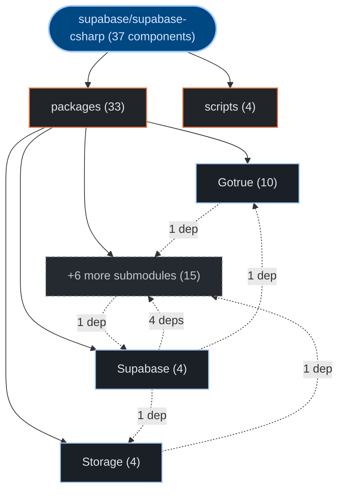
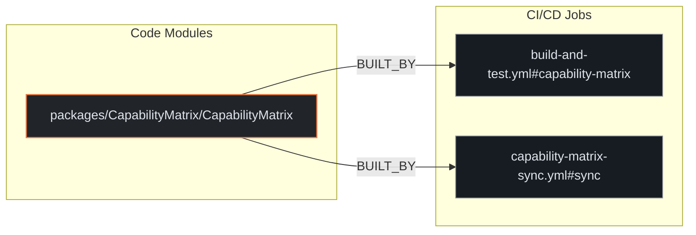
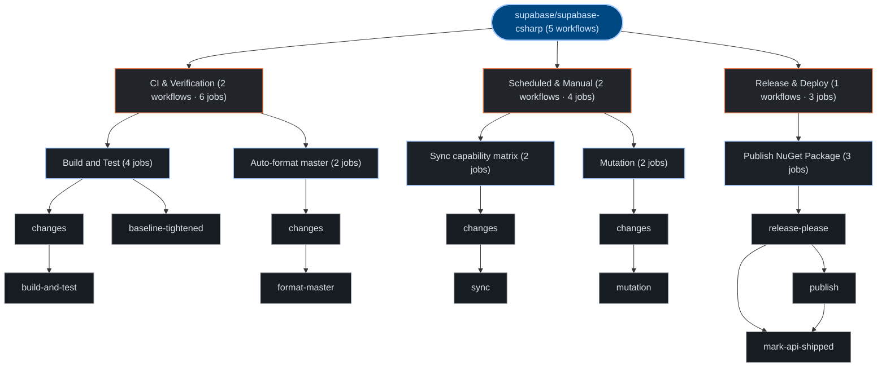

# Repository Architecture Analysis: supabase/supabase-csharp

## Metadata
- **SHA**: `0bda9b48515941adb9ec537725cc8b0b0fd24046`
- **Primary Ecosystem**: .NET

## Quality Metrics
- **ast_engine**: tree-sitter
- **avg_cognitive_complexity**: 0.44
- **avg_cyclomatic_complexity**: 1.44
- **component_count**: 37
- **dead_code_count**: 90
- **dead_code_symbols**: 50 entry(ies)
- **duplication_pct**: 87.65
- **file_complexities**: 25 entry(ies)
- **files_analyzed**: 688
- **fitness_passed**: False
- **fitness_violation_count**: 5
- **framework**: ASP.NET Core
- **import_edges**: 100 entry(ies)
- **loc**: 60148
- **max_cognitive_complexity**: 49
- **max_cyclomatic_complexity**: 36
- **sloc**: 41263

# Architecture: supabase/supabase-csharp

## Context
- **Repository**: `supabase/supabase-csharp`
- **SHA**: `0bda9b48515941adb9ec537725cc8b0b0fd24046`
- **Ecosystem**: .NET
- **Framework**: ASP.NET Core

## Building Block View

## Component Details
- **CapabilityMatrix** (`packages/CapabilityMatrix/CapabilityMatrix/CapabilityMatrix.csproj`): MODULE
- **CapabilityMatrix.Tests** (`packages/CapabilityMatrix/CapabilityMatrix.Tests/CapabilityMatrix.Tests.csproj`): MODULE (deps: CapabilityMatrix)
- **Core** (`packages/Core/Core/Core.csproj`): MODULE
- **Core.Tests** (`packages/Core/Core.Tests/Core.Tests.csproj`): MODULE (deps: Core)
- **Functions** (`packages/Functions/Functions/Functions.csproj`): MODULE (deps: Core)
- **Functions.Tests** (`packages/Functions/Functions.Tests/Functions.Tests.csproj`): MODULE (deps: Functions)
- **Gotrue** (`packages/Gotrue/Gotrue/Gotrue.csproj`): MODULE (deps: Core)
- **Gotrue.Tests** (`packages/Gotrue/Gotrue.Tests/Gotrue.Tests.csproj`): MODULE (deps: Gotrue)
- **Postgrest** (`packages/Postgrest/Postgrest/Postgrest.csproj`): MODULE (deps: Core)
- **Postgrest.Tests** (`packages/Postgrest/Postgrest.Tests/Postgrest.Tests.csproj`): MODULE (deps: Postgrest)
- **Realtime** (`packages/Realtime/Realtime/Realtime.csproj`): MODULE (deps: Core, Postgrest)
- **Realtime.Tests** (`packages/Realtime/Realtime.Tests/Realtime.Tests.csproj`): MODULE (deps: Realtime)
- **Storage** (`packages/Storage/Storage/Storage.csproj`): MODULE (deps: Core)
- **Storage.Tests** (`packages/Storage/Storage.Tests/Storage.Tests.csproj`): MODULE (deps: Storage)
- **Supabase** (`packages/Supabase/Supabase/Supabase.csproj`): MODULE (deps: Core, Functions, Gotrue, Postgrest, Realtime, Storage)
- **Supabase.Tests** (`packages/Supabase/Supabase.Tests/Supabase.Tests.csproj`): MODULE (deps: Supabase)
- **DependencyInjection** (`packages/extensions/DependencyInjection/DependencyInjection/DependencyInjection.csproj`): MODULE (deps: Supabase)
- **DependencyInjection.Tests** (`packages/extensions/DependencyInjection/DependencyInjection.Tests/DependencyInjection.Tests.csproj`): MODULE (deps: DependencyInjection)
- **Sample** (`scripts/quality-gate/fixtures/_base/Sample/Sample.csproj`): MODULE
- **Sample.Tests** (`scripts/quality-gate/fixtures/_base/Sample.Tests/Sample.Tests.csproj`): MODULE (deps: Sample)
- **Sample** (`scripts/quality-gate/fixtures/fixtures-tree-ignored/overlay/scripts/quality-gate/fixtures/decoy/Sample/Sample.csproj`): MODULE
- **Sample.Tests** (`scripts/quality-gate/fixtures/fixtures-tree-ignored/overlay/scripts/quality-gate/fixtures/decoy/Sample.Tests/Sample.Tests.csproj`): MODULE (deps: Sample)
- **SampleRepository** (`packages/CapabilityMatrix/CapabilityMatrix.Tests/SampleRepository.cs`): DATA_ACCESS_LAYER
- **StubHandler** (`packages/Core/Core.Tests/Http/RetryExecutorTests.cs`): SERVICE
- **SynchronousLogoutHandler** (`packages/Gotrue/Gotrue.Tests/Authentication/SignOutLocalSessionTests.cs`): SERVICE (deps: UnreachableHandler)
- **UnreachableHandler** (`packages/Gotrue/Gotrue.Tests/Authentication/SignOutLocalSessionTests.cs`): SERVICE (deps: SynchronousLogoutHandler)
- **SynchronousSignInHandler** (`packages/Gotrue/Gotrue.Tests/SignInWithPasskey/SignInWithPasskeyContractTests.cs`): SERVICE
- **SynchronousSignInHandler** (`packages/Gotrue/Gotrue.Tests/SignInWithWeb3/SignInWithWeb3ContractTests.cs`): SERVICE
- **SynchronousSignUpHandler** (`packages/Gotrue/Gotrue.Tests/SignUp/SignUpContractTests.cs`): SERVICE
- **UnreachableHandler** (`packages/Gotrue/Gotrue.Tests/TokenRefresh/SessionRestoreContractTests.cs`): SERVICE (deps: GatedHandler)
- **GatedHandler** (`packages/Gotrue/Gotrue.Tests/TokenRefresh/SessionRestoreContractTests.cs`): SERVICE (deps: UnreachableHandler)
- **SynchronousVerificationHandler** (`packages/Gotrue/Gotrue.Tests/VerifyRecoveryCode/VerifyRecoveryCodeContractTests.cs`): SERVICE
- **StubHandler** (`packages/Storage/Storage.Tests/Files/PurgeCacheCancellationTests.cs`): SERVICE
- **StubHandler** (`packages/Storage/Storage.Tests/Files/StorageFileDownloadCancellationTests.cs`): SERVICE
- **DefaultSupabaseSessionHandler** (`packages/Supabase/Supabase/DefaultSupabaseSessionHandler.cs`): SERVICE
- **UnreachableHandler** (`packages/Supabase/Supabase.Tests/SupabaseClientCompositionTests.cs`): SERVICE
- **CountingHandler** (`packages/extensions/DependencyInjection/DependencyInjection.Tests/SupabaseServiceCollectionExtensionsTests.cs`): SERVICE

## 6-Dimension Repository Scorecard

- **Overall Grade**: `F` (34.95/100)
- **Technical Debt Score**: 65.05
- **Estimated Remediation Effort**: 107.29h

| Dimension | Grade | Score | Weight | Details |
| :--- | :---: | :---: | :---: | :--- |
| Code Quality | `F` | 30.00 | 0.20 | avg_cc=1.44, max_cc=36, duplication=87.65%, dead_code=90 |
| Dependency Health | `B` | 85.00 | 0.15 | dependencies=106, outdated=0, vulnerable=0, has_lockfile=False |
| Maintainability | `F` | 13.00 | 0.15 | avg_cognitive=0.44, max_cognitive=49, fitness_violations=5, oversized_files=7 |
| Pipeline Health | `F` | 25.00 | 0.15 | workflows=5, operational_antipatterns=16, parallel_branches=True |
| Security | `F` | 0.00 | 0.20 | vulnerabilities=0, secrets=3, pipeline_security_findings=9 |
| Test Coverage | `C` | 70.00 | 0.15 | coverage=unavailable, ci_test_job=True, test_files_detected=True |

## Architecture Fitness & Workspace Boundaries

- **[HIGH] `ATRUSS-ARCH-004` (CIRCULAR_DEPENDENCY)**: Circular dependency detected between architectural components. (GatedHandler -> UnreachableHandler -> GatedHandler)
- **[HIGH] `ATRUSS-ARCH-004` (CIRCULAR_DEPENDENCY)**: Circular dependency detected between architectural components. (SynchronousLogoutHandler -> UnreachableHandler -> SynchronousLogoutHandler)
- **[MEDIUM] `ATRUSS-ARCH-005` (COMPLEXITY_THRESHOLD)**: Repository duplication_pct (87.65) exceeds policy threshold (15.0).
- **[MEDIUM] `ATRUSS-ARCH-005` (COMPLEXITY_THRESHOLD)**: Repository max_cognitive_complexity (49.0) exceeds policy threshold (25.0).
- **[MEDIUM] `ATRUSS-ARCH-005` (COMPLEXITY_THRESHOLD)**: Repository max_cyclomatic_complexity (36.0) exceeds policy threshold (20.0).

## Supply Chain Dependencies, Vulnerabilities & Secrets

- **Dependencies Parsed**: 106 | **Vulnerabilities**: 0 | **Secrets**: 3

### Secret Findings (Redacted)
- **[HIGH] `ATRUSS-SEC-005`** at `packages/Realtime/Realtime.Tests/Helpers.cs:11` (`public const string ApiKeyAnon = "sb_p***REDACTED***";`)
- **[HIGH] `ATRUSS-SEC-005`** at `packages/Realtime/Realtime.Tests/Helpers.cs:12` (`public const string ApiKey = "sb_s***REDACTED***";`)
- **[HIGH] `ATRUSS-SEC-005`** at `packages/Supabase/Supabase.Tests/SupabaseClientDatabaseTests.cs:23` (`private const string ServiceKey = "sb_s***REDACTED***";`)

### Inventory Sample
- `BirdMessenger` `*` (NuGet, `packages/Storage/Storage/Storage.csproj`)
- `BouncyCastle.Cryptography` `*` (NuGet, `packages/Gotrue/Gotrue.Tests/Gotrue.Tests.csproj`)
- `FluentAssertions` `*` (NuGet, `packages/CapabilityMatrix/CapabilityMatrix.Tests/CapabilityMatrix.Tests.csproj`)
- `FluentAssertions` `*` (NuGet, `packages/Core/Core.Tests/Core.Tests.csproj`)
- `FluentAssertions` `*` (NuGet, `packages/Functions/Functions.Tests/Functions.Tests.csproj`)
- `FluentAssertions` `*` (NuGet, `packages/Gotrue/Gotrue.Tests/Gotrue.Tests.csproj`)
- `FluentAssertions` `*` (NuGet, `packages/Postgrest/Postgrest.Tests/Postgrest.Tests.csproj`)
- `FluentAssertions` `*` (NuGet, `packages/Realtime/Realtime.Tests/Realtime.Tests.csproj`)
- `FluentAssertions` `*` (NuGet, `packages/Storage/Storage.Tests/Storage.Tests.csproj`)
- `FluentAssertions` `*` (NuGet, `packages/Supabase/Supabase.Tests/Supabase.Tests.csproj`)
- `FluentAssertions` `*` (NuGet, `packages/extensions/DependencyInjection/DependencyInjection.Tests/DependencyInjection.Tests.csproj`)
- `MSTest.TestAdapter` `*` (NuGet, `packages/CapabilityMatrix/CapabilityMatrix.Tests/CapabilityMatrix.Tests.csproj`)
- `MSTest.TestAdapter` `*` (NuGet, `packages/Core/Core.Tests/Core.Tests.csproj`)
- `MSTest.TestAdapter` `*` (NuGet, `packages/Functions/Functions.Tests/Functions.Tests.csproj`)
- `MSTest.TestAdapter` `*` (NuGet, `packages/Gotrue/Gotrue.Tests/Gotrue.Tests.csproj`)
- `MSTest.TestAdapter` `*` (NuGet, `packages/Postgrest/Postgrest.Tests/Postgrest.Tests.csproj`)
- `MSTest.TestAdapter` `*` (NuGet, `packages/Realtime/Realtime.Tests/Realtime.Tests.csproj`)
- `MSTest.TestAdapter` `*` (NuGet, `packages/Storage/Storage.Tests/Storage.Tests.csproj`)
- `MSTest.TestAdapter` `*` (NuGet, `packages/Supabase/Supabase.Tests/Supabase.Tests.csproj`)
- `MSTest.TestAdapter` `*` (NuGet, `packages/extensions/DependencyInjection/DependencyInjection.Tests/DependencyInjection.Tests.csproj`)
- `MSTest.TestAdapter` `4.3.3` (NuGet, `scripts/quality-gate/fixtures/_base/Sample.Tests/Sample.Tests.csproj`)
- `MSTest.TestAdapter` `4.3.3` (NuGet, `scripts/quality-gate/fixtures/fixtures-tree-ignored/overlay/scripts/quality-gate/fixtures/decoy/Sample.Tests/Sample.Tests.csproj`)
- `MSTest.TestFramework` `*` (NuGet, `packages/CapabilityMatrix/CapabilityMatrix.Tests/CapabilityMatrix.Tests.csproj`)
- `MSTest.TestFramework` `*` (NuGet, `packages/Core/Core.Tests/Core.Tests.csproj`)
- `MSTest.TestFramework` `*` (NuGet, `packages/Functions/Functions.Tests/Functions.Tests.csproj`)
- `MSTest.TestFramework` `*` (NuGet, `packages/Gotrue/Gotrue.Tests/Gotrue.Tests.csproj`)
- `MSTest.TestFramework` `*` (NuGet, `packages/Postgrest/Postgrest.Tests/Postgrest.Tests.csproj`)
- `MSTest.TestFramework` `*` (NuGet, `packages/Realtime/Realtime.Tests/Realtime.Tests.csproj`)
- `MSTest.TestFramework` `*` (NuGet, `packages/Storage/Storage.Tests/Storage.Tests.csproj`)
- `MSTest.TestFramework` `*` (NuGet, `packages/Supabase/Supabase.Tests/Supabase.Tests.csproj`)
- ... (+76 more dependencies)

## Section 7: Code-to-Cloud Deployment Traceability

- `packages/CapabilityMatrix/CapabilityMatrix` (code_module) --[BUILT_BY]--> `build-and-test.yml#capability-matrix` (ci_job)
- `packages/CapabilityMatrix/CapabilityMatrix` (code_module) --[BUILT_BY]--> `capability-matrix-sync.yml#sync` (ci_job)

## CI/CD Pipeline Topology

