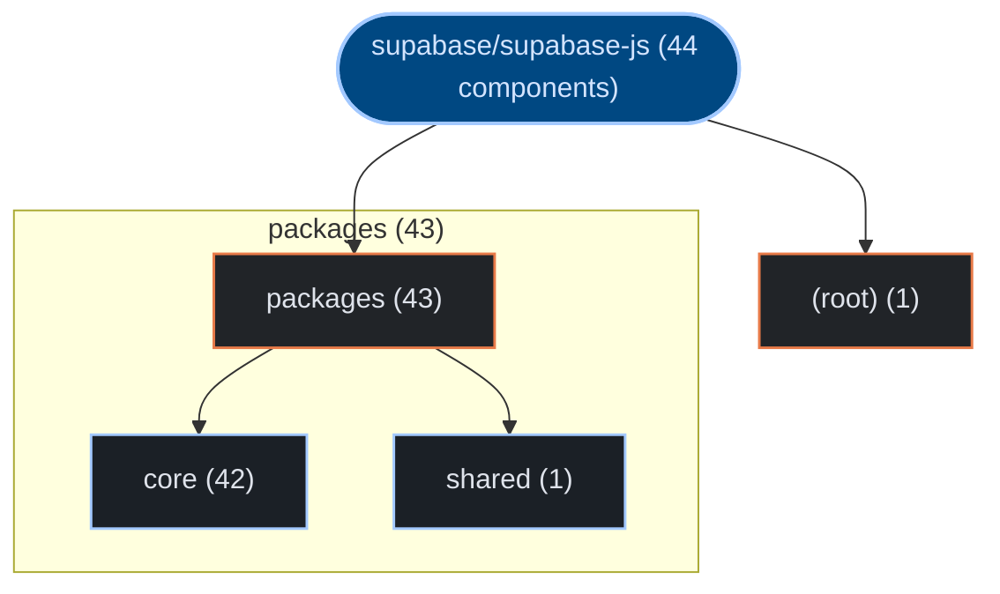

# Repository Architecture Analysis: supabase/supabase-js

## Metadata
- **SHA**: `13211d930a144fc4b0852bf0698a58097ed6e963`
- **Primary Ecosystem**: JavaScript/TypeScript

## Quality Metrics
- **ast_engine**: tree-sitter
- **avg_cognitive_complexity**: 2.89
- **avg_cyclomatic_complexity**: 3.17
- **component_count**: 44
- **dead_code_count**: 15
- **dead_code_symbols**: 15 entry(ies)
- **duplication_pct**: 84.49
- **file_complexities**: 25 entry(ies)
- **files_analyzed**: 359
- **fitness_passed**: False
- **fitness_violation_count**: 12
- **framework**: Next.js
- **import_edges**: 100 entry(ies)
- **loc**: 101537
- **max_cognitive_complexity**: 79
- **max_cyclomatic_complexity**: 54
- **sloc**: 70586
- **test_file_count**: 262

# Architecture: supabase/supabase-js

## Context
- **Repository**: `supabase/supabase-js`
- **SHA**: `13211d930a144fc4b0852bf0698a58097ed6e963`
- **Ecosystem**: JavaScript/TypeScript
- **Framework**: Next.js

## Building Block View

## Component Details
- **@supabase-js/source** (`package.json`): MODULE
- **auth-js-example-react** (`packages/core/auth-js/example/react/package.json`): MODULE
- **@supabase/auth-js** (`packages/core/auth-js/package.json`): MODULE
- **@supabase/functions-js** (`packages/core/functions-js/package.json`): MODULE
- **@supabase/postgrest-js** (`packages/core/postgrest-js/package.json`): MODULE
- **example** (`packages/core/realtime-js/example/package.json`): MODULE
- **@supabase/realtime-js** (`packages/core/realtime-js/package.json`): MODULE
- **@supabase/storage-js** (`packages/core/storage-js/package.json`): MODULE
- **@supabase/supabase-js** (`packages/core/supabase-js/package.json`): MODULE
- **test-deno** (`packages/core/supabase-js/test/deno/package.json`): MODULE
- **test-bun** (`packages/core/supabase-js/test/integration/bun/package.json`): MODULE
- **expo-app** (`packages/core/supabase-js/test/integration/expo/package.json`): MODULE
- **supabase-js-test-next** (`packages/core/supabase-js/test/integration/next/package.json`): MODULE
- **websocket-playwright-tests** (`packages/core/supabase-js/test/integration/node-browser/package.json`): MODULE
- **@supabase/tracing** (`packages/shared/tracing/package.json`): MODULE
- **GoTrueClient** (`packages/core/auth-js/src/GoTrueClient.ts`): SERVICE (deps: DEFAULT_AUTH_OPTIONS, DEFAULT_DB_OPTIONS, DEFAULT_GLOBAL_OPTIONS, DEFAULT_HEADERS, DEFAULT_REALTIME_OPTIONS, DEFAULT_TRACE_PROPAGATION_OPTIONS, SIGN_OUT_SCOPES, WebAuthnAbortService)
- **SIGN_OUT_SCOPES** (`packages/core/auth-js/src/lib/types.ts`): UI_COMPONENT (deps: WebAuthnAbortService)
- **WebAuthnAbortService** (`packages/core/auth-js/src/lib/webauthn.ts`): SERVICE (deps: GoTrueClient, SIGN_OUT_SCOPES)
- **FunctionsClient** (`packages/core/functions-js/src/FunctionsClient.ts`): SERVICE (deps: SIGN_OUT_SCOPES)
- **PostgrestClient** (`packages/core/postgrest-js/src/PostgrestClient.ts`): SERVICE (deps: SIGN_OUT_SCOPES)
- **RootLayout** (`packages/core/realtime-js/example/app/layout.tsx`): UI_COMPONENT
- **Home** (`packages/core/realtime-js/example/app/page.tsx`): UI_COMPONENT
- **Chat** (`packages/core/realtime-js/example/components/chat.tsx`): UI_COMPONENT
- **RealtimeClient** (`packages/core/realtime-js/src/RealtimeClient.ts`): SERVICE (deps: DEFAULT_AUTH_OPTIONS, DEFAULT_DB_OPTIONS, DEFAULT_GLOBAL_OPTIONS, DEFAULT_HEADERS, DEFAULT_REALTIME_OPTIONS, DEFAULT_TRACE_PROPAGATION_OPTIONS, SIGN_OUT_SCOPES)
- **StorageClient** (`packages/core/storage-js/src/StorageClient.ts`): SERVICE (deps: StorageAnalyticsClient, StorageVectorsClient)
- **BaseApiClient** (`packages/core/storage-js/src/lib/common/BaseApiClient.ts`): SERVICE
- **StorageAnalyticsClient** (`packages/core/storage-js/src/packages/StorageAnalyticsClient.ts`): SERVICE (deps: BaseApiClient, DEFAULT_AUTH_OPTIONS, DEFAULT_DB_OPTIONS, DEFAULT_GLOBAL_OPTIONS, DEFAULT_HEADERS, DEFAULT_REALTIME_OPTIONS, DEFAULT_TRACE_PROPAGATION_OPTIONS, SIGN_OUT_SCOPES)
- **StorageVectorsClient** (`packages/core/storage-js/src/packages/StorageVectorsClient.ts`): SERVICE (deps: SIGN_OUT_SCOPES)
- **TestApiClient** (`packages/core/storage-js/test/common/BaseApiClient.test.ts`): SERVICE (deps: BaseApiClient, Index)
- **SupabaseClient** (`packages/core/supabase-js/src/SupabaseClient.ts`): SERVICE (deps: DEFAULT_AUTH_OPTIONS, DEFAULT_DB_OPTIONS, DEFAULT_GLOBAL_OPTIONS, DEFAULT_HEADERS, DEFAULT_REALTIME_OPTIONS, DEFAULT_TRACE_PROPAGATION_OPTIONS, SIGN_OUT_SCOPES, SupabaseAuthClient)
- **LargeSecureStore** (`packages/core/supabase-js/src/SupabaseClient.ts`): SERVICE (deps: DEFAULT_AUTH_OPTIONS, DEFAULT_DB_OPTIONS, DEFAULT_GLOBAL_OPTIONS, DEFAULT_HEADERS, DEFAULT_REALTIME_OPTIONS, DEFAULT_TRACE_PROPAGATION_OPTIONS, SIGN_OUT_SCOPES, SupabaseAuthClient)
- **SupabaseAuthClient** (`packages/core/supabase-js/src/lib/SupabaseAuthClient.ts`): SERVICE (deps: SIGN_OUT_SCOPES)
- **DEFAULT_HEADERS** (`packages/core/supabase-js/src/lib/constants.ts`): UI_COMPONENT (deps: SIGN_OUT_SCOPES)
- **DEFAULT_GLOBAL_OPTIONS** (`packages/core/supabase-js/src/lib/constants.ts`): UI_COMPONENT (deps: SIGN_OUT_SCOPES)
- **DEFAULT_DB_OPTIONS** (`packages/core/supabase-js/src/lib/constants.ts`): UI_COMPONENT (deps: SIGN_OUT_SCOPES)
- **DEFAULT_AUTH_OPTIONS** (`packages/core/supabase-js/src/lib/constants.ts`): UI_COMPONENT (deps: SIGN_OUT_SCOPES)
- **DEFAULT_REALTIME_OPTIONS** (`packages/core/supabase-js/src/lib/constants.ts`): UI_COMPONENT (deps: SIGN_OUT_SCOPES)
- **DEFAULT_TRACE_PROPAGATION_OPTIONS** (`packages/core/supabase-js/src/lib/constants.ts`): UI_COMPONENT (deps: SIGN_OUT_SCOPES)
- **RootLayout** (`packages/core/supabase-js/test/integration/expo/app/_layout.tsx`): UI_COMPONENT
- **Index** (`packages/core/supabase-js/test/integration/expo/app/index.tsx`): UI_COMPONENT
- **RootLayout** (`packages/core/supabase-js/test/integration/next/app/layout.tsx`): UI_COMPONENT
- **Home** (`packages/core/supabase-js/test/integration/next/app/page.tsx`): UI_COMPONENT
- **docker-compose** (`packages/core/auth-js/infra/docker-compose.yml`): module
- **docker-compose** (`packages/core/postgrest-js/test/v12/docker-compose.yml`): module

## 6-Dimension Repository Scorecard

- **Overall Grade**: `F` (31.36/100)
- **Technical Debt Score**: 68.64
- **Estimated Remediation Effort**: 169.31h

| Dimension | Grade | Score | Weight | Details |
| :--- | :---: | :---: | :---: | :--- |
| Code Quality | `F` | 29.32 | 0.20 | avg_cc=3.17, max_cc=54, duplication=84.49%, dead_code=15 |
| Dependency Health | `A` | 100.00 | 0.15 | dependencies=1893, outdated=0, vulnerable=0, has_lockfile=True |
| Maintainability | `F` | 0.00 | 0.15 | avg_cognitive=2.89, max_cognitive=79, fitness_violations=12, oversized_files=13 |
| Pipeline Health | `F` | 0.00 | 0.15 | workflows=17, operational_antipatterns=63, parallel_branches=True |
| Security | `F` | 0.00 | 0.20 | vulnerabilities=0, secrets=4, pipeline_security_findings=21 |
| Test Coverage | `C` | 70.00 | 0.15 | coverage=unavailable, ci_test_job=True, test_files_detected=True |

## Architecture Fitness & Workspace Boundaries

- **[HIGH] `ATRUSS-ARCH-004` (CIRCULAR_DEPENDENCY)**: Circular dependency detected between architectural components. (DEFAULT_AUTH_OPTIONS -> SIGN_OUT_SCOPES -> WebAuthnAbortService -> GoTrueClient -> DEFAULT_AUTH_OPTIONS)
- **[HIGH] `ATRUSS-ARCH-004` (CIRCULAR_DEPENDENCY)**: Circular dependency detected between architectural components. (DEFAULT_DB_OPTIONS -> SIGN_OUT_SCOPES -> WebAuthnAbortService -> GoTrueClient -> DEFAULT_DB_OPTIONS)
- **[HIGH] `ATRUSS-ARCH-004` (CIRCULAR_DEPENDENCY)**: Circular dependency detected between architectural components. (DEFAULT_GLOBAL_OPTIONS -> SIGN_OUT_SCOPES -> WebAuthnAbortService -> GoTrueClient -> DEFAULT_GLOBAL_OPTIONS)
- **[HIGH] `ATRUSS-ARCH-004` (CIRCULAR_DEPENDENCY)**: Circular dependency detected between architectural components. (DEFAULT_HEADERS -> SIGN_OUT_SCOPES -> WebAuthnAbortService -> GoTrueClient -> DEFAULT_HEADERS)
- **[HIGH] `ATRUSS-ARCH-004` (CIRCULAR_DEPENDENCY)**: Circular dependency detected between architectural components. (DEFAULT_REALTIME_OPTIONS -> SIGN_OUT_SCOPES -> WebAuthnAbortService -> GoTrueClient -> DEFAULT_REALTIME_OPTIONS)
- **[HIGH] `ATRUSS-ARCH-004` (CIRCULAR_DEPENDENCY)**: Circular dependency detected between architectural components. (DEFAULT_TRACE_PROPAGATION_OPTIONS -> SIGN_OUT_SCOPES -> WebAuthnAbortService -> GoTrueClient -> DEFAULT_TRACE_PROPAGATION_OPTIONS)
- **[HIGH] `ATRUSS-ARCH-004` (CIRCULAR_DEPENDENCY)**: Circular dependency detected between architectural components. (GoTrueClient -> SIGN_OUT_SCOPES -> WebAuthnAbortService -> GoTrueClient)
- **[HIGH] `ATRUSS-ARCH-004` (CIRCULAR_DEPENDENCY)**: Circular dependency detected between architectural components. (GoTrueClient -> WebAuthnAbortService -> GoTrueClient)
- **[HIGH] `ATRUSS-ARCH-004` (CIRCULAR_DEPENDENCY)**: Circular dependency detected between architectural components. (SIGN_OUT_SCOPES -> WebAuthnAbortService -> SIGN_OUT_SCOPES)
- **[MEDIUM] `ATRUSS-ARCH-005` (COMPLEXITY_THRESHOLD)**: Repository duplication_pct (84.49) exceeds policy threshold (15.0).
- **[MEDIUM] `ATRUSS-ARCH-005` (COMPLEXITY_THRESHOLD)**: Repository max_cognitive_complexity (79.0) exceeds policy threshold (25.0).
- **[MEDIUM] `ATRUSS-ARCH-005` (COMPLEXITY_THRESHOLD)**: Repository max_cyclomatic_complexity (54.0) exceeds policy threshold (20.0).

### Workspace Packages
- **@supabase/auth-js** (`packages/core/auth-js`, react_ts_js, pnpm)
- **auth-js-example-react** (`packages/core/auth-js/example/react`, react_ts_js, pnpm) -> internal deps: `@supabase/auth-js`
- **@supabase/functions-js** (`packages/core/functions-js`, react_ts_js, pnpm)
- **@supabase/postgrest-js** (`packages/core/postgrest-js`, react_ts_js, pnpm)
- **@supabase/realtime-js** (`packages/core/realtime-js`, react_ts_js, pnpm)
- **example** (`packages/core/realtime-js/example`, react_ts_js, pnpm) -> internal deps: `@supabase/supabase-js`
- **@supabase/storage-js** (`packages/core/storage-js`, react_ts_js, pnpm)
- **@supabase/supabase-js** (`packages/core/supabase-js`, react_ts_js, pnpm) -> internal deps: `@supabase/auth-js, @supabase/functions-js, @supabase/postgrest-js, @supabase/realtime-js, @supabase/storage-js, @supabase/tracing`
- **expo-app** (`packages/core/supabase-js/test/integration/expo`, react_ts_js, nx)
- **@supabase/tracing** (`packages/shared/tracing`, react_ts_js, pnpm)

## Supply Chain Dependencies, Vulnerabilities & Secrets

- **Dependencies Parsed**: 1893 | **Vulnerabilities**: 0 | **Secrets**: 4

### Secret Findings (Redacted)
- **[HIGH] `ATRUSS-SEC-005`** at `packages/core/auth-js/example/react/.env.local.ci:2` (`VITE_SUPABASE_PUBLISHABLE_DEFAULT_KEY=eyJh***REDACTED***`)
- **[HIGH] `ATRUSS-SEC-005`** at `packages/core/auth-js/infra/docker-compose.yml:96` (`GOTRUE_JWT_SECRET: 'Z7-A***REDACTED***'`)
- **[HIGH] `ATRUSS-SEC-005`** at `packages/core/realtime-js/example/.env.local.ci:2` (`NEXT_PUBLIC_SUPABASE_PUBLISHABLE_KEY=eyJh***REDACTED***`)
- **[HIGH] `ATRUSS-SEC-005`** at `packages/core/supabase-js/test/integration.browser.test.ts:23` (`const PUBLISHABLE_KEY = 'eyJh***REDACTED***'`)

### Inventory Sample
- `@arethetypeswrong/cli` `*` (npm, `packages/core/realtime-js/package.json`)
- `@arethetypeswrong/cli` `*` (npm, `packages/core/supabase-js/package.json`)
- `@arethetypeswrong/cli` `0.18.2` (npm, `pnpm-lock.yaml`)
- `@babel/core` `7.25.2` (npm, `packages/core/supabase-js/test/integration/expo/package.json`)
- `@commitlint/cli` `19.8.1` (npm, `package.json`)
- `@commitlint/cli` `19.8.1` (npm, `pnpm-lock.yaml`)
- `@commitlint/config-conventional` `19.8.1` (npm, `package.json`)
- `@commitlint/config-conventional` `19.8.1` (npm, `pnpm-lock.yaml`)
- `@commitlint/cz-commitlint` `19.8.1` (npm, `package.json`)
- `@commitlint/cz-commitlint` `19.8.1` (npm, `pnpm-lock.yaml`)
- `@eslint/eslintrc` `3` (npm, `packages/core/realtime-js/example/package.json`)
- `@eslint/eslintrc` `3` (npm, `packages/core/supabase-js/test/integration/next/package.json`)
- `@eslint/eslintrc` `3.3.5` (npm, `pnpm-lock.yaml`)
- `@eslint/js` `10.0.1` (npm, `package.json`)
- `@eslint/js` `10.0.1` (npm, `pnpm-lock.yaml`)
- `@eslint/js` `9.39.1` (npm, `packages/core/auth-js/example/react/package.json`)
- `@eslint/js` `9.39.4` (npm, `pnpm-lock.yaml`)
- `@expo/vector-icons` `15.0.0` (npm, `packages/core/supabase-js/test/integration/expo/package.json`)
- `@faker-js/faker` `9.9.0` (npm, `packages/core/auth-js/package.json`)
- `@faker-js/faker` `9.9.0` (npm, `pnpm-lock.yaml`)
- `@jest/globals` `*` (npm, `packages/core/supabase-js/package.json`)
- `@jest/globals` `30.4.1` (npm, `pnpm-lock.yaml`)
- `@jest/types` `*` (npm, `packages/core/functions-js/package.json`)
- `@jest/types` `*` (npm, `packages/core/postgrest-js/package.json`)
- `@jest/types` `*` (npm, `packages/core/supabase-js/package.json`)
- `@jest/types` `30.4.1` (npm, `pnpm-lock.yaml`)
- `@nx/eslint` `23.1.0` (npm, `package.json`)
- `@nx/eslint` `23.1.0` (npm, `pnpm-lock.yaml`)
- `@nx/eslint-plugin` `23.1.0` (npm, `package.json`)
- `@nx/eslint-plugin` `23.1.0` (npm, `pnpm-lock.yaml`)
- ... (+1863 more dependencies)

## Section 7: Code-to-Cloud Deployment Traceability

```mermaid
flowchart LR
    classDef atlasCategory fill:#212428,stroke:#E87A48,stroke-width:1.5px,color:#dfe3eb
    classDef atlasWorkflow fill:#1b2026,stroke:#a3c9ff,stroke-width:1.5px,color:#dfe3eb
    classDef atlasJob fill:#171c22,stroke:#8d9199,stroke-width:1px,color:#dfe3eb
    classDef atlasTarget fill:#005227,stroke:#8bd99b,stroke-width:1.5px,color:#a7f6b6
    subgraph code_modules["Code Modules"]
        mod_packages_core_auth_js["packages/core/auth-js"]:::atlasCategory
        mod_packages_core_auth_js_example_react["packages/core/auth-js/example/react"]:::atlasCategory
        mod_packages_core_auth_js_infra["packages/core/auth-js/infra"]:::atlasCategory
        mod_packages_core_functions_js["packages/core/functions-js"]:::atlasCategory
        mod_packages_core_postgrest_js["packages/core/postgrest-js"]:::atlasCategory
        mod_packages_core_postgrest_js_test_v12["packages/core/postgrest-js/test/v12"]:::atlasCategory
        mod_packages_core_realtime_js["packages/core/realtime-js"]:::atlasCategory
        mod_packages_core_realtime_js_example["packages/core/realtime-js/example"]:::atlasCategory
        mod_packages_core_storage_js["packages/core/storage-js"]:::atlasCategory
        mod_packages_core_supabase_js["packages/core/supabase-js"]:::atlasCategory
        mod_packages_core_supabase_js_test_integration_bun["packages/core/supabase-js/test/integration/bun"]:::atlasCategory
        mod_packages_core_supabase_js_test_integration_expo["packages/core/supabase-js/test/integration/expo"]:::atlasCategory
        mod_packages_core_supabase_js_test_integration_next["packages/core/supabase-js/test/integration/next"]:::atlasCategory
    end
    subgraph build_artifacts["Build Artifacts / Containers"]
        art_packages_core_auth_js_infra_docker_compose_yml["packages/core/auth-js/infra/docker-compose.yml"]:::atlasWorkflow
        art_packages_core_postgrest_js_test_v12_docker_compose_yml["packages/core/postgrest-js/test/v12/docker-compose.yml"]:::atlasWorkflow
    end
    subgraph ci_jobs["CI/CD Jobs"]
        job_ci_core_yml_test_auth_cli["ci-core.yml#test-auth-cli"]:::atlasJob
        job_ci_core_yml_test_auth_js_docker["ci-core.yml#test-auth-js-docker"]:::atlasJob
        job_ci_core_yml_test_postgrest_js["ci-core.yml#test-postgrest-js"]:::atlasJob
        job_deprecate_version_yml_deprecate["deprecate-version.yml#deprecate"]:::atlasJob
        job_docs_yml_docs["docs.yml#docs"]:::atlasJob
        job_integration_tests_yml_integration_tests["integration-tests.yml#integration-tests"]:::atlasJob
        job_preview_release_yml_preview["preview-release.yml#preview"]:::atlasJob
        job_publish_yml_release_beta["publish.yml#release-beta"]:::atlasJob
        job_publish_yml_release_canary["publish.yml#release-canary"]:::atlasJob
        job_publish_yml_release_next["publish.yml#release-next"]:::atlasJob
        job_publish_yml_release_stable["publish.yml#release-stable"]:::atlasJob
    end
    subgraph runtime_envs["Runtime Environments"]
        env_docs_publish["docs-publish"]:::atlasTarget
        env_npm_deprecate["npm-deprecate"]:::atlasTarget
        env_npm_publish["npm-publish"]:::atlasTarget
    end
    job_deprecate_version_yml_deprecate -->|DEPLOYS_TO| env_npm_deprecate
    job_docs_yml_docs -->|DEPLOYS_TO| env_docs_publish
    job_publish_yml_release_beta -->|DEPLOYS_TO| env_npm_publish
    job_publish_yml_release_canary -->|DEPLOYS_TO| env_npm_publish
    job_publish_yml_release_next -->|DEPLOYS_TO| env_npm_publish
    job_publish_yml_release_stable -->|DEPLOYS_TO| env_npm_publish
    mod_packages_core_auth_js -->|BUILT_BY| job_ci_core_yml_test_auth_cli
    mod_packages_core_auth_js -->|BUILT_BY| job_ci_core_yml_test_auth_js_docker
    mod_packages_core_auth_js -->|BUILT_BY| job_integration_tests_yml_integration_tests
    mod_packages_core_auth_js -->|BUILT_BY| job_preview_release_yml_preview
    mod_packages_core_auth_js -->|DEPLOYED_BY| job_docs_yml_docs
    mod_packages_core_auth_js_example_react -->|BUILT_BY| job_integration_tests_yml_integration_tests
    mod_packages_core_auth_js_infra -->|PACKAGED_BY| art_packages_core_auth_js_infra_docker_compose_yml
    mod_packages_core_functions_js -->|BUILT_BY| job_preview_release_yml_preview
    mod_packages_core_functions_js -->|DEPLOYED_BY| job_docs_yml_docs
    mod_packages_core_postgrest_js -->|BUILT_BY| job_ci_core_yml_test_postgrest_js
    mod_packages_core_postgrest_js -->|BUILT_BY| job_preview_release_yml_preview
    mod_packages_core_postgrest_js -->|DEPLOYED_BY| job_docs_yml_docs
    mod_packages_core_postgrest_js_test_v12 -->|PACKAGED_BY| art_packages_core_postgrest_js_test_v12_docker_compose_yml
    mod_packages_core_realtime_js -->|BUILT_BY| job_integration_tests_yml_integration_tests
    mod_packages_core_realtime_js -->|BUILT_BY| job_preview_release_yml_preview
    mod_packages_core_realtime_js -->|DEPLOYED_BY| job_docs_yml_docs
    mod_packages_core_realtime_js_example -->|BUILT_BY| job_integration_tests_yml_integration_tests
    mod_packages_core_storage_js -->|BUILT_BY| job_preview_release_yml_preview
    mod_packages_core_storage_js -->|DEPLOYED_BY| job_docs_yml_docs
    mod_packages_core_supabase_js -->|BUILT_BY| job_integration_tests_yml_integration_tests
    mod_packages_core_supabase_js -->|BUILT_BY| job_preview_release_yml_preview
    mod_packages_core_supabase_js -->|DEPLOYED_BY| job_docs_yml_docs
    mod_packages_core_supabase_js_test_integration_bun -->|BUILT_BY| job_integration_tests_yml_integration_tests
    mod_packages_core_supabase_js_test_integration_expo -->|BUILT_BY| job_integration_tests_yml_integration_tests
    mod_packages_core_supabase_js_test_integration_next -->|BUILT_BY| job_integration_tests_yml_integration_tests
```

- `deprecate-version.yml#deprecate` (ci_job) --[DEPLOYS_TO]--> `npm-deprecate` (environment)
- `docs.yml#docs` (ci_job) --[DEPLOYS_TO]--> `docs-publish` (environment)
- `publish.yml#release-beta` (ci_job) --[DEPLOYS_TO]--> `npm-publish` (environment)
- `publish.yml#release-canary` (ci_job) --[DEPLOYS_TO]--> `npm-publish` (environment)
- `publish.yml#release-next` (ci_job) --[DEPLOYS_TO]--> `npm-publish` (environment)
- `publish.yml#release-stable` (ci_job) --[DEPLOYS_TO]--> `npm-publish` (environment)
- `packages/core/auth-js` (code_module) --[BUILT_BY]--> `ci-core.yml#test-auth-cli` (ci_job)
- `packages/core/auth-js` (code_module) --[BUILT_BY]--> `ci-core.yml#test-auth-js-docker` (ci_job)
- `packages/core/auth-js` (code_module) --[BUILT_BY]--> `integration-tests.yml#integration-tests` (ci_job)
- `packages/core/auth-js` (code_module) --[BUILT_BY]--> `preview-release.yml#preview` (ci_job)
- `packages/core/auth-js` (code_module) --[DEPLOYED_BY]--> `docs.yml#docs` (ci_job)
- `packages/core/auth-js/example/react` (code_module) --[BUILT_BY]--> `integration-tests.yml#integration-tests` (ci_job)
- `packages/core/auth-js/infra` (code_module) --[PACKAGED_BY]--> `packages/core/auth-js/infra/docker-compose.yml` (container)
- `packages/core/functions-js` (code_module) --[BUILT_BY]--> `preview-release.yml#preview` (ci_job)
- `packages/core/functions-js` (code_module) --[DEPLOYED_BY]--> `docs.yml#docs` (ci_job)
- `packages/core/postgrest-js` (code_module) --[BUILT_BY]--> `ci-core.yml#test-postgrest-js` (ci_job)
- `packages/core/postgrest-js` (code_module) --[BUILT_BY]--> `preview-release.yml#preview` (ci_job)
- `packages/core/postgrest-js` (code_module) --[DEPLOYED_BY]--> `docs.yml#docs` (ci_job)
- `packages/core/postgrest-js/test/v12` (code_module) --[PACKAGED_BY]--> `packages/core/postgrest-js/test/v12/docker-compose.yml` (container)
- `packages/core/realtime-js` (code_module) --[BUILT_BY]--> `integration-tests.yml#integration-tests` (ci_job)
- `packages/core/realtime-js` (code_module) --[BUILT_BY]--> `preview-release.yml#preview` (ci_job)
- `packages/core/realtime-js` (code_module) --[DEPLOYED_BY]--> `docs.yml#docs` (ci_job)
- `packages/core/realtime-js/example` (code_module) --[BUILT_BY]--> `integration-tests.yml#integration-tests` (ci_job)
- `packages/core/storage-js` (code_module) --[BUILT_BY]--> `preview-release.yml#preview` (ci_job)
- `packages/core/storage-js` (code_module) --[DEPLOYED_BY]--> `docs.yml#docs` (ci_job)
- `packages/core/supabase-js` (code_module) --[BUILT_BY]--> `integration-tests.yml#integration-tests` (ci_job)
- `packages/core/supabase-js` (code_module) --[BUILT_BY]--> `preview-release.yml#preview` (ci_job)
- `packages/core/supabase-js` (code_module) --[DEPLOYED_BY]--> `docs.yml#docs` (ci_job)
- `packages/core/supabase-js/test/integration/bun` (code_module) --[BUILT_BY]--> `integration-tests.yml#integration-tests` (ci_job)
- `packages/core/supabase-js/test/integration/expo` (code_module) --[BUILT_BY]--> `integration-tests.yml#integration-tests` (ci_job)
- `packages/core/supabase-js/test/integration/next` (code_module) --[BUILT_BY]--> `integration-tests.yml#integration-tests` (ci_job)

## CI/CD Pipeline Topology

```mermaid
graph TD;
  classDef atlasRoot fill:#004882,stroke:#a3c9ff,stroke-width:2px,color:#d3e4ff
  classDef atlasCategory fill:#212428,stroke:#E87A48,stroke-width:1.5px,color:#dfe3eb
  classDef atlasWorkflow fill:#1b2026,stroke:#a3c9ff,stroke-width:1.5px,color:#dfe3eb
  classDef atlasJob fill:#171c22,stroke:#8d9199,stroke-width:1px,color:#dfe3eb
  classDef atlasTarget fill:#005227,stroke:#8bd99b,stroke-width:1.5px,color:#a7f6b6
  classDef atlasAlert fill:#93000a,stroke:#ffb4ab,stroke-width:1.5px,color:#ffdad6
  classDef atlasMore fill:#252a31,stroke:#8d9199,stroke-dasharray:4 4,color:#c3c6cf
  pipeline_root(["supabase/supabase-js (17 workflows)"]):::atlasRoot
  subgraph sg_grp_0_CI___Verification["CI & Verification (6 workflows · 19 jobs)"]
    direction TB
    subgraph sg_wf_1_Core_packages_tests["Core packages tests (10 jobs)"]
      direction TB
      wf_1_Core_packages_tests(["Trigger: Core packages tests"]):::atlasWorkflow
      job_1_check_affected["check-affected"]:::atlasJob
      job_1_build["build"]:::atlasJob
      job_1_test_fast["test-fast"]:::atlasJob
      wf_1_Core_packages_tests --> job_1_check_affected
      job_1_check_affected --> job_1_build
      job_1_check_affected --> job_1_test_fast
      job_1_build --> job_1_test_fast
    end
    pipeline_root --> wf_1_Core_packages_tests
    subgraph sg_wf_2_Supabase_JS_tests["Supabase JS tests (3 jobs)"]
      direction TB
      wf_2_Supabase_JS_tests(["Trigger: Supabase JS tests"]):::atlasWorkflow
      job_2_build_package["build-package"]:::atlasJob
      job_2_test["test"]:::atlasJob
      job_2_module_resolution["module-resolution"]:::atlasJob
      wf_2_Supabase_JS_tests --> job_2_build_package
      job_2_build_package --> job_2_test
      job_2_build_package --> job_2_module_resolution
    end
    pipeline_root --> wf_2_Supabase_JS_tests
    subgraph sg_wf_3_CI__Pull_Requests_["CI (Pull Requests) (3 jobs)"]
      direction TB
      wf_3_CI__Pull_Requests_(["Trigger: CI (Pull Requests)"]):::atlasWorkflow
      job_3_ci_core["ci-core"]:::atlasJob
      job_3_ci_supabase_js["ci-supabase-js"]:::atlasJob
      job_3_coveralls_finish["coveralls-finish"]:::atlasJob
      wf_3_CI__Pull_Requests_ --> job_3_ci_core
      wf_3_CI__Pull_Requests_ --> job_3_ci_supabase_js
      job_3_ci_core --> job_3_coveralls_finish
      job_3_ci_supabase_js --> job_3_coveralls_finish
    end
    pipeline_root --> wf_3_CI__Pull_Requests_
  end
  subgraph sg_grp_1_Scheduled___Manual["Scheduled & Manual (4 workflows · 6 jobs)"]
    direction TB
    subgraph sg_wf_4_Deprecate_package_versions["Deprecate package versions (3 jobs)"]
      direction TB
      wf_4_Deprecate_package_versions(["Trigger: Deprecate package versions"]):::atlasWorkflow
      job_4_deprecate["deprecate"]:::atlasJob
      job_4_notify_success["notify-success"]:::atlasJob
      job_4_notify_failure["notify-failure"]:::atlasJob
      wf_4_Deprecate_package_versions --> job_4_deprecate
      job_4_deprecate --> job_4_notify_success
      job_4_deprecate --> job_4_notify_failure
    end
    pipeline_root --> wf_4_Deprecate_package_versions
    subgraph sg_wf_6_Dogfood["Dogfood (1 jobs)"]
      direction TB
      wf_6_Dogfood(["Trigger: Dogfood"]):::atlasWorkflow
      job_6_trigger_downstream["trigger-downstream"]:::atlasJob
      wf_6_Dogfood --> job_6_trigger_downstream
    end
    pipeline_root --> wf_6_Dogfood
  end
  subgraph sg_grp_2_Release___Deploy["Release & Deploy (3 workflows · 22 jobs)"]
    direction TB
    subgraph sg_wf_10_Preview_release["Preview release (2 jobs)"]
      direction TB
      wf_10_Preview_release(["Trigger: Preview release"]):::atlasWorkflow
      job_10_preview["preview"]:::atlasJob
      job_10_integration_tests["integration-tests"]:::atlasJob
      wf_10_Preview_release --> job_10_preview
      job_10_preview --> job_10_integration_tests
    end
    pipeline_root --> wf_10_Preview_release
    subgraph sg_wf_11_Publish_releases["Publish releases (19 jobs)"]
      direction TB
      wf_11_Publish_releases(["Trigger: Publish releases"]):::atlasWorkflow
      job_11_release_stable["release-stable"]:::atlasJob
      wf_11_Publish_releases --> job_11_release_stable
    end
    pipeline_root --> wf_11_Publish_releases
  end
  subgraph sg_grp_3_Security___Governance["Security & Governance (3 workflows · 4 jobs)"]
    direction TB
    wf_0_Block_WIP_Draft_Merges["Block WIP/Draft Merges (1 jobs)"]:::atlasWorkflow
    pipeline_root --> wf_0_Block_WIP_Draft_Merges
    wf_14_Mark_as_Stale_and_Close_Stale_Issues["Mark as Stale and Close Stale Issues (2 jobs)"]:::atlasWorkflow
    pipeline_root --> wf_14_Mark_as_Stale_and_Close_Stale_Issues
  end
  subgraph sg_grp_4_Automation___Other["Automation & Other (1 workflows · 1 jobs)"]
    direction TB
    wf_13_Reusable_Slack_Notification["Reusable Slack Notification (1 jobs)"]:::atlasWorkflow
    pipeline_root --> wf_13_Reusable_Slack_Notification
  end
  wf_more["+7 more workflows"]:::atlasMore
  pipeline_root --> wf_more
```

