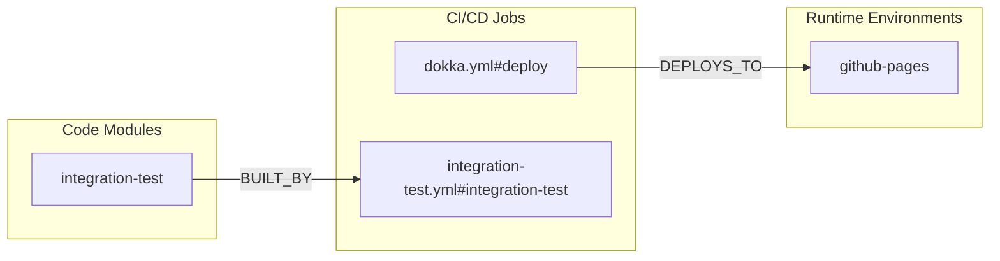
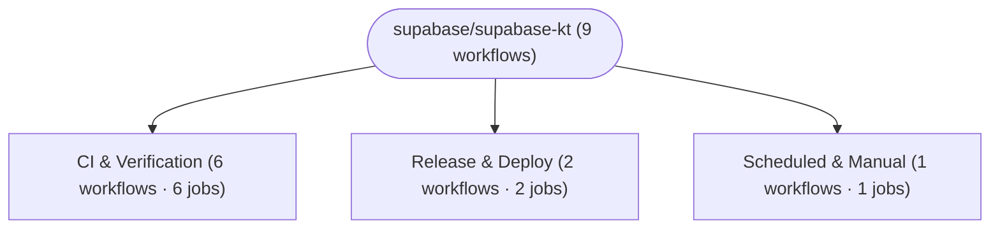

# Repository Architecture Analysis: supabase/supabase-kt

## Metadata
- **SHA**: `4b844142f64512926377cf834e5431c7ae0ff4df`
- **Primary Ecosystem**: Java

## Quality Metrics
- **ast_engine**: fallback
- **avg_cognitive_complexity**: 1.72
- **avg_cyclomatic_complexity**: 6.38
- **component_count**: 0
- **dead_code_count**: 0
- **dead_code_symbols**: 0 entry(ies)
- **duplication_pct**: 78.86
- **file_complexities**: 25 entry(ies)
- **files_analyzed**: 637
- **fitness_passed**: False
- **fitness_violation_count**: 3
- **framework**: Java Maven/Gradle
- **import_edges**: 0 entry(ies)
- **loc**: 41867
- **max_cognitive_complexity**: 106
- **max_cyclomatic_complexity**: 169
- **sloc**: 31134
- **test_file_count**: 13

## 6-Dimension Repository Scorecard

- **Overall Grade**: `F` (37.60/100)
- **Technical Debt Score**: 62.40
- **Estimated Remediation Effort**: 85.37h

| Dimension | Grade | Score | Weight | Details |
| :--- | :---: | :---: | :---: | :--- |
| Code Quality | `F` | 36.48 | 0.20 | avg_cc=6.38, max_cc=169, duplication=78.86%, dead_code=0 |
| Dependency Health | `B` | 85.00 | 0.15 | dependencies=1, outdated=0, vulnerable=0, has_lockfile=False |
| Maintainability | `F` | 47.00 | 0.15 | avg_cognitive=1.72, max_cognitive=106, fitness_violations=3, oversized_files=2 |
| Pipeline Health | `F` | 0.00 | 0.15 | workflows=9, operational_antipatterns=18, parallel_branches=False |
| Security | `F` | 0.00 | 0.20 | vulnerabilities=0, secrets=2, pipeline_security_findings=18 |
| Test Coverage | `C` | 70.00 | 0.15 | coverage=unavailable, ci_test_job=True, test_files_detected=True |

## Architecture Fitness & Workspace Boundaries

- **[MEDIUM] `ATRUSS-ARCH-005` (COMPLEXITY_THRESHOLD)**: Repository duplication_pct (78.86) exceeds policy threshold (15.0).
- **[MEDIUM] `ATRUSS-ARCH-005` (COMPLEXITY_THRESHOLD)**: Repository max_cognitive_complexity (106.0) exceeds policy threshold (25.0).
- **[MEDIUM] `ATRUSS-ARCH-005` (COMPLEXITY_THRESHOLD)**: Repository max_cyclomatic_complexity (169.0) exceeds policy threshold (20.0).

## Supply Chain Dependencies, Vulnerabilities & Secrets

- **Dependencies Parsed**: 1 | **Vulnerabilities**: 0 | **Secrets**: 2

### Secret Findings (Redacted)
- **[HIGH] `ATRUSS-SEC-005`** at `Auth/src/commonTest/kotlin/AuthPasskeyApiTest.kt:169` (`...4YW1wbGUuY29tIn0=","authenticatorData":"SZYN***REDACTED***","signature":"MEQCIB..."}}"""`)
- **[HIGH] `ATRUSS-SEC-005`** at `demos/android-login/common/src/commonMain/kotlin/io/github/jan/supabase/common/di/supabaseModule.kt:18` (`supabaseKey = "eyJh***REDACTED***"`)

### Inventory Sample
- `com.google.accompanist:accompanist-webview` `0.31.1-alpha` (Maven, `demos/android-login/common/build.gradle.kts`)

## Section 7: Code-to-Cloud Deployment Traceability

- `dokka.yml#deploy` (ci_job) --[DEPLOYS_TO]--> `github-pages` (environment)
- `integration-test` (code_module) --[BUILT_BY]--> `integration-test.yml#integration-test` (ci_job)

## CI/CD Pipeline Topology

