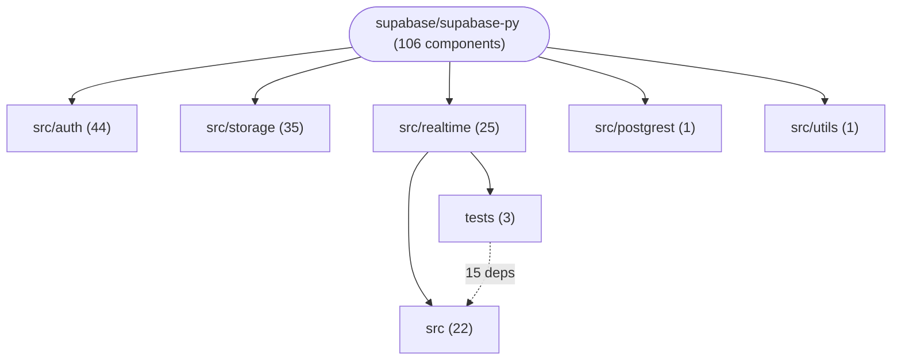
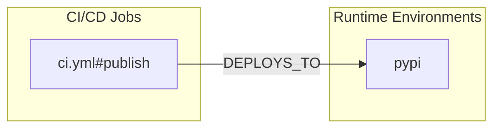
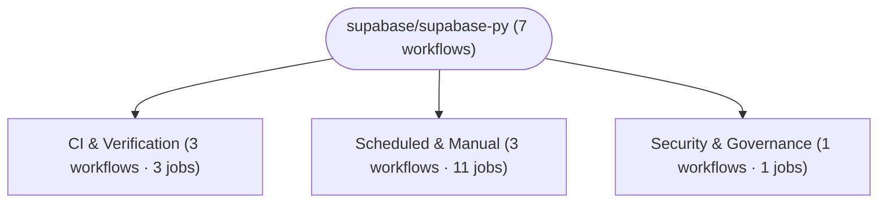

# Repository Architecture Analysis: supabase/supabase-py

## Metadata
- **SHA**: `fd9ff93616616ee5b87aee2893c58c15fc773076`
- **Primary Ecosystem**: Python

## Quality Metrics
- **ast_engine**: tree-sitter
- **avg_cognitive_complexity**: 0.48
- **avg_cyclomatic_complexity**: 1.42
- **component_count**: 106
- **dead_code_count**: 8
- **dead_code_symbols**: 8 entry(ies)
- **duplication_pct**: 86.93
- **file_complexities**: 25 entry(ies)
- **files_analyzed**: 208
- **fitness_passed**: False
- **fitness_violation_count**: 1
- **framework**: Unknown
- **import_edges**: 100 entry(ies)
- **loc**: 42569
- **max_cognitive_complexity**: 19
- **max_cyclomatic_complexity**: 18
- **sloc**: 34458
- **test_file_count**: 138

# Architecture: supabase/supabase-py

## Context
- **Repository**: `supabase/supabase-py`
- **SHA**: `fd9ff93616616ee5b87aee2893c58c15fc773076`
- **Ecosystem**: Python
- **Framework**: Unknown

## Building Block View

## Component Details

Showing top 60 representative components out of 106 across 5 module group(s):

- **Module `src/auth`** (44 components — DATA_ACCESS_LAYER: 44)
- **Module `src/storage`** (35 components — DATA_ACCESS_LAYER: 35)
- **Module `src/realtime`** (25 components — DATA_ACCESS_LAYER: 25)
- **Module `src/postgrest`** (1 components — DATA_ACCESS_LAYER: 1)
- **Module `src/utils`** (1 components — DATA_ACCESS_LAYER: 1)

- **CreateMsgResponse** (`src/realtime/tests/test_connection.py`): DATA_ACCESS_LAYER (deps: BroadcastMessage, ChannelCloseMessage, Message, PostgresChangesMessage, SystemMessage)
- **CreateTodoResponse** (`src/realtime/tests/test_connection.py`): DATA_ACCESS_LAYER (deps: BroadcastMessage, ChannelCloseMessage, Message, PostgresChangesMessage, SystemMessage)
- **SignupMessageResponse** (`src/realtime/tests/test_connection.py`): DATA_ACCESS_LAYER (deps: BroadcastMessage, ChannelCloseMessage, Message, PostgresChangesMessage, SystemMessage)
- **AMREntry** (`src/auth/src/supabase_auth/types.py`): DATA_ACCESS_LAYER
- **APIErrorFromJSON** (`src/postgrest/src/postgrest/exceptions.py`): DATA_ACCESS_LAYER
- **AccessTokenMessage** (`src/realtime/src/realtime/message.py`): DATA_ACCESS_LAYER
- **AccessTokenPayload** (`src/realtime/src/realtime/message.py`): DATA_ACCESS_LAYER
- **AnalyticsBucket** (`src/storage/src/storage3/types.py`): DATA_ACCESS_LAYER
- **AnalyticsBucketDeleteResponse** (`src/storage/src/storage3/types.py`): DATA_ACCESS_LAYER
- **AuthMFAAdminDeleteFactorResponse** (`src/auth/src/supabase_auth/types.py`): DATA_ACCESS_LAYER
- **AuthMFAChallengeResponse** (`src/auth/src/supabase_auth/types.py`): DATA_ACCESS_LAYER
- **AuthMFAEnrollResponse** (`src/auth/src/supabase_auth/types.py`): DATA_ACCESS_LAYER
- **AuthMFAEnrollResponseTotp** (`src/auth/src/supabase_auth/types.py`): DATA_ACCESS_LAYER
- **AuthMFAGetAuthenticatorAssuranceLevelResponse** (`src/auth/src/supabase_auth/types.py`): DATA_ACCESS_LAYER
- **AuthMFAListFactorsResponse** (`src/auth/src/supabase_auth/types.py`): DATA_ACCESS_LAYER
- **AuthMFAUnenrollResponse** (`src/auth/src/supabase_auth/types.py`): DATA_ACCESS_LAYER
- **AuthMFAVerifyResponse** (`src/auth/src/supabase_auth/types.py`): DATA_ACCESS_LAYER
- **AuthOtpResponse** (`src/auth/src/supabase_auth/types.py`): DATA_ACCESS_LAYER
- **AuthResponse** (`src/auth/src/supabase_auth/types.py`): DATA_ACCESS_LAYER
- **BroadcastMessage** (`src/realtime/src/realtime/message.py`): DATA_ACCESS_LAYER
- **Bucket** (`src/storage/src/storage3/types.py`): DATA_ACCESS_LAYER
- **BucketName** (`src/storage/src/storage3/types.py`): DATA_ACCESS_LAYER
- **CaptchaToken** (`src/auth/src/supabase_auth/types.py`): DATA_ACCESS_LAYER
- **ChannelCloseMessage** (`src/realtime/src/realtime/message.py`): DATA_ACCESS_LAYER
- **ChannelErrorMessage** (`src/realtime/src/realtime/message.py`): DATA_ACCESS_LAYER
- **ChannelLeaveMessage** (`src/realtime/src/realtime/message.py`): DATA_ACCESS_LAYER
- **CreateOAuthClientParams** (`src/auth/src/supabase_auth/types.py`): DATA_ACCESS_LAYER
- **CreateOrUpdateBucketBody** (`src/storage/src/storage3/types.py`): DATA_ACCESS_LAYER
- **CreateSignedUrlBody** (`src/storage/src/storage3/types.py`): DATA_ACCESS_LAYER
- **CreateSignedUrlsBody** (`src/storage/src/storage3/types.py`): DATA_ACCESS_LAYER
- **ErrorReplyMessage** (`src/realtime/src/realtime/message.py`): DATA_ACCESS_LAYER
- **ErrorSystemPayload** (`src/realtime/src/realtime/message.py`): DATA_ACCESS_LAYER
- **Factor** (`src/auth/src/supabase_auth/types.py`): DATA_ACCESS_LAYER
- **FileObject** (`src/storage/src/storage3/types.py`): DATA_ACCESS_LAYER
- **GenerateLinkBody** (`src/auth/src/supabase_auth/types.py`): DATA_ACCESS_LAYER
- **GenerateLinkParams** (`src/auth/src/supabase_auth/types.py`): DATA_ACCESS_LAYER
- **GenerateLinkProperties** (`src/auth/src/supabase_auth/types.py`): DATA_ACCESS_LAYER
- **GenerateLinkResponse** (`src/auth/src/supabase_auth/types.py`): DATA_ACCESS_LAYER
- **GetVectorBucketResponse** (`src/storage/src/storage3/types.py`): DATA_ACCESS_LAYER
- **GetVectorIndexResponse** (`src/storage/src/storage3/types.py`): DATA_ACCESS_LAYER
- **GetVectorsResponse** (`src/storage/src/storage3/types.py`): DATA_ACCESS_LAYER
- **HeartbeatMessage** (`src/realtime/src/realtime/message.py`): DATA_ACCESS_LAYER
- **HeartbeatPayload** (`src/realtime/src/realtime/message.py`): DATA_ACCESS_LAYER
- **IdentitiesResponse** (`src/auth/src/supabase_auth/types.py`): DATA_ACCESS_LAYER
- **Item** (`src/utils/tests/test_request.py`): DATA_ACCESS_LAYER
- **JWK** (`src/auth/src/supabase_auth/types.py`): DATA_ACCESS_LAYER
- **JWKSet** (`src/auth/src/supabase_auth/types.py`): DATA_ACCESS_LAYER
- **JWTHeader** (`src/auth/src/supabase_auth/types.py`): DATA_ACCESS_LAYER
- **JWTPayload** (`src/auth/src/supabase_auth/types.py`): DATA_ACCESS_LAYER
- **JoinMessage** (`src/realtime/src/realtime/message.py`): DATA_ACCESS_LAYER
- **LinkIdentityResponse** (`src/auth/src/supabase_auth/types.py`): DATA_ACCESS_LAYER
- **ListBody** (`src/storage/src/storage3/types.py`): DATA_ACCESS_LAYER
- **ListFileObject** (`src/storage/src/storage3/types.py`): DATA_ACCESS_LAYER
- **ListIndexesResponseItem** (`src/storage/src/storage3/types.py`): DATA_ACCESS_LAYER
- **ListVectorBucketsItem** (`src/storage/src/storage3/types.py`): DATA_ACCESS_LAYER
- **ListVectorBucketsResponse** (`src/storage/src/storage3/types.py`): DATA_ACCESS_LAYER
- **ListVectorIndexesResponse** (`src/storage/src/storage3/types.py`): DATA_ACCESS_LAYER
- **ListVectorsResponse** (`src/storage/src/storage3/types.py`): DATA_ACCESS_LAYER
- **MFAEnrollPhoneParams** (`src/auth/src/supabase_auth/types.py`): DATA_ACCESS_LAYER
- **MFAEnrollTOTPParams** (`src/auth/src/supabase_auth/types.py`): DATA_ACCESS_LAYER

## 6-Dimension Repository Scorecard

- **Overall Grade**: `D` (62.10/100)
- **Technical Debt Score**: 37.90
- **Estimated Remediation Effort**: 57.86h

| Dimension | Grade | Score | Weight | Details |
| :--- | :---: | :---: | :---: | :--- |
| Code Quality | `F` | 54.50 | 0.20 | avg_cc=1.42, max_cc=18, duplication=86.93%, dead_code=8 |
| Dependency Health | `A` | 100.00 | 0.15 | dependencies=193, outdated=0, vulnerable=0, has_lockfile=True |
| Maintainability | `C` | 74.00 | 0.15 | avg_cognitive=0.48, max_cognitive=19, fitness_violations=1, oversized_files=8 |
| Pipeline Health | `D` | 60.00 | 0.15 | workflows=7, operational_antipatterns=14, parallel_branches=True |
| Security | `F` | 28.00 | 0.20 | vulnerabilities=0, secrets=4, pipeline_security_findings=0 |
| Test Coverage | `C` | 70.00 | 0.15 | coverage=unavailable, ci_test_job=True, test_files_detected=True |

## Architecture Fitness & Workspace Boundaries

- **[MEDIUM] `ATRUSS-ARCH-005` (COMPLEXITY_THRESHOLD)**: Repository duplication_pct (86.93) exceeds policy threshold (15.0).

### Workspace Packages
- **supabase_auth** (`src/auth`, python, uv) -> internal deps: `supabase_utils`
- **supabase_functions** (`src/functions`, python, uv) -> internal deps: `supabase_utils`
- **postgrest** (`src/postgrest`, python, uv) -> internal deps: `supabase_utils`
- **realtime** (`src/realtime`, python, uv) -> internal deps: `supabase_utils`
- **storage3** (`src/storage`, python, uv) -> internal deps: `supabase_utils`
- **supabase** (`src/supabase`, python, uv) -> internal deps: `postgrest, realtime, storage3, supabase_auth, supabase_functions, supabase_utils`
- **supabase_utils** (`src/utils`, python, uv)

## Supply Chain Dependencies, Vulnerabilities & Secrets

- **Dependencies Parsed**: 193 | **Vulnerabilities**: 0 | **Secrets**: 4

### Secret Findings (Redacted)
- **[HIGH] `ATRUSS-SEC-005`** at `src/functions/tests/_async/test_function_client.py:83` (`valid_token = "eyJh***REDACTED***"`)
- **[HIGH] `ATRUSS-SEC-005`** at `src/functions/tests/_sync/test_function_client.py:83` (`valid_token = "eyJh***REDACTED***"`)
- **[HIGH] `ATRUSS-SEC-005`** at `src/storage/tests/tests.env:2` (`SUPABASE_TEST_KEY="eyJh***REDACTED***"`)
- **[HIGH] `ATRUSS-SEC-005`** at `src/supabase/tests/tests.env:1` (`SUPABASE_TEST_KEY="eyJh***REDACTED***"`)

### Inventory Sample
- `Faker` `37.4.0` (PyPI, `src/auth/pyproject.toml`)
- `aiohttp` `3.14.4` (PyPI, `src/realtime/pyproject.toml`)
- `aiohttp` `3.14.4` (PyPI, `src/utils/pyproject.toml`)
- `httpx` `0.28` (PyPI, `src/utils/pyproject.toml`)
- `mypy` `2.4.1` (PyPI, `src/postgrest/pyproject.toml`)
- `postgrest` `3.0.0-a1` (PyPI, `src/supabase/pyproject.toml`)
- `pudb` `2025.1.5` (PyPI, `src/realtime/pyproject.toml`)
- `pydantic` `2` (PyPI, `src/auth/pyproject.toml`)
- `pydantic` `2` (PyPI, `src/postgrest/pyproject.toml`)
- `pydantic` `2.11.7` (PyPI, `src/realtime/pyproject.toml`)
- `pydantic` `2.11.7` (PyPI, `src/storage/pyproject.toml`)
- `pydantic` `2.12.2` (PyPI, `src/functions/pyproject.toml`)
- `pydantic` `2.12.2` (PyPI, `src/utils/pyproject.toml`)
- `pyiceberg` `0.11.0` (PyPI, `src/storage/pyproject.toml`)
- `pyjwt` `2.15.1` (PyPI, `src/auth/pyproject.toml`)
- `pyjwt` `2.15.1` (PyPI, `src/functions/pyproject.toml`)
- `pyotp` `2.9.0` (PyPI, `src/auth/pyproject.toml`)
- `pyrefly` `1.4.0` (PyPI, `src/auth/pyproject.toml`)
- `pyrefly` `1.4.0` (PyPI, `src/functions/pyproject.toml`)
- `pyrefly` `1.4.0` (PyPI, `src/postgrest/pyproject.toml`)
- `pyrefly` `1.4.0` (PyPI, `src/realtime/pyproject.toml`)
- `pyrefly` `1.4.0` (PyPI, `src/storage/pyproject.toml`)
- `pyrefly` `1.4.0` (PyPI, `src/supabase/pyproject.toml`)
- `pyrefly` `1.4.0` (PyPI, `src/utils/pyproject.toml`)
- `pyright` `1.1.414` (PyPI, `src/postgrest/pyproject.toml`)
- `pyrsistent` `0.20.0` (PyPI, `src/utils/pyproject.toml`)
- `pytest` `9.0.3` (PyPI, `src/auth/pyproject.toml`)
- `pytest` `9.0.3` (PyPI, `src/functions/pyproject.toml`)
- `pytest` `9.0.3` (PyPI, `src/postgrest/pyproject.toml`)
- `pytest` `9.0.3` (PyPI, `src/realtime/pyproject.toml`)
- ... (+163 more dependencies)

## Section 7: Code-to-Cloud Deployment Traceability

- `ci.yml#publish` (ci_job) --[DEPLOYS_TO]--> `pypi` (environment)

## CI/CD Pipeline Topology

