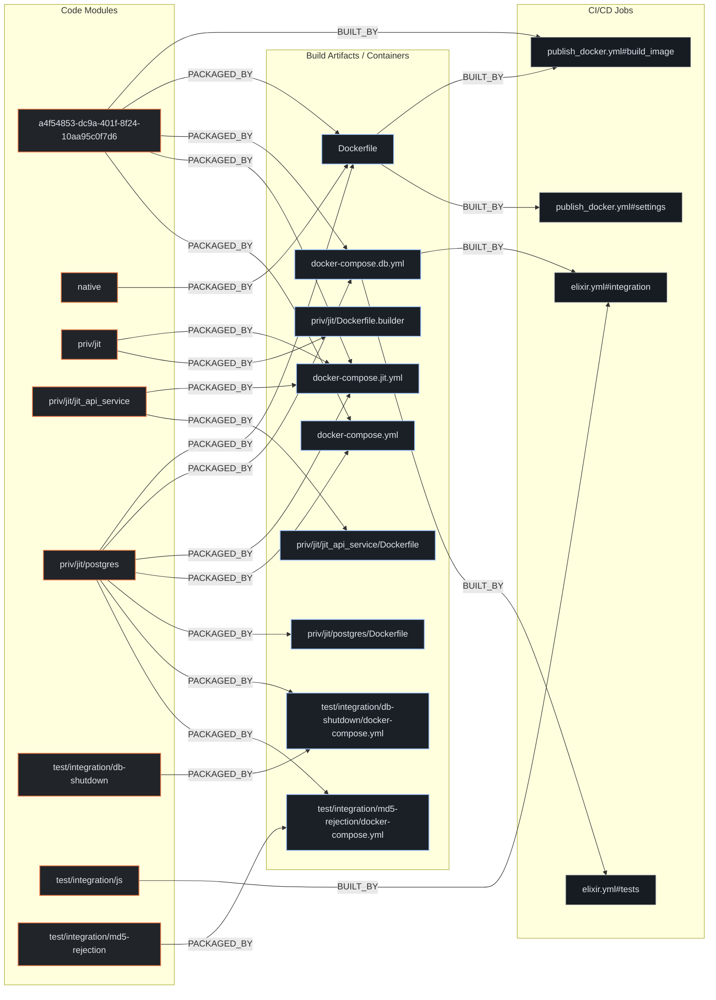

# Repository Architecture Analysis: supabase/supavisor

## Metadata
- **SHA**: `e59909dc629230a4c07af3df16957ef22a184774`
- **Primary Ecosystem**: Elixir

## Quality Metrics
- **ast_engine**: tree-sitter
- **avg_cognitive_complexity**: 2.67
- **avg_cyclomatic_complexity**: 2.73
- **component_count**: 254
- **dead_code_count**: 1
- **dead_code_symbols**: 1 entry(ies)
- **duplication_pct**: 4.31
- **file_complexities**: 4 entry(ies)
- **files_analyzed**: 348
- **fitness_passed**: True
- **fitness_violation_count**: 0
- **framework**: Phoenix
- **import_edges**: 18 entry(ies)
- **loc**: 51168
- **max_cognitive_complexity**: 23
- **max_cyclomatic_complexity**: 16
- **sloc**: 39911
- **test_file_count**: 153

# Architecture: supabase/supavisor

## Context
- **Repository**: `supabase/supavisor`
- **SHA**: `e59909dc629230a4c07af3df16957ef22a184774`
- **Ecosystem**: Elixir
- **Framework**: Phoenix

## Building Block View

```mermaid
graph TD;
  classDef atlasRoot fill:#004882,stroke:#a3c9ff,stroke-width:2px,color:#d3e4ff
  classDef atlasCategory fill:#212428,stroke:#E87A48,stroke-width:1.5px,color:#dfe3eb
  classDef atlasWorkflow fill:#1b2026,stroke:#a3c9ff,stroke-width:1.5px,color:#dfe3eb
  classDef atlasJob fill:#171c22,stroke:#8d9199,stroke-width:1px,color:#dfe3eb
  classDef atlasTarget fill:#005227,stroke:#8bd99b,stroke-width:1.5px,color:#a7f6b6
  classDef atlasAlert fill:#93000a,stroke:#ffb4ab,stroke-width:1.5px,color:#ffdad6
  classDef atlasMore fill:#252a31,stroke:#8d9199,stroke-dasharray:4 4,color:#c3c6cf
    repo_root(["supabase/supavisor (254 components)"]):::atlasRoot
    subgraph sg_dir_0_lib["lib (178)"]
      direction TB
      dir_0_lib["lib (178)"]:::atlasCategory
      sub_0_0_supavisor["supavisor (149)"]:::atlasWorkflow
      dir_0_lib --> sub_0_0_supavisor
      sub_0_1_supavisor_web["supavisor_web (24)"]:::atlasWorkflow
      dir_0_lib --> sub_0_1_supavisor_web
      sub_0_2__module_root_["(module root) (2)"]:::atlasWorkflow
      dir_0_lib --> sub_0_2__module_root_
      sub_0_more["+2 more submodules (3)"]:::atlasMore
      dir_0_lib --> sub_0_more
    end
    repo_root --> dir_0_lib
    subgraph sg_dir_1_test["test (32)"]
      direction TB
      dir_1_test["test (32)"]:::atlasCategory
      sub_1_0_integration["integration (29)"]:::atlasWorkflow
      dir_1_test --> sub_1_0_integration
      sub_1_1__module_root_["(module root) (3)"]:::atlasWorkflow
      dir_1_test --> sub_1_1__module_root_
    end
    repo_root --> dir_1_test
    subgraph sg_dir_2_priv["priv (30)"]
      direction TB
      dir_2_priv["priv (30)"]:::atlasCategory
      sub_2_0_repo_migrations["repo/migrations (27)"]:::atlasWorkflow
      dir_2_priv --> sub_2_0_repo_migrations
      sub_2_1_repo["repo (3)"]:::atlasWorkflow
      dir_2_priv --> sub_2_1_repo
    end
    repo_root --> dir_2_priv
    dir_3_config["config (5)"]:::atlasCategory
    repo_root --> dir_3_config
    dir_4__root_["(root) (4)"]:::atlasCategory
    repo_root --> dir_4__root_
    dir_other_modules["+2 more modules (5)"]:::atlasMore
    repo_root --> dir_other_modules
```

## Component Details

Showing top 60 representative components out of 254 across 7 module group(s):

- **Module `lib`** (178 components — module: 178)
- **Module `test`** (32 components — module: 31, MODULE: 1)
- **Module `priv`** (30 components — module: 30)
- **Module `config`** (5 components — module: 5)
- **Module `(root)`** (4 components — module: 4)
- **Module `bench`** (4 components — module: 4)
- **Module `native`** (1 components — module: 1)

- **.credo** (`.credo.exs`): module
- **.dialyzer_ignore** (`.dialyzer_ignore.exs`): module
- **.formatter** (`.formatter.exs`): module
- **.formatter** (`priv/repo/migrations/.formatter.exs`): module
- **.formatter** (`test/.formatter.exs`): module
- **20230125140723_create_tenants** (`priv/repo/migrations/20230125140723_create_tenants.exs`): module
- **20230418151441_create_users** (`priv/repo/migrations/20230418151441_create_users.exs`): module
- **20230502101623_add_timeout_to_users** (`priv/repo/migrations/20230502101623_add_timeout_to_users.exs`): module
- **20230601125553_add_tenant_pg_version** (`priv/repo/migrations/20230601125553_add_tenant_pg_version.exs`): module
- **20230619091028_add_tenant_ip_version** (`priv/repo/migrations/20230619091028_add_tenant_ip_version.exs`): module
- **20230705154938_add_upstream_ssl_opts** (`priv/repo/migrations/20230705154938_add_upstream_ssl_opts.exs`): module
- **20230711142028_add_enforce_ssl** (`priv/repo/migrations/20230711142028_add_enforce_ssl.exs`): module
- **20230714153019_add_auth_query** (`priv/repo/migrations/20230714153019_add_auth_query.exs`): module
- **20230718175315_add_sni_host** (`priv/repo/migrations/20230718175315_add_sni_host.exs`): module
- **20230801090256_add_user_max_clients** (`priv/repo/migrations/20230801090256_add_user_max_clients.exs`): module
- **20230801090942_add_tenant_def_max_clients** (`priv/repo/migrations/20230801090942_add_tenant_def_max_clients.exs`): module
- **20230914102712_add_client_idle_timeout** (`priv/repo/migrations/20230914102712_add_client_idle_timeout.exs`): module
- **20230919091334_create_clusters** (`priv/repo/migrations/20230919091334_create_clusters.exs`): module
- **20230919100141_create_cluster_tenants** (`priv/repo/migrations/20230919100141_create_cluster_tenants.exs`): module
- **20231004133121_add_default_pool_strategy** (`priv/repo/migrations/20231004133121_add_default_pool_strategy.exs`): module
- **20231214120555_add_heartbeat_interval** (`priv/repo/migrations/20231214120555_add_heartbeat_interval.exs`): module
- **20231229010413_add_tenant_allow_list** (`priv/repo/migrations/20231229010413_add_tenant_allow_list.exs`): module
- **20240822132419_add_availability_zone** (`priv/repo/migrations/20240822132419_add_availability_zone.exs`): module
- **20250811122429_add_tenant_use_it** (`priv/repo/migrations/20250811122429_add_tenant_use_it.exs`): module
- **20250812153752_add_feature_flags_to_tenants** (`priv/repo/migrations/20250812153752_add_feature_flags_to_tenants.exs`): module
- **20260307125522_add_users_tenant_external_id_index** (`priv/repo/migrations/20260307125522_add_users_tenant_external_id_index.exs`): module
- **20260323000000_add_tenant_ban_fields** (`priv/repo/migrations/20260323000000_add_tenant_ban_fields.exs`): module
- **20260722000000_add_txn_mode_leak_action** (`priv/repo/migrations/20260722000000_add_txn_mode_leak_action.exs`): module
- **20260722000001_validate_txn_mode_leak_action** (`priv/repo/migrations/20260722000001_validate_txn_mode_leak_action.exs`): module
- **20261007150223_add_server_reset_query** (`priv/repo/migrations/20261007150223_add_server_reset_query.exs`): module
- **20261014000000_add_tenant_log_connections** (`priv/repo/migrations/20261014000000_add_tenant_log_connections.exs`): module
- **address_not_allowed_error** (`lib/supavisor/errors/address_not_allowed_error.ex`): module
- **alg_fixup_middleware** (`lib/supavisor/jwt/jwks/alg_fixup_middleware.ex`): module
- **api_spec** (`lib/supavisor_web/api_spec.ex`): module
- **application** (`lib/supavisor/application.ex`): module
- **atomics** (`lib/supavisor/peep_storage/atomics.ex`): module
- **auth_methods** (`lib/supavisor/client_handler/auth_methods.ex`): module
- **auth_protocol_error** (`lib/supavisor/errors/auth_protocol_error.ex`): module
- **auth_query** (`lib/supavisor/auth_query.ex`): module
- **auth_query_error** (`lib/supavisor/errors/auth_query_error.ex`): module
- **auth_secrets_error** (`lib/supavisor/errors/auth_secrets_error.ex`): module
- **auth_timeout_error** (`lib/supavisor/errors/auth_timeout_error.ex`): module
- **backend_connection** (`lib/supavisor/protocol/backend_connection.ex`): module
- **backend_storage** (`lib/supavisor/protocol/prepared_statements/backend_storage.ex`): module
- **cancel** (`lib/supavisor/client_handler/cancel.ex`): module
- **cgroup** (`lib/supavisor/monitoring/cgroup.ex`): module
- **changeset_json** (`lib/supavisor_web/controllers/changeset_json.ex`): module
- **changeset_view** (`lib/supavisor_web/views/changeset_view.ex`): module
- **check_ready** (`bench/check_ready.exs`): module
- **checkout_error** (`lib/supavisor/errors/checkout_error.ex`): module
- **checkout_retries_exhausted_error** (`lib/supavisor/errors/checkout_retries_exhausted_error.ex`): module
- **checkout_timeout_error** (`lib/supavisor/errors/checkout_timeout_error.ex`): module
- **checks** (`lib/supavisor/client_handler/checks.ex`): module
- **circuit_breaker** (`bench/circuit_breaker.exs`): module
- **circuit_breaker** (`lib/supavisor/circuit_breaker.ex`): module
- **circuit_breaker_cluster_test** (`test/integration/circuit_breaker_cluster_test.exs`): module
- **circuit_breaker_error** (`lib/supavisor/errors/circuit_breaker_error.ex`): module
- **client** (`lib/supavisor/protocol/client.ex`): module
- **client_authentication** (`lib/supavisor/client_authentication.ex`): module
- **client_authentication_test** (`test/integration/client_authentication_test.exs`): module

## 6-Dimension Repository Scorecard

- **Overall Grade**: `F` (57.08/100)
- **Technical Debt Score**: 42.92
- **Estimated Remediation Effort**: 53.84h

| Dimension | Grade | Score | Weight | Details |
| :--- | :---: | :---: | :---: | :--- |
| Code Quality | `A` | 90.03 | 0.20 | avg_cc=2.73, max_cc=16, duplication=4.31%, dead_code=1 |
| Dependency Health | `A` | 100.00 | 0.15 | dependencies=141, outdated=0, vulnerable=0, has_lockfile=True |
| Maintainability | `A` | 90.50 | 0.15 | avg_cognitive=2.67, max_cognitive=23, fitness_violations=0, oversized_files=1 |
| Pipeline Health | `F` | 0.00 | 0.15 | workflows=7, operational_antipatterns=22, parallel_branches=True |
| Security | `F` | 0.00 | 0.20 | vulnerabilities=0, secrets=9, pipeline_security_findings=4 |
| Test Coverage | `C` | 70.00 | 0.15 | coverage=unavailable, ci_test_job=True, test_files_detected=True |

## Supply Chain Dependencies, Vulnerabilities & Secrets

- **Dependencies Parsed**: 141 | **Vulnerabilities**: 0 | **Secrets**: 9

### Secret Findings (Redacted)
- **[HIGH] `ATRUSS-SEC-005`** at `config/config.exs:29` (`secret_key_base: "ktyW***REDACTED***",`)
- **[CRITICAL] `ATRUSS-SEC-004`** at `priv/test/certs/ca.key:1` (`-----BEGIN ... PRIVATE KEY----- [REDACTED]`)
- **[CRITICAL] `ATRUSS-SEC-004`** at `priv/test/certs/ca_v2.key:1` (`-----BEGIN ... PRIVATE KEY----- [REDACTED]`)
- **[CRITICAL] `ATRUSS-SEC-004`** at `priv/test/certs/server.key:1` (`-----BEGIN ... PRIVATE KEY----- [REDACTED]`)
- **[CRITICAL] `ATRUSS-SEC-004`** at `priv/test/certs/server_ecdsa.key:4` (`-----BEGIN ... PRIVATE KEY----- [REDACTED]`)
- **[CRITICAL] `ATRUSS-SEC-004`** at `priv/test/certs/server_eddsa.key:1` (`-----BEGIN ... PRIVATE KEY----- [REDACTED]`)
- **[CRITICAL] `ATRUSS-SEC-004`** at `priv/test/certs/server_rsa.key:1` (`-----BEGIN ... PRIVATE KEY----- [REDACTED]`)
- **[CRITICAL] `ATRUSS-SEC-004`** at `priv/test/certs/server_v2_ecdsa.key:4` (`-----BEGIN ... PRIVATE KEY----- [REDACTED]`)
- **[CRITICAL] `ATRUSS-SEC-004`** at `priv/test/certs/server_v2_rsa.key:1` (`-----BEGIN ... PRIVATE KEY----- [REDACTED]`)

### Inventory Sample
- `pg_query` `6.2` (cargo, `native/pgparser/Cargo.toml`)
- `rustler` `0.36.1` (cargo, `native/pgparser/Cargo.toml`)
- `benchee` `1.3` (hex, `mix.exs`)
- `cachex` `3.6` (hex, `mix.exs`)
- `cloak_ecto` `1.3.0` (hex, `mix.exs`)
- `credo` `1.7` (hex, `mix.exs`)
- `dialyxir` `1.4` (hex, `mix.exs`)
- `distillery` `2.1` (hex, `mix.exs`)
- `ecto_sql` `3.10` (hex, `mix.exs`)
- `eflambe` `0.3.1` (hex, `mix.exs`)
- `excoveralls` `0.0.0` (hex, `mix.exs`)
- `inet_cidr` `1.0.0` (hex, `mix.exs`)
- `joken` `2.7.0` (hex, `mix.exs`)
- `joken_jwks` `1.8` (hex, `mix.exs`)
- `libcluster` `3.5` (hex, `mix.exs`)
- `meck` `1.0` (hex, `mix.exs`)
- `mint` `1.9.3` (hex, `mix.exs`)
- `mix_audit` `2.1` (hex, `mix.exs`)
- `observer_cli` `1.7` (hex, `mix.exs`)
- `open_api_spex` `3.16` (hex, `mix.exs`)
- `peep` `4.4.0` (hex, `mix.exs`)
- `pgo` `0.13` (hex, `mix.exs`)
- `phoenix` `1.7.2` (hex, `mix.exs`)
- `phoenix_ecto` `4.4` (hex, `mix.exs`)
- `phoenix_live_dashboard` `0.7` (hex, `mix.exs`)
- `phoenix_live_view` `1.0` (hex, `mix.exs`)
- `phoenix_view` `2.0.2` (hex, `mix.exs`)
- `plug_cowboy` `2.5` (hex, `mix.exs`)
- `poolboy` `1.5.2` (hex, `mix.exs`)
- `prom_ex` `1.10` (hex, `mix.exs`)
- ... (+111 more dependencies)

## Section 7: Code-to-Cloud Deployment Traceability

- `a4f54853-dc9a-401f-8f24-10aa95c0f7d6` (code_module) --[BUILT_BY]--> `publish_docker.yml#build_image` (ci_job)
- `a4f54853-dc9a-401f-8f24-10aa95c0f7d6` (code_module) --[PACKAGED_BY]--> `Dockerfile` (container)
- `a4f54853-dc9a-401f-8f24-10aa95c0f7d6` (code_module) --[PACKAGED_BY]--> `docker-compose.db.yml` (container)
- `a4f54853-dc9a-401f-8f24-10aa95c0f7d6` (code_module) --[PACKAGED_BY]--> `docker-compose.jit.yml` (container)
- `a4f54853-dc9a-401f-8f24-10aa95c0f7d6` (code_module) --[PACKAGED_BY]--> `docker-compose.yml` (container)
- `native` (code_module) --[PACKAGED_BY]--> `Dockerfile` (container)
- `priv/jit` (code_module) --[PACKAGED_BY]--> `docker-compose.jit.yml` (container)
- `priv/jit` (code_module) --[PACKAGED_BY]--> `priv/jit/Dockerfile.builder` (container)
- `priv/jit/jit_api_service` (code_module) --[PACKAGED_BY]--> `docker-compose.jit.yml` (container)
- `priv/jit/jit_api_service` (code_module) --[PACKAGED_BY]--> `priv/jit/jit_api_service/Dockerfile` (container)
- `priv/jit/postgres` (code_module) --[PACKAGED_BY]--> `Dockerfile` (container)
- `priv/jit/postgres` (code_module) --[PACKAGED_BY]--> `docker-compose.db.yml` (container)
- `priv/jit/postgres` (code_module) --[PACKAGED_BY]--> `docker-compose.jit.yml` (container)
- `priv/jit/postgres` (code_module) --[PACKAGED_BY]--> `docker-compose.yml` (container)
- `priv/jit/postgres` (code_module) --[PACKAGED_BY]--> `priv/jit/postgres/Dockerfile` (container)
- `priv/jit/postgres` (code_module) --[PACKAGED_BY]--> `test/integration/db-shutdown/docker-compose.yml` (container)
- `priv/jit/postgres` (code_module) --[PACKAGED_BY]--> `test/integration/md5-rejection/docker-compose.yml` (container)
- `test/integration/db-shutdown` (code_module) --[PACKAGED_BY]--> `test/integration/db-shutdown/docker-compose.yml` (container)
- `test/integration/js` (code_module) --[BUILT_BY]--> `elixir.yml#integration` (ci_job)
- `test/integration/md5-rejection` (code_module) --[PACKAGED_BY]--> `test/integration/md5-rejection/docker-compose.yml` (container)
- `Dockerfile` (container) --[BUILT_BY]--> `publish_docker.yml#build_image` (ci_job)
- `Dockerfile` (container) --[BUILT_BY]--> `publish_docker.yml#settings` (ci_job)
- `docker-compose.db.yml` (container) --[BUILT_BY]--> `elixir.yml#integration` (ci_job)
- `docker-compose.db.yml` (container) --[BUILT_BY]--> `elixir.yml#tests` (ci_job)

## CI/CD Pipeline Topology

```mermaid
graph TD;
  classDef atlasRoot fill:#004882,stroke:#a3c9ff,stroke-width:2px,color:#d3e4ff
  classDef atlasCategory fill:#212428,stroke:#E87A48,stroke-width:1.5px,color:#dfe3eb
  classDef atlasWorkflow fill:#1b2026,stroke:#a3c9ff,stroke-width:1.5px,color:#dfe3eb
  classDef atlasJob fill:#171c22,stroke:#8d9199,stroke-width:1px,color:#dfe3eb
  classDef atlasTarget fill:#005227,stroke:#8bd99b,stroke-width:1.5px,color:#a7f6b6
  classDef atlasAlert fill:#93000a,stroke:#ffb4ab,stroke-width:1.5px,color:#ffdad6
  classDef atlasMore fill:#252a31,stroke:#8d9199,stroke-dasharray:4 4,color:#c3c6cf
  pipeline_root(["supabase/supavisor (7 workflows)"]):::atlasRoot
  subgraph sg_grp_0_Release___Deploy["Release & Deploy (4 workflows · 7 jobs)"]
    direction TB
    subgraph sg_wf_0_Dispatch_base_artifact_build["Dispatch base artifact build (1 jobs)"]
      direction TB
      wf_0_Dispatch_base_artifact_build(["Trigger: Dispatch base artifact build"]):::atlasWorkflow
      job_0_dispatch["dispatch"]:::atlasJob
      wf_0_Dispatch_base_artifact_build --> job_0_dispatch
    end
    pipeline_root --> wf_0_Dispatch_base_artifact_build
    subgraph sg_wf_1_Dispatch_continuous_deploy["Dispatch continuous deploy (1 jobs)"]
      direction TB
      wf_1_Dispatch_continuous_deploy(["Trigger: Dispatch continuous deploy"]):::atlasWorkflow
      job_1_dispatch["dispatch"]:::atlasJob
      wf_1_Dispatch_continuous_deploy --> job_1_dispatch
    end
    pipeline_root --> wf_1_Dispatch_continuous_deploy
    subgraph sg_wf_2_Publish_docs["Publish docs (1 jobs)"]
      direction TB
      wf_2_Publish_docs(["Trigger: Publish docs"]):::atlasWorkflow
      job_2_deploy["deploy"]:::atlasJob
      wf_2_Publish_docs --> job_2_deploy
    end
    pipeline_root --> wf_2_Publish_docs
    subgraph sg_wf_5_Release_on_Dockerhub["Release on Dockerhub (4 jobs)"]
      direction TB
      wf_5_Release_on_Dockerhub(["Trigger: Release on Dockerhub"]):::atlasWorkflow
      job_5_settings["settings"]:::atlasJob
      job_5_build_image["build_image"]:::atlasJob
      job_5_merge_manifest["merge_manifest"]:::atlasJob
      wf_5_Release_on_Dockerhub --> job_5_settings
      job_5_settings --> job_5_build_image
      job_5_settings --> job_5_merge_manifest
      job_5_build_image --> job_5_merge_manifest
    end
    pipeline_root --> wf_5_Release_on_Dockerhub
  end
  subgraph sg_grp_1_CI___Verification["CI & Verification (1 workflows · 7 jobs)"]
    direction TB
    subgraph sg_wf_3_Elixir_tests["Elixir tests (7 jobs)"]
      direction TB
      wf_3_Elixir_tests(["Trigger: Elixir tests"]):::atlasWorkflow
      job_3_deps["deps"]:::atlasJob
      job_3_format["format"]:::atlasJob
      job_3_credo["credo"]:::atlasJob
      wf_3_Elixir_tests --> job_3_deps
      job_3_deps --> job_3_format
      job_3_deps --> job_3_credo
    end
    pipeline_root --> wf_3_Elixir_tests
  end
  subgraph sg_grp_2_Scheduled___Manual["Scheduled & Manual (1 workflows · 1 jobs)"]
    direction TB
    subgraph sg_wf_4_Mirror_Image["Mirror Image (1 jobs)"]
      direction TB
      wf_4_Mirror_Image(["Trigger: Mirror Image"]):::atlasWorkflow
      job_4_mirror["mirror"]:::atlasJob
      wf_4_Mirror_Image --> job_4_mirror
    end
    pipeline_root --> wf_4_Mirror_Image
  end
  subgraph sg_grp_3_Security___Governance["Security & Governance (1 workflows · 3 jobs)"]
    direction TB
    subgraph sg_wf_6_Security_checks["Security checks (3 jobs)"]
      direction TB
      wf_6_Security_checks(["Trigger: Security checks"]):::atlasWorkflow
      job_6_deps["deps"]:::atlasJob
      job_6_audit["audit"]:::atlasJob
      job_6_sobelow["sobelow"]:::atlasJob
      wf_6_Security_checks --> job_6_deps
      job_6_deps --> job_6_audit
      job_6_deps --> job_6_sobelow
    end
    pipeline_root --> wf_6_Security_checks
  end
```

