# Repository Architecture Analysis: supabase/wrappers

## Metadata
- **SHA**: `e4397456efd345663f1386852a24275851113d9d`
- **Primary Ecosystem**: Rust

## Quality Metrics
- **ast_engine**: tree-sitter
- **avg_cognitive_complexity**: 11.25
- **avg_cyclomatic_complexity**: 6.5
- **component_count**: 144
- **dead_code_count**: 0
- **dead_code_symbols**: 0 entry(ies)
- **duplication_pct**: 0.03
- **file_complexities**: 2 entry(ies)
- **files_analyzed**: 143
- **fitness_passed**: True
- **fitness_violation_count**: 0
- **framework**: Rust Cargo
- **import_edges**: 14 entry(ies)
- **loc**: 60500
- **max_cognitive_complexity**: 22
- **max_cyclomatic_complexity**: 13
- **sloc**: 49001
- **test_file_count**: 21

# Architecture: supabase/wrappers

## Context
- **Repository**: `supabase/wrappers`
- **SHA**: `e4397456efd345663f1386852a24275851113d9d`
- **Ecosystem**: Rust
- **Framework**: Rust Cargo

## Building Block View

```mermaid
graph TD;
  classDef atlasRoot fill:#004882,stroke:#a3c9ff,stroke-width:2px,color:#d3e4ff
  classDef atlasCategory fill:#212428,stroke:#E87A48,stroke-width:1.5px,color:#dfe3eb
  classDef atlasWorkflow fill:#1b2026,stroke:#a3c9ff,stroke-width:1.5px,color:#dfe3eb
  classDef atlasJob fill:#171c22,stroke:#8d9199,stroke-width:1px,color:#dfe3eb
  classDef atlasTarget fill:#005227,stroke:#8bd99b,stroke-width:1.5px,color:#a7f6b6
  classDef atlasAlert fill:#93000a,stroke:#ffb4ab,stroke-width:1.5px,color:#ffdad6
  classDef atlasMore fill:#252a31,stroke:#8d9199,stroke-dasharray:4 4,color:#c3c6cf
    repo_root(["supabase/wrappers (144 components)"]):::atlasRoot
    subgraph sg_dir_0_wrappers["wrappers (95)"]
      direction TB
      dir_0_wrappers["wrappers (95)"]:::atlasCategory
      sub_0_0_src["src (87)"]:::atlasWorkflow
      dir_0_wrappers --> sub_0_0_src
      sub_0_1_dockerfiles["dockerfiles (4)"]:::atlasWorkflow
      dir_0_wrappers --> sub_0_1_dockerfiles
      sub_0_2__ci[".ci (3)"]:::atlasWorkflow
      dir_0_wrappers --> sub_0_2__ci
      sub_0_more["+1 more submodules (1)"]:::atlasMore
      dir_0_wrappers --> sub_0_more
    end
    repo_root --> dir_0_wrappers
    subgraph sg_dir_1_wasm_wrappers["wasm-wrappers (34)"]
      direction TB
      dir_1_wasm_wrappers["wasm-wrappers (34)"]:::atlasCategory
      sub_1_0_fdw_openapi_fdw["fdw/openapi_fdw (17)"]:::atlasWorkflow
      dir_1_wasm_wrappers --> sub_1_0_fdw_openapi_fdw
      sub_1_1_fdw_slack_fdw["fdw/slack_fdw (3)"]:::atlasWorkflow
      dir_1_wasm_wrappers --> sub_1_1_fdw_slack_fdw
      sub_1_2_fdw_shopify_fdw["fdw/shopify_fdw (2)"]:::atlasWorkflow
      dir_1_wasm_wrappers --> sub_1_2_fdw_shopify_fdw
      sub_1_more["+12 more submodules (12)"]:::atlasMore
      dir_1_wasm_wrappers --> sub_1_more
    end
    repo_root --> dir_1_wasm_wrappers
    dir_2_supabase_wrappers["supabase-wrappers (14)"]:::atlasCategory
    repo_root --> dir_2_supabase_wrappers
    dir_3_supabase_wrappers_macros["supabase-wrappers-macros (1)"]:::atlasCategory
    repo_root --> dir_3_supabase_wrappers_macros
```

## Component Details

Showing top 60 representative components out of 144 across 4 module group(s):

- **Module `wrappers`** (95 components — module: 92, API_ROUTE: 3)
- **Module `wasm-wrappers`** (34 components — module: 34)
- **Module `supabase-wrappers`** (14 components — module: 14)
- **Module `supabase-wrappers-macros`** (1 components — module: 1)

- **airtable_fdw** (`wrappers/src/fdw/airtable_fdw/airtable_fdw.rs`): module
- **api** (`wasm-wrappers/fdw/slack_fdw/src/api.rs`): module
- **auth0_fdw** (`wrappers/src/fdw/auth0_fdw/auth0_fdw.rs`): module
- **bigquery_fdw** (`wrappers/src/fdw/bigquery_fdw/bigquery_fdw.rs`): module
- **build** (`wrappers/build.rs`): module
- **clickhouse_fdw** (`wrappers/src/fdw/clickhouse_fdw/clickhouse_fdw.rs`): module
- **cognito_fdw** (`wrappers/src/fdw/cognito_fdw/cognito_fdw.rs`): module
- **column_matching** (`wasm-wrappers/fdw/openapi_fdw/src/column_matching.rs`): module
- **column_matching_tests** (`wasm-wrappers/fdw/openapi_fdw/src/column_matching_tests.rs`): module
- **config** (`wasm-wrappers/fdw/openapi_fdw/src/config.rs`): module
- **config_tests** (`wasm-wrappers/fdw/openapi_fdw/src/config_tests.rs`): module
- **conv** (`wrappers/src/fdw/dynamodb_fdw/conv.rs`): module
- **conv** (`wrappers/src/fdw/s3vectors_fdw/conv.rs`): module
- **data** (`wrappers/dockerfiles/bigquery/data.yaml`): module
- **docker-compose** (`wasm-wrappers/fdw/openapi_fdw/test/docker-compose.yml`): module
- **docker-compose** (`wrappers/.ci/docker-compose.yaml`): module
- **docker-compose-native** (`wrappers/.ci/docker-compose-native.yaml`): module
- **docker-compose-wasm** (`wrappers/.ci/docker-compose-wasm.yaml`): module
- **duckdb_fdw** (`wrappers/src/fdw/duckdb_fdw/duckdb_fdw.rs`): module
- **dynamodb_fdw** (`wrappers/src/fdw/dynamodb_fdw/dynamodb_fdw.rs`): module
- **endpoint** (`wrappers/dockerfiles/logflare/server.py`): API_ROUTE
- **field_maps** (`wasm-wrappers/fdw/shopify_fdw/src/field_maps.rs`): module
- **firebase_fdw** (`wrappers/src/fdw/firebase_fdw/firebase_fdw.rs`): module
- **helloworld_fdw** (`wrappers/src/fdw/helloworld_fdw/helloworld_fdw.rs`): module
- **http** (`wrappers/src/fdw/wasm_fdw/host/http.rs`): module
- **iceberg_fdw** (`wrappers/src/fdw/iceberg_fdw/iceberg_fdw.rs`): module
- **import_foreign_schema** (`supabase-wrappers/src/import_foreign_schema.rs`): module
- **instance** (`supabase-wrappers/src/instance.rs`): module
- **interface** (`supabase-wrappers/src/interface.rs`): module
- **jwt** (`wrappers/src/fdw/wasm_fdw/host/jwt.rs`): module
- **lib** (`supabase-wrappers-macros/src/lib.rs`): module
- **lib** (`supabase-wrappers/src/lib.rs`): module
- **lib** (`wasm-wrappers/fdw/cal_fdw/src/lib.rs`): module
- **lib** (`wasm-wrappers/fdw/calendly_fdw/src/lib.rs`): module
- **lib** (`wasm-wrappers/fdw/cfd1_fdw/src/lib.rs`): module
- **lib** (`wasm-wrappers/fdw/clerk_fdw/src/lib.rs`): module
- **lib** (`wasm-wrappers/fdw/helloworld_fdw/src/lib.rs`): module
- **lib** (`wasm-wrappers/fdw/hubspot_fdw/src/lib.rs`): module
- **lib** (`wasm-wrappers/fdw/infura_fdw/src/lib.rs`): module
- **lib** (`wasm-wrappers/fdw/langfuse_fdw/src/lib.rs`): module
- **lib** (`wasm-wrappers/fdw/notion_fdw/src/lib.rs`): module
- **lib** (`wasm-wrappers/fdw/openapi_fdw/src/lib.rs`): module
- **lib** (`wasm-wrappers/fdw/orb_fdw/src/lib.rs`): module
- **lib** (`wasm-wrappers/fdw/paddle_fdw/src/lib.rs`): module
- **lib** (`wasm-wrappers/fdw/shopify_fdw/src/lib.rs`): module
- **lib** (`wasm-wrappers/fdw/slack_fdw/src/lib.rs`): module
- **lib** (`wasm-wrappers/fdw/snowflake_fdw/src/lib.rs`): module
- **lib** (`wrappers/src/lib.rs`): module
- **lib_tests** (`wasm-wrappers/fdw/openapi_fdw/src/lib_tests.rs`): module
- **limit** (`supabase-wrappers/src/limit.rs`): module
- **logflare_fdw** (`wrappers/src/fdw/logflare_fdw/logflare_fdw.rs`): module
- **mapper** (`wrappers/src/fdw/duckdb_fdw/mapper.rs`): module
- **mapper** (`wrappers/src/fdw/iceberg_fdw/mapper.rs`): module
- **memctx** (`supabase-wrappers/src/memctx.rs`): module
- **mod** (`wrappers/src/fdw/airtable_fdw/mod.rs`): module
- **mod** (`wrappers/src/fdw/auth0_fdw/auth0_client/mod.rs`): module
- **mod** (`wrappers/src/fdw/auth0_fdw/mod.rs`): module
- **mod** (`wrappers/src/fdw/bigquery_fdw/mod.rs`): module
- **mod** (`wrappers/src/fdw/clickhouse_fdw/mod.rs`): module
- **mod** (`wrappers/src/fdw/cognito_fdw/cognito_client/mod.rs`): module

## 6-Dimension Repository Scorecard

- **Overall Grade**: `F` (54.43/100)
- **Technical Debt Score**: 45.57
- **Estimated Remediation Effort**: 50.90h

| Dimension | Grade | Score | Weight | Details |
| :--- | :---: | :---: | :---: | :--- |
| Code Quality | `B` | 85.95 | 0.20 | avg_cc=6.50, max_cc=13, duplication=0.03%, dead_code=0 |
| Dependency Health | `A` | 100.00 | 0.15 | dependencies=1126, outdated=0, vulnerable=0, has_lockfile=True |
| Maintainability | `C` | 78.25 | 0.15 | avg_cognitive=11.25, max_cognitive=22, fitness_violations=0, oversized_files=0 |
| Pipeline Health | `F` | 0.00 | 0.15 | workflows=8, operational_antipatterns=19, parallel_branches=True |
| Security | `F` | 0.00 | 0.20 | vulnerabilities=0, secrets=6, pipeline_security_findings=5 |
| Test Coverage | `C` | 70.00 | 0.15 | coverage=unavailable, ci_test_job=True, test_files_detected=True |

## Architecture Fitness & Workspace Boundaries

### Workspace Packages
- **supabase-wrappers** (`supabase-wrappers`, rust, cargo) -> internal deps: `supabase-wrappers-macros`
- **supabase-wrappers-macros** (`supabase-wrappers-macros`, rust, cargo)
- **cal_fdw** (`wasm-wrappers/fdw/cal_fdw`, rust, cargo)
- **calendly_fdw** (`wasm-wrappers/fdw/calendly_fdw`, rust, cargo)
- **cfd1_fdw** (`wasm-wrappers/fdw/cfd1_fdw`, rust, cargo)
- **clerk_fdw** (`wasm-wrappers/fdw/clerk_fdw`, rust, cargo)
- **helloworld_fdw** (`wasm-wrappers/fdw/helloworld_fdw`, rust, cargo)
- **hubspot_fdw** (`wasm-wrappers/fdw/hubspot_fdw`, rust, cargo)
- **infura_fdw** (`wasm-wrappers/fdw/infura_fdw`, rust, cargo)
- **langfuse_fdw** (`wasm-wrappers/fdw/langfuse_fdw`, rust, cargo)
- **notion_fdw** (`wasm-wrappers/fdw/notion_fdw`, rust, cargo)
- **openapi_fdw** (`wasm-wrappers/fdw/openapi_fdw`, rust, cargo)
- **orb_fdw** (`wasm-wrappers/fdw/orb_fdw`, rust, cargo)
- **paddle_fdw** (`wasm-wrappers/fdw/paddle_fdw`, rust, cargo)
- **shopify_fdw** (`wasm-wrappers/fdw/shopify_fdw`, rust, cargo)
- **slack_fdw** (`wasm-wrappers/fdw/slack_fdw`, rust, cargo)
- **snowflake_fdw** (`wasm-wrappers/fdw/snowflake_fdw`, rust, cargo)
- **wrappers** (`wrappers`, rust, cargo) -> internal deps: `supabase-wrappers`

## Supply Chain Dependencies, Vulnerabilities & Secrets

- **Dependencies Parsed**: 1126 | **Vulnerabilities**: 0 | **Secrets**: 6

### Secret Findings (Redacted)
- **[CRITICAL] `ATRUSS-SEC-004`** at `docs/catalog/bigquery.md:50` (`-----BEGIN ... PRIVATE KEY----- [REDACTED]`)
- **[CRITICAL] `ATRUSS-SEC-004`** at `docs/catalog/snowflake.md:56` (`-----BEGIN ... PRIVATE KEY----- [REDACTED]`)
- **[HIGH] `ATRUSS-SEC-005`** at `wrappers/dockerfiles/firebase/baseline-data/auth_export/accounts.json:1` (`...e":"Luck","photoUrl":"","passwordHash":"fake***REDACTED***","salt":"fakeSaltL62cBYW58puy9DarO9TO",...`)
- **[HIGH] `ATRUSS-SEC-005`** at `wrappers/dockerfiles/firebase/baseline-data/auth_export/accounts.json:1` (`...e":"Yoda","photoUrl":"","passwordHash":"fake***REDACTED***","salt":"fakeSaltNZhRYxXIjWaiXB75SD8z",...`)
- **[CRITICAL] `ATRUSS-SEC-004`** at `wrappers/src/fdw/bigquery_fdw/bigquery_fdw.rs:665` (`-----BEGIN ... PRIVATE KEY----- [REDACTED]`)
- **[CRITICAL] `ATRUSS-SEC-004`** at `wrappers/src/fdw/wasm_fdw/tests.rs:30` (`-----BEGIN ... PRIVATE KEY----- [REDACTED]`)

### Inventory Sample
- `fastapi` `*` (PyPI, `wrappers/dockerfiles/logflare/requirements.txt`)
- `fastapi` `*` (PyPI, `wrappers/dockerfiles/notion/requirements.txt`)
- `mkdocs` `*` (PyPI, `docs/requirements_docs.txt`)
- `mkdocs-material` `*` (PyPI, `docs/requirements_docs.txt`)
- `uvicorn` `*` (PyPI, `wrappers/dockerfiles/logflare/requirements.txt`)
- `uvicorn` `*` (PyPI, `wrappers/dockerfiles/notion/requirements.txt`)
- `anyhow` `1.0.81` (cargo, `wrappers/Cargo.toml`)
- `arrow-array` `57.3.0` (cargo, `wrappers/Cargo.toml`)
- `arrow-array-compat` `58` (cargo, `wrappers/Cargo.toml`)
- `arrow-json` `57.3.0` (cargo, `wrappers/Cargo.toml`)
- `arrow-json-compat` `58` (cargo, `wrappers/Cargo.toml`)
- `arrow-schema` `57.3.0` (cargo, `wrappers/Cargo.toml`)
- `arrow-schema-compat` `58` (cargo, `wrappers/Cargo.toml`)
- `async-compression` `0.3.15` (cargo, `wrappers/Cargo.toml`)
- `aws-config` `1.8.6` (cargo, `wrappers/Cargo.toml`)
- `aws-sdk-cognitoidentityprovider` `1.103.0` (cargo, `wrappers/Cargo.toml`)
- `aws-sdk-dynamodb` `1.60.0` (cargo, `wrappers/Cargo.toml`)
- `aws-sdk-s3` `1.86.0` (cargo, `wrappers/Cargo.toml`)
- `aws-sdk-s3vectors` `1.14.0` (cargo, `wrappers/Cargo.toml`)
- `aws-smithy-async` `1.2.5` (cargo, `wrappers/Cargo.toml`)
- `aws-smithy-types` `1.3.2` (cargo, `wrappers/Cargo.toml`)
- `base64` `0.22` (cargo, `wasm-wrappers/fdw/langfuse_fdw/Cargo.toml`)
- `bson` `2.13` (cargo, `wrappers/Cargo.toml`)
- `bytes` `1.11.1` (cargo, `wrappers/Cargo.toml`)
- `chrono` `0.4` (cargo, `wrappers/Cargo.toml`)
- `chrono` `0.4.38` (cargo, `wasm-wrappers/fdw/cal_fdw/Cargo.toml`)
- `chrono` `0.4.38` (cargo, `wasm-wrappers/fdw/calendly_fdw/Cargo.toml`)
- `chrono` `0.4.38` (cargo, `wasm-wrappers/fdw/notion_fdw/Cargo.toml`)
- `chrono` `0.4.38` (cargo, `wasm-wrappers/fdw/paddle_fdw/Cargo.toml`)
- `chrono` `0.4.38` (cargo, `wasm-wrappers/fdw/shopify_fdw/Cargo.toml`)
- ... (+1096 more dependencies)

## Section 7: Code-to-Cloud Deployment Traceability

```mermaid
flowchart LR
    classDef atlasCategory fill:#212428,stroke:#E87A48,stroke-width:1.5px,color:#dfe3eb
    classDef atlasWorkflow fill:#1b2026,stroke:#a3c9ff,stroke-width:1.5px,color:#dfe3eb
    classDef atlasJob fill:#171c22,stroke:#8d9199,stroke-width:1px,color:#dfe3eb
    classDef atlasTarget fill:#005227,stroke:#8bd99b,stroke-width:1.5px,color:#a7f6b6
    subgraph code_modules["Code Modules"]
        mod_supabase_wrappers["supabase-wrappers"]:::atlasCategory
        mod_supabase_wrappers_macros["supabase-wrappers-macros"]:::atlasCategory
        mod_wasm_wrappers_fdw_openapi_fdw_test["wasm-wrappers/fdw/openapi_fdw/test"]:::atlasCategory
        mod_wrappers["wrappers"]:::atlasCategory
        mod_wrappers__ci["wrappers/.ci"]:::atlasCategory
        mod_wrappers_dockerfiles_airtable["wrappers/dockerfiles/airtable"]:::atlasCategory
        mod_wrappers_dockerfiles_auth0["wrappers/dockerfiles/auth0"]:::atlasCategory
        mod_wrappers_dockerfiles_bigquery["wrappers/dockerfiles/bigquery"]:::atlasCategory
        mod_wrappers_dockerfiles_logflare["wrappers/dockerfiles/logflare"]:::atlasCategory
        mod_wrappers_dockerfiles_notion["wrappers/dockerfiles/notion"]:::atlasCategory
        mod_wrappers_dockerfiles_s3["wrappers/dockerfiles/s3"]:::atlasCategory
        mod_wrappers_dockerfiles_s3vectors["wrappers/dockerfiles/s3vectors"]:::atlasCategory
        mod_wrappers_dockerfiles_wasm["wrappers/dockerfiles/wasm"]:::atlasCategory
    end
    subgraph build_artifacts["Build Artifacts / Containers"]
        art_wasm_wrappers_fdw_openapi_fdw_test_docker_compose_yml["wasm-wrappers/fdw/openapi_fdw/test/docker-compose.yml"]:::atlasWorkflow
        art_wrappers__ci_docker_compose_native_yaml["wrappers/.ci/docker-compose-native.yaml"]:::atlasWorkflow
        art_wrappers__ci_docker_compose_wasm_yaml["wrappers/.ci/docker-compose-wasm.yaml"]:::atlasWorkflow
        art_wrappers__ci_docker_compose_yaml["wrappers/.ci/docker-compose.yaml"]:::atlasWorkflow
        art_wrappers_dockerfiles_airtable_Dockerfile["wrappers/dockerfiles/airtable/Dockerfile"]:::atlasWorkflow
        art_wrappers_dockerfiles_auth0_Dockerfile["wrappers/dockerfiles/auth0/Dockerfile"]:::atlasWorkflow
        art_wrappers_dockerfiles_bigquery_Dockerfile["wrappers/dockerfiles/bigquery/Dockerfile"]:::atlasWorkflow
        art_wrappers_dockerfiles_logflare_Dockerfile["wrappers/dockerfiles/logflare/Dockerfile"]:::atlasWorkflow
        art_wrappers_dockerfiles_notion_Dockerfile["wrappers/dockerfiles/notion/Dockerfile"]:::atlasWorkflow
        art_wrappers_dockerfiles_s3_Dockerfile["wrappers/dockerfiles/s3/Dockerfile"]:::atlasWorkflow
        art_wrappers_dockerfiles_s3vectors_Dockerfile["wrappers/dockerfiles/s3vectors/Dockerfile"]:::atlasWorkflow
        art_wrappers_dockerfiles_wasm_Dockerfile["wrappers/dockerfiles/wasm/Dockerfile"]:::atlasWorkflow
    end
    subgraph ci_jobs["CI/CD Jobs"]
        job_coverage_yml_code_coverage["coverage.yml#code-coverage"]:::atlasJob
        job_docs_yml_deploy_docs["docs.yml#deploy-docs"]:::atlasJob
        job_publish_crates_io_yml_publish_to_crates_io["publish-crates-io.yml#publish-to-crates-io"]:::atlasJob
        job_release_yml_build_linux_gnu["release.yml#build-linux-gnu"]:::atlasJob
        job_release_wasm_fdw_yml_release["release_wasm_fdw.yml#release"]:::atlasJob
        job_test_supabase_wrappers_yml_test["test_supabase_wrappers.yml#test"]:::atlasJob
        job_test_wrappers_yml_changes["test_wrappers.yml#changes"]:::atlasJob
        job_test_wrappers_yml_test_native["test_wrappers.yml#test_native"]:::atlasJob
        job_test_wrappers_yml_test_upgrade["test_wrappers.yml#test_upgrade"]:::atlasJob
        job_test_wrappers_yml_test_wasm["test_wrappers.yml#test_wasm"]:::atlasJob
    end
    subgraph runtime_envs["Runtime Environments"]
        env_release["release"]:::atlasTarget
    end
    job_publish_crates_io_yml_publish_to_crates_io -->|DEPLOYS_TO| env_release
    mod_supabase_wrappers -->|BUILT_BY| job_coverage_yml_code_coverage
    mod_supabase_wrappers -->|BUILT_BY| job_test_supabase_wrappers_yml_test
    mod_supabase_wrappers -->|BUILT_BY| job_test_wrappers_yml_changes
    mod_supabase_wrappers -->|DEPLOYED_BY| job_publish_crates_io_yml_publish_to_crates_io
    mod_supabase_wrappers_macros -->|BUILT_BY| job_test_supabase_wrappers_yml_test
    mod_supabase_wrappers_macros -->|BUILT_BY| job_test_wrappers_yml_changes
    mod_supabase_wrappers_macros -->|DEPLOYED_BY| job_publish_crates_io_yml_publish_to_crates_io
    mod_wasm_wrappers_fdw_openapi_fdw_test -->|PACKAGED_BY| art_wasm_wrappers_fdw_openapi_fdw_test_docker_compose_yml
    mod_wasm_wrappers_fdw_openapi_fdw_test -->|PACKAGED_BY| art_wrappers__ci_docker_compose_native_yaml
    mod_wasm_wrappers_fdw_openapi_fdw_test -->|PACKAGED_BY| art_wrappers__ci_docker_compose_wasm_yaml
    mod_wasm_wrappers_fdw_openapi_fdw_test -->|PACKAGED_BY| art_wrappers_dockerfiles_bigquery_Dockerfile
    mod_wasm_wrappers_fdw_openapi_fdw_test -->|PACKAGED_BY| art_wrappers_dockerfiles_s3_Dockerfile
    mod_wrappers -->|BUILT_BY| job_coverage_yml_code_coverage
    mod_wrappers -->|BUILT_BY| job_test_supabase_wrappers_yml_test
    mod_wrappers -->|BUILT_BY| job_test_wrappers_yml_changes
    mod_wrappers -->|BUILT_BY| job_test_wrappers_yml_test_native
    mod_wrappers -->|BUILT_BY| job_test_wrappers_yml_test_upgrade
    mod_wrappers -->|BUILT_BY| job_test_wrappers_yml_test_wasm
    mod_wrappers -->|DEPLOYED_BY| job_docs_yml_deploy_docs
    mod_wrappers -->|DEPLOYED_BY| job_publish_crates_io_yml_publish_to_crates_io
    mod_wrappers -->|DEPLOYED_BY| job_release_yml_build_linux_gnu
    mod_wrappers -->|DEPLOYED_BY| job_release_wasm_fdw_yml_release
    mod_wrappers -->|PACKAGED_BY| art_wrappers__ci_docker_compose_native_yaml
    mod_wrappers__ci -->|BUILT_BY| job_coverage_yml_code_coverage
    mod_wrappers__ci -->|BUILT_BY| job_test_wrappers_yml_test_native
    mod_wrappers__ci -->|BUILT_BY| job_test_wrappers_yml_test_wasm
    mod_wrappers__ci -->|PACKAGED_BY| art_wrappers__ci_docker_compose_native_yaml
    mod_wrappers__ci -->|PACKAGED_BY| art_wrappers__ci_docker_compose_wasm_yaml
    mod_wrappers__ci -->|PACKAGED_BY| art_wrappers__ci_docker_compose_yaml
    mod_wrappers_dockerfiles_airtable -->|PACKAGED_BY| art_wrappers__ci_docker_compose_native_yaml
    mod_wrappers_dockerfiles_airtable -->|PACKAGED_BY| art_wrappers_dockerfiles_airtable_Dockerfile
    mod_wrappers_dockerfiles_auth0 -->|PACKAGED_BY| art_wrappers__ci_docker_compose_native_yaml
    mod_wrappers_dockerfiles_auth0 -->|PACKAGED_BY| art_wrappers_dockerfiles_auth0_Dockerfile
    mod_wrappers_dockerfiles_bigquery -->|PACKAGED_BY| art_wrappers__ci_docker_compose_native_yaml
    mod_wrappers_dockerfiles_bigquery -->|PACKAGED_BY| art_wrappers_dockerfiles_bigquery_Dockerfile
    mod_wrappers_dockerfiles_logflare -->|PACKAGED_BY| art_wrappers__ci_docker_compose_native_yaml
    mod_wrappers_dockerfiles_logflare -->|PACKAGED_BY| art_wrappers_dockerfiles_logflare_Dockerfile
    mod_wrappers_dockerfiles_notion -->|PACKAGED_BY| art_wrappers__ci_docker_compose_native_yaml
    mod_wrappers_dockerfiles_notion -->|PACKAGED_BY| art_wrappers_dockerfiles_notion_Dockerfile
    mod_wrappers_dockerfiles_s3 -->|PACKAGED_BY| art_wrappers__ci_docker_compose_native_yaml
    mod_wrappers_dockerfiles_s3 -->|PACKAGED_BY| art_wrappers_dockerfiles_s3_Dockerfile
    mod_wrappers_dockerfiles_s3vectors -->|PACKAGED_BY| art_wrappers__ci_docker_compose_native_yaml
    mod_wrappers_dockerfiles_s3vectors -->|PACKAGED_BY| art_wrappers_dockerfiles_s3vectors_Dockerfile
    mod_wrappers_dockerfiles_wasm -->|PACKAGED_BY| art_wrappers__ci_docker_compose_wasm_yaml
    mod_wrappers_dockerfiles_wasm -->|PACKAGED_BY| art_wrappers__ci_docker_compose_yaml
    mod_wrappers_dockerfiles_wasm -->|PACKAGED_BY| art_wrappers_dockerfiles_wasm_Dockerfile
    art_wrappers__ci_docker_compose_native_yaml -->|BUILT_BY| job_coverage_yml_code_coverage
    art_wrappers__ci_docker_compose_native_yaml -->|BUILT_BY| job_test_wrappers_yml_test_native
    art_wrappers__ci_docker_compose_native_yaml -->|BUILT_BY| job_test_wrappers_yml_test_wasm
    art_wrappers__ci_docker_compose_wasm_yaml -->|BUILT_BY| job_coverage_yml_code_coverage
    art_wrappers__ci_docker_compose_wasm_yaml -->|BUILT_BY| job_test_wrappers_yml_test_native
    art_wrappers__ci_docker_compose_wasm_yaml -->|BUILT_BY| job_test_wrappers_yml_test_wasm
    art_wrappers__ci_docker_compose_yaml -->|BUILT_BY| job_coverage_yml_code_coverage
    art_wrappers__ci_docker_compose_yaml -->|BUILT_BY| job_test_wrappers_yml_test_native
    art_wrappers__ci_docker_compose_yaml -->|BUILT_BY| job_test_wrappers_yml_test_wasm
```

- `publish-crates-io.yml#publish-to-crates-io` (ci_job) --[DEPLOYS_TO]--> `release` (environment)
- `supabase-wrappers` (code_module) --[BUILT_BY]--> `coverage.yml#code-coverage` (ci_job)
- `supabase-wrappers` (code_module) --[BUILT_BY]--> `test_supabase_wrappers.yml#test` (ci_job)
- `supabase-wrappers` (code_module) --[BUILT_BY]--> `test_wrappers.yml#changes` (ci_job)
- `supabase-wrappers` (code_module) --[DEPLOYED_BY]--> `publish-crates-io.yml#publish-to-crates-io` (ci_job)
- `supabase-wrappers-macros` (code_module) --[BUILT_BY]--> `test_supabase_wrappers.yml#test` (ci_job)
- `supabase-wrappers-macros` (code_module) --[BUILT_BY]--> `test_wrappers.yml#changes` (ci_job)
- `supabase-wrappers-macros` (code_module) --[DEPLOYED_BY]--> `publish-crates-io.yml#publish-to-crates-io` (ci_job)
- `wasm-wrappers/fdw/openapi_fdw/test` (code_module) --[PACKAGED_BY]--> `wasm-wrappers/fdw/openapi_fdw/test/docker-compose.yml` (container)
- `wasm-wrappers/fdw/openapi_fdw/test` (code_module) --[PACKAGED_BY]--> `wrappers/.ci/docker-compose-native.yaml` (container)
- `wasm-wrappers/fdw/openapi_fdw/test` (code_module) --[PACKAGED_BY]--> `wrappers/.ci/docker-compose-wasm.yaml` (container)
- `wasm-wrappers/fdw/openapi_fdw/test` (code_module) --[PACKAGED_BY]--> `wrappers/dockerfiles/bigquery/Dockerfile` (container)
- `wasm-wrappers/fdw/openapi_fdw/test` (code_module) --[PACKAGED_BY]--> `wrappers/dockerfiles/s3/Dockerfile` (container)
- `wrappers` (code_module) --[BUILT_BY]--> `coverage.yml#code-coverage` (ci_job)
- `wrappers` (code_module) --[BUILT_BY]--> `test_supabase_wrappers.yml#test` (ci_job)
- `wrappers` (code_module) --[BUILT_BY]--> `test_wrappers.yml#changes` (ci_job)
- `wrappers` (code_module) --[BUILT_BY]--> `test_wrappers.yml#test_native` (ci_job)
- `wrappers` (code_module) --[BUILT_BY]--> `test_wrappers.yml#test_upgrade` (ci_job)
- `wrappers` (code_module) --[BUILT_BY]--> `test_wrappers.yml#test_wasm` (ci_job)
- `wrappers` (code_module) --[DEPLOYED_BY]--> `docs.yml#deploy-docs` (ci_job)
- `wrappers` (code_module) --[DEPLOYED_BY]--> `publish-crates-io.yml#publish-to-crates-io` (ci_job)
- `wrappers` (code_module) --[DEPLOYED_BY]--> `release.yml#build-linux-gnu` (ci_job)
- `wrappers` (code_module) --[DEPLOYED_BY]--> `release_wasm_fdw.yml#release` (ci_job)
- `wrappers` (code_module) --[PACKAGED_BY]--> `wrappers/.ci/docker-compose-native.yaml` (container)
- `wrappers/.ci` (code_module) --[BUILT_BY]--> `coverage.yml#code-coverage` (ci_job)
- `wrappers/.ci` (code_module) --[BUILT_BY]--> `test_wrappers.yml#test_native` (ci_job)
- `wrappers/.ci` (code_module) --[BUILT_BY]--> `test_wrappers.yml#test_wasm` (ci_job)
- `wrappers/.ci` (code_module) --[PACKAGED_BY]--> `wrappers/.ci/docker-compose-native.yaml` (container)
- `wrappers/.ci` (code_module) --[PACKAGED_BY]--> `wrappers/.ci/docker-compose-wasm.yaml` (container)
- `wrappers/.ci` (code_module) --[PACKAGED_BY]--> `wrappers/.ci/docker-compose.yaml` (container)
- `wrappers/dockerfiles/airtable` (code_module) --[PACKAGED_BY]--> `wrappers/.ci/docker-compose-native.yaml` (container)
- `wrappers/dockerfiles/airtable` (code_module) --[PACKAGED_BY]--> `wrappers/dockerfiles/airtable/Dockerfile` (container)
- `wrappers/dockerfiles/auth0` (code_module) --[PACKAGED_BY]--> `wrappers/.ci/docker-compose-native.yaml` (container)
- `wrappers/dockerfiles/auth0` (code_module) --[PACKAGED_BY]--> `wrappers/dockerfiles/auth0/Dockerfile` (container)
- `wrappers/dockerfiles/bigquery` (code_module) --[PACKAGED_BY]--> `wrappers/.ci/docker-compose-native.yaml` (container)
- `wrappers/dockerfiles/bigquery` (code_module) --[PACKAGED_BY]--> `wrappers/dockerfiles/bigquery/Dockerfile` (container)
- `wrappers/dockerfiles/logflare` (code_module) --[PACKAGED_BY]--> `wrappers/.ci/docker-compose-native.yaml` (container)
- `wrappers/dockerfiles/logflare` (code_module) --[PACKAGED_BY]--> `wrappers/dockerfiles/logflare/Dockerfile` (container)
- `wrappers/dockerfiles/notion` (code_module) --[PACKAGED_BY]--> `wrappers/.ci/docker-compose-native.yaml` (container)
- `wrappers/dockerfiles/notion` (code_module) --[PACKAGED_BY]--> `wrappers/dockerfiles/notion/Dockerfile` (container)

## CI/CD Pipeline Topology

```mermaid
graph TD;
  classDef atlasRoot fill:#004882,stroke:#a3c9ff,stroke-width:2px,color:#d3e4ff
  classDef atlasCategory fill:#212428,stroke:#E87A48,stroke-width:1.5px,color:#dfe3eb
  classDef atlasWorkflow fill:#1b2026,stroke:#a3c9ff,stroke-width:1.5px,color:#dfe3eb
  classDef atlasJob fill:#171c22,stroke:#8d9199,stroke-width:1px,color:#dfe3eb
  classDef atlasTarget fill:#005227,stroke:#8bd99b,stroke-width:1.5px,color:#a7f6b6
  classDef atlasAlert fill:#93000a,stroke:#ffb4ab,stroke-width:1.5px,color:#ffdad6
  classDef atlasMore fill:#252a31,stroke:#8d9199,stroke-dasharray:4 4,color:#c3c6cf
  pipeline_root(["supabase/wrappers (8 workflows)"]):::atlasRoot
  subgraph sg_grp_0_CI___Verification["CI & Verification (4 workflows · 7 jobs)"]
    direction TB
    subgraph sg_wf_0_Code_Coverage["Code Coverage (1 jobs)"]
      direction TB
      wf_0_Code_Coverage(["Trigger: Code Coverage"]):::atlasWorkflow
      job_0_code_coverage["code-coverage"]:::atlasJob
      wf_0_Code_Coverage --> job_0_code_coverage
    end
    pipeline_root --> wf_0_Code_Coverage
    subgraph sg_wf_5_Test_Docs["Test Docs (1 jobs)"]
      direction TB
      wf_5_Test_Docs(["Trigger: Test Docs"]):::atlasWorkflow
      job_5_test_docs["test_docs"]:::atlasJob
      wf_5_Test_Docs --> job_5_test_docs
    end
    pipeline_root --> wf_5_Test_Docs
    subgraph sg_wf_6_Test_Wrappers["Test Wrappers (1 jobs)"]
      direction TB
      wf_6_Test_Wrappers(["Trigger: Test Wrappers"]):::atlasWorkflow
      job_6_test["test"]:::atlasJob
      wf_6_Test_Wrappers --> job_6_test
    end
    pipeline_root --> wf_6_Test_Wrappers
    subgraph sg_wf_7_Test_Wrappers["Test Wrappers (4 jobs)"]
      direction TB
      wf_7_Test_Wrappers(["Trigger: Test Wrappers"]):::atlasWorkflow
      job_7_changes["changes"]:::atlasJob
      job_7_test_native["test_native"]:::atlasJob
      job_7_test_wasm["test_wasm"]:::atlasJob
      wf_7_Test_Wrappers --> job_7_changes
      job_7_changes --> job_7_test_native
      job_7_changes --> job_7_test_wasm
    end
    pipeline_root --> wf_7_Test_Wrappers
  end
  subgraph sg_grp_1_Release___Deploy["Release & Deploy (4 workflows · 6 jobs)"]
    direction TB
    subgraph sg_wf_1_Deploy_docs["Deploy docs (1 jobs)"]
      direction TB
      wf_1_Deploy_docs(["Trigger: Deploy docs"]):::atlasWorkflow
      job_1_deploy_docs["deploy-docs"]:::atlasJob
      wf_1_Deploy_docs --> job_1_deploy_docs
    end
    pipeline_root --> wf_1_Deploy_docs
    subgraph sg_wf_2_Publish_to_crates_io["Publish to crates.io (1 jobs)"]
      direction TB
      wf_2_Publish_to_crates_io(["Trigger: Publish to crates.io"]):::atlasWorkflow
      job_2_publish_to_crates_io["publish-to-crates-io"]:::atlasJob
      wf_2_Publish_to_crates_io --> job_2_publish_to_crates_io
    end
    pipeline_root --> wf_2_Publish_to_crates_io
    subgraph sg_wf_3_Release["Release (3 jobs)"]
      direction TB
      wf_3_Release(["Trigger: Release"]):::atlasWorkflow
      job_3_publish_to_crates_io["publish-to-crates-io"]:::atlasJob
      job_3_release["release"]:::atlasJob
      job_3_build_linux_gnu["build-linux-gnu"]:::atlasJob
      wf_3_Release --> job_3_publish_to_crates_io
      wf_3_Release --> job_3_release
      job_3_release --> job_3_build_linux_gnu
    end
    pipeline_root --> wf_3_Release
    subgraph sg_wf_4_Wasm_FDW_Release["Wasm FDW Release (1 jobs)"]
      direction TB
      wf_4_Wasm_FDW_Release(["Trigger: Wasm FDW Release"]):::atlasWorkflow
      job_4_release["release"]:::atlasJob
      wf_4_Wasm_FDW_Release --> job_4_release
    end
    pipeline_root --> wf_4_Wasm_FDW_Release
  end
```

