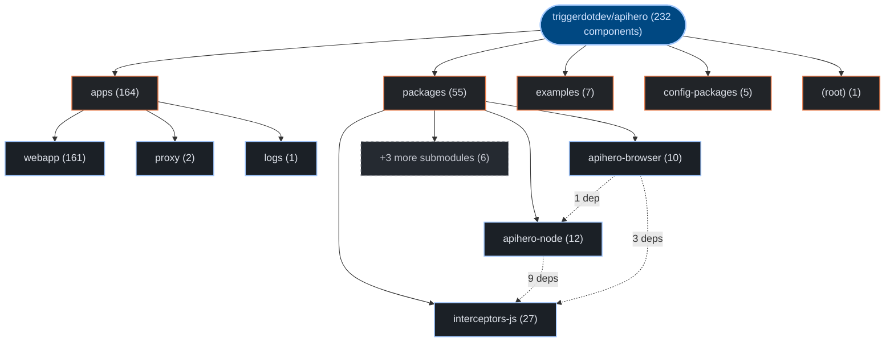
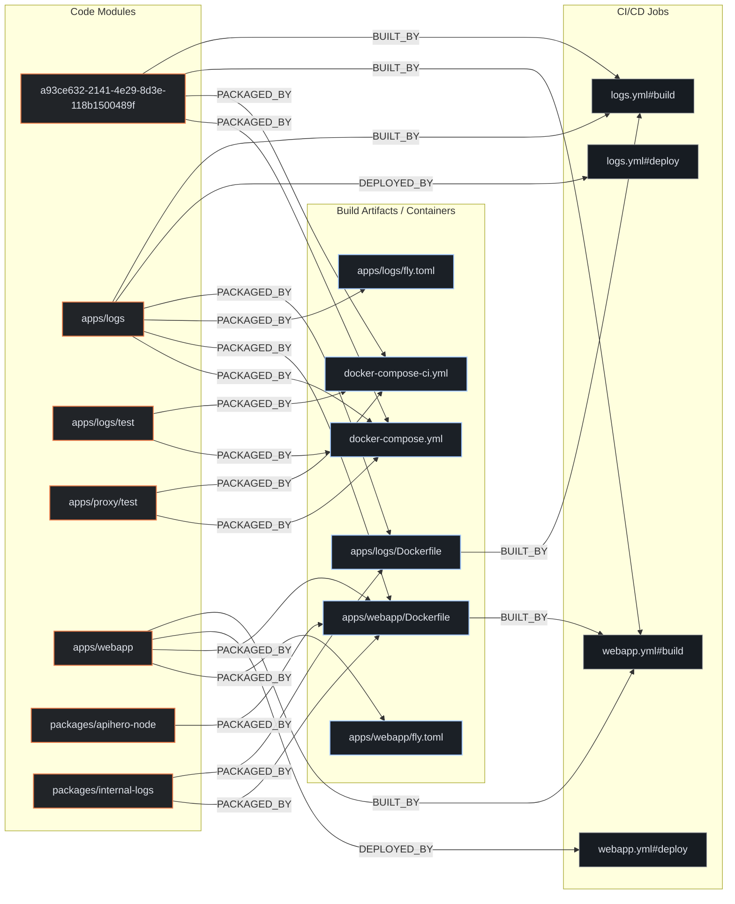
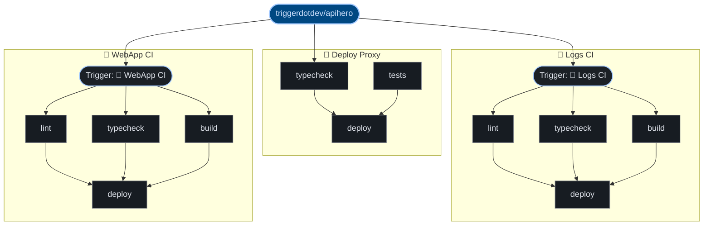

# Repository Architecture Analysis: triggerdotdev/apihero

## Metadata
- **SHA**: `2f204e8fc57343a584d8b244d7ad492b72ed1242`
- **Primary Ecosystem**: JavaScript/TypeScript

## Quality Metrics
- **ast_engine**: tree-sitter
- **avg_cognitive_complexity**: 2.07
- **avg_cyclomatic_complexity**: 2.59
- **component_count**: 232
- **dead_code_count**: 9
- **dead_code_symbols**: 9 entry(ies)
- **duplication_pct**: 81.35
- **file_complexities**: 25 entry(ies)
- **files_analyzed**: 361
- **fitness_passed**: False
- **fitness_violation_count**: 3
- **framework**: Next.js
- **import_edges**: 100 entry(ies)
- **loc**: 29644
- **max_cognitive_complexity**: 53
- **max_cyclomatic_complexity**: 34
- **sloc**: 25724
- **test_file_count**: 48

# Architecture: triggerdotdev/apihero

## Context
- **Repository**: `triggerdotdev/apihero`
- **SHA**: `2f204e8fc57343a584d8b244d7ad492b72ed1242`
- **Ecosystem**: JavaScript/TypeScript
- **Framework**: Next.js

## Building Block View

## Component Details

Showing top 60 representative components out of 232 across 5 module group(s):

- **Module `apps`** (164 components — UI_COMPONENT: 160, MODULE: 3, SERVICE: 1)
- **Module `packages`** (55 components — API_ROUTE: 49, MODULE: 6)
- **Module `examples`** (7 components — UI_COMPONENT: 4, MODULE: 2, API_ROUTE: 1)
- **Module `config-packages`** (5 components — MODULE: 5)
- **Module `(root)`** (1 components — MODULE: 1)

- **CountdownToRefreshButton** (`apps/webapp/app/libraries/ui/src/components/LogsOnboarding.tsx`): UI_COMPONENT (deps: CopyTextButton, DestructiveButton, PrimaryA, PrimaryButton, PrimaryLink, SecondaryA (+5 more))
- **LogsFilters** (`apps/webapp/app/libraries/ui/src/components/LogsFilters.tsx`): UI_COMPONENT (deps: ComboBox, FormField, Input, MultipleComboBox, SingleComboBox, StatusCode (+5 more))
- **LogsOnboarding** (`apps/webapp/app/libraries/ui/src/components/LogsOnboarding.tsx`): UI_COMPONENT (deps: CopyTextButton, DestructiveButton, PrimaryA, PrimaryButton, PrimaryLink, SecondaryA (+5 more))
- **OperationIndexRoute** (`apps/webapp/app/routes/admin/operations/$operationId/index.tsx`): UI_COMPONENT (deps: ModelRoute, SchemaOperationClientRoute, SchemaOperationLayoutRoute, Tabs)
- **ApiSchemaDetailsRoute** (`apps/webapp/app/routes/admin/schemas/$id/index.tsx`): UI_COMPONENT (deps: ApiIntegrationIdRoute, ApiSchemaIdRoute, Tabs)
- **EditIntegrationRoute** (`apps/webapp/app/routes/admin/integrations/$id/edit.tsx`): UI_COMPONENT (deps: ApiIntegrationIdRoute, ApiSchemaIdRoute, Tabs)
- **Header** (`apps/webapp/app/libraries/ui/src/components/Header.tsx`): UI_COMPONENT (deps: FeedbackMenu, Logo, UserProfileMenu)
- **IntegrationDetailsRoute** (`apps/webapp/app/routes/admin/integrations/$id/index.tsx`): UI_COMPONENT (deps: ApiIntegrationIdRoute, ApiSchemaIdRoute, Tabs)
- **ReleaseRoute** (`apps/webapp/app/routes/admin/schemas/$id/releases/$releaseId.tsx`): UI_COMPONENT (deps: ApiIntegrationIdRoute, ApiSchemaIdRoute, Tabs)
- **SchemaDocumentRoute** (`apps/webapp/app/routes/admin/schemas/$id/document.tsx`): UI_COMPONENT (deps: ApiIntegrationIdRoute, ApiSchemaIdRoute, Tabs)
- **HTTPMethodLabel** (`apps/webapp/app/libraries/common/src/components/HTTPMethod.tsx`): UI_COMPONENT (deps: ModelRoute, SchemaOperationClientRoute)
- **ProjectKey** (`apps/webapp/app/libraries/ui/src/components/ProjectKey.tsx`): UI_COMPONENT (deps: CopyTextButton, Label)
- **WorkspaceMenu** (`apps/webapp/app/libraries/ui/src/components/WorkspaceMenu.tsx`): UI_COMPONENT (deps: ModelRoute, SchemaOperationClientRoute)
- **CopyTextButton** (`apps/webapp/app/libraries/ui/src/components/Buttons/CopyTextButton.tsx`): UI_COMPONENT (deps: CopyText)
- **CopyTextButton** (`apps/webapp/app/libraries/ui/src/components/CopyTextButton.tsx`): UI_COMPONENT (deps: CopyText)
- **DELETE_delete** (`packages/apihero-browser/test/browser/setupWorker.test.ts`): API_ROUTE (deps: GET_root)
- **FormField** (`apps/webapp/app/libraries/ui/src/components/Primitives/FormField.tsx`): UI_COMPONENT (deps: Label)
- **GET_get** (`packages/apihero-browser/test/browser/setupWorker.noAllow.test.ts`): API_ROUTE (deps: GET_root)
- **GET_get** (`packages/apihero-browser/test/browser/setupWorker.test.ts`): API_ROUTE (deps: GET_root)
- **GET_get** (`packages/apihero-fetch/test/createFetchProxy.test.ts`): API_ROUTE (deps: GET_root)
- **GET_get** (`packages/apihero-node/test/node/fetch.allow.test.ts`): API_ROUTE (deps: GET_root)
- **GET_get** (`packages/apihero-node/test/node/fetch.deny.test.ts`): API_ROUTE (deps: GET_root)
- **GET_get** (`packages/apihero-node/test/node/fetch.native.test.ts`): API_ROUTE (deps: GET_root)
- **GET_get** (`packages/apihero-node/test/node/fetch.test.ts`): API_ROUTE (deps: GET_root)
- **GET_proxyServiceWorker.js** (`packages/apihero-browser/test/vitest.setup.ts`): API_ROUTE (deps: POST_console_:messageType)
- **Home** (`examples/next-github-stars/pages/index.tsx`): UI_COMPONENT (deps: Main)
- **InfoPanel** (`apps/webapp/app/libraries/ui/src/components/InfoPanel.tsx`): UI_COMPONENT (deps: ApiLogoContainer)
- **LogsTable** (`apps/webapp/app/libraries/logging/LogsTable.tsx`): UI_COMPONENT (deps: LogRow)
- **Main** (`examples/next-github-stars/components/Main.tsx`): UI_COMPONENT (deps: StarCount)
- **NavBar** (`apps/webapp/app/libraries/ui/src/components/NavBar.tsx`): UI_COMPONENT (deps: Breadcrumb)
- **PATCH_patch** (`packages/apihero-browser/test/browser/setupWorker.test.ts`): API_ROUTE (deps: GET_root)
- **POST_console_:messageType** (`packages/apihero-browser/test/support/workerConsole.ts`): API_ROUTE (deps: GET_root)
- **POST_console_:messageType** (`packages/apihero-node/test/support/workerConsole.ts`): API_ROUTE (deps: GET_root)
- **POST_post** (`packages/apihero-browser/test/browser/setupWorker.test.ts`): API_ROUTE (deps: GET_root)
- **POST_post** (`packages/apihero-fetch/test/createFetchProxy.test.ts`): API_ROUTE (deps: GET_root)
- **POST_post** (`packages/apihero-node/test/node/fetch.allow.test.ts`): API_ROUTE (deps: GET_root)
- **POST_post** (`packages/apihero-node/test/node/fetch.deny.test.ts`): API_ROUTE (deps: GET_root)
- **POST_post** (`packages/apihero-node/test/node/fetch.native.test.ts`): API_ROUTE (deps: GET_root)
- **POST_post** (`packages/apihero-node/test/node/fetch.test.ts`): API_ROUTE (deps: GET_root)
- **POST_v3_apihero.run_messages** (`packages/apihero-node/test/node/fetch.allow.test.ts`): API_ROUTE (deps: GET_root)
- **PUT_put** (`packages/apihero-browser/test/browser/setupWorker.test.ts`): API_ROUTE (deps: GET_root)
- **PanelHeader** (`apps/webapp/app/libraries/ui/src/components/Panel/PanelHeader.tsx`): UI_COMPONENT (deps: SmallTitle)
- **RequestResponseViewer** (`apps/webapp/app/libraries/request-response-viewer/src/RequestResponseViewer.tsx`): UI_COMPONENT (deps: RequestViewer)
- **RequestUrlBar** (`apps/webapp/app/libraries/request-response-viewer/src/RequestResponseViewer.tsx`): UI_COMPONENT (deps: RequestViewer)
- **ResponseInfo** (`apps/webapp/app/libraries/ui/src/components/ResponseInfo.tsx`): UI_COMPONENT (deps: StatusCode)
- **UserProfileMenu** (`apps/webapp/app/libraries/ui/src/components/UserProfileMenu.tsx`): UI_COMPONENT (deps: UserProfilePhoto)
- **@apihero/browser** (`packages/apihero-browser/package.json`): MODULE
- **@apihero/eslint-config-vite** (`config-packages/eslint-config-vite/package.json`): MODULE
- **@apihero/fetch** (`packages/apihero-fetch/package.json`): MODULE
- **@apihero/interceptors-js** (`packages/interceptors-js/package.json`): MODULE
- **@apihero/node** (`packages/apihero-node/package.json`): MODULE
- **@apihero/tailwind-config** (`config-packages/tailwind-config/package.json`): MODULE
- **@apihero/tsconfig** (`config-packages/tsconfig/package.json`): MODULE
- **@examples/fetch-load-test** (`examples/fetch-load-test/package.json`): MODULE
- **@examples/next-github-stars** (`examples/next-github-stars/package.json`): MODULE
- **APIHeroProvider** (`apps/webapp/app/libraries/client/src/react.tsx`): UI_COMPONENT
- **API_api_hello** (`examples/next-github-stars/pages/api/hello.ts`): API_ROUTE
- **AdminDashboardRoute** (`apps/webapp/app/routes/admin/index.tsx`): UI_COMPONENT
- **Alerts** (`apps/webapp/app/routes/__app/workspaces/$workspaceSlug/projects/$projectSlug/alerts/index.tsx`): UI_COMPONENT
- **ApiIntegrationIdRoute** (`apps/webapp/app/routes/admin/integrations/$id.tsx`): UI_COMPONENT

## 6-Dimension Repository Scorecard

- **Overall Grade**: `F` (41.35/100)
- **Technical Debt Score**: 58.65
- **Estimated Remediation Effort**: 109.18h

| Dimension | Grade | Score | Weight | Details |
| :--- | :---: | :---: | :---: | :--- |
| Code Quality | `F` | 32.00 | 0.20 | avg_cc=2.59, max_cc=34, duplication=81.35%, dead_code=9 |
| Dependency Health | `A` | 100.00 | 0.15 | dependencies=2505, outdated=0, vulnerable=0, has_lockfile=True |
| Maintainability | `F` | 37.00 | 0.15 | avg_cognitive=2.07, max_cognitive=53, fitness_violations=3, oversized_files=4 |
| Pipeline Health | `F` | 26.00 | 0.15 | workflows=3, operational_antipatterns=13, parallel_branches=True |
| Security | `F` | 0.00 | 0.20 | vulnerabilities=0, secrets=2, pipeline_security_findings=34 |
| Test Coverage | `C` | 70.00 | 0.15 | coverage=unavailable, ci_test_job=True, test_files_detected=True |

## Architecture Fitness & Workspace Boundaries

- **[MEDIUM] `ATRUSS-ARCH-005` (COMPLEXITY_THRESHOLD)**: Repository duplication_pct (81.35) exceeds policy threshold (15.0).
- **[MEDIUM] `ATRUSS-ARCH-005` (COMPLEXITY_THRESHOLD)**: Repository max_cognitive_complexity (53.0) exceeds policy threshold (25.0).
- **[MEDIUM] `ATRUSS-ARCH-005` (COMPLEXITY_THRESHOLD)**: Repository max_cyclomatic_complexity (34.0) exceeds policy threshold (20.0).

### Workspace Packages
- **logs** (`apps/logs`, react_ts_js, pnpm) -> internal deps: `internal-logs`
- **proxy** (`apps/proxy`, react_ts_js, pnpm) -> internal deps: `internal-logs`
- **webapp** (`apps/webapp`, react_ts_js, pnpm) -> internal deps: `@apihero/node, @apihero/tailwind-config, internal-logs`
- **eslint-config-custom** (`config-packages/eslint-config-custom`, react_ts_js, pnpm)
- **eslint-config-custom-next** (`config-packages/eslint-config-custom-next`, react_ts_js, pnpm)
- **@apihero/eslint-config-vite** (`config-packages/eslint-config-vite`, react_ts_js, pnpm)
- **@apihero/tailwind-config** (`config-packages/tailwind-config`, react_ts_js, pnpm)
- **@apihero/tsconfig** (`config-packages/tsconfig`, react_ts_js, pnpm)
- **@examples/fetch-load-test** (`examples/fetch-load-test`, react_ts_js, pnpm) -> internal deps: `@apihero/node, @apihero/tsconfig`
- **@examples/next-github-stars** (`examples/next-github-stars`, react_ts_js, pnpm) -> internal deps: `@apihero/browser, @apihero/node`
- **@apihero/browser** (`packages/apihero-browser`, react_ts_js, pnpm) -> internal deps: `@apihero/eslint-config-vite, @apihero/tsconfig`
- **@apihero/fetch** (`packages/apihero-fetch`, react_ts_js, pnpm) -> internal deps: `@apihero/eslint-config-vite, @apihero/tsconfig, internal-constants`
- **@apihero/node** (`packages/apihero-node`, react_ts_js, pnpm) -> internal deps: `@apihero/eslint-config-vite, @apihero/interceptors-js, @apihero/tsconfig, internal-constants`
- **@apihero/interceptors-js** (`packages/interceptors-js`, react_ts_js, pnpm) -> internal deps: `@apihero/eslint-config-vite, @apihero/tsconfig`
- **internal-constants** (`packages/internal-constants`, react_ts_js, pnpm)
- **internal-logs** (`packages/internal-logs`, react_ts_js, pnpm) -> internal deps: `@apihero/eslint-config-vite, @apihero/tsconfig`

## Supply Chain Dependencies, Vulnerabilities & Secrets

- **Dependencies Parsed**: 2505 | **Vulnerabilities**: 0 | **Secrets**: 2

### Secret Findings (Redacted)
- **[CRITICAL] `ATRUSS-SEC-004`** at `packages/apihero-browser/test/support/certs/key.pem:1` (`-----BEGIN ... PRIVATE KEY----- [REDACTED]`)
- **[CRITICAL] `ATRUSS-SEC-004`** at `packages/apihero-node/test/support/certs/key.pem:1` (`-----BEGIN ... PRIVATE KEY----- [REDACTED]`)

### Inventory Sample
- `@apihero/browser` `*` (npm, `examples/next-github-stars/package.json`)
- `@apihero/eslint-config-vite` `*` (npm, `packages/apihero-browser/package.json`)
- `@apihero/eslint-config-vite` `*` (npm, `packages/apihero-fetch/package.json`)
- `@apihero/eslint-config-vite` `*` (npm, `packages/apihero-node/package.json`)
- `@apihero/eslint-config-vite` `*` (npm, `packages/interceptors-js/package.json`)
- `@apihero/eslint-config-vite` `*` (npm, `packages/internal-logs/package.json`)
- `@apihero/interceptors-js` `*` (npm, `packages/apihero-node/package.json`)
- `@apihero/node` `*` (npm, `apps/webapp/package.json`)
- `@apihero/node` `*` (npm, `examples/fetch-load-test/package.json`)
- `@apihero/node` `*` (npm, `examples/next-github-stars/package.json`)
- `@apihero/openapi-spec-generator` `0.1.6` (npm, `apps/webapp/package.json`)
- `@apihero/openapi-spec-generator` `0.1.6` (npm, `pnpm-lock.yaml`)
- `@apihero/tailwind-config` `*` (npm, `apps/webapp/package.json`)
- `@apihero/tsconfig` `*` (npm, `examples/fetch-load-test/package.json`)
- `@apihero/tsconfig` `*` (npm, `packages/apihero-browser/package.json`)
- `@apihero/tsconfig` `*` (npm, `packages/apihero-fetch/package.json`)
- `@apihero/tsconfig` `*` (npm, `packages/apihero-node/package.json`)
- `@apihero/tsconfig` `*` (npm, `packages/interceptors-js/package.json`)
- `@apihero/tsconfig` `*` (npm, `packages/internal-logs/package.json`)
- `@aws-sdk/client-s3` `3.186.0` (npm, `apps/webapp/package.json`)
- `@aws-sdk/client-s3` `3.188.0` (npm, `pnpm-lock.yaml`)
- `@aws-sdk/s3-request-presigner` `3.186.0` (npm, `apps/webapp/package.json`)
- `@aws-sdk/s3-request-presigner` `3.188.0` (npm, `pnpm-lock.yaml`)
- `@cfworker/json-schema` `1.12.4` (npm, `apps/webapp/package.json`)
- `@cfworker/json-schema` `1.12.5` (npm, `pnpm-lock.yaml`)
- `@changesets/cli` `2.25.2` (npm, `package.json`)
- `@changesets/cli` `2.25.2` (npm, `pnpm-lock.yaml`)
- `@cloudflare/workers-types` `3.18.0` (npm, `apps/proxy/package.json`)
- `@cloudflare/workers-types` `3.18.0` (npm, `pnpm-lock.yaml`)
- `@codemirror/autocomplete` `6.3.1` (npm, `apps/webapp/package.json`)
- ... (+2475 more dependencies)

## Section 7: Code-to-Cloud Deployment Traceability

- `a93ce632-2141-4e29-8d3e-118b1500489f` (code_module) --[BUILT_BY]--> `logs.yml#build` (ci_job)
- `a93ce632-2141-4e29-8d3e-118b1500489f` (code_module) --[BUILT_BY]--> `webapp.yml#build` (ci_job)
- `a93ce632-2141-4e29-8d3e-118b1500489f` (code_module) --[PACKAGED_BY]--> `docker-compose-ci.yml` (container)
- `a93ce632-2141-4e29-8d3e-118b1500489f` (code_module) --[PACKAGED_BY]--> `docker-compose.yml` (container)
- `apps/logs` (code_module) --[BUILT_BY]--> `logs.yml#build` (ci_job)
- `apps/logs` (code_module) --[DEPLOYED_BY]--> `logs.yml#deploy` (ci_job)
- `apps/logs` (code_module) --[PACKAGED_BY]--> `apps/logs/Dockerfile` (container)
- `apps/logs` (code_module) --[PACKAGED_BY]--> `apps/logs/fly.toml` (container)
- `apps/logs` (code_module) --[PACKAGED_BY]--> `apps/webapp/Dockerfile` (container)
- `apps/logs` (code_module) --[PACKAGED_BY]--> `docker-compose.yml` (container)
- `apps/logs/test` (code_module) --[PACKAGED_BY]--> `docker-compose-ci.yml` (container)
- `apps/logs/test` (code_module) --[PACKAGED_BY]--> `docker-compose.yml` (container)
- `apps/proxy/test` (code_module) --[PACKAGED_BY]--> `docker-compose-ci.yml` (container)
- `apps/proxy/test` (code_module) --[PACKAGED_BY]--> `docker-compose.yml` (container)
- `apps/webapp` (code_module) --[BUILT_BY]--> `webapp.yml#build` (ci_job)
- `apps/webapp` (code_module) --[DEPLOYED_BY]--> `webapp.yml#deploy` (ci_job)
- `apps/webapp` (code_module) --[PACKAGED_BY]--> `apps/webapp/Dockerfile` (container)
- `apps/webapp` (code_module) --[PACKAGED_BY]--> `apps/webapp/fly.toml` (container)
- `packages/apihero-node` (code_module) --[PACKAGED_BY]--> `apps/webapp/Dockerfile` (container)
- `packages/internal-logs` (code_module) --[PACKAGED_BY]--> `apps/logs/Dockerfile` (container)
- `packages/internal-logs` (code_module) --[PACKAGED_BY]--> `apps/webapp/Dockerfile` (container)
- `apps/logs/Dockerfile` (container) --[BUILT_BY]--> `logs.yml#build` (ci_job)
- `apps/webapp/Dockerfile` (container) --[BUILT_BY]--> `webapp.yml#build` (ci_job)

## CI/CD Pipeline Topology

