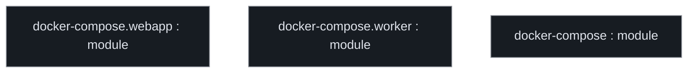
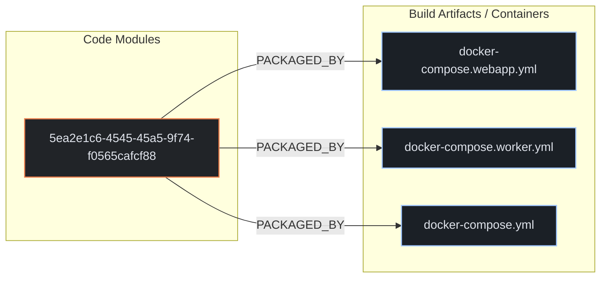

# Repository Architecture Analysis: triggerdotdev/docker

## Metadata
- **SHA**: `b2c2949ac923b91f86fe2014059e531fae1d9c33`
- **Primary Ecosystem**: Container / Helm / IaC

## Quality Metrics
- **ast_engine**: fallback
- **avg_cognitive_complexity**: 0.0
- **avg_cyclomatic_complexity**: 0.0
- **component_count**: 3
- **dead_code_count**: 0
- **dead_code_symbols**: 0 entry(ies)
- **duplication_pct**: 0.0
- **file_complexities**: 0 entry(ies)
- **files_analyzed**: 3
- **fitness_passed**: True
- **fitness_violation_count**: 0
- **framework**: Docker Compose
- **import_edges**: 0 entry(ies)
- **loc**: 213
- **max_cognitive_complexity**: 0
- **max_cyclomatic_complexity**: 0
- **sloc**: 195

# Architecture: triggerdotdev/docker

## Context
- **Repository**: `triggerdotdev/docker`
- **SHA**: `b2c2949ac923b91f86fe2014059e531fae1d9c33`
- **Ecosystem**: Container / Helm / IaC
- **Framework**: Docker Compose

## Building Block View

## Component Details
- **docker-compose.webapp** (`docker-compose.webapp.yml`): module
- **docker-compose.worker** (`docker-compose.worker.yml`): module
- **docker-compose** (`docker-compose.yml`): module

## 6-Dimension Repository Scorecard

- **Overall Grade**: `B` (80.50/100)
- **Technical Debt Score**: 19.50
- **Estimated Remediation Effort**: 4.88h

| Dimension | Grade | Score | Weight | Details |
| :--- | :---: | :---: | :---: | :--- |
| Code Quality | `A` | 100.00 | 0.20 | avg_cc=0.00, max_cc=0, duplication=0.00%, dead_code=0 |
| Dependency Health | `A` | 90.00 | 0.15 | dependencies=0 (no manifests parsed) |
| Maintainability | `A` | 100.00 | 0.15 | avg_cognitive=0.00, max_cognitive=0, fitness_violations=0, oversized_files=0 |
| Pipeline Health | `F` | 40.00 | 0.15 | workflows=0 |
| Security | `A` | 100.00 | 0.20 | vulnerabilities=0, secrets=0, pipeline_security_findings=0 |
| Test Coverage | `F` | 40.00 | 0.15 | coverage=unavailable, ci_test_job=False, test_files_detected=False |

## Section 7: Code-to-Cloud Deployment Traceability

- `5ea2e1c6-4545-45a5-9f74-f0565cafcf88` (code_module) --[PACKAGED_BY]--> `docker-compose.webapp.yml` (container)
- `5ea2e1c6-4545-45a5-9f74-f0565cafcf88` (code_module) --[PACKAGED_BY]--> `docker-compose.worker.yml` (container)
- `5ea2e1c6-4545-45a5-9f74-f0565cafcf88` (code_module) --[PACKAGED_BY]--> `docker-compose.yml` (container)

## CI/CD Pipeline Topology

