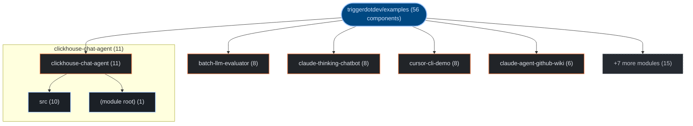

# Repository Architecture Analysis: triggerdotdev/examples

## Metadata
- **SHA**: `b6336ff0ed2bb1e6670fe32e8909ff76ed1d7b06`
- **Primary Ecosystem**: JavaScript/TypeScript

## Quality Metrics
- **ast_engine**: tree-sitter
- **avg_cognitive_complexity**: 3.48
- **avg_cyclomatic_complexity**: 3.44
- **component_count**: 56
- **dead_code_count**: 2
- **dead_code_symbols**: 2 entry(ies)
- **duplication_pct**: 64.81
- **file_complexities**: 25 entry(ies)
- **files_analyzed**: 199
- **fitness_passed**: False
- **fitness_violation_count**: 3
- **framework**: Next.js
- **import_edges**: 100 entry(ies)
- **loc**: 17560
- **max_cognitive_complexity**: 72
- **max_cyclomatic_complexity**: 43
- **sloc**: 15047

# Architecture: triggerdotdev/examples

## Context
- **Repository**: `triggerdotdev/examples`
- **SHA**: `b6336ff0ed2bb1e6670fe32e8909ff76ed1d7b06`
- **Ecosystem**: JavaScript/TypeScript
- **Framework**: Next.js

## Building Block View

## Component Details
- **broadway-deal-hunter** (`anchor-browser-web-scraper/package.json`): MODULE
- **article-summary-workflow** (`article-summary-workflow/package.json`): MODULE
- **RootLayout** (`article-summary-workflow/src/app/layout.tsx`): UI_COMPONENT
- **Flow** (`article-summary-workflow/src/components/Flow.tsx`): UI_COMPONENT
- **llm-evaluator** (`batch-llm-evaluator/package.json`): MODULE
- **RootLayout** (`batch-llm-evaluator/src/app/layout.tsx`): UI_COMPONENT
- **LLMEvaluatorPage** (`batch-llm-evaluator/src/app/page.tsx`): UI_COMPONENT
- **EvalCard** (`batch-llm-evaluator/src/components/EvalCard.tsx`): UI_COMPONENT
- **LLMEvaluator** (`batch-llm-evaluator/src/components/llm-evaluator.tsx`): UI_COMPONENT
- **AnthropicEval** (`batch-llm-evaluator/src/components/evals/Anthropic.tsx`): UI_COMPONENT
- **OpenAIEval** (`batch-llm-evaluator/src/components/evals/OpenAI.tsx`): UI_COMPONENT
- **XAIEval** (`batch-llm-evaluator/src/components/evals/XAI.tsx`): UI_COMPONENT
- **building-effective-agents** (`building-effective-agents/package.json`): MODULE
- **changelog-generator** (`changelog-generator/package.json`): MODULE
- **RootLayout** (`changelog-generator/app/layout.tsx`): UI_COMPONENT
- **Home** (`changelog-generator/app/page.tsx`): UI_COMPONENT
- **API_generate-changelog_route** (`changelog-generator/app/api/generate-changelog/route.ts`): API_ROUTE
- **ResponsePage** (`changelog-generator/app/response/[runId]/page.tsx`): UI_COMPONENT
- **claude-agent-github-wiki** (`claude-agent-github-wiki/package.json`): MODULE
- **RootLayout** (`claude-agent-github-wiki/app/layout.tsx`): UI_COMPONENT
- **Home** (`claude-agent-github-wiki/app/page.tsx`): UI_COMPONENT
- **API_abort_route** (`claude-agent-github-wiki/app/api/abort/route.ts`): API_ROUTE
- **API_analyze-repo_route** (`claude-agent-github-wiki/app/api/analyze-repo/route.ts`): API_ROUTE
- **ResponsePage** (`claude-agent-github-wiki/app/response/[runId]/page.tsx`): UI_COMPONENT
- **claude-agent-sdk-trigger** (`claude-agent-sdk-trigger/package.json`): MODULE
- **my-v0-project** (`claude-thinking-chatbot/package.json`): MODULE
- **RootLayout** (`claude-thinking-chatbot/app/layout.tsx`): UI_COMPONENT
- **ClaudeChatPage** (`claude-thinking-chatbot/app/page.tsx`): UI_COMPONENT (deps: ClaudeChat)
- **API_chat_route** (`claude-thinking-chatbot/app/api/chat/route.ts`): API_ROUTE
- **ClaudeChat** (`claude-thinking-chatbot/app/components/claude-chat.tsx`): UI_COMPONENT
- **ThemeProvider** (`claude-thinking-chatbot/components/theme-provider.tsx`): UI_COMPONENT
- **Toaster** (`claude-thinking-chatbot/components/toaster.tsx`): UI_COMPONENT
- **Toaster** (`claude-thinking-chatbot/components/ui/toaster.tsx`): UI_COMPONENT
- **clickhouse-chat-agent** (`clickhouse-chat-agent/package.json`): MODULE
- **RootLayout** (`clickhouse-chat-agent/src/app/layout.tsx`): UI_COMPONENT
- **Home** (`clickhouse-chat-agent/src/app/page.tsx`): UI_COMPONENT
- **BarChartView** (`clickhouse-chat-agent/src/components/charts.tsx`): UI_COMPONENT
- **LineChartView** (`clickhouse-chat-agent/src/components/charts.tsx`): UI_COMPONENT
- **AreaChartView** (`clickhouse-chat-agent/src/components/charts.tsx`): UI_COMPONENT
- **PieChartView** (`clickhouse-chat-agent/src/components/charts.tsx`): UI_COMPONENT
- **StatView** (`clickhouse-chat-agent/src/components/charts.tsx`): UI_COMPONENT
- **Chat** (`clickhouse-chat-agent/src/components/chat.tsx`): UI_COMPONENT
- **PointMapView** (`clickhouse-chat-agent/src/components/point-map.tsx`): UI_COMPONENT
- **Visualization** (`clickhouse-chat-agent/src/components/visualization.tsx`): UI_COMPONENT
- **cursor-cli-demo** (`cursor-cli-demo/package.json`): MODULE
- **RootLayout** (`cursor-cli-demo/app/layout.tsx`): UI_COMPONENT
- **Home** (`cursor-cli-demo/app/page.tsx`): UI_COMPONENT
- **API_trigger_route** (`cursor-cli-demo/app/api/trigger/route.ts`): API_ROUTE
- **AgentRunner** (`cursor-cli-demo/components/agent-runner.tsx`): UI_COMPONENT
- **ControlBar** (`cursor-cli-demo/components/control-bar.tsx`): UI_COMPONENT
- **CursorEventRow** (`cursor-cli-demo/components/cursor-event.tsx`): UI_COMPONENT
- **Terminal** (`cursor-cli-demo/components/terminal.tsx`): UI_COMPONENT (deps: CursorEventRow)
- **mastra-clothing-advisor-agent** (`mastra-agents/package.json`): MODULE
- **meme-generator** (`meme-generator-human-in-the-loop/package.json`): MODULE
- **RootLayout** (`meme-generator-human-in-the-loop/src/app/layout.tsx`): UI_COMPONENT
- **Home** (`meme-generator-human-in-the-loop/src/app/page.tsx`): UI_COMPONENT

## 6-Dimension Repository Scorecard

- **Overall Grade**: `D` (63.65/100)
- **Technical Debt Score**: 36.35
- **Estimated Remediation Effort**: 28.55h

| Dimension | Grade | Score | Weight | Details |
| :--- | :---: | :---: | :---: | :--- |
| Code Quality | `F` | 44.24 | 0.20 | avg_cc=3.44, max_cc=43, duplication=64.81%, dead_code=2 |
| Dependency Health | `A` | 100.00 | 0.15 | dependencies=18310, outdated=0, vulnerable=0, has_lockfile=True |
| Maintainability | `F` | 52.00 | 0.15 | avg_cognitive=3.48, max_cognitive=72, fitness_violations=3, oversized_files=1 |
| Pipeline Health | `F` | 40.00 | 0.15 | workflows=0 |
| Security | `A` | 100.00 | 0.20 | vulnerabilities=0, secrets=0, pipeline_security_findings=0 |
| Test Coverage | `F` | 40.00 | 0.15 | coverage=unavailable, ci_test_job=False, test_files_detected=False |

## Architecture Fitness & Workspace Boundaries

- **[MEDIUM] `ATRUSS-ARCH-005` (COMPLEXITY_THRESHOLD)**: Repository duplication_pct (64.81) exceeds policy threshold (15.0).
- **[MEDIUM] `ATRUSS-ARCH-005` (COMPLEXITY_THRESHOLD)**: Repository max_cognitive_complexity (72.0) exceeds policy threshold (25.0).
- **[MEDIUM] `ATRUSS-ARCH-005` (COMPLEXITY_THRESHOLD)**: Repository max_cyclomatic_complexity (43.0) exceeds policy threshold (20.0).

## Supply Chain Dependencies, Vulnerabilities & Secrets

- **Dependencies Parsed**: 18310 | **Vulnerabilities**: 0 | **Secrets**: 0

### Inventory Sample
- `Pillow` `10.3.0` (PyPI, `python-image-processing/requirements.txt`)
- `PyMuPDF` `1.23.8` (PyPI, `python-pdf-form-extractor/requirements.txt`)
- `crawl4ai` `*` (PyPI, `python-crawl4ai/requirements.txt`)
- `markitdown` `*` (PyPI, `python-doc-to-markdown-converter/requirements.txt`)
- `numpy` `1.26.3` (PyPI, `python-image-processing/requirements.txt`)
- `openai-agents` `*` (PyPI, `openai-agent-sdk-guardrails-examples/requirements.txt`)
- `opencv-python` `4.8.1.78` (PyPI, `python-image-processing/requirements.txt`)
- `playwright` `*` (PyPI, `python-crawl4ai/requirements.txt`)
- `python-dotenv` `1.0.0` (PyPI, `python-image-processing/requirements.txt`)
- `requests` `2.32.4` (PyPI, `python-image-processing/requirements.txt`)
- `requests` `2.32.4` (PyPI, `python-pdf-form-extractor/requirements.txt`)
- `urllib3` `2.0.0` (PyPI, `python-crawl4ai/requirements.txt`)
- `@ai-sdk/anthropic` `1.0.2` (npm, `batch-llm-evaluator/package-lock.json`)
- `@ai-sdk/anthropic` `1.0.2` (npm, `batch-llm-evaluator/package.json`)
- `@ai-sdk/anthropic` `1.1.11` (npm, `claude-thinking-chatbot/package-lock.json`)
- `@ai-sdk/anthropic` `1.1.11` (npm, `claude-thinking-chatbot/package.json`)
- `@ai-sdk/anthropic` `2.0.57` (npm, `smart-spreadsheet/package-lock.json`)
- `@ai-sdk/anthropic` `2.0.57` (npm, `smart-spreadsheet/package.json`)
- `@ai-sdk/anthropic` `3.0.0` (npm, `clickhouse-chat-agent/package.json`)
- `@ai-sdk/anthropic` `3.0.0` (npm, `trigger-chat-agent/package.json`)
- `@ai-sdk/anthropic` `3.0.105` (npm, `trigger-chat-agent/pnpm-lock.yaml`)
- `@ai-sdk/anthropic` `3.0.92` (npm, `clickhouse-chat-agent/pnpm-lock.yaml`)
- `@ai-sdk/anthropic` `4.0.39` (npm, `voice-agent-demo/package.json`)
- `@ai-sdk/anthropic` `4.0.39` (npm, `voice-agent-demo/pnpm-lock.yaml`)
- `@ai-sdk/mcp` `1.0.66` (npm, `trigger-chat-agent/package.json`)
- `@ai-sdk/mcp` `1.0.66` (npm, `trigger-chat-agent/pnpm-lock.yaml`)
- `@ai-sdk/openai` `1.0.6` (npm, `batch-llm-evaluator/package-lock.json`)
- `@ai-sdk/openai` `1.0.6` (npm, `batch-llm-evaluator/package.json`)
- `@ai-sdk/openai` `1.1.5` (npm, `vercel-ai-sdk-deep-research-agent/package-lock.json`)
- `@ai-sdk/openai` `1.1.5` (npm, `vercel-ai-sdk-deep-research-agent/package.json`)
- ... (+18280 more dependencies)

## CI/CD Pipeline Topology

