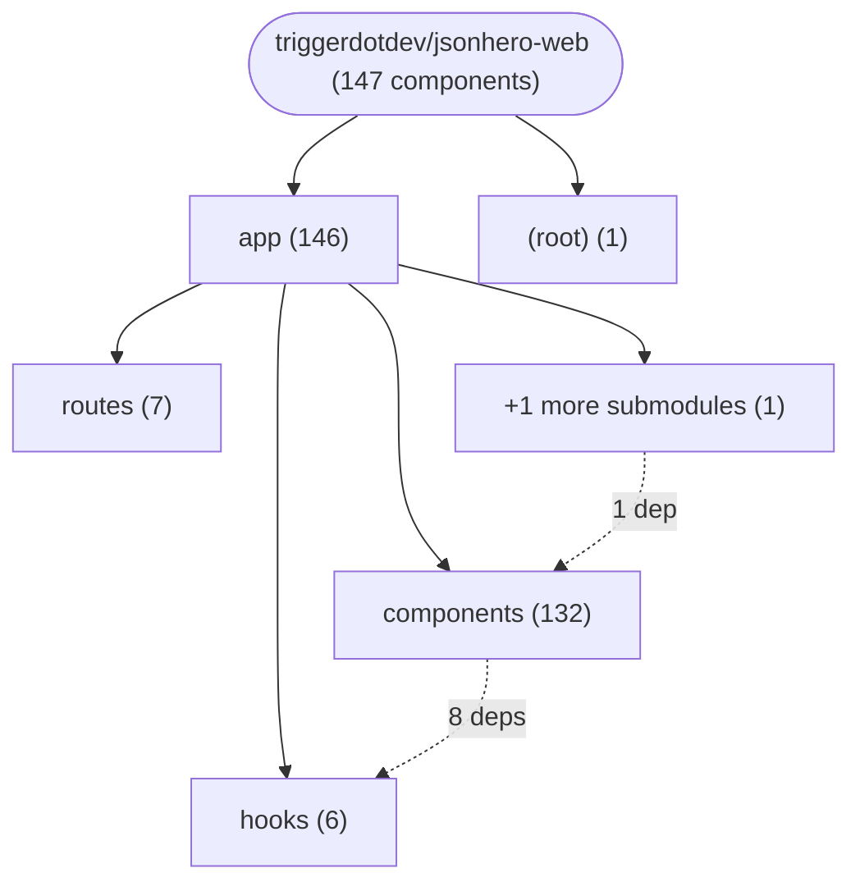
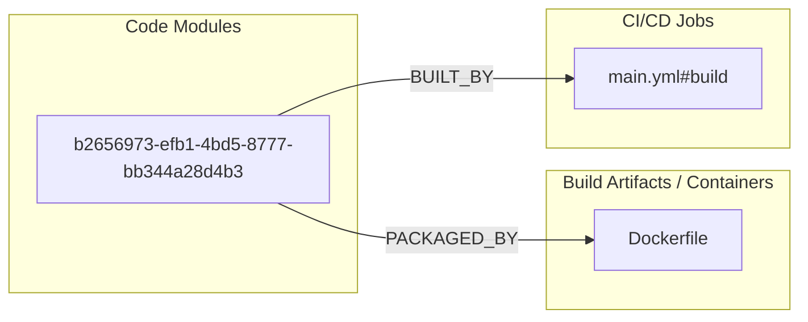
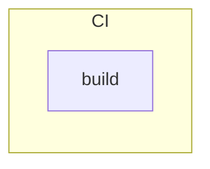

# Repository Architecture Analysis: triggerdotdev/jsonhero-web

## Metadata
- **SHA**: `15157053174ba7a0a79c77b2925fbde7e05a6334`
- **Primary Ecosystem**: JavaScript/TypeScript

## Quality Metrics
- **ast_engine**: tree-sitter
- **avg_cognitive_complexity**: 3.43
- **avg_cyclomatic_complexity**: 3.64
- **component_count**: 147
- **dead_code_count**: 3
- **dead_code_symbols**: 3 entry(ies)
- **duplication_pct**: 65.95
- **file_complexities**: 25 entry(ies)
- **files_analyzed**: 195
- **fitness_passed**: False
- **fitness_violation_count**: 3
- **framework**: React (Vite)
- **import_edges**: 100 entry(ies)
- **loc**: 13558
- **max_cognitive_complexity**: 103
- **max_cyclomatic_complexity**: 54
- **sloc**: 11813
- **test_file_count**: 8

# Architecture: triggerdotdev/jsonhero-web

## Context
- **Repository**: `triggerdotdev/jsonhero-web`
- **SHA**: `15157053174ba7a0a79c77b2925fbde7e05a6334`
- **Ecosystem**: JavaScript/TypeScript
- **Framework**: React (Vite)

## Building Block View

## Component Details

Showing top 60 representative components out of 147 across 2 module group(s):

- **Module `app`** (146 components — UI_COMPONENT: 146)
- **Module `(root)`** (1 components — MODULE: 1)

- **Header** (`app/components/Header.tsx`): UI_COMPONENT (deps: DiscordIconTransparent, DocumentTitle, EmailIconTransparent, GithubStar, Logo, LogoTriggerdotdev (+6 more))
- **HomeHeader** (`app/components/Home/HomeHeader.tsx`): UI_COMPONENT (deps: DiscordIconTransparent, EmailIconTransparent, GithubStar, Logo, LogoTriggerdotdev, NewDocument (+5 more))
- **InfoHeader** (`app/components/InfoHeader.tsx`): UI_COMPONENT (deps: Body, CopyTextButton, DocumentTitle, ExtraLargeTitle, LargeMono, LargeTitle (+5 more))
- **NewDocument** (`app/components/NewDocument.tsx`): UI_COMPONENT (deps: DocumentTitle, DragAndDropForm, ExtraLargeTitle, LargeTitle, PageNotFoundTitle, SampleUrls (+3 more))
- **NewFile** (`app/components/NewFile.tsx`): UI_COMPONENT (deps: DocumentTitle, DragAndDropForm, ExtraLargeTitle, LargeTitle, PageNotFoundTitle, SampleUrls (+3 more))
- **SearchBar** (`app/components/SearchBar.tsx`): UI_COMPONENT (deps: Body, CopyShortcutIcon, Dialog, DialogContent, DialogTrigger, SearchItem (+3 more))
- **SearchItem** (`app/components/SearchPalette.tsx`): UI_COMPONENT (deps: ArrowKeysUpDownIcon, Body, CopyShortcutIcon, EscapeKeyIcon, LargeMono, LoadingIcon (+3 more))
- **SearchPalette** (`app/components/SearchPalette.tsx`): UI_COMPONENT (deps: ArrowKeysUpDownIcon, Body, CopyShortcutIcon, EscapeKeyIcon, LargeMono, LoadingIcon (+3 more))
- **Footer** (`app/components/Footer.tsx`): UI_COMPONENT (deps: ArrowKeysIcon, Body, CopyShortcutIcon, EscapeKeyIcon, GithubStarSmall, SmallBody (+2 more))
- **HomeGridFeatureItem** (`app/components/Home/HomeGridFeatureItem.tsx`): UI_COMPONENT (deps: Body, DocumentTitle, ExtraLargeTitle, LargeTitle, PageNotFoundTitle, SmallBody (+2 more))
- **Column** (`app/components/Column.tsx`): UI_COMPONENT (deps: DocumentTitle, ExtraLargeTitle, JsonProvider, LargeTitle, PageNotFoundTitle, SmallTitle (+1 more))
- **DataTable** (`app/components/DataTable.tsx`): UI_COMPONENT (deps: CopyTextButton, DocumentTitle, ExtraLargeTitle, LargeTitle, PageNotFoundTitle, SmallTitle (+1 more))
- **PreviewString** (`app/components/Preview/Types/PreviewString.tsx`): UI_COMPONENT (deps: PreviewAudioUri, PreviewBox, PreviewDate, PreviewIPFSImage, PreviewImageUri, PreviewUri (+1 more))
- **SideBar** (`app/components/SideBar.tsx`): UI_COMPONENT (deps: Body, CopyShortcutIcon, NonFlashOfWrongThemeEls, ShortcutIcon, SmallBody, ThemeProvider (+1 more))
- **CalendarMonth** (`app/components/Preview/CalendarMonth.tsx`): UI_COMPONENT (deps: DocumentTitle, ExtraLargeTitle, LargeTitle, PageNotFoundTitle, SmallTitle, Title)
- **HomeFeatureGridSection** (`app/components/Home/HomeFeatureGridSection.tsx`): UI_COMPONENT (deps: Body, ExtraLargeTitle, HomeGridFeatureItem, HomeSection, LargeTitle, SmallBody)
- **HomeInfoBoxSection** (`app/components/Home/HomeInfoBoxSection.tsx`): UI_COMPONENT (deps: ExtraLargeTitle, HomeSection, JsonPreview, PreviewValue, PropertiesValue, SmallSubtitle)
- **PreviewBox** (`app/components/Preview/PreviewBox.tsx`): UI_COMPONENT (deps: DocumentTitle, ExtraLargeTitle, LargeTitle, PageNotFoundTitle, SmallTitle, Title)
- **RelatedValues** (`app/components/RelatedValues.tsx`): UI_COMPONENT (deps: JsonColumnViewProvider, JsonProvider, LargeMono, Mono, PathPreview, SmallBody)
- **HomeFooter** (`app/components/Home/HomeFooter.tsx`): UI_COMPONENT (deps: DiscordIcon, EmailIcon, GithubIcon, Logo, TwitterIcon)
- **InfoPanel** (`app/components/InfoPanel.tsx`): UI_COMPONENT (deps: ContainerInfo, InfoHeader, PreviewValue, PropertiesValue, RelatedValues)
- **JsonTreeView** (`app/components/JsonTreeView.tsx`): UI_COMPONENT (deps: Body, CopySelectedNodeShortcut, LargeMono, Mono, SmallBody)
- **JsonView** (`app/components/JsonView.tsx`): UI_COMPONENT (deps: PathBar, PathBarLink, PathBarText, PathHistoryControls, SearchBar)
- **ColumnItem** (`app/components/ColumnItem.tsx`): UI_COMPONENT (deps: Body, LargeMono, Mono, SmallBody)
- **ContainerInfo** (`app/components/ContainerInfo.tsx`): UI_COMPONENT (deps: JsonPreview, JsonSchemaViewer, TabContent, Tabs)
- **GithubStar** (`app/components/UI/GithubStar.tsx`): UI_COMPONENT (deps: Body, GithubIconSimple, SmallBody, StarCountProvider)
- **GithubStarSmall** (`app/components/UI/GithubStarSmall.tsx`): UI_COMPONENT (deps: Body, GithubIconSimple, SmallBody, StarCountProvider)
- **HomeCollaborateSection** (`app/components/Home/HomeCollaborateSection.tsx`): UI_COMPONENT (deps: AutoplayVideo, ExtraLargeTitle, HomeSection, SmallSubtitle)
- **HomeEdgeCasesSection** (`app/components/Home/HomeEdgeCasesSection.tsx`): UI_COMPONENT (deps: AutoplayVideo, ExtraLargeTitle, HomeSection, SmallSubtitle)
- **HomeHeroSection** (`app/components/Home/HomeHeroSection.tsx`): UI_COMPONENT (deps: AutoplayVideo, ExtraLargeTitle, NewFile, SmallSubtitle)
- **HomeSearchSection** (`app/components/Home/HomeSearchSection.tsx`): UI_COMPONENT (deps: AutoplayVideo, ExtraLargeTitle, HomeSection, SmallSubtitle)
- **ThemeModeToggler** (`app/components/ThemeModeToggle.tsx`): UI_COMPONENT (deps: MoonIcon, NonFlashOfWrongThemeEls, SunIcon, ThemeProvider)
- **Columns** (`app/components/Columns.tsx`): UI_COMPONENT (deps: BlankColumn, Column, ColumnItem)
- **CopyTextButton** (`app/components/CopyTextButton.tsx`): UI_COMPONENT (deps: Body, CopyText, SmallBody)
- **GithubBanner** (`app/components/Home/HomeGithubBanner.tsx`): UI_COMPONENT (deps: Body, GithubStar, SmallBody)
- **HomeApiHeroBanner** (`app/components/Home/HomeApiHeroBanner.tsx`): UI_COMPONENT (deps: Body, HomeApiHeroLaptop, SmallBody)
- **JsonColumnView** (`app/components/JsonColumnView.tsx`): UI_COMPONENT (deps: Columns, CopySelectedNodeShortcut, JsonColumnViewProvider)
- **JsonPreview** (`app/components/JsonPreview.tsx`): UI_COMPONENT (deps: CopyTextButton, NonFlashOfWrongThemeEls, ThemeProvider)
- **PathBar** (`app/components/PathBar.tsx`): UI_COMPONENT (deps: Body, JsonColumnViewProvider, SmallBody)
- **PathBarLink** (`app/components/PathBar.tsx`): UI_COMPONENT (deps: Body, JsonColumnViewProvider, SmallBody)
- **PathBarText** (`app/components/PathBar.tsx`): UI_COMPONENT (deps: Body, JsonColumnViewProvider, SmallBody)
- **PathHistoryControls** (`app/components/PathBar.tsx`): UI_COMPONENT (deps: Body, JsonColumnViewProvider, SmallBody)
- **PreviewUriElement** (`app/components/Preview/Types/PreviewUriElement.tsx`): UI_COMPONENT (deps: PreviewHtml, PreviewImage, PreviewJson)
- **PropertiesValue** (`app/components/Properties/PropertiesValue.tsx`): UI_COMPONENT (deps: PropertiesFloat, PropertiesInt, PropertiesString)
- **CodeEditor** (`app/components/CodeEditor.tsx`): UI_COMPONENT (deps: NonFlashOfWrongThemeEls, ThemeProvider)
- **CodeViewer** (`app/components/CodeViewer.tsx`): UI_COMPONENT (deps: NonFlashOfWrongThemeEls, ThemeProvider)
- **IndentPreference** (`app/components/IndentPreference.tsx`): UI_COMPONENT (deps: Body, SmallBody)
- **JsonColumnViewProvider** (`app/hooks/useJsonColumnView.tsx`): UI_COMPONENT (deps: JsonDocProvider, JsonProvider)
- **JsonSchemaViewer** (`app/components/JsonSchemaViewer.tsx`): UI_COMPONENT (deps: CodeViewer, CopyTextButton)
- **JsonTreeViewProvider** (`app/hooks/useJsonTree.tsx`): UI_COMPONENT (deps: JsonDocProvider, JsonProvider)
- **PathPreview** (`app/components/PathPreview.tsx`): UI_COMPONENT (deps: Body, SmallBody)
- **PreviewImage** (`app/components/Preview/Types/PreviewImage.tsx`): UI_COMPONENT (deps: PreviewBox, PreviewProperties)
- **PreviewProperties** (`app/components/Preview/PreviewProperties.tsx`): UI_COMPONENT (deps: Body, SmallBody)
- **PreviewUri** (`app/components/Preview/Types/PreviewUri.tsx`): UI_COMPONENT (deps: PreviewBox, PreviewUriElement)
- **PropertiesFloat** (`app/components/Properties/PropertiesFloat.tsx`): UI_COMPONENT (deps: DataTable, ValueIcon)
- **PropertiesInt** (`app/components/Properties/PropertiesInt.tsx`): UI_COMPONENT (deps: DataTable, ValueIcon)
- **Share** (`app/components/Share.tsx`): UI_COMPONENT (deps: Body, SmallBody)
- **AppWithProviders** (`app/root.tsx`): UI_COMPONENT (deps: StarCountProvider)
- **JsonEditor** (`app/components/JsonEditor.tsx`): UI_COMPONENT (deps: CodeEditor)
- **JsonSchemaProvider** (`app/hooks/useJsonSchema.tsx`): UI_COMPONENT (deps: JsonProvider)

## 6-Dimension Repository Scorecard

- **Overall Grade**: `D` (69.69/100)
- **Technical Debt Score**: 30.31
- **Estimated Remediation Effort**: 33.52h

| Dimension | Grade | Score | Weight | Details |
| :--- | :---: | :---: | :---: | :--- |
| Code Quality | `F` | 41.44 | 0.20 | avg_cc=3.64, max_cc=54, duplication=65.95%, dead_code=3 |
| Dependency Health | `A` | 100.00 | 0.15 | dependencies=1302, outdated=0, vulnerable=0, has_lockfile=True |
| Maintainability | `F` | 47.00 | 0.15 | avg_cognitive=3.43, max_cognitive=103, fitness_violations=3, oversized_files=2 |
| Pipeline Health | `A` | 91.00 | 0.15 | workflows=1, operational_antipatterns=2, parallel_branches=False |
| Security | `C` | 76.00 | 0.20 | vulnerabilities=0, secrets=0, pipeline_security_findings=2 |
| Test Coverage | `C` | 70.00 | 0.15 | coverage=unavailable, ci_test_job=True, test_files_detected=True |

## Architecture Fitness & Workspace Boundaries

- **[MEDIUM] `ATRUSS-ARCH-005` (COMPLEXITY_THRESHOLD)**: Repository duplication_pct (65.95) exceeds policy threshold (15.0).
- **[MEDIUM] `ATRUSS-ARCH-005` (COMPLEXITY_THRESHOLD)**: Repository max_cognitive_complexity (103.0) exceeds policy threshold (25.0).
- **[MEDIUM] `ATRUSS-ARCH-005` (COMPLEXITY_THRESHOLD)**: Repository max_cyclomatic_complexity (54.0) exceeds policy threshold (20.0).

## Supply Chain Dependencies, Vulnerabilities & Secrets

- **Dependencies Parsed**: 1302 | **Vulnerabilities**: 0 | **Secrets**: 0

### Inventory Sample
- `@apihero/fetch` `0.1.0` (npm, `package-lock.json`)
- `@apihero/fetch` `0.1.0` (npm, `package.json`)
- `@cloudflare/workers-types` `2.2.2` (npm, `package-lock.json`)
- `@cloudflare/workers-types` `2.2.2` (npm, `package.json`)
- `@codemirror/lang-json` `0.19.1` (npm, `package-lock.json`)
- `@codemirror/lang-json` `0.19.1` (npm, `package.json`)
- `@codemirror/rangeset` `0.19.6` (npm, `package-lock.json`)
- `@codemirror/rangeset` `0.19.6` (npm, `package.json`)
- `@heroicons/react` `1.0.5` (npm, `package-lock.json`)
- `@heroicons/react` `1.0.5` (npm, `package.json`)
- `@js-temporal/polyfill` `0.3.0` (npm, `package-lock.json`)
- `@js-temporal/polyfill` `0.3.0` (npm, `package.json`)
- `@jsonhero/fuzzy-json-search` `0.2.0` (npm, `package.json`)
- `@jsonhero/fuzzy-json-search` `0.2.1` (npm, `package-lock.json`)
- `@jsonhero/json-infer-types` `1.2.11` (npm, `package-lock.json`)
- `@jsonhero/json-infer-types` `1.2.x` (npm, `package.json`)
- `@jsonhero/json-schema-fns` `0.0.1` (npm, `package-lock.json`)
- `@jsonhero/json-schema-fns` `0.0.1` (npm, `package.json`)
- `@jsonhero/path` `1.0.17` (npm, `package.json`)
- `@jsonhero/path` `1.0.21` (npm, `package-lock.json`)
- `@jsonhero/schema-infer` `0.1.4` (npm, `package-lock.json`)
- `@jsonhero/schema-infer` `0.1.x` (npm, `package.json`)
- `@radix-ui/react-dialog` `0.1.7` (npm, `package-lock.json`)
- `@radix-ui/react-dialog` `0.1.7` (npm, `package.json`)
- `@radix-ui/react-popover` `0.1.5` (npm, `package-lock.json`)
- `@radix-ui/react-popover` `0.1.5` (npm, `package.json`)
- `@radix-ui/react-tabs` `0.1.5` (npm, `package-lock.json`)
- `@radix-ui/react-tabs` `0.1.5` (npm, `package.json`)
- `@radix-ui/react-toast` `1.0.0` (npm, `package-lock.json`)
- `@radix-ui/react-toast` `1.0.0` (npm, `package.json`)
- ... (+1272 more dependencies)

## Section 7: Code-to-Cloud Deployment Traceability

- `b2656973-efb1-4bd5-8777-bb344a28d4b3` (code_module) --[BUILT_BY]--> `main.yml#build` (ci_job)
- `b2656973-efb1-4bd5-8777-bb344a28d4b3` (code_module) --[PACKAGED_BY]--> `Dockerfile` (container)

## CI/CD Pipeline Topology

