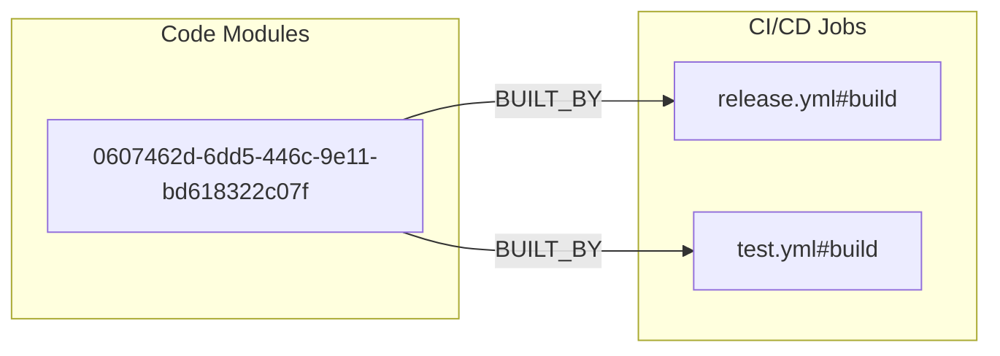
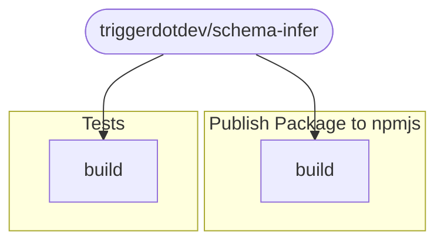

# Repository Architecture Analysis: triggerdotdev/schema-infer

## Metadata
- **SHA**: `c72139c01e139f2e5638134f89d36ed6cf1c55e2`
- **Primary Ecosystem**: JavaScript/TypeScript

## Quality Metrics
- **ast_engine**: tree-sitter
- **avg_cognitive_complexity**: 1.88
- **avg_cyclomatic_complexity**: 2.41
- **component_count**: 1
- **dead_code_count**: 0
- **dead_code_symbols**: 0 entry(ies)
- **duplication_pct**: 72.57
- **file_complexities**: 7 entry(ies)
- **files_analyzed**: 7
- **fitness_passed**: False
- **fitness_violation_count**: 1
- **framework**: TypeScript
- **import_edges**: 38 entry(ies)
- **loc**: 833
- **max_cognitive_complexity**: 15
- **max_cyclomatic_complexity**: 12
- **sloc**: 707
- **test_file_count**: 6

# Architecture: triggerdotdev/schema-infer

## Context
- **Repository**: `triggerdotdev/schema-infer`
- **SHA**: `c72139c01e139f2e5638134f89d36ed6cf1c55e2`
- **Ecosystem**: JavaScript/TypeScript
- **Framework**: TypeScript

## Building Block View

## Component Details
- **@jsonhero/schema-infer** (`package.json`): MODULE

## 6-Dimension Repository Scorecard

- **Overall Grade**: `B` (82.10/100)
- **Technical Debt Score**: 17.90
- **Estimated Remediation Effort**: 26.49h

| Dimension | Grade | Score | Weight | Details |
| :--- | :---: | :---: | :---: | :--- |
| Code Quality | `C` | 75.00 | 0.20 | avg_cc=2.41, max_cc=12, duplication=72.57%, dead_code=0 |
| Dependency Health | `A` | 100.00 | 0.15 | dependencies=475, outdated=0, vulnerable=0, has_lockfile=True |
| Maintainability | `A` | 94.00 | 0.15 | avg_cognitive=1.88, max_cognitive=15, fitness_violations=1, oversized_files=0 |
| Pipeline Health | `B` | 82.00 | 0.15 | workflows=2, operational_antipatterns=4, parallel_branches=False |
| Security | `C` | 76.00 | 0.20 | vulnerabilities=0, secrets=0, pipeline_security_findings=2 |
| Test Coverage | `C` | 70.00 | 0.15 | coverage=unavailable, ci_test_job=True, test_files_detected=True |

## Architecture Fitness & Workspace Boundaries

- **[MEDIUM] `ATRUSS-ARCH-005` (COMPLEXITY_THRESHOLD)**: Repository duplication_pct (72.57) exceeds policy threshold (15.0).

## Supply Chain Dependencies, Vulnerabilities & Secrets

- **Dependencies Parsed**: 475 | **Vulnerabilities**: 0 | **Secrets**: 0

### Inventory Sample
- `@jsonhero/json-infer-types` `1.2.3` (npm, `package-lock.json`)
- `@jsonhero/json-infer-types` `1.2.x` (npm, `package.json`)
- `@jsonhero/json-schema-fns` `0.0.1` (npm, `package-lock.json`)
- `@jsonhero/json-schema-fns` `0.0.1` (npm, `package.json`)
- `@tsconfig/node16` `1.0.2` (npm, `package-lock.json`)
- `@tsconfig/node16` `1.0.2` (npm, `package.json`)
- `@types/jest` `27.0.2` (npm, `package.json`)
- `@types/jest` `27.0.3` (npm, `package-lock.json`)
- `@types/lodash.omit` `4.5.6` (npm, `package-lock.json`)
- `@types/lodash.omit` `4.5.6` (npm, `package.json`)
- `@types/node` `16.11.14` (npm, `package-lock.json`)
- `@types/node` `16.11.7` (npm, `package.json`)
- `@typescript-eslint/eslint-plugin` `5.8.1` (npm, `package-lock.json`)
- `@typescript-eslint/eslint-plugin` `5.8.1` (npm, `package.json`)
- `@typescript-eslint/parser` `5.8.1` (npm, `package-lock.json`)
- `@typescript-eslint/parser` `5.8.1` (npm, `package.json`)
- `ajv` `8.8.2` (npm, `package-lock.json`)
- `ajv` `8.8.2` (npm, `package.json`)
- `ajv-formats` `2.1.1` (npm, `package-lock.json`)
- `ajv-formats` `2.1.1` (npm, `package.json`)
- `eslint` `8.5.0` (npm, `package-lock.json`)
- `eslint` `8.5.0` (npm, `package.json`)
- `eslint-config-prettier` `8.3.0` (npm, `package-lock.json`)
- `eslint-config-prettier` `8.3.0` (npm, `package.json`)
- `eslint-plugin-prettier` `4.0.0` (npm, `package-lock.json`)
- `eslint-plugin-prettier` `4.0.0` (npm, `package.json`)
- `jest` `27.3.1` (npm, `package.json`)
- `jest` `27.4.5` (npm, `package-lock.json`)
- `jest-coverage-badges` `1.1.2` (npm, `package-lock.json`)
- `jest-coverage-badges` `1.1.2` (npm, `package.json`)
- ... (+445 more dependencies)

## Section 7: Code-to-Cloud Deployment Traceability

- `0607462d-6dd5-446c-9e11-bd618322c07f` (code_module) --[BUILT_BY]--> `release.yml#build` (ci_job)
- `0607462d-6dd5-446c-9e11-bd618322c07f` (code_module) --[BUILT_BY]--> `test.yml#build` (ci_job)

## CI/CD Pipeline Topology

