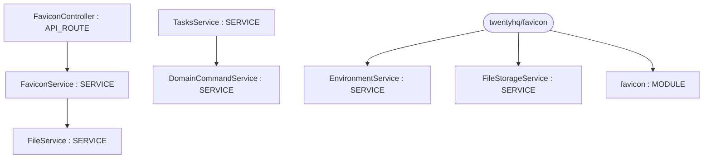
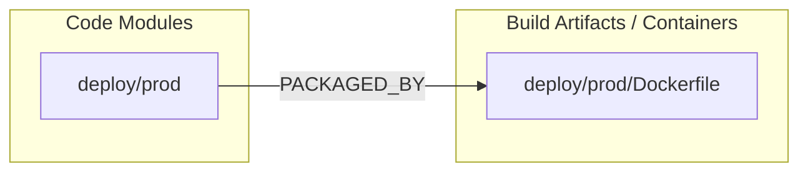
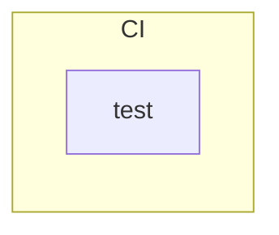

# Repository Architecture Analysis: twentyhq/favicon

## Metadata
- **SHA**: `fb84fc14394ee60a675fa88a892b912cb4329557`
- **Primary Ecosystem**: JavaScript/TypeScript

## Quality Metrics
- **ast_engine**: tree-sitter
- **avg_cognitive_complexity**: 0.92
- **avg_cyclomatic_complexity**: 1.83
- **component_count**: 8
- **dead_code_count**: 0
- **dead_code_symbols**: 0 entry(ies)
- **duplication_pct**: 40.59
- **file_complexities**: 25 entry(ies)
- **files_analyzed**: 43
- **fitness_passed**: False
- **fitness_violation_count**: 1
- **framework**: TypeScript
- **import_edges**: 100 entry(ies)
- **loc**: 1592
- **max_cognitive_complexity**: 7
- **max_cyclomatic_complexity**: 7
- **sloc**: 1343
- **test_file_count**: 6

# Architecture: twentyhq/favicon

## Context
- **Repository**: `twentyhq/favicon`
- **SHA**: `fb84fc14394ee60a675fa88a892b912cb4329557`
- **Ecosystem**: JavaScript/TypeScript
- **Framework**: TypeScript

## Building Block View

## Component Details
- **favicon** (`package.json`): MODULE
- **FaviconController** (`src/favicon/favicon.controller.ts`): API_ROUTE (deps: FaviconService)
- **FaviconService** (`src/favicon/favicon.service.ts`): SERVICE (deps: FileService)
- **FileService** (`src/favicon/file.service.ts`): SERVICE
- **DomainCommandService** (`src/packages/commands/commands.service.ts`): SERVICE
- **EnvironmentService** (`src/packages/environment/environment.service.ts`): SERVICE
- **FileStorageService** (`src/packages/file-storage/file-storage.service.ts`): SERVICE
- **TasksService** (`src/packages/tasks/tasks.service.ts`): SERVICE (deps: DomainCommandService)

## 6-Dimension Repository Scorecard

- **Overall Grade**: `B` (83.60/100)
- **Technical Debt Score**: 16.40
- **Estimated Remediation Effort**: 16.72h

| Dimension | Grade | Score | Weight | Details |
| :--- | :---: | :---: | :---: | :--- |
| Code Quality | `C` | 75.00 | 0.20 | avg_cc=1.83, max_cc=7, duplication=40.59%, dead_code=0 |
| Dependency Health | `B` | 85.00 | 0.15 | dependencies=42, outdated=0, vulnerable=0, has_lockfile=False |
| Maintainability | `A` | 94.00 | 0.15 | avg_cognitive=0.92, max_cognitive=7, fitness_violations=1, oversized_files=0 |
| Pipeline Health | `A` | 91.00 | 0.15 | workflows=1, operational_antipatterns=2, parallel_branches=False |
| Security | `B` | 88.00 | 0.20 | vulnerabilities=0, secrets=0, pipeline_security_findings=1 |
| Test Coverage | `C` | 70.00 | 0.15 | coverage=unavailable, ci_test_job=True, test_files_detected=True |

## Architecture Fitness & Workspace Boundaries

- **[MEDIUM] `ATRUSS-ARCH-005` (COMPLEXITY_THRESHOLD)**: Repository duplication_pct (40.59) exceeds policy threshold (15.0).

## Supply Chain Dependencies, Vulnerabilities & Secrets

- **Dependencies Parsed**: 42 | **Vulnerabilities**: 0 | **Secrets**: 0

### Inventory Sample
- `@aws-sdk/client-s3` `3.1034.0` (npm, `package.json`)
- `@aws-sdk/credential-providers` `3.1034.0` (npm, `package.json`)
- `@eslint/eslintrc` `3.2.0` (npm, `package.json`)
- `@nestjs/cli` `11.0.21` (npm, `package.json`)
- `@nestjs/common` `11.2.7` (npm, `package.json`)
- `@nestjs/config` `4.0.4` (npm, `package.json`)
- `@nestjs/core` `11.2.7` (npm, `package.json`)
- `@nestjs/platform-express` `11.2.7` (npm, `package.json`)
- `@nestjs/schedule` `6.1.3` (npm, `package.json`)
- `@nestjs/schematics` `11.1.0` (npm, `package.json`)
- `@nestjs/testing` `11.2.7` (npm, `package.json`)
- `@types/express` `4.17.17` (npm, `package.json`)
- `@types/inquirer` `8.1.3` (npm, `package.json`)
- `@types/jest` `30.0.0` (npm, `package.json`)
- `@types/node` `25.6.0` (npm, `package.json`)
- `@types/supertest` `7.2.0` (npm, `package.json`)
- `@typescript-eslint/eslint-plugin` `8.59.0` (npm, `package.json`)
- `@typescript-eslint/parser` `8.59.0` (npm, `package.json`)
- `axios` `1.20.0` (npm, `package.json`)
- `axios-curlirize` `2.0.0` (npm, `package.json`)
- `cheerio` `1.2.0` (npm, `package.json`)
- `class-transformer` `0.5.1` (npm, `package.json`)
- `class-validator` `0.15.1` (npm, `package.json`)
- `eslint` `10.0.2` (npm, `package.json`)
- `eslint-config-prettier` `10.1.8` (npm, `package.json`)
- `eslint-plugin-prettier` `5.5.5` (npm, `package.json`)
- `file-type` `21` (npm, `package.json`)
- `globals` `17.5.0` (npm, `package.json`)
- `ico-to-png` `0.2.1` (npm, `package.json`)
- `jest` `30.3.0` (npm, `package.json`)
- ... (+12 more dependencies)

## Section 7: Code-to-Cloud Deployment Traceability

- `deploy/prod` (code_module) --[PACKAGED_BY]--> `deploy/prod/Dockerfile` (container)

## CI/CD Pipeline Topology

