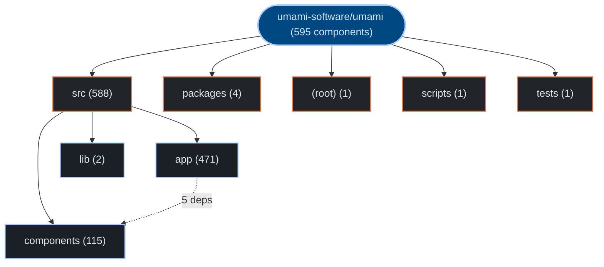
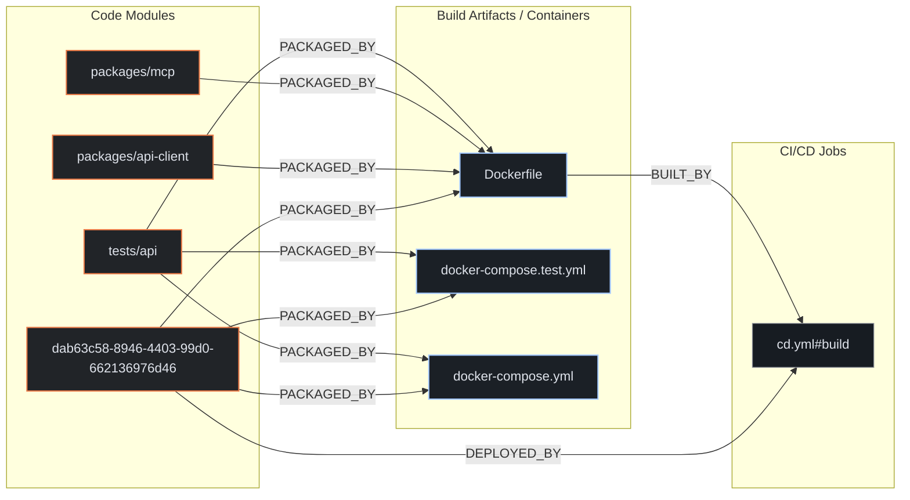
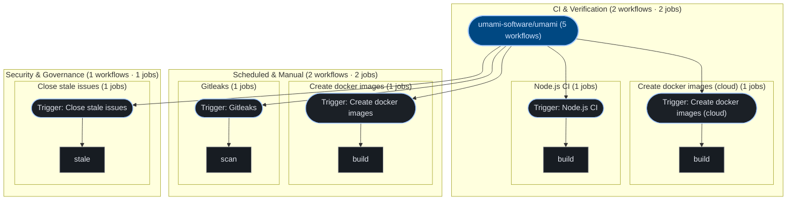

# Repository Architecture Analysis: umami-software/umami

## Metadata
- **SHA**: `b18d5144dfe7342edeeca6f61d13ba3baabed9ad`
- **Primary Ecosystem**: JavaScript/TypeScript

## Quality Metrics
- **ast_engine**: tree-sitter
- **avg_cognitive_complexity**: 2.73
- **avg_cyclomatic_complexity**: 3.2
- **component_count**: 595
- **dead_code_count**: 6
- **dead_code_symbols**: 6 entry(ies)
- **duplication_pct**: 90.05
- **file_complexities**: 25 entry(ies)
- **files_analyzed**: 1519
- **fitness_passed**: False
- **fitness_violation_count**: 3
- **framework**: Next.js
- **import_edges**: 100 entry(ies)
- **loc**: 183598
- **max_cognitive_complexity**: 100
- **max_cyclomatic_complexity**: 104
- **sloc**: 157312
- **test_file_count**: 254

# Architecture: umami-software/umami

## Context
- **Repository**: `umami-software/umami`
- **SHA**: `b18d5144dfe7342edeeca6f61d13ba3baabed9ad`
- **Ecosystem**: JavaScript/TypeScript
- **Framework**: Next.js

## Building Block View

## Component Details

Showing top 60 representative components out of 595 across 5 module group(s):

- **Module `src`** (588 components — UI_COMPONENT: 432, API_ROUTE: 154, SERVICE: 2)
- **Module `packages`** (4 components — MODULE: 2, SERVICE: 2)
- **Module `(root)`** (1 components — MODULE: 1)
- **Module `scripts`** (1 components — SERVICE: 1)
- **Module `tests`** (1 components — SERVICE: 1)

- **Revenue** (`src/app/(main)/websites/[websiteId]/(reports)/revenue/Revenue.tsx`): UI_COMPONENT (deps: BoardRevenueChart, BoardRevenueMetricsBar, BoardRevenueMetricsTable, RevenueChart, RevenueMetricsBar, RevenueMetricsTable (+2 more))
- **PreferenceSettings** (`src/app/(main)/settings/preferences/PreferenceSettings.tsx`): UI_COMPONENT (deps: DateRangeSetting, LanguageSetting, ThemeSetting, TimeFormatSetting, TimezoneSetting, VersionSetting)
- **SessionProfile** (`src/app/(main)/websites/[websiteId]/sessions/SessionProfile.tsx`): UI_COMPONENT (deps: SessionActivity, SessionData, SessionDeleteButton, SessionInfo, SessionReplaysDataTable, SessionStats)
- **WebsitePage** (`src/app/(main)/websites/[websiteId]/WebsitePage.tsx`): UI_COMPONENT (deps: AnnotationsButton, AnnotationsModal, WebsiteChart, WebsiteControls, WebsiteMetricsBar, WebsitePanels)
- **WebsiteShareForm** (`src/app/(main)/websites/[websiteId]/settings/WebsiteShareForm.tsx`): UI_COMPONENT (deps: BoardSharesTable, ShareEditForm, SharedSharesTable, SharesTable, SimpleShareEditForm, SimpleSharesTable)
- **RealtimePage** (`src/app/(main)/websites/[websiteId]/realtime/RealtimePage.tsx`): UI_COMPONENT (deps: RealtimeCountries, RealtimeHeader, RealtimeLog, RealtimePaths, RealtimeReferrers)
- **TeamSettings** (`src/app/(main)/teams/[teamId]/TeamSettings.tsx`): UI_COMPONENT (deps: TeamEditForm, TeamManage, TeamMembersDataTable, TeamTwoFactorSettings, TeamsMemberAddButton)
- **WebsiteSettings** (`src/app/(main)/websites/[websiteId]/settings/WebsiteSettings.tsx`): UI_COMPONENT (deps: WebsiteData, WebsiteEditForm, WebsiteReplaySettings, WebsiteShareForm, WebsiteTrackingCode)
- **ErrorIssuePage** (`src/app/(main)/websites/[websiteId]/errors/[issueId]/ErrorIssuePage.tsx`): UI_COMPONENT (deps: ErrorFilters, ErrorStats, SessionModal, WebsiteControls)
- **ReplaysDataTable** (`src/app/(main)/websites/[websiteId]/replays/ReplaysDataTable.tsx`): UI_COMPONENT (deps: ReplayFilterButton, ReplaysTable, SavedReplaysTable, SessionReplaysTable)
- **ReplaysPage** (`src/app/(main)/websites/[websiteId]/replays/ReplaysPage.tsx`): UI_COMPONENT (deps: ReplayModal, ReplaysDataTable, SavedReplaysDataTable, SessionReplaysDataTable)
- **SessionsPage** (`src/app/(main)/websites/[websiteId]/sessions/SessionsPage.tsx`): UI_COMPONENT (deps: RevenueSessionsDataTable, SessionModal, SessionProperties, SessionsDataTable)
- **WebsitesPage** (`src/app/(main)/websites/WebsitesPage.tsx`): UI_COMPONENT (deps: AdminWebsitesDataTable, TeamWebsitesDataTable, WebsiteAddButton, WebsitesDataTable)
- **BoardDesignPage** (`src/app/(main)/boards/[boardId]/BoardEditPage.tsx`): UI_COMPONENT (deps: BoardControls, BoardDesignHeader, BoardEditBody)
- **BoardEditColumn** (`src/app/(main)/boards/[boardId]/BoardEditColumn.tsx`): UI_COMPONENT (deps: BoardComponentRenderer, BoardComponentSelect, CATEGORIES)
- **BoardViewColumn** (`src/app/(main)/boards/[boardId]/BoardViewColumn.tsx`): UI_COMPONENT (deps: BoardComponentRenderer, BoardEntityBadge, CATEGORIES)
- **BoardViewPage** (`src/app/(main)/boards/[boardId]/BoardViewPage.tsx`): UI_COMPONENT (deps: BoardControls, BoardViewBody, BoardViewHeader)
- **BoardsTable** (`src/app/(main)/boards/BoardsTable.tsx`): UI_COMPONENT (deps: BoardDeleteButton, BoardDesignButton, BoardEditButton)
- **ErrorsPage** (`src/app/(main)/websites/[websiteId]/errors/ErrorsPage.tsx`): UI_COMPONENT (deps: ErrorFilters, ErrorStats, WebsiteControls)
- **EventsPage** (`src/app/(main)/websites/[websiteId]/events/EventsPage.tsx`): UI_COMPONENT (deps: EventProperties, EventsDataTable, EventsMetricsBar)
- **FunnelsPage** (`src/app/(main)/websites/[websiteId]/(reports)/funnels/FunnelsPage.tsx`): UI_COMPONENT (deps: BoardFunnel, Funnel, FunnelAddButton)
- **GoalsPage** (`src/app/(main)/websites/[websiteId]/(reports)/goals/GoalsPage.tsx`): UI_COMPONENT (deps: BoardGoal, Goal, GoalAddButton)
- **GoogleAdsPage** (`src/app/(main)/websites/[websiteId]/google-ads/GoogleAdsPage.tsx`): UI_COMPONENT (deps: GoogleAdsChart, GoogleAdsConversionsTable, GoogleAdsTable)
- **UserPage** (`src/app/(main)/admin/users/[userId]/UserPage.tsx`): UI_COMPONENT (deps: UserContext, UserProvider, UserSettings)
- **UserSettings** (`src/app/(main)/admin/users/[userId]/UserSettings.tsx`): UI_COMPONENT (deps: UserEditForm, UserTwoFactorSettings, UserWebsites)
- **WebsiteData** (`src/app/(main)/websites/[websiteId]/settings/WebsiteData.tsx`): UI_COMPONENT (deps: WebsiteDeleteForm, WebsiteResetForm, WebsiteTransferForm)
- **WebsitesDataTable** (`src/app/(main)/websites/WebsitesDataTable.tsx`): UI_COMPONENT (deps: AdminWebsitesTable, TeamWebsitesTable, WebsitesTable)
- **AdminTeamsPage** (`src/app/(main)/admin/teams/AdminTeamsPage.tsx`): UI_COMPONENT (deps: AdminTeamsDataTable, TeamsAddButton)
- **AnnotationsModal** (`src/app/(main)/websites/[websiteId]/annotations/AnnotationsModal.tsx`): UI_COMPONENT (deps: AnnotationDeleteButton, AnnotationEditForm)
- **ApiKeysPage** (`src/app/(main)/settings/api-keys/ApiKeysPage.tsx`): UI_COMPONENT (deps: ApiKeyAddButton, ApiKeysTable)
- **BoardComponentSelect** (`src/app/(main)/boards/[boardId]/BoardComponentSelect.tsx`): UI_COMPONENT (deps: BoardComponentRenderer, CATEGORIES)
- **BoardShareDialog** (`src/app/(main)/boards/[boardId]/BoardShareDialog.tsx`): UI_COMPONENT (deps: BoardShareCreateForm, BoardSharesTable)
- **BoardViewHeader** (`src/app/(main)/boards/[boardId]/BoardViewHeader.tsx`): UI_COMPONENT (deps: BoardCloneButton, BoardEntityBadge)
- **BoardsPage** (`src/app/(main)/boards/BoardsPage.tsx`): UI_COMPONENT (deps: BoardAddButton, BoardsDataTable)
- **CohortsDataTable** (`src/app/(main)/websites/[websiteId]/cohorts/CohortsDataTable.tsx`): UI_COMPONENT (deps: CohortAddButton, CohortsTable)
- **DashboardEditPage** (`src/app/(main)/dashboard/DashboardEditPage.tsx`): UI_COMPONENT (deps: DashboardEditHeader, DashboardProvider)
- **DashboardViewPage** (`src/app/(main)/dashboard/DashboardViewPage.tsx`): UI_COMPONENT (deps: DashboardProvider, DashboardViewHeader)
- **LinksTable** (`src/app/(main)/links/LinksTable.tsx`): UI_COMPONENT (deps: LinkDeleteButton, LinkEditButton)
- **MobileNav** (`src/app/(main)/MobileNav.tsx`): UI_COMPONENT (deps: AdminNav, SettingsNav)
- **PixelsPage** (`src/app/(main)/pixels/PixelsPage.tsx`): UI_COMPONENT (deps: PixelAddButton, PixelsDataTable)
- **PixelsTable** (`src/app/(main)/pixels/PixelsTable.tsx`): UI_COMPONENT (deps: PixelDeleteButton, PixelEditButton)
- **ReplayPlayback** (`src/app/(main)/websites/[websiteId]/replays/[replayId]/ReplayPlayback.tsx`): UI_COMPONENT (deps: ReplayPlayer, ReplaySaveForm)
- **SearchConsolePage** (`src/app/(main)/websites/[websiteId]/search-console/SearchConsolePage.tsx`): UI_COMPONENT (deps: SearchConsoleChart, SearchConsoleTable)
- **SegmentsDataTable** (`src/app/(main)/websites/[websiteId]/segments/SegmentsDataTable.tsx`): UI_COMPONENT (deps: SegmentAddButton, SegmentsTable)
- **SessionProperties** (`src/app/(main)/websites/[websiteId]/sessions/SessionProperties.tsx`): UI_COMPONENT (deps: SessionDataPivotTable, SessionPropertyChart)
- **SessionReplaysDataTable** (`src/app/(main)/websites/[websiteId]/sessions/SessionReplaysDataTable.tsx`): UI_COMPONENT (deps: ReplayPlayback, SessionReplaysTable)
- **ShareEditButton** (`src/app/(main)/websites/[websiteId]/settings/ShareEditButton.tsx`): UI_COMPONENT (deps: ShareEditForm, SimpleShareEditForm)
- **SharePage** (`src/app/share/[slug]/[[...path]]/SharePage.tsx`): UI_COMPONENT (deps: ShareFooter, ShareNav)
- **SharesTable** (`src/app/(main)/websites/[websiteId]/settings/SharesTable.tsx`): UI_COMPONENT (deps: ShareEditForm, SimpleShareEditForm)
- **SimpleSharesTable** (`src/components/share/SimpleSharesTable.tsx`): UI_COMPONENT (deps: SharedSharesTable, SimpleShareEditButton)
- **TeamMembersTable** (`src/app/(main)/teams/[teamId]/TeamMembersTable.tsx`): UI_COMPONENT (deps: TeamMemberEditButton, TeamMemberRemoveButton)
- **TeamsDataTable** (`src/app/(main)/teams/TeamsDataTable.tsx`): UI_COMPONENT (deps: AdminTeamsTable, TeamsTable)
- **TeamsHeader** (`src/app/(main)/teams/TeamsHeader.tsx`): UI_COMPONENT (deps: TeamsAddButton, TeamsJoinButton)
- **UTMPage** (`src/app/(main)/websites/[websiteId]/(reports)/utm/UTMPage.tsx`): UI_COMPONENT (deps: BoardUTM, UTM)
- **UsersPage** (`src/app/(main)/admin/users/UsersPage.tsx`): UI_COMPONENT (deps: UserAddButton, UsersDataTable)
- **WebsiteAddButton** (`src/app/(main)/websites/WebsiteAddButton.tsx`): UI_COMPONENT (deps: WebsiteAddForm, WebsiteTrackingCode)
- **AdminTeamsDataTable** (`src/app/(main)/admin/teams/AdminTeamsDataTable.tsx`): UI_COMPONENT (deps: AdminTeamsTable)
- **AdminTeamsTable** (`src/app/(main)/admin/teams/AdminTeamsTable.tsx`): UI_COMPONENT (deps: TeamDeleteForm)
- **AdminWebsitesDataTable** (`src/app/(main)/admin/websites/AdminWebsitesDataTable.tsx`): UI_COMPONENT (deps: AdminWebsitesTable)
- **AdminWebsitesPage** (`src/app/(main)/admin/websites/AdminWebsitesPage.tsx`): UI_COMPONENT (deps: AdminWebsitesDataTable)

## 6-Dimension Repository Scorecard

- **Overall Grade**: `F` (45.24/100)
- **Technical Debt Score**: 54.76
- **Estimated Remediation Effort**: 91.20h

| Dimension | Grade | Score | Weight | Details |
| :--- | :---: | :---: | :---: | :--- |
| Code Quality | `F` | 37.20 | 0.20 | avg_cc=3.20, max_cc=104, duplication=90.05%, dead_code=6 |
| Dependency Health | `A` | 100.00 | 0.15 | dependencies=1270, outdated=0, vulnerable=0, has_lockfile=True |
| Maintainability | `F` | 37.00 | 0.15 | avg_cognitive=2.73, max_cognitive=100, fitness_violations=3, oversized_files=9 |
| Pipeline Health | `F` | 45.00 | 0.15 | workflows=5, operational_antipatterns=7, parallel_branches=False |
| Security | `F` | 0.00 | 0.20 | vulnerabilities=0, secrets=8, pipeline_security_findings=11 |
| Test Coverage | `C` | 70.00 | 0.15 | coverage=unavailable, ci_test_job=True, test_files_detected=True |

## Architecture Fitness & Workspace Boundaries

- **[MEDIUM] `ATRUSS-ARCH-005` (COMPLEXITY_THRESHOLD)**: Repository duplication_pct (90.05) exceeds policy threshold (15.0).
- **[MEDIUM] `ATRUSS-ARCH-005` (COMPLEXITY_THRESHOLD)**: Repository max_cognitive_complexity (100.0) exceeds policy threshold (25.0).
- **[MEDIUM] `ATRUSS-ARCH-005` (COMPLEXITY_THRESHOLD)**: Repository max_cyclomatic_complexity (104.0) exceeds policy threshold (20.0).

### Workspace Packages
- **@umami/api-client** (`packages/api-client`, react_ts_js, pnpm)
- **@umami/mcp** (`packages/mcp`, react_ts_js, pnpm) -> internal deps: `@umami/api-client`

## Supply Chain Dependencies, Vulnerabilities & Secrets

- **Dependencies Parsed**: 1270 | **Vulnerabilities**: 0 | **Secrets**: 8

### Secret Findings (Redacted)
- **[HIGH] `ATRUSS-SEC-005`** at `public/intl/messages/ja-JP.json:483` (`"password-change-required": "アカウン***REDACTED***",`)
- **[HIGH] `ATRUSS-SEC-005`** at `public/intl/messages/ja-JP.json:535` (`"api-key-created": "今すぐA***REDACTED***",`)
- **[HIGH] `ATRUSS-SEC-005`** at `src/lib/auth.test.ts:112` (`const API_KEY = 'umam***REDACTED***';`)
- **[HIGH] `ATRUSS-SEC-005`** at `src/lib/auth.test.ts:305` (`const systemUserPasswordHash = '$2b$***REDACTED***';`)
- **[HIGH] `ATRUSS-SEC-005`** at `src/lib/password.test.ts:42` (`password: '$2b$***REDACTED***',`)
- **[HIGH] `ATRUSS-SEC-005`** at `src/lib/password.test.ts:56` (`password: '$2b$***REDACTED***',`)
- **[HIGH] `ATRUSS-SEC-005`** at `src/lib/password.test.ts:69` (`password: '$2b$***REDACTED***',`)
- **[HIGH] `ATRUSS-SEC-005`** at `src/lib/password.ts:5` (`const SYSTEM_USER_PASSWORD_HASH = '$2b$***REDACTED***';`)

### Inventory Sample
- `@biomejs/biome` `2.5.15` (npm, `package.json`)
- `@biomejs/biome` `2.5.15` (npm, `pnpm-lock.yaml`)
- `@clickhouse/client` `1.24.0` (npm, `package.json`)
- `@clickhouse/client` `1.24.0` (npm, `pnpm-lock.yaml`)
- `@dicebear/core` `10.7.0` (npm, `package.json`)
- `@dicebear/core` `10.7.0` (npm, `pnpm-lock.yaml`)
- `@dicebear/styles` `10.6.0` (npm, `package.json`)
- `@dicebear/styles` `10.6.0` (npm, `pnpm-lock.yaml`)
- `@eloqnt/cli` `0.6.33` (npm, `package.json`)
- `@eloqnt/cli` `0.6.33` (npm, `pnpm-lock.yaml`)
- `@modelcontextprotocol/client` `2.3.1` (npm, `packages/mcp/package.json`)
- `@modelcontextprotocol/client` `2.3.1` (npm, `pnpm-lock.yaml`)
- `@modelcontextprotocol/server` `2.3.1` (npm, `packages/mcp/package.json`)
- `@modelcontextprotocol/server` `2.3.1` (npm, `pnpm-lock.yaml`)
- `@netlify/plugin-nextjs` `5.16.2` (npm, `package.json`)
- `@netlify/plugin-nextjs` `5.16.2` (npm, `pnpm-lock.yaml`)
- `@playwright/test` `1.64.0` (npm, `package.json`)
- `@playwright/test` `1.64.0` (npm, `pnpm-lock.yaml`)
- `@prisma/adapter-pg` `7.10.0` (npm, `package.json`)
- `@prisma/adapter-pg` `7.10.0` (npm, `pnpm-lock.yaml`)
- `@prisma/client` `7.10.0` (npm, `package.json`)
- `@prisma/client` `7.10.0` (npm, `pnpm-lock.yaml`)
- `@prisma/extension-read-replicas` `0.5.0` (npm, `package.json`)
- `@prisma/extension-read-replicas` `0.5.0` (npm, `pnpm-lock.yaml`)
- `@rollup/plugin-commonjs` `29.0.3` (npm, `package.json`)
- `@rollup/plugin-commonjs` `29.0.3` (npm, `pnpm-lock.yaml`)
- `@rollup/plugin-node-resolve` `16.0.3` (npm, `package.json`)
- `@rollup/plugin-node-resolve` `16.0.3` (npm, `pnpm-lock.yaml`)
- `@rollup/plugin-replace` `6.0.3` (npm, `package.json`)
- `@rollup/plugin-replace` `6.0.3` (npm, `pnpm-lock.yaml`)
- ... (+1240 more dependencies)

## Section 7: Code-to-Cloud Deployment Traceability

- `dab63c58-8946-4403-99d0-662136976d46` (code_module) --[DEPLOYED_BY]--> `cd.yml#build` (ci_job)
- `dab63c58-8946-4403-99d0-662136976d46` (code_module) --[PACKAGED_BY]--> `Dockerfile` (container)
- `dab63c58-8946-4403-99d0-662136976d46` (code_module) --[PACKAGED_BY]--> `docker-compose.test.yml` (container)
- `dab63c58-8946-4403-99d0-662136976d46` (code_module) --[PACKAGED_BY]--> `docker-compose.yml` (container)
- `packages/api-client` (code_module) --[PACKAGED_BY]--> `Dockerfile` (container)
- `packages/mcp` (code_module) --[PACKAGED_BY]--> `Dockerfile` (container)
- `tests/api` (code_module) --[PACKAGED_BY]--> `Dockerfile` (container)
- `tests/api` (code_module) --[PACKAGED_BY]--> `docker-compose.test.yml` (container)
- `tests/api` (code_module) --[PACKAGED_BY]--> `docker-compose.yml` (container)
- `Dockerfile` (container) --[BUILT_BY]--> `cd.yml#build` (ci_job)

## CI/CD Pipeline Topology

