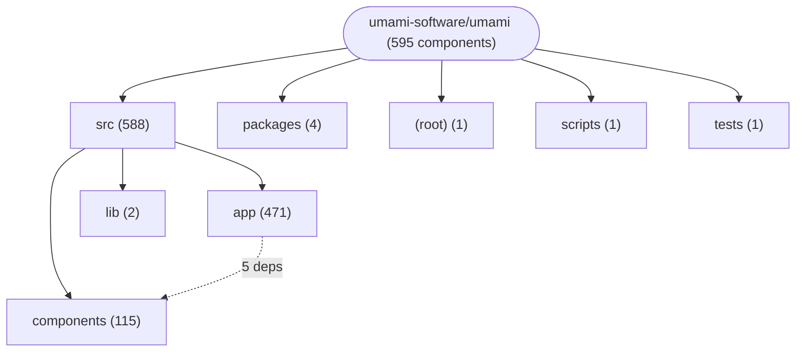
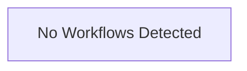

# Repository Architecture Analysis: umami-software/umami

## Metadata
- **SHA**: `b18d5144dfe7342edeeca6f61d13ba3baabed9ad`
- **Primary Ecosystem**: JavaScript/TypeScript

## Quality Metrics
- **avg_cyclomatic_complexity**: 21.24
- **component_count**: 595
- **files_analyzed**: 1610
- **framework**: Next.js
- **loc**: 227333
- **max_cyclomatic_complexity**: 488
- **sloc**: 188689

# Architecture: umami-software/umami

## Context
- **Repository**: `umami-software/umami`
- **SHA**: `b18d5144dfe7342edeeca6f61d13ba3baabed9ad`
- **Ecosystem**: JavaScript/TypeScript
- **Framework**: Unknown

## Building Block View

## Component Details

Showing top 60 representative components out of 595 across 5 module group(s):

- **Module `src`** (588 components — UI_COMPONENT: 432, API_ROUTE: 154, SERVICE: 2)
- **Module `packages`** (4 components — MODULE: 2, SERVICE: 2)
- **Module `(root)`** (1 components — MODULE: 1)
- **Module `scripts`** (1 components — SERVICE: 1)
- **Module `tests`** (1 components — SERVICE: 1)

- **Revenue** (`src/app/(main)/websites/[websiteId]/(reports)/revenue/Revenue.tsx`): UI_COMPONENT (deps: BoardRevenueChart, BoardRevenueMetricsBar, BoardRevenueMetricsTable, RevenueChart, RevenueMetricsBar, RevenueMetricsTable (+2 more))
- **PreferenceSettings** (`src/app/(main)/settings/preferences/PreferenceSettings.tsx`): UI_COMPONENT (deps: DateRangeSetting, LanguageSetting, ThemeSetting, TimeFormatSetting, TimezoneSetting, VersionSetting)
- **SessionProfile** (`src/app/(main)/websites/[websiteId]/sessions/SessionProfile.tsx`): UI_COMPONENT (deps: SessionActivity, SessionData, SessionDeleteButton, SessionInfo, SessionReplaysDataTable, SessionStats)
- **WebsitePage** (`src/app/(main)/websites/[websiteId]/WebsitePage.tsx`): UI_COMPONENT (deps: AnnotationsButton, AnnotationsModal, WebsiteChart, WebsiteControls, WebsiteMetricsBar, WebsitePanels)
- **WebsiteShareForm** (`src/app/(main)/websites/[websiteId]/settings/WebsiteShareForm.tsx`): UI_COMPONENT (deps: BoardSharesTable, ShareEditForm, SharedSharesTable, SharesTable, SimpleShareEditForm, SimpleSharesTable)
- **RealtimePage** (`src/app/(main)/websites/[websiteId]/realtime/RealtimePage.tsx`): UI_COMPONENT (deps: RealtimeCountries, RealtimeHeader, RealtimeLog, RealtimePaths, RealtimeReferrers)
- **TeamSettings** (`src/app/(main)/teams/[teamId]/TeamSettings.tsx`): UI_COMPONENT (deps: TeamEditForm, TeamManage, TeamMembersDataTable, TeamTwoFactorSettings, TeamsMemberAddButton)
- **WebsiteSettings** (`src/app/(main)/websites/[websiteId]/settings/WebsiteSettings.tsx`): UI_COMPONENT (deps: WebsiteData, WebsiteEditForm, WebsiteReplaySettings, WebsiteShareForm, WebsiteTrackingCode)
- **ErrorIssuePage** (`src/app/(main)/websites/[websiteId]/errors/[issueId]/ErrorIssuePage.tsx`): UI_COMPONENT (deps: ErrorFilters, ErrorStats, SessionModal, WebsiteControls)
- **ReplaysDataTable** (`src/app/(main)/websites/[websiteId]/replays/ReplaysDataTable.tsx`): UI_COMPONENT (deps: ReplayFilterButton, ReplaysTable, SavedReplaysTable, SessionReplaysTable)
- **ReplaysPage** (`src/app/(main)/websites/[websiteId]/replays/ReplaysPage.tsx`): UI_COMPONENT (deps: ReplayModal, ReplaysDataTable, SavedReplaysDataTable, SessionReplaysDataTable)
- **SessionsPage** (`src/app/(main)/websites/[websiteId]/sessions/SessionsPage.tsx`): UI_COMPONENT (deps: RevenueSessionsDataTable, SessionModal, SessionProperties, SessionsDataTable)
- **WebsitesPage** (`src/app/(main)/websites/WebsitesPage.tsx`): UI_COMPONENT (deps: AdminWebsitesDataTable, TeamWebsitesDataTable, WebsiteAddButton, WebsitesDataTable)
- **BoardDesignPage** (`src/app/(main)/boards/[boardId]/BoardEditPage.tsx`): UI_COMPONENT (deps: BoardControls, BoardDesignHeader, BoardEditBody)
- **BoardEditColumn** (`src/app/(main)/boards/[boardId]/BoardEditColumn.tsx`): UI_COMPONENT (deps: BoardComponentRenderer, BoardComponentSelect, CATEGORIES)
- **BoardViewColumn** (`src/app/(main)/boards/[boardId]/BoardViewColumn.tsx`): UI_COMPONENT (deps: BoardComponentRenderer, BoardEntityBadge, CATEGORIES)
- **BoardViewPage** (`src/app/(main)/boards/[boardId]/BoardViewPage.tsx`): UI_COMPONENT (deps: BoardControls, BoardViewBody, BoardViewHeader)
- **BoardsTable** (`src/app/(main)/boards/BoardsTable.tsx`): UI_COMPONENT (deps: BoardDeleteButton, BoardDesignButton, BoardEditButton)
- **ErrorsPage** (`src/app/(main)/websites/[websiteId]/errors/ErrorsPage.tsx`): UI_COMPONENT (deps: ErrorFilters, ErrorStats, WebsiteControls)
- **EventsPage** (`src/app/(main)/websites/[websiteId]/events/EventsPage.tsx`): UI_COMPONENT (deps: EventProperties, EventsDataTable, EventsMetricsBar)
- **FunnelsPage** (`src/app/(main)/websites/[websiteId]/(reports)/funnels/FunnelsPage.tsx`): UI_COMPONENT (deps: BoardFunnel, Funnel, FunnelAddButton)
- **GoalsPage** (`src/app/(main)/websites/[websiteId]/(reports)/goals/GoalsPage.tsx`): UI_COMPONENT (deps: BoardGoal, Goal, GoalAddButton)
- **GoogleAdsPage** (`src/app/(main)/websites/[websiteId]/google-ads/GoogleAdsPage.tsx`): UI_COMPONENT (deps: GoogleAdsChart, GoogleAdsConversionsTable, GoogleAdsTable)
- **UserPage** (`src/app/(main)/admin/users/[userId]/UserPage.tsx`): UI_COMPONENT (deps: UserContext, UserProvider, UserSettings)
- **UserSettings** (`src/app/(main)/admin/users/[userId]/UserSettings.tsx`): UI_COMPONENT (deps: UserEditForm, UserTwoFactorSettings, UserWebsites)
- **WebsiteData** (`src/app/(main)/websites/[websiteId]/settings/WebsiteData.tsx`): UI_COMPONENT (deps: WebsiteDeleteForm, WebsiteResetForm, WebsiteTransferForm)
- **WebsitesDataTable** (`src/app/(main)/websites/WebsitesDataTable.tsx`): UI_COMPONENT (deps: AdminWebsitesTable, TeamWebsitesTable, WebsitesTable)
- **AdminTeamsPage** (`src/app/(main)/admin/teams/AdminTeamsPage.tsx`): UI_COMPONENT (deps: AdminTeamsDataTable, TeamsAddButton)
- **AnnotationsModal** (`src/app/(main)/websites/[websiteId]/annotations/AnnotationsModal.tsx`): UI_COMPONENT (deps: AnnotationDeleteButton, AnnotationEditForm)
- **ApiKeysPage** (`src/app/(main)/settings/api-keys/ApiKeysPage.tsx`): UI_COMPONENT (deps: ApiKeyAddButton, ApiKeysTable)
- **BoardComponentSelect** (`src/app/(main)/boards/[boardId]/BoardComponentSelect.tsx`): UI_COMPONENT (deps: BoardComponentRenderer, CATEGORIES)
- **BoardShareDialog** (`src/app/(main)/boards/[boardId]/BoardShareDialog.tsx`): UI_COMPONENT (deps: BoardShareCreateForm, BoardSharesTable)
- **BoardViewHeader** (`src/app/(main)/boards/[boardId]/BoardViewHeader.tsx`): UI_COMPONENT (deps: BoardCloneButton, BoardEntityBadge)
- **BoardsPage** (`src/app/(main)/boards/BoardsPage.tsx`): UI_COMPONENT (deps: BoardAddButton, BoardsDataTable)
- **CohortsDataTable** (`src/app/(main)/websites/[websiteId]/cohorts/CohortsDataTable.tsx`): UI_COMPONENT (deps: CohortAddButton, CohortsTable)
- **DashboardEditPage** (`src/app/(main)/dashboard/DashboardEditPage.tsx`): UI_COMPONENT (deps: DashboardEditHeader, DashboardProvider)
- **DashboardViewPage** (`src/app/(main)/dashboard/DashboardViewPage.tsx`): UI_COMPONENT (deps: DashboardProvider, DashboardViewHeader)
- **LinksTable** (`src/app/(main)/links/LinksTable.tsx`): UI_COMPONENT (deps: LinkDeleteButton, LinkEditButton)
- **MobileNav** (`src/app/(main)/MobileNav.tsx`): UI_COMPONENT (deps: AdminNav, SettingsNav)
- **PixelsPage** (`src/app/(main)/pixels/PixelsPage.tsx`): UI_COMPONENT (deps: PixelAddButton, PixelsDataTable)
- **PixelsTable** (`src/app/(main)/pixels/PixelsTable.tsx`): UI_COMPONENT (deps: PixelDeleteButton, PixelEditButton)
- **ReplayPlayback** (`src/app/(main)/websites/[websiteId]/replays/[replayId]/ReplayPlayback.tsx`): UI_COMPONENT (deps: ReplayPlayer, ReplaySaveForm)
- **SearchConsolePage** (`src/app/(main)/websites/[websiteId]/search-console/SearchConsolePage.tsx`): UI_COMPONENT (deps: SearchConsoleChart, SearchConsoleTable)
- **SegmentsDataTable** (`src/app/(main)/websites/[websiteId]/segments/SegmentsDataTable.tsx`): UI_COMPONENT (deps: SegmentAddButton, SegmentsTable)
- **SessionProperties** (`src/app/(main)/websites/[websiteId]/sessions/SessionProperties.tsx`): UI_COMPONENT (deps: SessionDataPivotTable, SessionPropertyChart)
- **SessionReplaysDataTable** (`src/app/(main)/websites/[websiteId]/sessions/SessionReplaysDataTable.tsx`): UI_COMPONENT (deps: ReplayPlayback, SessionReplaysTable)
- **ShareEditButton** (`src/app/(main)/websites/[websiteId]/settings/ShareEditButton.tsx`): UI_COMPONENT (deps: ShareEditForm, SimpleShareEditForm)
- **SharePage** (`src/app/share/[slug]/[[...path]]/SharePage.tsx`): UI_COMPONENT (deps: ShareFooter, ShareNav)
- **SharesTable** (`src/app/(main)/websites/[websiteId]/settings/SharesTable.tsx`): UI_COMPONENT (deps: ShareEditForm, SimpleShareEditForm)
- **SimpleSharesTable** (`src/components/share/SimpleSharesTable.tsx`): UI_COMPONENT (deps: SharedSharesTable, SimpleShareEditButton)
- **TeamMembersTable** (`src/app/(main)/teams/[teamId]/TeamMembersTable.tsx`): UI_COMPONENT (deps: TeamMemberEditButton, TeamMemberRemoveButton)
- **TeamsDataTable** (`src/app/(main)/teams/TeamsDataTable.tsx`): UI_COMPONENT (deps: AdminTeamsTable, TeamsTable)
- **TeamsHeader** (`src/app/(main)/teams/TeamsHeader.tsx`): UI_COMPONENT (deps: TeamsAddButton, TeamsJoinButton)
- **UTMPage** (`src/app/(main)/websites/[websiteId]/(reports)/utm/UTMPage.tsx`): UI_COMPONENT (deps: BoardUTM, UTM)
- **UsersPage** (`src/app/(main)/admin/users/UsersPage.tsx`): UI_COMPONENT (deps: UserAddButton, UsersDataTable)
- **WebsiteAddButton** (`src/app/(main)/websites/WebsiteAddButton.tsx`): UI_COMPONENT (deps: WebsiteAddForm, WebsiteTrackingCode)
- **AdminTeamsDataTable** (`src/app/(main)/admin/teams/AdminTeamsDataTable.tsx`): UI_COMPONENT (deps: AdminTeamsTable)
- **AdminTeamsTable** (`src/app/(main)/admin/teams/AdminTeamsTable.tsx`): UI_COMPONENT (deps: TeamDeleteForm)
- **AdminWebsitesDataTable** (`src/app/(main)/admin/websites/AdminWebsitesDataTable.tsx`): UI_COMPONENT (deps: AdminWebsitesTable)
- **AdminWebsitesPage** (`src/app/(main)/admin/websites/AdminWebsitesPage.tsx`): UI_COMPONENT (deps: AdminWebsitesDataTable)

## CI/CD Pipeline Topology

