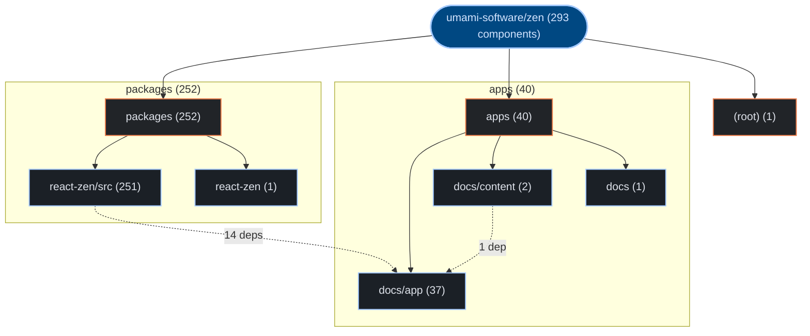

# Repository Architecture Analysis: umami-software/zen

## Metadata
- **SHA**: `e984734f77dcd90c9eadbfc17e4865346f1f3f3f`
- **Primary Ecosystem**: JavaScript/TypeScript

## Quality Metrics
- **ast_engine**: tree-sitter
- **avg_cognitive_complexity**: 2.7
- **avg_cyclomatic_complexity**: 3.3
- **component_count**: 293
- **dead_code_count**: 0
- **dead_code_symbols**: 0 entry(ies)
- **duplication_pct**: 79.93
- **file_complexities**: 25 entry(ies)
- **files_analyzed**: 168
- **fitness_passed**: False
- **fitness_violation_count**: 53
- **framework**: React (Vite)
- **import_edges**: 100 entry(ies)
- **loc**: 19856
- **max_cognitive_complexity**: 44
- **max_cyclomatic_complexity**: 38
- **sloc**: 17754

# Architecture: umami-software/zen

## Context
- **Repository**: `umami-software/zen`
- **SHA**: `e984734f77dcd90c9eadbfc17e4865346f1f3f3f`
- **Ecosystem**: JavaScript/TypeScript
- **Framework**: React (Vite)

## Building Block View

## Component Details

Showing top 60 representative components out of 293 across 3 module group(s):

- **Module `packages`** (252 components — UI_COMPONENT: 251, MODULE: 1)
- **Module `apps`** (40 components — UI_COMPONENT: 39, MODULE: 1)
- **Module `(root)`** (1 components — MODULE: 1)

- **TextField** (`packages/react-zen/src/components/TextField.tsx`): UI_COMPONENT (deps: CopyButton, Field, FieldContent, FieldControl, FieldDescription, FieldError (+19 more))
- **AlertDialog** (`packages/react-zen/src/components/AlertDialog.tsx`): UI_COMPONENT (deps: Button, Column, ConfirmationDialog, CopyButton, Dialog, DialogTrigger (+17 more))
- **AlertDialogAction** (`packages/react-zen/src/components/AlertDialog.tsx`): UI_COMPONENT (deps: Button, Column, ConfirmationDialog, CopyButton, Dialog, DialogTrigger (+17 more))
- **AlertDialogCancel** (`packages/react-zen/src/components/AlertDialog.tsx`): UI_COMPONENT (deps: Button, Column, ConfirmationDialog, CopyButton, Dialog, DialogTrigger (+17 more))
- **AlertDialogDescription** (`packages/react-zen/src/components/AlertDialog.tsx`): UI_COMPONENT (deps: Button, Column, ConfirmationDialog, CopyButton, Dialog, DialogTrigger (+17 more))
- **AlertDialogTitle** (`packages/react-zen/src/components/AlertDialog.tsx`): UI_COMPONENT (deps: Button, Column, ConfirmationDialog, CopyButton, Dialog, DialogTrigger (+17 more))
- **Modal** (`packages/react-zen/src/components/Modal.tsx`): UI_COMPONENT (deps: Button, CopyButton, DialogTrigger, FileTrigger, Focusable, FormResetButton (+14 more))
- **ModalClose** (`packages/react-zen/src/components/Modal.tsx`): UI_COMPONENT (deps: Button, CopyButton, DialogTrigger, FileTrigger, Focusable, FormResetButton (+14 more))
- **ModalDescription** (`packages/react-zen/src/components/Modal.tsx`): UI_COMPONENT (deps: Button, CopyButton, DialogTrigger, FileTrigger, Focusable, FormResetButton (+14 more))
- **ModalTitle** (`packages/react-zen/src/components/Modal.tsx`): UI_COMPONENT (deps: Button, CopyButton, DialogTrigger, FileTrigger, Focusable, FormResetButton (+14 more))
- **ModalTrigger** (`packages/react-zen/src/components/Modal.tsx`): UI_COMPONENT (deps: Button, CopyButton, DialogTrigger, FileTrigger, Focusable, FormResetButton (+14 more))
- **Sheet** (`packages/react-zen/src/components/Sheet.tsx`): UI_COMPONENT (deps: Button, CopyButton, DialogTrigger, FileTrigger, Focusable, FormResetButton (+14 more))
- **SheetClose** (`packages/react-zen/src/components/Sheet.tsx`): UI_COMPONENT (deps: Button, CopyButton, DialogTrigger, FileTrigger, Focusable, FormResetButton (+14 more))
- **SheetDescription** (`packages/react-zen/src/components/Sheet.tsx`): UI_COMPONENT (deps: Button, CopyButton, DialogTrigger, FileTrigger, Focusable, FormResetButton (+14 more))
- **SheetHeader** (`packages/react-zen/src/components/Sheet.tsx`): UI_COMPONENT (deps: Button, CopyButton, DialogTrigger, FileTrigger, Focusable, FormResetButton (+14 more))
- **SheetTitle** (`packages/react-zen/src/components/Sheet.tsx`): UI_COMPONENT (deps: Button, CopyButton, DialogTrigger, FileTrigger, Focusable, FormResetButton (+14 more))
- **SheetTrigger** (`packages/react-zen/src/components/Sheet.tsx`): UI_COMPONENT (deps: Button, CopyButton, DialogTrigger, FileTrigger, Focusable, FormResetButton (+14 more))
- **ContextMenu** (`packages/react-zen/src/components/ContextMenu.tsx`): UI_COMPONENT (deps: DialogTrigger, FileTrigger, Focusable, Menu, MenuItem, MenuPrimitiveContext (+12 more))
- **ContextMenuContent** (`packages/react-zen/src/components/ContextMenu.tsx`): UI_COMPONENT (deps: DialogTrigger, FileTrigger, Focusable, Menu, MenuItem, MenuPrimitiveContext (+12 more))
- **ContextMenuRoot** (`packages/react-zen/src/components/ContextMenu.tsx`): UI_COMPONENT (deps: DialogTrigger, FileTrigger, Focusable, Menu, MenuItem, MenuPrimitiveContext (+12 more))
- **ContextMenuTrigger** (`packages/react-zen/src/components/ContextMenu.tsx`): UI_COMPONENT (deps: DialogTrigger, FileTrigger, Focusable, Menu, MenuItem, MenuPrimitiveContext (+12 more))
- **Menubar** (`packages/react-zen/src/components/Menubar.tsx`): UI_COMPONENT (deps: Button, CopyButton, DialogTrigger, FileTrigger, Focusable, FormResetButton (+11 more))
- **MenubarMenu** (`packages/react-zen/src/components/Menubar.tsx`): UI_COMPONENT (deps: Button, CopyButton, DialogTrigger, FileTrigger, Focusable, FormResetButton (+11 more))
- **Menu** (`packages/react-zen/src/components/Menu.tsx`): UI_COMPONENT (deps: DialogTrigger, FileTrigger, Focusable, Icon, MenuPrimitiveContext, MenuTrigger (+9 more))
- **MenuItem** (`packages/react-zen/src/components/Menu.tsx`): UI_COMPONENT (deps: DialogTrigger, FileTrigger, Focusable, Icon, MenuPrimitiveContext, MenuTrigger (+9 more))
- **MenuSection** (`packages/react-zen/src/components/Menu.tsx`): UI_COMPONENT (deps: DialogTrigger, FileTrigger, Focusable, Icon, MenuPrimitiveContext, MenuTrigger (+9 more))
- **MenuSeparator** (`packages/react-zen/src/components/Menu.tsx`): UI_COMPONENT (deps: DialogTrigger, FileTrigger, Focusable, Icon, MenuPrimitiveContext, MenuTrigger (+9 more))
- **MenuShortcut** (`packages/react-zen/src/components/Menu.tsx`): UI_COMPONENT (deps: DialogTrigger, FileTrigger, Focusable, Icon, MenuPrimitiveContext, MenuTrigger (+9 more))
- **MenuVariantContext** (`packages/react-zen/src/components/Menu.tsx`): UI_COMPONENT (deps: DialogTrigger, FileTrigger, Focusable, Icon, MenuPrimitiveContext, MenuTrigger (+9 more))
- **SubMenuTrigger** (`packages/react-zen/src/components/Menu.tsx`): UI_COMPONENT (deps: DialogTrigger, FileTrigger, Focusable, Icon, MenuPrimitiveContext, MenuTrigger (+9 more))
- **Dialog** (`packages/react-zen/src/components/Dialog.tsx`): UI_COMPONENT (deps: Column, DialogTrigger, FileTrigger, Focusable, Heading, MenuPrimitiveContext (+8 more))
- **Popover** (`packages/react-zen/src/components/Popover.tsx`): UI_COMPONENT (deps: DialogTrigger, FileTrigger, Focusable, Heading, MenuPrimitiveContext, MenuTrigger (+7 more))
- **PopoverClose** (`packages/react-zen/src/components/Popover.tsx`): UI_COMPONENT (deps: DialogTrigger, FileTrigger, Focusable, Heading, MenuPrimitiveContext, MenuTrigger (+7 more))
- **PopoverDescription** (`packages/react-zen/src/components/Popover.tsx`): UI_COMPONENT (deps: DialogTrigger, FileTrigger, Focusable, Heading, MenuPrimitiveContext, MenuTrigger (+7 more))
- **PopoverTitle** (`packages/react-zen/src/components/Popover.tsx`): UI_COMPONENT (deps: DialogTrigger, FileTrigger, Focusable, Heading, MenuPrimitiveContext, MenuTrigger (+7 more))
- **PopoverTrigger** (`packages/react-zen/src/components/Popover.tsx`): UI_COMPONENT (deps: DialogTrigger, FileTrigger, Focusable, Heading, MenuPrimitiveContext, MenuTrigger (+7 more))
- **Navbar** (`packages/react-zen/src/components/Navbar.tsx`): UI_COMPONENT (deps: ContextMenu, ContextMenuContent, ContextMenuRoot, ContextMenuTrigger, Menu, MenuItem (+6 more))
- **NavbarItem** (`packages/react-zen/src/components/Navbar.tsx`): UI_COMPONENT (deps: ContextMenu, ContextMenuContent, ContextMenuRoot, ContextMenuTrigger, Menu, MenuItem (+6 more))
- **NavbarLink** (`packages/react-zen/src/components/Navbar.tsx`): UI_COMPONENT (deps: ContextMenu, ContextMenuContent, ContextMenuRoot, ContextMenuTrigger, Menu, MenuItem (+6 more))
- **DataColumn** (`packages/react-zen/src/components/DataTable.tsx`): UI_COMPONENT (deps: Table, TableBody, TableCaption, TableCell, TableColumn, TableContainer (+5 more))
- **DataTable** (`packages/react-zen/src/components/DataTable.tsx`): UI_COMPONENT (deps: Table, TableBody, TableCaption, TableCell, TableColumn, TableContainer (+5 more))
- **HoverTrigger** (`packages/react-zen/src/components/HoverTrigger.tsx`): UI_COMPONENT (deps: DialogTrigger, FileTrigger, Focusable, MenuPrimitiveContext, MenuTrigger, MenubarContext (+5 more))
- **ConfirmationDialog** (`packages/react-zen/src/components/ConfirmationDialog.tsx`): UI_COMPONENT (deps: AlertDialog, AlertDialogAction, AlertDialogCancel, AlertDialogDescription, AlertDialogTitle, Box (+4 more))
- **Select** (`packages/react-zen/src/components/Select.tsx`): UI_COMPONENT (deps: Icon, Label, List, ListItem, ListPrimitiveProvider, ListSection (+4 more))
- **Autocomplete** (`packages/react-zen/src/components/Autocomplete.tsx`): UI_COMPONENT (deps: Icon, InputGroup, InputGroupAddon, InputGroupButton, InputGroupInput, InputGroupText (+2 more))
- **ComboBox** (`packages/react-zen/src/components/ComboBox.tsx`): UI_COMPONENT (deps: InputGroup, InputGroupAddon, InputGroupButton, InputGroupInput, InputGroupText, InputGroupTextarea (+2 more))
- **InputGroup** (`packages/react-zen/src/components/InputGroup.tsx`): UI_COMPONENT (deps: Button, CopyButton, FormResetButton, FormSubmitButton, Input, LoadingButton (+2 more))
- **InputGroupAddon** (`packages/react-zen/src/components/InputGroup.tsx`): UI_COMPONENT (deps: Button, CopyButton, FormResetButton, FormSubmitButton, Input, LoadingButton (+2 more))
- **InputGroupButton** (`packages/react-zen/src/components/InputGroup.tsx`): UI_COMPONENT (deps: Button, CopyButton, FormResetButton, FormSubmitButton, Input, LoadingButton (+2 more))
- **InputGroupInput** (`packages/react-zen/src/components/InputGroup.tsx`): UI_COMPONENT (deps: Button, CopyButton, FormResetButton, FormSubmitButton, Input, LoadingButton (+2 more))
- **InputGroupText** (`packages/react-zen/src/components/InputGroup.tsx`): UI_COMPONENT (deps: Button, CopyButton, FormResetButton, FormSubmitButton, Input, LoadingButton (+2 more))
- **InputGroupTextarea** (`packages/react-zen/src/components/InputGroup.tsx`): UI_COMPONENT (deps: Button, CopyButton, FormResetButton, FormSubmitButton, Input, LoadingButton (+2 more))
- **PasswordField** (`packages/react-zen/src/components/PasswordField.tsx`): UI_COMPONENT (deps: Icon, InputGroup, InputGroupAddon, InputGroupButton, InputGroupInput, InputGroupText (+2 more))
- **SearchField** (`packages/react-zen/src/components/SearchField.tsx`): UI_COMPONENT (deps: Icon, InputGroup, InputGroupAddon, InputGroupButton, InputGroupInput, InputGroupText (+2 more))
- **Command** (`packages/react-zen/src/components/Command.tsx`): UI_COMPONENT (deps: Icon, Modal, ModalClose, ModalDescription, ModalTitle, ModalTrigger (+1 more))
- **CommandDialog** (`packages/react-zen/src/components/Command.tsx`): UI_COMPONENT (deps: Icon, Modal, ModalClose, ModalDescription, ModalTitle, ModalTrigger (+1 more))
- **CommandEmpty** (`packages/react-zen/src/components/Command.tsx`): UI_COMPONENT (deps: Icon, Modal, ModalClose, ModalDescription, ModalTitle, ModalTrigger (+1 more))
- **CommandGroup** (`packages/react-zen/src/components/Command.tsx`): UI_COMPONENT (deps: Icon, Modal, ModalClose, ModalDescription, ModalTitle, ModalTrigger (+1 more))
- **CommandInput** (`packages/react-zen/src/components/Command.tsx`): UI_COMPONENT (deps: Icon, Modal, ModalClose, ModalDescription, ModalTitle, ModalTrigger (+1 more))
- **CommandItem** (`packages/react-zen/src/components/Command.tsx`): UI_COMPONENT (deps: Icon, Modal, ModalClose, ModalDescription, ModalTitle, ModalTrigger (+1 more))

## 6-Dimension Repository Scorecard

- **Overall Grade**: `F` (56.76/100)
- **Technical Debt Score**: 43.24
- **Estimated Remediation Effort**: 160.80h

| Dimension | Grade | Score | Weight | Details |
| :--- | :---: | :---: | :---: | :--- |
| Code Quality | `F` | 48.80 | 0.20 | avg_cc=3.30, max_cc=38, duplication=79.93%, dead_code=0 |
| Dependency Health | `A` | 100.00 | 0.15 | dependencies=824, outdated=0, vulnerable=0, has_lockfile=True |
| Maintainability | `F` | 0.00 | 0.15 | avg_cognitive=2.70, max_cognitive=44, fitness_violations=53, oversized_files=3 |
| Pipeline Health | `F` | 40.00 | 0.15 | workflows=0 |
| Security | `A` | 100.00 | 0.20 | vulnerabilities=0, secrets=0, pipeline_security_findings=0 |
| Test Coverage | `F` | 40.00 | 0.15 | coverage=unavailable, ci_test_job=False, test_files_detected=False |

## Architecture Fitness & Workspace Boundaries

- **[HIGH] `ATRUSS-ARCH-004` (CIRCULAR_DEPENDENCY)**: Circular dependency detected between architectural components. (AlertDialog -> ConfirmationDialog -> AlertDialog)
- **[HIGH] `ATRUSS-ARCH-004` (CIRCULAR_DEPENDENCY)**: Circular dependency detected between architectural components. (AlertDialogAction -> ConfirmationDialog -> AlertDialogAction)
- **[HIGH] `ATRUSS-ARCH-004` (CIRCULAR_DEPENDENCY)**: Circular dependency detected between architectural components. (AlertDialogCancel -> ConfirmationDialog -> AlertDialogCancel)
- **[HIGH] `ATRUSS-ARCH-004` (CIRCULAR_DEPENDENCY)**: Circular dependency detected between architectural components. (AlertDialogDescription -> ConfirmationDialog -> AlertDialogDescription)
- **[HIGH] `ATRUSS-ARCH-004` (CIRCULAR_DEPENDENCY)**: Circular dependency detected between architectural components. (AlertDialogTitle -> ConfirmationDialog -> AlertDialogTitle)
- **[HIGH] `ATRUSS-ARCH-004` (CIRCULAR_DEPENDENCY)**: Circular dependency detected between architectural components. (ComboBox -> InputGroup -> CopyButton -> FormResetButton -> FormSubmitButton -> LoadingButton -> Spinner -> ComboBox)
- **[HIGH] `ATRUSS-ARCH-004` (CIRCULAR_DEPENDENCY)**: Circular dependency detected between architectural components. (ComboBox -> InputGroup -> CopyButton -> FormResetButton -> LoadingButton -> Spinner -> ComboBox)
- **[HIGH] `ATRUSS-ARCH-004` (CIRCULAR_DEPENDENCY)**: Circular dependency detected between architectural components. (ComboBox -> InputGroup -> CopyButton -> FormResetButton -> ThemeButton -> FormSubmitButton -> LoadingButton -> Spinner -> ComboBox)
- **[HIGH] `ATRUSS-ARCH-004` (CIRCULAR_DEPENDENCY)**: Circular dependency detected between architectural components. (ComboBox -> InputGroup -> CopyButton -> FormResetButton -> ThemeButton -> LoadingButton -> Spinner -> ComboBox)
- **[HIGH] `ATRUSS-ARCH-004` (CIRCULAR_DEPENDENCY)**: Circular dependency detected between architectural components. (ComboBox -> InputGroup -> CopyButton -> FormSubmitButton -> LoadingButton -> Spinner -> ComboBox)
- **[HIGH] `ATRUSS-ARCH-004` (CIRCULAR_DEPENDENCY)**: Circular dependency detected between architectural components. (ComboBox -> InputGroup -> CopyButton -> LoadingButton -> Spinner -> ComboBox)
- **[HIGH] `ATRUSS-ARCH-004` (CIRCULAR_DEPENDENCY)**: Circular dependency detected between architectural components. (ComboBox -> InputGroup -> CopyButton -> ThemeButton -> FormResetButton -> FormSubmitButton -> LoadingButton -> Spinner -> ComboBox)
- **[HIGH] `ATRUSS-ARCH-004` (CIRCULAR_DEPENDENCY)**: Circular dependency detected between architectural components. (ComboBox -> InputGroup -> CopyButton -> ThemeButton -> FormResetButton -> LoadingButton -> Spinner -> ComboBox)
- **[HIGH] `ATRUSS-ARCH-004` (CIRCULAR_DEPENDENCY)**: Circular dependency detected between architectural components. (ComboBox -> InputGroup -> CopyButton -> ThemeButton -> FormSubmitButton -> LoadingButton -> Spinner -> ComboBox)
- **[HIGH] `ATRUSS-ARCH-004` (CIRCULAR_DEPENDENCY)**: Circular dependency detected between architectural components. (ComboBox -> InputGroup -> CopyButton -> ThemeButton -> LoadingButton -> Spinner -> ComboBox)
- **[HIGH] `ATRUSS-ARCH-004` (CIRCULAR_DEPENDENCY)**: Circular dependency detected between architectural components. (ComboBox -> InputGroup -> FormResetButton -> CopyButton -> FormSubmitButton -> LoadingButton -> Spinner -> ComboBox)
- **[HIGH] `ATRUSS-ARCH-004` (CIRCULAR_DEPENDENCY)**: Circular dependency detected between architectural components. (ComboBox -> InputGroup -> FormResetButton -> CopyButton -> LoadingButton -> Spinner -> ComboBox)
- **[HIGH] `ATRUSS-ARCH-004` (CIRCULAR_DEPENDENCY)**: Circular dependency detected between architectural components. (ComboBox -> InputGroup -> FormResetButton -> CopyButton -> ThemeButton -> FormSubmitButton -> LoadingButton -> Spinner -> ComboBox)
- **[HIGH] `ATRUSS-ARCH-004` (CIRCULAR_DEPENDENCY)**: Circular dependency detected between architectural components. (ComboBox -> InputGroup -> FormResetButton -> CopyButton -> ThemeButton -> LoadingButton -> Spinner -> ComboBox)
- **[HIGH] `ATRUSS-ARCH-004` (CIRCULAR_DEPENDENCY)**: Circular dependency detected between architectural components. (ComboBox -> InputGroup -> FormResetButton -> FormSubmitButton -> LoadingButton -> Spinner -> ComboBox)
- **[HIGH] `ATRUSS-ARCH-004` (CIRCULAR_DEPENDENCY)**: Circular dependency detected between architectural components. (ComboBox -> InputGroup -> FormResetButton -> LoadingButton -> Spinner -> ComboBox)
- **[HIGH] `ATRUSS-ARCH-004` (CIRCULAR_DEPENDENCY)**: Circular dependency detected between architectural components. (ComboBox -> InputGroup -> FormResetButton -> ThemeButton -> CopyButton -> FormSubmitButton -> LoadingButton -> Spinner -> ComboBox)
- **[HIGH] `ATRUSS-ARCH-004` (CIRCULAR_DEPENDENCY)**: Circular dependency detected between architectural components. (ComboBox -> InputGroup -> FormResetButton -> ThemeButton -> CopyButton -> LoadingButton -> Spinner -> ComboBox)
- **[HIGH] `ATRUSS-ARCH-004` (CIRCULAR_DEPENDENCY)**: Circular dependency detected between architectural components. (ComboBox -> InputGroup -> FormResetButton -> ThemeButton -> FormSubmitButton -> LoadingButton -> Spinner -> ComboBox)
- **[HIGH] `ATRUSS-ARCH-004` (CIRCULAR_DEPENDENCY)**: Circular dependency detected between architectural components. (ComboBox -> InputGroup -> FormResetButton -> ThemeButton -> LoadingButton -> Spinner -> ComboBox)
- **[HIGH] `ATRUSS-ARCH-004` (CIRCULAR_DEPENDENCY)**: Circular dependency detected between architectural components. (ComboBox -> InputGroup -> FormSubmitButton -> LoadingButton -> Spinner -> ComboBox)
- **[HIGH] `ATRUSS-ARCH-004` (CIRCULAR_DEPENDENCY)**: Circular dependency detected between architectural components. (ComboBox -> InputGroup -> LoadingButton -> Spinner -> ComboBox)
- **[HIGH] `ATRUSS-ARCH-004` (CIRCULAR_DEPENDENCY)**: Circular dependency detected between architectural components. (ComboBox -> InputGroup -> ThemeButton -> CopyButton -> FormResetButton -> FormSubmitButton -> LoadingButton -> Spinner -> ComboBox)
- **[HIGH] `ATRUSS-ARCH-004` (CIRCULAR_DEPENDENCY)**: Circular dependency detected between architectural components. (ComboBox -> InputGroup -> ThemeButton -> CopyButton -> FormResetButton -> LoadingButton -> Spinner -> ComboBox)
- **[HIGH] `ATRUSS-ARCH-004` (CIRCULAR_DEPENDENCY)**: Circular dependency detected between architectural components. (ComboBox -> InputGroup -> ThemeButton -> CopyButton -> FormSubmitButton -> LoadingButton -> Spinner -> ComboBox)
- **[HIGH] `ATRUSS-ARCH-004` (CIRCULAR_DEPENDENCY)**: Circular dependency detected between architectural components. (ComboBox -> InputGroup -> ThemeButton -> CopyButton -> LoadingButton -> Spinner -> ComboBox)
- **[HIGH] `ATRUSS-ARCH-004` (CIRCULAR_DEPENDENCY)**: Circular dependency detected between architectural components. (ComboBox -> InputGroup -> ThemeButton -> FormResetButton -> CopyButton -> FormSubmitButton -> LoadingButton -> Spinner -> ComboBox)
- **[HIGH] `ATRUSS-ARCH-004` (CIRCULAR_DEPENDENCY)**: Circular dependency detected between architectural components. (ComboBox -> InputGroup -> ThemeButton -> FormResetButton -> CopyButton -> LoadingButton -> Spinner -> ComboBox)
- **[HIGH] `ATRUSS-ARCH-004` (CIRCULAR_DEPENDENCY)**: Circular dependency detected between architectural components. (ComboBox -> InputGroup -> ThemeButton -> FormResetButton -> FormSubmitButton -> LoadingButton -> Spinner -> ComboBox)
- **[HIGH] `ATRUSS-ARCH-004` (CIRCULAR_DEPENDENCY)**: Circular dependency detected between architectural components. (ComboBox -> InputGroup -> ThemeButton -> FormResetButton -> LoadingButton -> Spinner -> ComboBox)
- **[HIGH] `ATRUSS-ARCH-004` (CIRCULAR_DEPENDENCY)**: Circular dependency detected between architectural components. (ComboBox -> InputGroup -> ThemeButton -> FormSubmitButton -> LoadingButton -> Spinner -> ComboBox)
- **[HIGH] `ATRUSS-ARCH-004` (CIRCULAR_DEPENDENCY)**: Circular dependency detected between architectural components. (ComboBox -> InputGroup -> ThemeButton -> LoadingButton -> Spinner -> ComboBox)
- **[HIGH] `ATRUSS-ARCH-004` (CIRCULAR_DEPENDENCY)**: Circular dependency detected between architectural components. (ComboBox -> InputGroupAddon -> CopyButton -> FormResetButton -> FormSubmitButton -> LoadingButton -> Spinner -> ComboBox)
- **[HIGH] `ATRUSS-ARCH-004` (CIRCULAR_DEPENDENCY)**: Circular dependency detected between architectural components. (ComboBox -> InputGroupAddon -> CopyButton -> FormResetButton -> LoadingButton -> Spinner -> ComboBox)
- **[HIGH] `ATRUSS-ARCH-004` (CIRCULAR_DEPENDENCY)**: Circular dependency detected between architectural components. (ComboBox -> InputGroupAddon -> CopyButton -> FormResetButton -> ThemeButton -> FormSubmitButton -> LoadingButton -> Spinner -> ComboBox)
- ... (+13 more fitness violations)

### Workspace Packages
- **react-zen-docs** (`apps/docs`, react_ts_js, pnpm) -> internal deps: `@umami/react-zen`
- **@umami/react-zen** (`packages/react-zen`, react_ts_js, pnpm)

## Supply Chain Dependencies, Vulnerabilities & Secrets

- **Dependencies Parsed**: 824 | **Vulnerabilities**: 0 | **Secrets**: 0

### Inventory Sample
- `@base-ui/react` `1.7.0` (npm, `pnpm-lock.yaml`)
- `@base-ui/react` `1.8.0` (npm, `packages/react-zen/package.json`)
- `@base-ui/react` `1.8.0` (npm, `pnpm-lock.yaml`)
- `@biomejs/biome` `2.3.14` (npm, `pnpm-lock.yaml`)
- `@biomejs/biome` `2.3.7` (npm, `package.json`)
- `@biomejs/biome` `2.3.7` (npm, `packages/react-zen/package.json`)
- `@hyrious/esbuild-plugin-commonjs` `0.2.6` (npm, `packages/react-zen/package.json`)
- `@hyrious/esbuild-plugin-commonjs` `0.2.6` (npm, `pnpm-lock.yaml`)
- `@react-spring/web` `9.7.5` (npm, `packages/react-zen/package.json`)
- `@react-spring/web` `9.7.5` (npm, `pnpm-lock.yaml`)
- `@svgr/cli` `8.1.0` (npm, `packages/react-zen/package.json`)
- `@svgr/cli` `8.1.0` (npm, `pnpm-lock.yaml`)
- `@tailwindcss/cli` `4.1.18` (npm, `packages/react-zen/package.json`)
- `@tailwindcss/cli` `4.1.18` (npm, `pnpm-lock.yaml`)
- `@tailwindcss/postcss` `4.1.18` (npm, `packages/react-zen/package.json`)
- `@tailwindcss/postcss` `4.1.18` (npm, `pnpm-lock.yaml`)
- `@types/node` `22.19.1` (npm, `packages/react-zen/package.json`)
- `@types/node` `22.19.8` (npm, `pnpm-lock.yaml`)
- `@types/node` `8.0.0` (npm, `pnpm-lock.yaml`)
- `@types/react` `19.2.11` (npm, `pnpm-lock.yaml`)
- `@types/react` `19.2.7` (npm, `packages/react-zen/package.json`)
- `@types/react-dom` `19.2.3` (npm, `packages/react-zen/package.json`)
- `@types/react-dom` `19.2.3` (npm, `pnpm-lock.yaml`)
- `@umami/esbuild-plugin-css-modules` `0.4.0` (npm, `packages/react-zen/package.json`)
- `@umami/esbuild-plugin-css-modules` `0.4.0` (npm, `pnpm-lock.yaml`)
- `@umami/react-zen` `*` (npm, `apps/docs/package.json`)
- `@umami/shiso` `1.12.0` (npm, `apps/docs/package.json`)
- `@umami/shiso` `1.12.0` (npm, `pnpm-lock.yaml`)
- `autoprefixer` `10.4.23` (npm, `packages/react-zen/package.json`)
- `autoprefixer` `10.4.24` (npm, `pnpm-lock.yaml`)
- ... (+794 more dependencies)

## CI/CD Pipeline Topology

