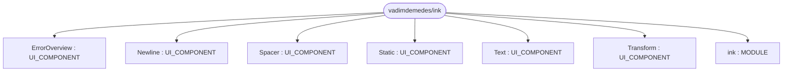
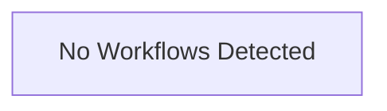

# Repository Architecture Analysis: vadimdemedes/ink

## Metadata
- **SHA**: `681bef6262b7eb5c7f699a2b44eb5e2d167cccdc`
- **Primary Ecosystem**: JavaScript/TypeScript

## Quality Metrics
- **avg_cyclomatic_complexity**: 4.03
- **component_count**: 7
- **files_analyzed**: 161
- **framework**: React (Vite)
- **loc**: 15899
- **max_cyclomatic_complexity**: 66
- **sloc**: 12557

# Architecture: vadimdemedes/ink

## Context
- **Repository**: `vadimdemedes/ink`
- **SHA**: `681bef6262b7eb5c7f699a2b44eb5e2d167cccdc`
- **Ecosystem**: JavaScript/TypeScript
- **Framework**: Unknown

## Building Block View

## Component Details
- **ink** (`package.json`): MODULE
- **ErrorOverview** (`src/components/ErrorOverview.tsx`): UI_COMPONENT
- **Newline** (`src/components/Newline.tsx`): UI_COMPONENT
- **Spacer** (`src/components/Spacer.tsx`): UI_COMPONENT
- **Static** (`src/components/Static.tsx`): UI_COMPONENT
- **Text** (`src/components/Text.tsx`): UI_COMPONENT
- **Transform** (`src/components/Transform.tsx`): UI_COMPONENT

## CI/CD Pipeline Topology

