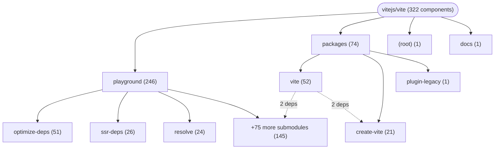

# Repository Architecture Analysis: vitejs/vite

## Metadata
- **SHA**: `61622b8df68b7a8e657caa6f98d9b70069643abf`
- **Primary Ecosystem**: JavaScript/TypeScript

## Quality Metrics
- **avg_cyclomatic_complexity**: 1.86
- **component_count**: 322
- **files_analyzed**: 5456
- **framework**: React (Vite)
- **loc**: 350954
- **max_cyclomatic_complexity**: 361
- **sloc**: 291948

# Architecture: vitejs/vite

## Context
- **Repository**: `vitejs/vite`
- **SHA**: `61622b8df68b7a8e657caa6f98d9b70069643abf`
- **Ecosystem**: JavaScript/TypeScript
- **Framework**: Unknown

## Building Block View

## Component Details

Showing top 60 representative components out of 322 across 4 module group(s):

- **Module `playground`** (246 components — MODULE: 245, UI_COMPONENT: 1)
- **Module `packages`** (74 components — MODULE: 65, UI_COMPONENT: 7, SERVICE: 2)
- **Module `(root)`** (1 components — MODULE: 1)
- **Module `docs`** (1 components — MODULE: 1)

- **IIFE_BEGIN_RE** (`packages/vite/src/node/plugins/oxc.ts`): UI_COMPONENT (deps: App, BundledDevHMRClient, ERR_CLOSED_SERVER, HMRClient, Root)
- **UMD_BEGIN_RE** (`packages/vite/src/node/plugins/oxc.ts`): UI_COMPONENT (deps: App, BundledDevHMRClient, ERR_CLOSED_SERVER, HMRClient, Root)
- **BundledDevHMRClient** (`packages/vite/src/client/bundledDevHmrClient.ts`): SERVICE (deps: HMRClient)
- **@vite/test-config-entry** (`packages/vite/src/node/__tests__/fixtures/config/entry/package.json`): MODULE
- **@vite/test-config-plugin-module-condition** (`packages/vite/src/node/__tests__/fixtures/config/plugin-module-condition/package.json`): MODULE
- **@vite/test-config-sibling** (`packages/vite/src/node/__tests__/fixtures/config/siblings/package.json`): MODULE
- **@vitejs/child** (`packages/vite/src/node/__tests__/packages/child/package.json`): MODULE
- **@vitejs/cjs-external** (`packages/vite/src/node/ssr/runtime/__tests__/fixtures/cjs-external/package.json`): MODULE
- **@vitejs/cjs-ssr-dep** (`packages/vite/src/node/__tests__/fixtures/cjs-ssr-dep/package.json`): MODULE
- **@vitejs/esm-external** (`packages/vite/src/node/ssr/runtime/__tests__/fixtures/esm-external/package.json`): MODULE
- **@vitejs/longfilename-aaaaaaaaaaaaaaaaaaaaaaaaaaaaaaaaaaaaaaaaaaaaaaaaaaaaaaaaaaaaaaaaaaaaaaaaaaaaaaaaaaaaaaaaaaaaaaaaaaaaaaaaaaaaaaaaaaaaaaaaaaaaaaaaaaaaaaaaaaaaaaaaaaaaaaaaaaaaaaaaaaaaaaaaaaaaaaaaaaaaaaaaaaaa** (`playground/optimize-deps/longfilename/package.json`): MODULE
- **@vitejs/monorepo-docs** (`docs/package.json`): MODULE
- **@vitejs/parent** (`packages/vite/src/node/__tests__/packages/parent/package.json`): MODULE
- **@vitejs/plugin-legacy** (`packages/plugin-legacy/package.json`): MODULE
- **@vitejs/require** (`playground/json/dep-json-require/package.json`): MODULE
- **@vitejs/self-referencing** (`playground/nested-deps/self-referencing/package.json`): MODULE
- **@vitejs/test-added-in-entries** (`playground/optimize-deps/added-in-entries/package.json`): MODULE
- **@vitejs/test-alias** (`playground/alias/package.json`): MODULE
- **@vitejs/test-alias-original** (`playground/ssr-alias/alias-original/package.json`): MODULE
- **@vitejs/test-aliased-module** (`playground/alias/dir/module/package.json`): MODULE
- **@vitejs/test-assets** (`playground/assets/package.json`): MODULE
- **@vitejs/test-assets-sanitize** (`playground/assets-sanitize/package.json`): MODULE
- **@vitejs/test-backend-integration** (`playground/backend-integration/package.json`): MODULE
- **@vitejs/test-base** (`playground/base/package.json`): MODULE
- **@vitejs/test-base-conflict** (`playground/base-conflict/package.json`): MODULE
- **@vitejs/test-blue-app** (`playground/css/postcss-caching/blue-app/package.json`): MODULE
- **@vitejs/test-browser-exports** (`playground/ssr-webworker/browser-exports/package.json`): MODULE
- **@vitejs/test-build-old** (`playground/build-old/package.json`): MODULE
- **@vitejs/test-chunk-importmap** (`playground/chunk-importmap/package.json`): MODULE
- **@vitejs/test-cjs-node-builtin** (`playground/ssr-webworker/cjs-node-builtin/package.json`): MODULE
- **@vitejs/test-cli** (`playground/cli/package.json`): MODULE
- **@vitejs/test-cli-module** (`playground/cli-module/package.json`): MODULE
- **@vitejs/test-client-reload** (`playground/client-reload/package.json`): MODULE
- **@vitejs/test-commonjs-dep** (`playground/define/commonjs-dep/package.json`): MODULE
- **@vitejs/test-csp** (`playground/csp/package.json`): MODULE
- **@vitejs/test-css** (`playground/css/package.json`): MODULE
- **@vitejs/test-css-codesplit** (`playground/css-codesplit/package.json`): MODULE
- **@vitejs/test-css-codesplit-cjs** (`playground/css-codesplit-cjs/package.json`): MODULE
- **@vitejs/test-css-dep** (`playground/css/css-dep/package.json`): MODULE
- **@vitejs/test-css-dep-exports** (`playground/css/css-dep-exports/package.json`): MODULE
- **@vitejs/test-css-dynamic-import** (`playground/css-dynamic-import/package.json`): MODULE
- **@vitejs/test-css-js-dep** (`playground/css/css-js-dep/package.json`): MODULE
- **@vitejs/test-css-lib** (`playground/ssr-deps/css-lib/package.json`): MODULE
- **@vitejs/test-css-lightningcss** (`playground/css-lightningcss/package.json`): MODULE
- **@vitejs/test-css-lightningcss-proxy** (`playground/css-lightningcss-proxy/package.json`): MODULE
- **@vitejs/test-css-lightningcss-root** (`playground/css-lightningcss-root/package.json`): MODULE
- **@vitejs/test-css-no-codesplit** (`playground/css-no-codesplit/package.json`): MODULE
- **@vitejs/test-css-proxy-dep** (`playground/css/css-proxy-dep/package.json`): MODULE
- **@vitejs/test-css-proxy-dep-nested** (`playground/css/css-proxy-dep-nested/package.json`): MODULE
- **@vitejs/test-css-sourcemap** (`playground/css-sourcemap/package.json`): MODULE
- **@vitejs/test-data-uri** (`playground/data-uri/package.json`): MODULE
- **@vitejs/test-deep-import** (`playground/ssr-resolve/deep-import/package.json`): MODULE
- **@vitejs/test-define** (`playground/define/package.json`): MODULE
- **@vitejs/test-define-properties-exports** (`playground/ssr-deps/define-properties-exports/package.json`): MODULE
- **@vitejs/test-define-property-exports** (`playground/ssr-deps/define-property-exports/package.json`): MODULE
- **@vitejs/test-dep-a** (`playground/preload/dep-a/package.json`): MODULE
- **@vitejs/test-dep-alias-using-absolute-path** (`playground/optimize-deps/dep-alias-using-absolute-path/package.json`): MODULE
- **@vitejs/test-dep-browser-false** (`playground/optimize-deps/dep-browser-false/package.json`): MODULE
- **@vitejs/test-dep-cjs-browser-field** (`playground/optimize-deps/dep-cjs-browser-field/package.json`): MODULE
- **@vitejs/test-dep-cjs-browser-field-bare** (`playground/optimize-deps/dep-cjs-browser-field-bare/package.json`): MODULE

## CI/CD Pipeline Topology

