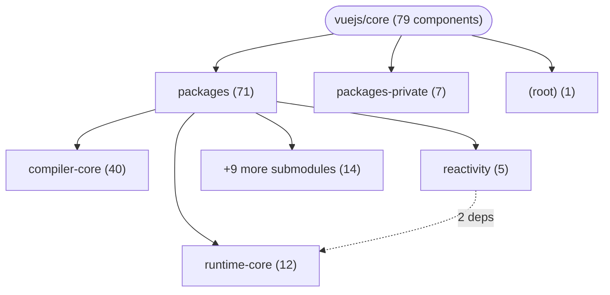

# Repository Architecture Analysis: vuejs/core

## Metadata
- **SHA**: `21738b527bac4a91eef9cbdfc2cc5ac1f3dbdec9`
- **Primary Ecosystem**: JavaScript/TypeScript

## Quality Metrics
- **avg_cyclomatic_complexity**: 10.38
- **component_count**: 79
- **files_analyzed**: 1086
- **framework**: React (Vite)
- **loc**: 345261
- **max_cyclomatic_complexity**: 424
- **sloc**: 291448

# Architecture: vuejs/core

## Context
- **Repository**: `vuejs/core`
- **SHA**: `21738b527bac4a91eef9cbdfc2cc5ac1f3dbdec9`
- **Ecosystem**: JavaScript/TypeScript
- **Framework**: Unknown

## Building Block View

## Component Details

Showing top 60 representative components out of 79 across 3 module group(s):

- **Module `packages`** (71 components — UI_COMPONENT: 55, MODULE: 15, DATA_ACCESS_LAYER: 1)
- **Module `packages-private`** (7 components — MODULE: 6, UI_COMPONENT: 1)
- **Module `(root)`** (1 components — MODULE: 1)

- **BaseTransition** (`packages/runtime-core/src/components/BaseTransition.ts`): UI_COMPONENT (deps: Comment, ErrorTypeStrings, Fragment, Static, Text)
- **BaseTransitionPropsValidators** (`packages/runtime-core/src/components/BaseTransition.ts`): UI_COMPONENT (deps: Comment, ErrorTypeStrings, Fragment, Static, Text)
- **Comment** (`packages/runtime-core/src/vnode.ts`): UI_COMPONENT (deps: BaseTransition, BaseTransitionPropsValidators, ErrorTypeStrings, PublicInstanceProxyHandlers, RuntimeCompiledPublicInstanceProxyHandlers)
- **DeprecationTypes** (`packages/runtime-core/src/index.ts`): UI_COMPONENT (deps: Comment, ErrorTypeStrings, Fragment, Static, Text)
- **Fragment** (`packages/runtime-core/src/vnode.ts`): UI_COMPONENT (deps: BaseTransition, BaseTransitionPropsValidators, ErrorTypeStrings, PublicInstanceProxyHandlers, RuntimeCompiledPublicInstanceProxyHandlers)
- **Model** (`packages/reactivity/__tests__/effect.spec.ts`): DATA_ACCESS_LAYER (deps: ARRAY_ITERATE_KEY, DeprecationTypes, ErrorTypeStrings, ITERATE_KEY, MAP_KEY_ITERATE_KEY)
- **Static** (`packages/runtime-core/src/vnode.ts`): UI_COMPONENT (deps: BaseTransition, BaseTransitionPropsValidators, ErrorTypeStrings, PublicInstanceProxyHandlers, RuntimeCompiledPublicInstanceProxyHandlers)
- **Text** (`packages/runtime-core/src/vnode.ts`): UI_COMPONENT (deps: BaseTransition, BaseTransitionPropsValidators, ErrorTypeStrings, PublicInstanceProxyHandlers, RuntimeCompiledPublicInstanceProxyHandlers)
- **ErrorTypeStrings** (`packages/runtime-core/src/errorHandling.ts`): UI_COMPONENT (deps: Comment, Fragment, Static, Text)
- **ErrorTypeStrings** (`packages/runtime-core/src/index.ts`): UI_COMPONENT (deps: Comment, Fragment, Static, Text)
- **PublicInstanceProxyHandlers** (`packages/runtime-core/src/componentPublicInstance.ts`): UI_COMPONENT (deps: Comment, Fragment, Static, Text)
- **RuntimeCompiledPublicInstanceProxyHandlers** (`packages/runtime-core/src/componentPublicInstance.ts`): UI_COMPONENT (deps: Comment, Fragment, Static, Text)
- **@vue/compat** (`packages/vue-compat/package.json`): MODULE
- **@vue/compiler-core** (`packages/compiler-core/package.json`): MODULE
- **@vue/compiler-dom** (`packages/compiler-dom/package.json`): MODULE
- **@vue/compiler-sfc** (`packages/compiler-sfc/package.json`): MODULE
- **@vue/compiler-ssr** (`packages/compiler-ssr/package.json`): MODULE
- **@vue/reactivity** (`packages/reactivity/package.json`): MODULE
- **@vue/runtime-core** (`packages/runtime-core/package.json`): MODULE
- **@vue/runtime-dom** (`packages/runtime-dom/package.json`): MODULE
- **@vue/runtime-test** (`packages/runtime-test/package.json`): MODULE
- **@vue/server-renderer** (`packages/server-renderer/package.json`): MODULE
- **@vue/sfc-playground** (`packages-private/sfc-playground/package.json`): MODULE
- **@vue/shared** (`packages/shared/package.json`): MODULE
- **@vue/template-explorer** (`packages-private/template-explorer/package.json`): MODULE
- **ARRAY_ITERATE_KEY** (`packages/reactivity/src/dep.ts`): UI_COMPONENT
- **BASE_TRANSITION** (`packages/compiler-core/src/runtimeHelpers.ts`): UI_COMPONENT
- **CAMELIZE** (`packages/compiler-core/src/runtimeHelpers.ts`): UI_COMPONENT
- **CAPITALIZE** (`packages/compiler-core/src/runtimeHelpers.ts`): UI_COMPONENT
- **CREATE_BLOCK** (`packages/compiler-core/src/runtimeHelpers.ts`): UI_COMPONENT
- **CREATE_COMMENT** (`packages/compiler-core/src/runtimeHelpers.ts`): UI_COMPONENT
- **CREATE_ELEMENT_BLOCK** (`packages/compiler-core/src/runtimeHelpers.ts`): UI_COMPONENT
- **CREATE_ELEMENT_VNODE** (`packages/compiler-core/src/runtimeHelpers.ts`): UI_COMPONENT
- **CREATE_SLOTS** (`packages/compiler-core/src/runtimeHelpers.ts`): UI_COMPONENT
- **CREATE_STATIC** (`packages/compiler-core/src/runtimeHelpers.ts`): UI_COMPONENT
- **CREATE_TEXT** (`packages/compiler-core/src/runtimeHelpers.ts`): UI_COMPONENT
- **CREATE_VNODE** (`packages/compiler-core/src/runtimeHelpers.ts`): UI_COMPONENT
- **Custom** (`packages-private/dts-test/componentTypeExtensions.test-d.tsx`): UI_COMPONENT
- **DEFINE_PROPS** (`packages/compiler-sfc/src/script/defineProps.ts`): UI_COMPONENT
- **FRAGMENT** (`packages/compiler-core/src/runtimeHelpers.ts`): UI_COMPONENT
- **GUARD_REACTIVE_PROPS** (`packages/compiler-core/src/runtimeHelpers.ts`): UI_COMPONENT
- **IS_MEMO_SAME** (`packages/compiler-core/src/runtimeHelpers.ts`): UI_COMPONENT
- **IS_REF** (`packages/compiler-core/src/runtimeHelpers.ts`): UI_COMPONENT
- **ITERATE_KEY** (`packages/reactivity/src/dep.ts`): UI_COMPONENT
- **KEEP_ALIVE** (`packages/compiler-core/src/runtimeHelpers.ts`): UI_COMPONENT
- **MAP_KEY_ITERATE_KEY** (`packages/reactivity/src/dep.ts`): UI_COMPONENT
- **MERGE_PROPS** (`packages/compiler-core/src/runtimeHelpers.ts`): UI_COMPONENT
- **NORMALIZE_CLASS** (`packages/compiler-core/src/runtimeHelpers.ts`): UI_COMPONENT
- **NORMALIZE_PROPS** (`packages/compiler-core/src/runtimeHelpers.ts`): UI_COMPONENT
- **NORMALIZE_STYLE** (`packages/compiler-core/src/runtimeHelpers.ts`): UI_COMPONENT
- **OPEN_BLOCK** (`packages/compiler-core/src/runtimeHelpers.ts`): UI_COMPONENT
- **POP_SCOPE_ID** (`packages/compiler-core/src/runtimeHelpers.ts`): UI_COMPONENT
- **PUSH_SCOPE_ID** (`packages/compiler-core/src/runtimeHelpers.ts`): UI_COMPONENT
- **RENDER_LIST** (`packages/compiler-core/src/runtimeHelpers.ts`): UI_COMPONENT
- **RENDER_SLOT** (`packages/compiler-core/src/runtimeHelpers.ts`): UI_COMPONENT
- **RESOLVE_COMPONENT** (`packages/compiler-core/src/runtimeHelpers.ts`): UI_COMPONENT
- **RESOLVE_DIRECTIVE** (`packages/compiler-core/src/runtimeHelpers.ts`): UI_COMPONENT
- **RESOLVE_DYNAMIC_COMPONENT** (`packages/compiler-core/src/runtimeHelpers.ts`): UI_COMPONENT
- **RESOLVE_FILTER** (`packages/compiler-core/src/runtimeHelpers.ts`): UI_COMPONENT
- **SET_BLOCK_TRACKING** (`packages/compiler-core/src/runtimeHelpers.ts`): UI_COMPONENT

## CI/CD Pipeline Topology

