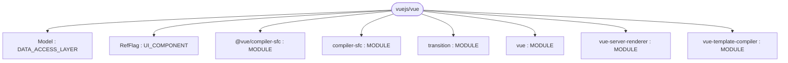
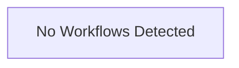

# Repository Architecture Analysis: vuejs/vue

## Metadata
- **SHA**: `9e88707940088cb1f4cd7dd210c9168a50dc347c`
- **Primary Ecosystem**: JavaScript/TypeScript

## Quality Metrics
- **avg_cyclomatic_complexity**: 7.34
- **component_count**: 8
- **files_analyzed**: 721
- **framework**: React
- **loc**: 142902
- **max_cyclomatic_complexity**: 348
- **sloc**: 122315

# Architecture: vuejs/vue

## Context
- **Repository**: `vuejs/vue`
- **SHA**: `9e88707940088cb1f4cd7dd210c9168a50dc347c`
- **Ecosystem**: JavaScript/TypeScript
- **Framework**: Unknown

## Building Block View

## Component Details
- **compiler-sfc** (`compiler-sfc/package.json`): MODULE
- **vue** (`package.json`): MODULE
- **@vue/compiler-sfc** (`packages/compiler-sfc/package.json`): MODULE
- **vue-server-renderer** (`packages/server-renderer/package.json`): MODULE
- **vue-template-compiler** (`packages/template-compiler/package.json`): MODULE
- **transition** (`test/transition/package.json`): MODULE
- **RefFlag** (`src/v3/reactivity/ref.ts`): UI_COMPONENT
- **Model** (`test/unit/features/global-api/set-delete.spec.ts`): DATA_ACCESS_LAYER

## CI/CD Pipeline Topology

