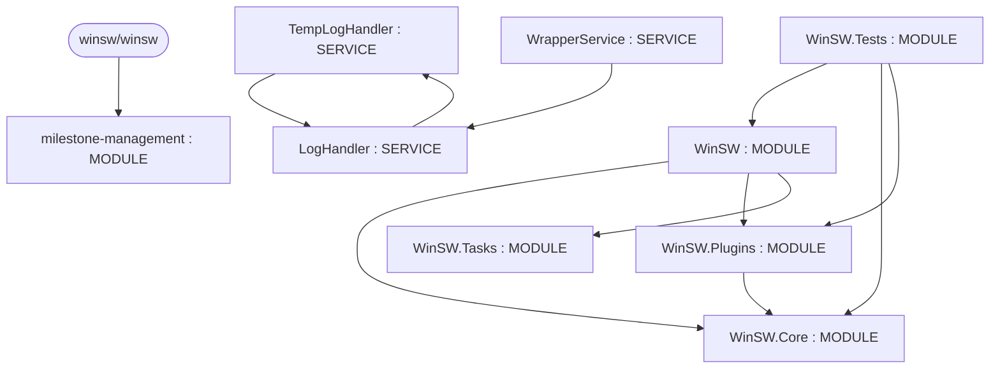

# Repository Architecture Analysis: winsw/winsw

## Metadata
- **SHA**: `1d0ee4a91bad596d5e7e9c360f2b39ef54674674`
- **Primary Ecosystem**: .NET

## Quality Metrics
- **avg_cyclomatic_complexity**: 9.61
- **component_count**: 9
- **files_analyzed**: 149
- **framework**: ASP.NET Core
- **loc**: 18186
- **max_cyclomatic_complexity**: 106
- **sloc**: 14593

# Architecture: winsw/winsw

## Context
- **Repository**: `winsw/winsw`
- **SHA**: `1d0ee4a91bad596d5e7e9c360f2b39ef54674674`
- **Ecosystem**: .NET
- **Framework**: Unknown

## Building Block View

## Component Details
- **milestone-management** (`.github/actions/milestone-management/package.json`): MODULE
- **WinSW** (`src/WinSW/WinSW.csproj`): MODULE (deps: WinSW.Core, WinSW.Plugins, WinSW.Tasks)
- **WinSW.Core** (`src/WinSW.Core/WinSW.Core.csproj`): MODULE
- **WinSW.Plugins** (`src/WinSW.Plugins/WinSW.Plugins.csproj`): MODULE (deps: WinSW.Core)
- **WinSW.Tasks** (`src/WinSW.Tasks/WinSW.Tasks.csproj`): MODULE
- **WinSW.Tests** (`src/WinSW.Tests/WinSW.Tests.csproj`): MODULE (deps: WinSW, WinSW.Core, WinSW.Plugins)
- **TempLogHandler** (`src/WinSW.Core/LogAppenders.cs`): SERVICE (deps: LogHandler)
- **LogHandler** (`src/WinSW.Core/LogAppenders.cs`): SERVICE (deps: TempLogHandler)
- **WrapperService** (`src/WinSW.Core/WrapperService.cs`): SERVICE (deps: LogHandler)

## CI/CD Pipeline Topology

