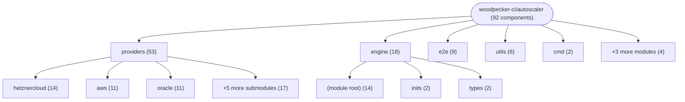
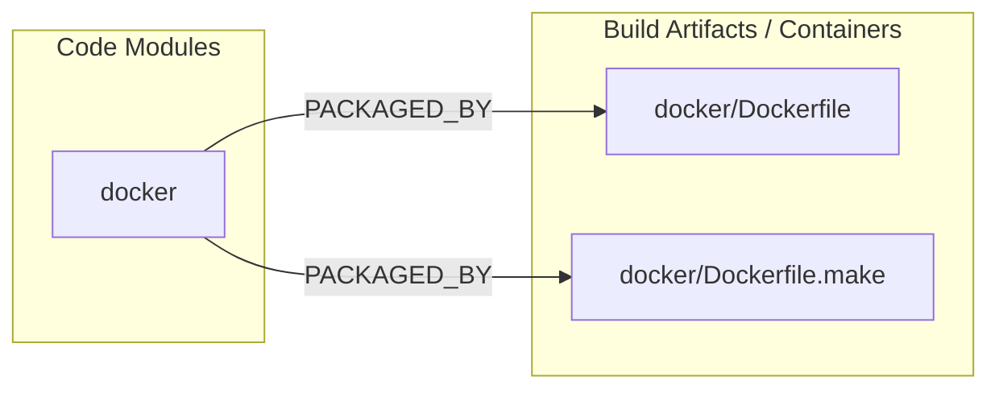
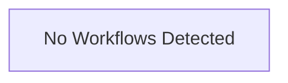

# Repository Architecture Analysis: woodpecker-ci/autoscaler

## Metadata
- **SHA**: `54581e24aeb93076bd749d389e2b1066fed45c23`
- **Primary Ecosystem**: Go

## Quality Metrics
- **ast_engine**: fallback
- **avg_cognitive_complexity**: 0.0
- **avg_cyclomatic_complexity**: 0.0
- **component_count**: 92
- **dead_code_count**: 0
- **dead_code_symbols**: 0 entry(ies)
- **duplication_pct**: 0.0
- **file_complexities**: 0 entry(ies)
- **files_analyzed**: 92
- **fitness_passed**: True
- **fitness_violation_count**: 0
- **framework**: Go Service
- **import_edges**: 0 entry(ies)
- **loc**: 28703
- **max_cognitive_complexity**: 0
- **max_cyclomatic_complexity**: 0
- **sloc**: 23034
- **test_file_count**: 30

# Architecture: woodpecker-ci/autoscaler

## Context
- **Repository**: `woodpecker-ci/autoscaler`
- **SHA**: `54581e24aeb93076bd749d389e2b1066fed45c23`
- **Ecosystem**: Go
- **Framework**: Go Service

## Building Block View

## Component Details

Showing top 60 representative components out of 92 across 8 module group(s):

- **Module `providers`** (53 components — module: 53)
- **Module `engine`** (18 components — module: 18)
- **Module `e2e`** (9 components — module: 9)
- **Module `utils`** (6 components — module: 6)
- **Module `cmd`** (2 components — module: 2)
- **Module `server`** (2 components — module: 2)
- **Module `config`** (1 components — module: 1)
- **Module `version`** (1 components — module: 1)

- **agents** (`engine/agents.go`): module
- **api** (`providers/aws/ec2api/api.go`): module
- **api** (`providers/hetznercloud/hcapi/api.go`): module
- **api** (`providers/oracle/ociapi/api.go`): module
- **autoscaler** (`engine/autoscaler.go`): module
- **autoscaler_test** (`engine/autoscaler_test.go`): module
- **billing** (`engine/billing.go`): module
- **billing_test** (`e2e/billing_test.go`): module
- **buckets** (`engine/buckets.go`): module
- **buckets_test** (`engine/buckets_test.go`): module
- **capabilities_test** (`e2e/capabilities_test.go`): module
- **cleanup** (`engine/cleanup.go`): module
- **cleanup_test** (`e2e/cleanup_test.go`): module
- **client** (`server/client.go`): module
- **cloudinit** (`engine/inits/cloudinit/cloudinit.go`): module
- **cloudinit_test** (`engine/inits/cloudinit/cloudinit_test.go`): module
- **config** (`config/config.go`): module
- **const** (`engine/const.go`): module
- **credentials_test** (`providers/aws/credentials_test.go`): module
- **fakes_test** (`e2e/fakes_test.go`): module
- **flags** (`cmd/woodpecker-autoscaler/flags.go`): module
- **flags** (`providers/aws/flags.go`): module
- **flags** (`providers/digitalocean/flags.go`): module
- **flags** (`providers/hetznercloud/flags.go`): module
- **flags** (`providers/linode/flags.go`): module
- **flags** (`providers/openstack/flags.go`): module
- **flags** (`providers/oracle/flags.go`): module
- **flags** (`providers/scaleway/flags.go`): module
- **flags** (`providers/vultr/flags.go`): module
- **harness_test** (`e2e/harness_test.go`): module
- **helper** (`providers/aws/helper.go`): module
- **helper** (`providers/hetznercloud/helper.go`): module
- **helper** (`providers/linode/helper.go`): module
- **helper** (`providers/oracle/helper.go`): module
- **helper** (`providers/scaleway/helper.go`): module
- **helper** (`providers/vultr/helper.go`): module
- **helper_test** (`providers/aws/helper_test.go`): module
- **helper_test** (`providers/hetznercloud/helper_test.go`): module
- **helper_test** (`providers/oracle/helper_test.go`): module
- **helper_test** (`providers/vultr/helper_test.go`): module
- **image** (`providers/aws/image.go`): module
- **image_test** (`providers/aws/image_test.go`): module
- **labels** (`engine/labels.go`): module
- **labels_test** (`engine/labels_test.go`): module
- **lifecycle_test** (`e2e/lifecycle_test.go`): module
- **limits_test** (`e2e/limits_test.go`): module
- **main** (`cmd/woodpecker-autoscaler/main.go`): module
- **mock_Client** (`providers/aws/ec2api/mocks/mock_Client.go`): module
- **mock_Client** (`providers/hetznercloud/hcapi/mocks/mock_Client.go`): module
- **mock_Client** (`server/mocks/mock_Client.go`): module
- **mock_ComputeClient** (`providers/oracle/ociapi/mocks/mock_ComputeClient.go`): module
- **mock_FirewallClient** (`providers/hetznercloud/hcapi/mocks/mock_FirewallClient.go`): module
- **mock_IdentityClient** (`providers/oracle/ociapi/mocks/mock_IdentityClient.go`): module
- **mock_ImageClient** (`providers/hetznercloud/hcapi/mocks/mock_ImageClient.go`): module
- **mock_NetworkClient** (`providers/hetznercloud/hcapi/mocks/mock_NetworkClient.go`): module
- **mock_NetworkClient** (`providers/oracle/ociapi/mocks/mock_NetworkClient.go`): module
- **mock_Provider** (`engine/types/mocks/mock_Provider.go`): module
- **mock_SSHKeyClient** (`providers/hetznercloud/hcapi/mocks/mock_SSHKeyClient.go`): module
- **mock_ServerClient** (`providers/hetznercloud/hcapi/mocks/mock_ServerClient.go`): module
- **mock_ServerTypeClient** (`providers/hetznercloud/hcapi/mocks/mock_ServerTypeClient.go`): module

## 6-Dimension Repository Scorecard

- **Overall Grade**: `C` (79.25/100)
- **Technical Debt Score**: 20.75
- **Estimated Remediation Effort**: 7.19h

| Dimension | Grade | Score | Weight | Details |
| :--- | :---: | :---: | :---: | :--- |
| Code Quality | `A` | 100.00 | 0.20 | avg_cc=0.00, max_cc=0, duplication=0.00%, dead_code=0 |
| Dependency Health | `B` | 85.00 | 0.15 | dependencies=54, outdated=0, vulnerable=0, has_lockfile=False |
| Maintainability | `A` | 100.00 | 0.15 | avg_cognitive=0.00, max_cognitive=0, fitness_violations=0, oversized_files=0 |
| Pipeline Health | `F` | 40.00 | 0.15 | workflows=0 |
| Security | `C` | 75.00 | 0.20 | vulnerabilities=0, secrets=1, pipeline_security_findings=0 |
| Test Coverage | `C` | 70.00 | 0.15 | coverage=unavailable, ci_test_job=False, test_files_detected=True |

## Supply Chain Dependencies, Vulnerabilities & Secrets

- **Dependencies Parsed**: 54 | **Vulnerabilities**: 0 | **Secrets**: 1

### Secret Findings (Redacted)
- **[CRITICAL] `ATRUSS-SEC-004`** at `providers/oracle/helper_test.go:367` (`-----BEGIN ... PRIVATE KEY----- [REDACTED]`)

### Inventory Sample
- `github.com/aws/aws-sdk-go-v2` `1.47.5` (golang, `go.mod`)
- `github.com/aws/aws-sdk-go-v2/config` `1.33.12` (golang, `go.mod`)
- `github.com/aws/aws-sdk-go-v2/credentials` `1.20.12` (golang, `go.mod`)
- `github.com/aws/aws-sdk-go-v2/service/ec2` `1.342.0` (golang, `go.mod`)
- `github.com/aws/aws-sdk-go-v2/service/sts` `1.51.6` (golang, `go.mod`)
- `github.com/aws/smithy-go` `1.28.7` (golang, `go.mod`)
- `github.com/digitalocean/godo` `1.233.0` (golang, `go.mod`)
- `github.com/docker/go-units` `0.5.0` (golang, `go.mod`)
- `github.com/gophercloud/gophercloud/v2` `2.15.0` (golang, `go.mod`)
- `github.com/hetznercloud/hcloud-go/v2` `2.53.0` (golang, `go.mod`)
- `github.com/joho/godotenv` `1.5.1` (golang, `go.mod`)
- `github.com/linode/linodego/v2` `2.10.0` (golang, `go.mod`)
- `github.com/oracle/oci-go-sdk/v65` `65.124.1` (golang, `go.mod`)
- `github.com/rs/zerolog` `1.35.1` (golang, `go.mod`)
- `github.com/scaleway/scaleway-sdk-go` `1.39.0` (golang, `go.mod`)
- `github.com/stretchr/testify` `1.12.1` (golang, `go.mod`)
- `github.com/urfave/cli/v3` `3.14.0` (golang, `go.mod`)
- `github.com/vultr/govultr/v3` `3.33.2` (golang, `go.mod`)
- `go.woodpecker-ci.org/woodpecker/v3` `3.19.0` (golang, `go.mod`)
- `golang.org/x/crypto` `0.58.0` (golang, `go.mod`)
- `golang.org/x/net` `0.62.0` (golang, `go.mod`)
- `golang.org/x/oauth2` `0.37.0` (golang, `go.mod`)
- `github.com/aws/aws-sdk-go-v2/feature/ec2/imds` `1.20.5` (golang, `go.mod`)
- `github.com/aws/aws-sdk-go-v2/internal/configsources` `1.5.8` (golang, `go.mod`)
- `github.com/aws/aws-sdk-go-v2/internal/endpoints/v2` `2.8.8` (golang, `go.mod`)
- `github.com/aws/aws-sdk-go-v2/internal/v4a` `1.5.8` (golang, `go.mod`)
- `github.com/aws/aws-sdk-go-v2/service/internal/accept-encoding` `1.13.23` (golang, `go.mod`)
- `github.com/aws/aws-sdk-go-v2/service/internal/presigned-url` `1.14.8` (golang, `go.mod`)
- `github.com/aws/aws-sdk-go-v2/service/signin` `1.12.0` (golang, `go.mod`)
- `github.com/aws/aws-sdk-go-v2/service/sso` `1.39.0` (golang, `go.mod`)
- ... (+24 more dependencies)

## Section 7: Code-to-Cloud Deployment Traceability

- `docker` (code_module) --[PACKAGED_BY]--> `docker/Dockerfile` (container)
- `docker` (code_module) --[PACKAGED_BY]--> `docker/Dockerfile.make` (container)

## CI/CD Pipeline Topology

