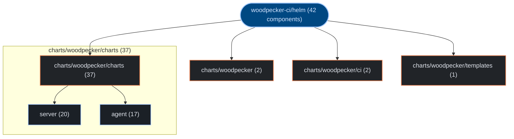

# Repository Architecture Analysis: woodpecker-ci/helm

## Metadata
- **SHA**: `14fa5d37aac91ed3b06f1beeb70468800a302eb6`
- **Primary Ecosystem**: Container / Helm / IaC

## Quality Metrics
- **ast_engine**: fallback
- **avg_cognitive_complexity**: 0.0
- **avg_cyclomatic_complexity**: 0.0
- **component_count**: 42
- **dead_code_count**: 0
- **dead_code_symbols**: 0 entry(ies)
- **duplication_pct**: 0.0
- **file_complexities**: 0 entry(ies)
- **files_analyzed**: 42
- **fitness_passed**: True
- **fitness_violation_count**: 0
- **framework**: Helm Chart
- **import_edges**: 0 entry(ies)
- **loc**: 2892
- **max_cognitive_complexity**: 0
- **max_cyclomatic_complexity**: 0
- **sloc**: 2331
- **test_file_count**: 1

# Architecture: woodpecker-ci/helm

## Context
- **Repository**: `woodpecker-ci/helm`
- **SHA**: `14fa5d37aac91ed3b06f1beeb70468800a302eb6`
- **Ecosystem**: Container / Helm / IaC
- **Framework**: Helm Chart

## Building Block View

## Component Details
- **Chart** (`charts/woodpecker/Chart.yaml`): module
- **values** (`charts/woodpecker/values.yaml`): module
- **Chart** (`charts/woodpecker/charts/agent/Chart.yaml`): module
- **values** (`charts/woodpecker/charts/agent/values.yaml`): module
- **networkpolicy** (`charts/woodpecker/charts/agent/templates/networkpolicy.yaml`): module
- **role** (`charts/woodpecker/charts/agent/templates/role.yaml`): module
- **rolebinding** (`charts/woodpecker/charts/agent/templates/rolebinding.yaml`): module
- **secret** (`charts/woodpecker/charts/agent/templates/secret.yml`): module
- **serviceaccount** (`charts/woodpecker/charts/agent/templates/serviceaccount.yaml`): module
- **statefulset** (`charts/woodpecker/charts/agent/templates/statefulset.yaml`): module
- **namespace** (`charts/woodpecker/charts/agent/unittests/namespace/namespace.yaml`): module
- **clusterrole** (`charts/woodpecker/charts/agent/unittests/role/clusterrole.yaml`): module
- **clusterrolebinding** (`charts/woodpecker/charts/agent/unittests/role/clusterrolebinding.yaml`): module
- **role** (`charts/woodpecker/charts/agent/unittests/role/role.yaml`): module
- **rolebinding** (`charts/woodpecker/charts/agent/unittests/role/rolebinding.yaml`): module
- **secret** (`charts/woodpecker/charts/agent/unittests/secret/secret.yaml`): module
- **initContainers** (`charts/woodpecker/charts/agent/unittests/statefulset/initContainers.yaml`): module
- **pvc** (`charts/woodpecker/charts/agent/unittests/statefulset/pvc.yaml`): module
- **volumes** (`charts/woodpecker/charts/agent/unittests/statefulset/volumes.yaml`): module
- **Chart** (`charts/woodpecker/charts/server/Chart.yaml`): module
- **values** (`charts/woodpecker/charts/server/values.yaml`): module
- **configmap_grafana_dashboards** (`charts/woodpecker/charts/server/templates/configmap_grafana_dashboards.yaml`): module
- **ingress-grpc** (`charts/woodpecker/charts/server/templates/ingress-grpc.yaml`): module
- **ingress-http** (`charts/woodpecker/charts/server/templates/ingress-http.yaml`): module
- **networkpolicy** (`charts/woodpecker/charts/server/templates/networkpolicy.yaml`): module
- **pod-monitor** (`charts/woodpecker/charts/server/templates/pod-monitor.yaml`): module
- **prometheus-rules** (`charts/woodpecker/charts/server/templates/prometheus-rules.yaml`): module
- **secret** (`charts/woodpecker/charts/server/templates/secret.yaml`): module
- **service-headless** (`charts/woodpecker/charts/server/templates/service-headless.yaml`): module
- **service** (`charts/woodpecker/charts/server/templates/service.yaml`): module
- **serviceaccount** (`charts/woodpecker/charts/server/templates/serviceaccount.yaml`): module
- **statefulset** (`charts/woodpecker/charts/server/templates/statefulset.yaml`): module
- **grpc_ingress_test** (`charts/woodpecker/charts/server/unittests/ingress/grpc_ingress_test.yaml`): module
- **namespace** (`charts/woodpecker/charts/server/unittests/namespace/namespace.yaml`): module
- **initContainers** (`charts/woodpecker/charts/server/unittests/statefulset/initContainers.yaml`): module
- **pvc** (`charts/woodpecker/charts/server/unittests/statefulset/pvc.yaml`): module
- **secrets** (`charts/woodpecker/charts/server/unittests/statefulset/secrets.yaml`): module
- **topologySpreadConstraints** (`charts/woodpecker/charts/server/unittests/statefulset/topologySpreadConstraints.yaml`): module
- **volumes** (`charts/woodpecker/charts/server/unittests/statefulset/volumes.yaml`): module
- **empty-values** (`charts/woodpecker/ci/empty-values.yaml`): module
- **networkpolicy-values** (`charts/woodpecker/ci/networkpolicy-values.yaml`): module
- **additionalObjects** (`charts/woodpecker/templates/additionalObjects.yaml`): module

## 6-Dimension Repository Scorecard

- **Overall Grade**: `B` (85.00/100)
- **Technical Debt Score**: 15.00
- **Estimated Remediation Effort**: 3.75h

| Dimension | Grade | Score | Weight | Details |
| :--- | :---: | :---: | :---: | :--- |
| Code Quality | `A` | 100.00 | 0.20 | avg_cc=0.00, max_cc=0, duplication=0.00%, dead_code=0 |
| Dependency Health | `A` | 90.00 | 0.15 | dependencies=0 (no manifests parsed) |
| Maintainability | `A` | 100.00 | 0.15 | avg_cognitive=0.00, max_cognitive=0, fitness_violations=0, oversized_files=0 |
| Pipeline Health | `F` | 40.00 | 0.15 | workflows=0 |
| Security | `A` | 100.00 | 0.20 | vulnerabilities=0, secrets=0, pipeline_security_findings=0 |
| Test Coverage | `C` | 70.00 | 0.15 | coverage=unavailable, ci_test_job=False, test_files_detected=True |

## CI/CD Pipeline Topology

