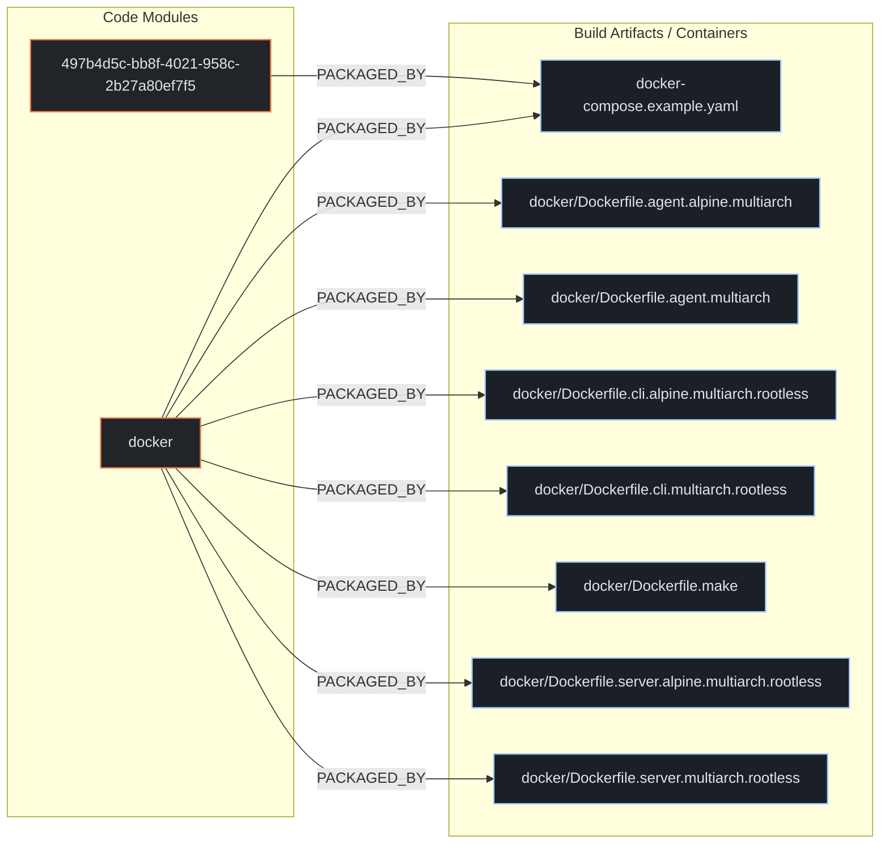

# Repository Architecture Analysis: woodpecker-ci/woodpecker

## Metadata
- **SHA**: `ceeea9ea6183935498023b04b4798abd5e2de551`
- **Primary Ecosystem**: Go

## Quality Metrics
- **ast_engine**: tree-sitter
- **avg_cognitive_complexity**: 1.36
- **avg_cyclomatic_complexity**: 2.04
- **component_count**: 266
- **dead_code_count**: 6
- **dead_code_symbols**: 6 entry(ies)
- **duplication_pct**: 2.7
- **file_complexities**: 25 entry(ies)
- **files_analyzed**: 910
- **fitness_passed**: False
- **fitness_violation_count**: 1
- **framework**: Go Gin / Echo / Fiber
- **import_edges**: 100 entry(ies)
- **loc**: 160199
- **max_cognitive_complexity**: 22
- **max_cyclomatic_complexity**: 28
- **sloc**: 120561
- **test_file_count**: 280

# Architecture: woodpecker-ci/woodpecker

## Context
- **Repository**: `woodpecker-ci/woodpecker`
- **SHA**: `ceeea9ea6183935498023b04b4798abd5e2de551`
- **Ecosystem**: Go
- **Framework**: Go Gin / Echo / Fiber

## Building Block View

```mermaid
graph TD;
  classDef atlasRoot fill:#004882,stroke:#a3c9ff,stroke-width:2px,color:#d3e4ff
  classDef atlasCategory fill:#212428,stroke:#E87A48,stroke-width:1.5px,color:#dfe3eb
  classDef atlasWorkflow fill:#1b2026,stroke:#a3c9ff,stroke-width:1.5px,color:#dfe3eb
  classDef atlasJob fill:#171c22,stroke:#8d9199,stroke-width:1px,color:#dfe3eb
  classDef atlasTarget fill:#005227,stroke:#8bd99b,stroke-width:1.5px,color:#a7f6b6
  classDef atlasAlert fill:#93000a,stroke:#ffb4ab,stroke-width:1.5px,color:#ffdad6
  classDef atlasMore fill:#252a31,stroke:#8d9199,stroke-dasharray:4 4,color:#c3c6cf
    repo_root(["woodpecker-ci/woodpecker (266 components)"]):::atlasRoot
    subgraph sg_dir_0_cli["cli (121)"]
      direction TB
      dir_0_cli["cli (121)"]:::atlasCategory
      sub_0_0_repo["repo (29)"]:::atlasWorkflow
      dir_0_cli --> sub_0_0_repo
      sub_0_1_pipeline["pipeline (21)"]:::atlasWorkflow
      dir_0_cli --> sub_0_1_pipeline
      sub_0_2_admin["admin (20)"]:::atlasWorkflow
      dir_0_cli --> sub_0_2_admin
      sub_0_more["+10 more submodules (51)"]:::atlasMore
      dir_0_cli --> sub_0_more
    end
    repo_root --> dir_0_cli
    subgraph sg_dir_1_pipeline["pipeline (66)"]
      direction TB
      dir_1_pipeline["pipeline (66)"]:::atlasCategory
      sub_1_0_backend["backend (65)"]:::atlasWorkflow
      dir_1_pipeline --> sub_1_0_backend
      sub_1_1__module_root_["(module root) (1)"]:::atlasWorkflow
      dir_1_pipeline --> sub_1_1__module_root_
    end
    repo_root --> dir_1_pipeline
    subgraph sg_dir_2_cmd["cmd (33)"]
      direction TB
      dir_2_cmd["cmd (33)"]:::atlasCategory
      sub_2_0_server["server (15)"]:::atlasWorkflow
      dir_2_cmd --> sub_2_0_server
      sub_2_1_agent["agent (11)"]:::atlasWorkflow
      dir_2_cmd --> sub_2_1_agent
      sub_2_2_cli["cli (5)"]:::atlasWorkflow
      dir_2_cmd --> sub_2_2_cli
      sub_2_more["+1 more submodules (2)"]:::atlasMore
      dir_2_cmd --> sub_2_more
    end
    repo_root --> dir_2_cmd
    subgraph sg_dir_3_agent["agent (15)"]
      direction TB
      dir_3_agent["agent (15)"]:::atlasCategory
      sub_3_0_rpc["rpc (8)"]:::atlasWorkflow
      dir_3_agent --> sub_3_0_rpc
      sub_3_1__module_root_["(module root) (5)"]:::atlasWorkflow
      dir_3_agent --> sub_3_1__module_root_
      sub_3_2_log["log (2)"]:::atlasWorkflow
      dir_3_agent --> sub_3_2_log
    end
    repo_root --> dir_3_agent
    subgraph sg_dir_4_e2e["e2e (15)"]
      direction TB
      dir_4_e2e["e2e (15)"]:::atlasCategory
      sub_4_0_scenarios["scenarios (10)"]:::atlasWorkflow
      dir_4_e2e --> sub_4_0_scenarios
      sub_4_1_setup["setup (5)"]:::atlasWorkflow
      dir_4_e2e --> sub_4_1_setup
    end
    repo_root --> dir_4_e2e
    dir_other_modules["+2 more modules (16)"]:::atlasMore
    repo_root --> dir_other_modules
```

## Component Details

Showing top 60 representative components out of 266 across 7 module group(s):

- **Module `cli`** (121 components — module: 121)
- **Module `pipeline`** (66 components — module: 66)
- **Module `cmd`** (33 components — module: 33)
- **Module `agent`** (15 components — module: 15)
- **Module `e2e`** (15 components — module: 15)
- **Module `docs`** (11 components — UI_COMPONENT: 9, MODULE: 2)
- **Module `web`** (5 components — SERVICE: 2, API_ROUTE: 2, MODULE: 1)

- **WoodpeckerPlugin** (`docs/plugins/woodpecker-plugins/src/theme/WoodpeckerPlugin.tsx`): UI_COMPONENT (deps: IconContainer, IconPlugin, IconRelease, IconVerified, IconWebsite)
- **WoodpeckerPluginList** (`docs/plugins/woodpecker-plugins/src/theme/WoodpeckerPluginList.tsx`): UI_COMPONENT (deps: IconContainer, IconPlugin, IconRelease, IconVerified, IconWebsite)
- **API_api_index** (`web/src/lib/api/index.ts`): API_ROUTE (deps: ApiClient)
- **Home** (`docs/src/pages/index.tsx`): UI_COMPONENT (deps: HomepageFeatures)
- **WoodpeckerClient** (`web/src/lib/api/index.ts`): SERVICE (deps: ApiClient)
- **@woodpecker-ci/plugin-index** (`docs/plugins/woodpecker-plugins/package.json`): MODULE
- **API_types_index** (`web/src/lib/api/types/index.ts`): API_ROUTE
- **ApiClient** (`web/src/lib/api/client.ts`): SERVICE
- **HomepageFeatures** (`docs/src/components/HomepageFeatures.js`): UI_COMPONENT
- **IconContainer** (`docs/plugins/woodpecker-plugins/src/theme/Icons.tsx`): UI_COMPONENT
- **IconPlugin** (`docs/plugins/woodpecker-plugins/src/theme/Icons.tsx`): UI_COMPONENT
- **IconRelease** (`docs/plugins/woodpecker-plugins/src/theme/Icons.tsx`): UI_COMPONENT
- **IconVerified** (`docs/plugins/woodpecker-plugins/src/theme/Icons.tsx`): UI_COMPONENT
- **IconWebsite** (`docs/plugins/woodpecker-plugins/src/theme/Icons.tsx`): UI_COMPONENT
- **admin** (`cli/admin/admin.go`): module
- **agent** (`cmd/agent/core/agent.go`): module
- **agent** (`e2e/setup/agent.go`): module
- **agent_routing_test** (`e2e/scenarios/agent_routing_test.go`): module
- **agent_test** (`cmd/agent/core/agent_test.go`): module
- **app** (`cmd/cli/app.go`): module
- **app** (`cmd/server/app.go`): module
- **app_test** (`cmd/cli/app_test.go`): module
- **approve** (`cli/pipeline/approve.go`): module
- **ask** (`cli/setup/ui/ask.go`): module
- **auth** (`pipeline/backend/types/auth.go`): module
- **auth_client_grpc** (`agent/rpc/auth_client_grpc.go`): module
- **auth_client_grpc_test** (`agent/rpc/auth_client_grpc_test.go`): module
- **auth_interceptor** (`agent/rpc/auth_interceptor.go`): module
- **auth_interceptor_test** (`agent/rpc/auth_interceptor_test.go`): module
- **backend** (`pipeline/backend/backend.go`): module
- **backend** (`pipeline/backend/types/backend.go`): module
- **backend_options** (`pipeline/backend/docker/backend_options.go`): module
- **backend_options** (`pipeline/backend/kubernetes/backend_options.go`): module
- **backend_options_test** (`pipeline/backend/docker/backend_options_test.go`): module
- **backend_options_test** (`pipeline/backend/kubernetes/backend_options_test.go`): module
- **cancel_test** (`e2e/scenarios/cancel_test.go`): module
- **client_grpc** (`agent/rpc/client_grpc.go`): module
- **client_grpc_test** (`agent/rpc/client_grpc_test.go`): module
- **clone** (`pipeline/backend/local/clone.go`): module
- **clone_test** (`pipeline/backend/local/clone_test.go`): module
- **cmd_unix** (`pipeline/backend/local/cmd_unix.go`): module
- **cmd_unix_test** (`pipeline/backend/local/cmd_unix_test.go`): module
- **cmd_win** (`pipeline/backend/local/cmd_win.go`): module
- **command** (`cli/update/command.go`): module
- **command** (`pipeline/backend/local/command.go`): module
- **command_test** (`pipeline/backend/local/command_test.go`): module
- **concurrency_test** (`e2e/scenarios/concurrency_test.go`): module
- **config** (`cli/internal/config/config.go`): module
- **config** (`cmd/agent/core/config.go`): module
- **config** (`pipeline/backend/docker/config.go`): module
- **config** (`pipeline/backend/types/config.go`): module
- **config_test** (`cli/internal/config/config_test.go`): module
- **config_test** (`cmd/agent/core/config_test.go`): module
- **confirm** (`cli/setup/ui/confirm.go`): module
- **conn** (`pipeline/backend/types/conn.go`): module
- **const** (`pipeline/backend/local/const.go`): module
- **const** (`pipeline/const.go`): module
- **const_test** (`pipeline/backend/local/const_test.go`): module
- **context** (`cli/context/context.go`): module
- **context** (`cli/internal/config/context.go`): module

## 6-Dimension Repository Scorecard

- **Overall Grade**: `D` (68.59/100)
- **Technical Debt Score**: 31.41
- **Estimated Remediation Effort**: 15.39h

| Dimension | Grade | Score | Weight | Details |
| :--- | :---: | :---: | :---: | :--- |
| Code Quality | `D` | 64.45 | 0.20 | avg_cc=2.04, max_cc=28, duplication=2.70%, dead_code=6 |
| Dependency Health | `B` | 85.00 | 0.15 | dependencies=302, outdated=0, vulnerable=0, has_lockfile=False |
| Maintainability | `A` | 91.00 | 0.15 | avg_cognitive=1.36, max_cognitive=22, fitness_violations=1, oversized_files=0 |
| Pipeline Health | `F` | 40.00 | 0.15 | workflows=0 |
| Security | `D` | 64.00 | 0.20 | vulnerabilities=0, secrets=2, pipeline_security_findings=0 |
| Test Coverage | `C` | 70.00 | 0.15 | coverage=unavailable, ci_test_job=False, test_files_detected=True |

## Architecture Fitness & Workspace Boundaries

- **[MEDIUM] `ATRUSS-ARCH-005` (COMPLEXITY_THRESHOLD)**: Repository max_cyclomatic_complexity (28.0) exceeds policy threshold (20.0).

## Supply Chain Dependencies, Vulnerabilities & Secrets

- **Dependencies Parsed**: 302 | **Vulnerabilities**: 0 | **Secrets**: 2

### Secret Findings (Redacted)
- **[HIGH] `ATRUSS-SEC-005`** at `server/forge/forgejo/fixtures/HookTag.json:3` (`"secret": "l26U***REDACTED***",`)
- **[HIGH] `ATRUSS-SEC-005`** at `server/forge/gitea/fixtures/HookTag.json:3` (`"secret": "l26U***REDACTED***",`)

### Inventory Sample
- `al.essio.dev/pkg/shellescape` `1.6.1` (golang, `go.mod`)
- `charm.land/huh/v2` `2.0.3` (golang, `go.mod`)
- `codeberg.org/6543/go-yaml2json/v2` `2.0.0` (golang, `go.mod`)
- `codeberg.org/6543/xyaml/v2` `2.0.1` (golang, `go.mod`)
- `codeberg.org/mvdkleijn/forgejo-sdk/forgejo/v4` `4.0.0` (golang, `go.mod`)
- `gitea.dev/sdk` `1.5.2-0.20261108232917-9fe07596a08d` (golang, `go.mod`)
- `github.com/6543/logfile-open` `1.2.1` (golang, `go.mod`)
- `github.com/adrg/xdg` `0.5.3` (golang, `go.mod`)
- `github.com/bmatcuk/doublestar/v4` `4.10.4` (golang, `go.mod`)
- `github.com/cenkalti/backoff/v7` `7.0.3` (golang, `go.mod`)
- `github.com/containerd/errdefs` `1.0.0` (golang, `go.mod`)
- `github.com/distribution/reference` `0.6.0` (golang, `go.mod`)
- `github.com/docker/cli` `29.9.3+incompatible` (golang, `go.mod`)
- `github.com/docker/go-connections` `0.8.2` (golang, `go.mod`)
- `github.com/docker/go-units` `0.5.0` (golang, `go.mod`)
- `github.com/drone/envsubst` `1.0.3` (golang, `go.mod`)
- `github.com/expr-lang/expr` `1.17.8` (golang, `go.mod`)
- `github.com/gdgvda/cron` `0.7.0` (golang, `go.mod`)
- `github.com/getkin/kin-openapi` `0.153.0` (golang, `go.mod`)
- `github.com/gin-gonic/gin` `1.12.0` (golang, `go.mod`)
- `github.com/gitsight/go-vcsurl` `1.0.1` (golang, `go.mod`)
- `github.com/go-sql-driver/mysql` `1.10.1` (golang, `go.mod`)
- `github.com/go-viper/mapstructure/v2` `2.5.0` (golang, `go.mod`)
- `github.com/golang-jwt/jwt/v5` `5.3.1` (golang, `go.mod`)
- `github.com/google/go-github/v93` `93.0.0` (golang, `go.mod`)
- `github.com/hashicorp/go-hclog` `1.6.3` (golang, `go.mod`)
- `github.com/hashicorp/go-plugin` `1.8.0` (golang, `go.mod`)
- `github.com/jellydator/ttlcache/v3` `3.4.1` (golang, `go.mod`)
- `github.com/joho/godotenv` `1.5.1` (golang, `go.mod`)
- `github.com/kinbiko/jsonassert` `1.2.0` (golang, `go.mod`)
- ... (+272 more dependencies)

## Section 7: Code-to-Cloud Deployment Traceability

- `497b4d5c-bb8f-4021-958c-2b27a80ef7f5` (code_module) --[PACKAGED_BY]--> `docker-compose.example.yaml` (container)
- `docker` (code_module) --[PACKAGED_BY]--> `docker-compose.example.yaml` (container)
- `docker` (code_module) --[PACKAGED_BY]--> `docker/Dockerfile.agent.alpine.multiarch` (container)
- `docker` (code_module) --[PACKAGED_BY]--> `docker/Dockerfile.agent.multiarch` (container)
- `docker` (code_module) --[PACKAGED_BY]--> `docker/Dockerfile.cli.alpine.multiarch.rootless` (container)
- `docker` (code_module) --[PACKAGED_BY]--> `docker/Dockerfile.cli.multiarch.rootless` (container)
- `docker` (code_module) --[PACKAGED_BY]--> `docker/Dockerfile.make` (container)
- `docker` (code_module) --[PACKAGED_BY]--> `docker/Dockerfile.server.alpine.multiarch.rootless` (container)
- `docker` (code_module) --[PACKAGED_BY]--> `docker/Dockerfile.server.multiarch.rootless` (container)

## CI/CD Pipeline Topology

