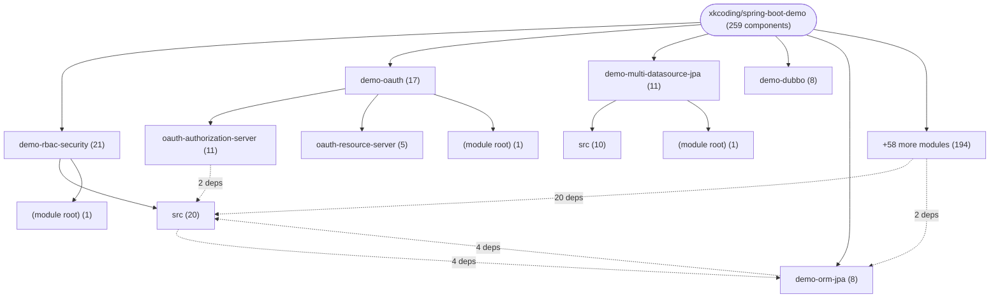
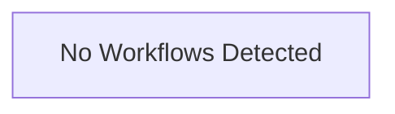

# Repository Architecture Analysis: xkcoding/spring-boot-demo

## Metadata
- **SHA**: `87a142f9604c1a5365b4d24d22c2c11c26a9d5ab`
- **Primary Ecosystem**: Java

## Quality Metrics
- **avg_cyclomatic_complexity**: 1.35
- **component_count**: 259
- **files_analyzed**: 1012
- **framework**: Spring Boot
- **loc**: 46867
- **max_cyclomatic_complexity**: 32
- **sloc**: 24967

# Architecture: xkcoding/spring-boot-demo

## Context
- **Repository**: `xkcoding/spring-boot-demo`
- **SHA**: `87a142f9604c1a5365b4d24d22c2c11c26a9d5ab`
- **Ecosystem**: Java
- **Framework**: Unknown

## Building Block View

## Component Details

Showing top 60 representative components out of 259 across 63 module group(s):

- **Module `demo-rbac-security`** (21 components — CONFIG: 9, DATA_ACCESS_LAYER: 5, API_ROUTE: 4)
- **Module `demo-oauth`** (17 components — CONFIG: 6, MODULE: 3, API_ROUTE: 3)
- **Module `demo-multi-datasource-jpa`** (11 components — CONFIG: 6, DATA_ACCESS_LAYER: 4, MODULE: 1)
- **Module `demo-dubbo`** (8 components — MODULE: 4, CONFIG: 2, API_ROUTE: 1)
- **Module `demo-orm-jpa`** (8 components — DATA_ACCESS_LAYER: 5, CONFIG: 2, MODULE: 1)
- **Module `demo-dynamic-datasource`** (7 components — CONFIG: 3, API_ROUTE: 2, MODULE: 1)
- **Module `demo-admin`** (6 components — MODULE: 3, CONFIG: 2, API_ROUTE: 1)
- **Module `demo-upload`** (6 components — CONFIG: 2, API_ROUTE: 2, MODULE: 1)
- **Module `demo-elasticsearch-rest-high-level-client`** (5 components — CONFIG: 3, MODULE: 1, SERVICE: 1)
- **Module `demo-orm-jdbctemplate`** (5 components — MODULE: 1, CONFIG: 1, API_ROUTE: 1)
- **Module `demo-ratelimit-redis`** (5 components — CONFIG: 2, API_ROUTE: 2, MODULE: 1)
- **Module `demo-task-xxl-job`** (5 components — CONFIG: 3, MODULE: 1, API_ROUTE: 1)

- **CustomUserDetailsService** (`demo-rbac-security/src/main/java/com/xkcoding/rbac/security/service/CustomUserDetailsService.java`): SERVICE (deps: Permission, Role, User, UserDao)
- **SecurityConfig** (`demo-rbac-security/src/main/java/com/xkcoding/rbac/security/config/SecurityConfig.java`): CONFIG (deps: AuthController, CustomConfig, CustomUserDetailsService)
- **SysUser** (`demo-oauth/oauth-authorization-server/src/main/java/com/xkcoding/oauth/entity/SysUser.java`): DATA_ACCESS_LAYER (deps: SysClientDetails, SysRole, User)
- **Department** (`demo-orm-jpa/src/main/java/com/xkcoding/orm/jpa/entity/Department.java`): DATA_ACCESS_LAYER (deps: AbstractAuditModel, User)
- **DepartmentDao** (`demo-orm-jpa/src/main/java/com/xkcoding/orm/jpa/repository/DepartmentDao.java`): DATA_ACCESS_LAYER (deps: Department, User)
- **MonitorService** (`demo-rbac-security/src/main/java/com/xkcoding/rbac/security/service/MonitorService.java`): SERVICE (deps: User, UserDao)
- **ServerConfig** (`demo-websocket-socketio/src/main/java/com/xkcoding/websocket/socketio/config/ServerConfig.java`): CONFIG (deps: JwtUtil, WsConfig)
- **SysUserServiceImpl** (`demo-oauth/oauth-authorization-server/src/main/java/com/xkcoding/oauth/service/impl/SysUserServiceImpl.java`): SERVICE (deps: SysUser, User)
- **User** (`demo-orm-jpa/src/main/java/com/xkcoding/orm/jpa/entity/User.java`): DATA_ACCESS_LAYER (deps: AbstractAuditModel, Department)
- **UserServiceImpl** (`demo-orm-beetlsql/src/main/java/com/xkcoding/orm/beetlsql/service/impl/UserServiceImpl.java`): SERVICE (deps: User, UserDao)
- **UserServiceImpl** (`demo-orm-jdbctemplate/src/main/java/com/xkcoding/orm/jdbctemplate/service/impl/UserServiceImpl.java`): SERVICE (deps: User, UserDao)
- **AuthController** (`demo-rbac-security/src/main/java/com/xkcoding/rbac/security/controller/AuthController.java`): API_ROUTE (deps: JwtUtil)
- **ElasticsearchAutoConfiguration** (`demo-elasticsearch-rest-high-level-client/src/main/java/com/xkcoding/elasticsearch/config/ElasticsearchAutoConfiguration.java`): CONFIG (deps: ElasticsearchProperties)
- **IndexController** (`demo-template-beetl/src/main/java/com/xkcoding/template/beetl/controller/IndexController.java`): API_ROUTE (deps: User)
- **IndexController** (`demo-template-enjoy/src/main/java/com/xkcoding/template/enjoy/controller/IndexController.java`): API_ROUTE (deps: User)
- **IndexController** (`demo-template-freemarker/src/main/java/com/xkcoding/template/freemarker/controller/IndexController.java`): API_ROUTE (deps: User)
- **IndexController** (`demo-template-thymeleaf/src/main/java/com/xkcoding/template/thymeleaf/controller/IndexController.java`): API_ROUTE (deps: User)
- **JwtUtil** (`demo-rbac-security/src/main/java/com/xkcoding/rbac/security/util/JwtUtil.java`): CONFIG (deps: JwtConfig)
- **MonitorController** (`demo-rbac-security/src/main/java/com/xkcoding/rbac/security/controller/MonitorController.java`): API_ROUTE (deps: MonitorService)
- **PersonServiceImpl** (`demo-ldap/src/main/java/com/xkcoding/ldap/service/impl/PersonServiceImpl.java`): SERVICE (deps: PersonRepository)
- **PrimaryMultiTableRepository** (`demo-multi-datasource-jpa/src/main/java/com/xkcoding/multi/datasource/jpa/repository/primary/PrimaryMultiTableRepository.java`): DATA_ACCESS_LAYER (deps: PrimaryMultiTable)
- **PropertyController** (`demo-properties/src/main/java/com/xkcoding/properties/controller/PropertyController.java`): API_ROUTE (deps: DeveloperProperty)
- **SecondMultiTableRepository** (`demo-multi-datasource-jpa/src/main/java/com/xkcoding/multi/datasource/jpa/repository/second/SecondMultiTableRepository.java`): DATA_ACCESS_LAYER (deps: SecondMultiTable)
- **SecurityConfiguration** (`demo-activiti/src/main/java/com/xkcoding/activiti/config/SecurityConfiguration.java`): CONFIG (deps: User)
- **SysClientDetails** (`demo-oauth/oauth-authorization-server/src/main/java/com/xkcoding/oauth/entity/SysClientDetails.java`): DATA_ACCESS_LAYER (deps: SysUser)
- **SysClientDetailsServiceImpl** (`demo-oauth/oauth-authorization-server/src/main/java/com/xkcoding/oauth/service/impl/SysClientDetailsServiceImpl.java`): SERVICE (deps: SysClientDetails)
- **SysRole** (`demo-oauth/oauth-authorization-server/src/main/java/com/xkcoding/oauth/entity/SysRole.java`): DATA_ACCESS_LAYER (deps: SysUser)
- **UserController** (`demo-dynamic-datasource/src/main/java/com/xkcoding/dynamic/datasource/controller/UserController.java`): API_ROUTE (deps: User)
- **UserController** (`demo-orm-jdbctemplate/src/main/java/com/xkcoding/orm/jdbctemplate/controller/UserController.java`): API_ROUTE (deps: User)
- **UserController** (`demo-swagger-beauty/src/main/java/com/xkcoding/swagger/beauty/controller/UserController.java`): API_ROUTE (deps: User)
- **UserController** (`demo-swagger/src/main/java/com/xkcoding/swagger/controller/UserController.java`): API_ROUTE (deps: User)
- **UserController** (`demo-template-beetl/src/main/java/com/xkcoding/template/beetl/controller/UserController.java`): API_ROUTE (deps: User)
- **UserController** (`demo-template-enjoy/src/main/java/com/xkcoding/template/enjoy/controller/UserController.java`): API_ROUTE (deps: User)
- **UserController** (`demo-template-freemarker/src/main/java/com/xkcoding/template/freemarker/controller/UserController.java`): API_ROUTE (deps: User)
- **UserController** (`demo-template-thymeleaf/src/main/java/com/xkcoding/template/thymeleaf/controller/UserController.java`): API_ROUTE (deps: User)
- **UserDao** (`demo-orm-jdbctemplate/src/main/java/com/xkcoding/orm/jdbctemplate/dao/UserDao.java`): DATA_ACCESS_LAYER (deps: User)
- **UserDao** (`demo-orm-jpa/src/main/java/com/xkcoding/orm/jpa/repository/UserDao.java`): DATA_ACCESS_LAYER (deps: User)
- **UserServiceImpl** (`demo-cache-ehcache/src/main/java/com/xkcoding/cache/ehcache/service/impl/UserServiceImpl.java`): SERVICE (deps: User)
- **UserServiceImpl** (`demo-cache-redis/src/main/java/com/xkcoding/cache/redis/service/impl/UserServiceImpl.java`): SERVICE (deps: User)
- **UserServiceImpl** (`demo-multi-datasource-mybatis/src/main/java/com/xkcoding/multi/datasource/mybatis/service/impl/UserServiceImpl.java`): SERVICE (deps: User)
- **UserServiceImpl** (`demo-orm-mybatis-plus/src/main/java/com/xkcoding/orm/mybatis/plus/service/impl/UserServiceImpl.java`): SERVICE (deps: User)
- **XxlJobConfig** (`demo-task-xxl-job/src/main/java/com/xkcoding/task/xxl/job/config/XxlJobConfig.java`): CONFIG (deps: XxlJobProps)
- **ZkConfig** (`demo-zookeeper/src/main/java/com/xkcoding/zookeeper/config/ZkConfig.java`): CONFIG (deps: ZkProps)
- **AbstractAuditModel** (`demo-orm-jpa/src/main/java/com/xkcoding/orm/jpa/entity/base/AbstractAuditModel.java`): DATA_ACCESS_LAYER
- **AuthorizationController** (`demo-oauth/oauth-authorization-server/src/main/java/com/xkcoding/oauth/controller/AuthorizationController.java`): API_ROUTE
- **BeetlConfig** (`demo-orm-beetlsql/src/main/java/com/xkcoding/orm/beetlsql/config/BeetlConfig.java`): CONFIG
- **CodeGenController** (`demo-codegen/src/main/java/com/xkcoding/codegen/controller/CodeGenController.java`): API_ROUTE
- **CodeGenServiceImpl** (`demo-codegen/src/main/java/com/xkcoding/codegen/service/impl/CodeGenServiceImpl.java`): SERVICE
- **CustomConfig** (`demo-rbac-security/src/main/java/com/xkcoding/rbac/security/config/CustomConfig.java`): CONFIG
- **DataSourceShardingConfig** (`demo-sharding-jdbc/src/main/java/com/xkcoding/sharding/jdbc/config/DataSourceShardingConfig.java`): CONFIG
- **DatasourceConfigController** (`demo-dynamic-datasource/src/main/java/com/xkcoding/dynamic/datasource/controller/DatasourceConfigController.java`): API_ROUTE
- **DatasourceConfiguration** (`demo-dynamic-datasource/src/main/java/com/xkcoding/dynamic/datasource/config/DatasourceConfiguration.java`): CONFIG
- **DemoExceptionHandler** (`demo-exception-handler/src/main/java/com/xkcoding/exception/handler/handler/DemoExceptionHandler.java`): API_ROUTE
- **DeveloperProperty** (`demo-properties/src/main/java/com/xkcoding/properties/property/DeveloperProperty.java`): CONFIG
- **ElasticsearchApplication** (`demo-elasticsearch-rest-high-level-client/src/main/java/com/xkcoding/elasticsearch/ElasticsearchApplication.java`): CONFIG
- **ElasticsearchProperties** (`demo-elasticsearch-rest-high-level-client/src/main/java/com/xkcoding/elasticsearch/config/ElasticsearchProperties.java`): CONFIG
- **EnjoyConfig** (`demo-template-enjoy/src/main/java/com/xkcoding/template/enjoy/config/EnjoyConfig.java`): CONFIG
- **GlobalExceptionHandler** (`demo-ratelimit-guava/src/main/java/com/xkcoding/ratelimit/guava/handler/GlobalExceptionHandler.java`): API_ROUTE
- **GlobalExceptionHandler** (`demo-ratelimit-redis/src/main/java/com/xkcoding/ratelimit/redis/handler/GlobalExceptionHandler.java`): API_ROUTE
- **GlobalExceptionHandler** (`demo-rbac-security/src/main/java/com/xkcoding/rbac/security/exception/handler/GlobalExceptionHandler.java`): API_ROUTE

## CI/CD Pipeline Topology

