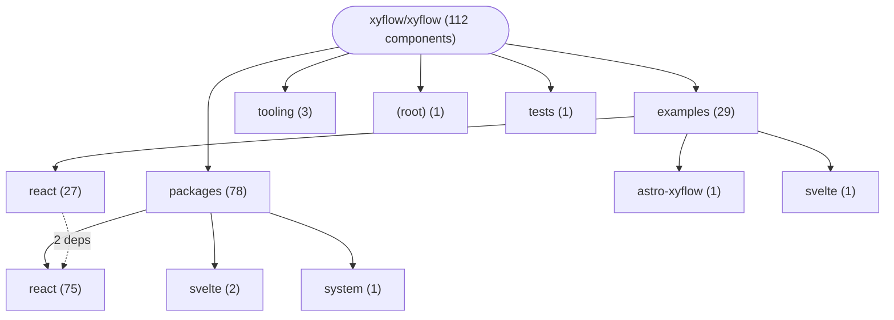
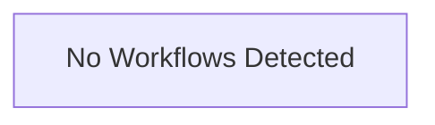

# Repository Architecture Analysis: xyflow/xyflow

## Metadata
- **SHA**: `7599c7f12e061d8befef36f3f3ced86f75938b8a`
- **Primary Ecosystem**: JavaScript/TypeScript

## Quality Metrics
- **avg_cyclomatic_complexity**: 4.63
- **component_count**: 112
- **files_analyzed**: 941
- **framework**: Astro
- **loc**: 78023
- **max_cyclomatic_complexity**: 70
- **sloc**: 59253

# Architecture: xyflow/xyflow

## Context
- **Repository**: `xyflow/xyflow`
- **SHA**: `7599c7f12e061d8befef36f3f3ced86f75938b8a`
- **Ecosystem**: JavaScript/TypeScript
- **Framework**: Unknown

## Building Block View

## Component Details

Showing top 60 representative components out of 112 across 5 module group(s):

- **Module `packages`** (78 components — UI_COMPONENT: 74, MODULE: 3, SERVICE: 1)
- **Module `examples`** (29 components — UI_COMPONENT: 26, MODULE: 3)
- **Module `tooling`** (3 components — MODULE: 3)
- **Module `(root)`** (1 components — MODULE: 1)
- **Module `tests`** (1 components — MODULE: 1)

- **Controls** (`packages/react/src/additional-components/Controls/Controls.tsx`): UI_COMPONENT (deps: ControlButton, FitViewIcon, Flow, LockIcon, MinusIcon, NodeCounter (+2 more))
- **Flow** (`packages/react/src/additional-components/Controls/Controls.tsx`): UI_COMPONENT (deps: ControlButton, FitViewIcon, LockIcon, MinusIcon, NodeCounter, PlusIcon (+1 more))
- **Handle** (`packages/react/src/components/Handle/index.tsx`): UI_COMPONENT (deps: Consumer, CustomNode, HandleConfigProvider, NodeIdContext, Provider)
- **NodeToolbar** (`packages/react/src/additional-components/NodeToolbar/NodeToolbar.tsx`): UI_COMPONENT (deps: Consumer, CustomNode, NodeIdContext, NodeToolbarPortal, Provider)
- **CustomNode** (`packages/react/src/components/Handle/index.tsx`): UI_COMPONENT (deps: Consumer, HandleConfigProvider, NodeIdContext, Provider)
- **NodeResizeControl** (`packages/react/src/additional-components/NodeResizer/NodeResizeControl.tsx`): UI_COMPONENT (deps: Consumer, CustomNode, NodeIdContext, Provider)
- **ResizeControlLine** (`packages/react/src/additional-components/NodeResizer/NodeResizeControl.tsx`): UI_COMPONENT (deps: Consumer, CustomNode, NodeIdContext, Provider)
- **Background** (`packages/react/src/additional-components/Background/Background.tsx`): UI_COMPONENT (deps: DotPattern, LinePattern)
- **BaseEdge** (`packages/react/src/components/Edges/BaseEdge.tsx`): UI_COMPONENT (deps: CustomEdgeLabel, EdgeText)
- **CustomEdge** (`packages/react/src/components/Edges/BaseEdge.tsx`): UI_COMPONENT (deps: CustomEdgeLabel, EdgeText)
- **Flow** (`packages/react/src/additional-components/Background/Background.tsx`): UI_COMPONENT (deps: DotPattern, LinePattern)
- **Flow** (`packages/react/src/components/ReactFlowProvider/index.tsx`): UI_COMPONENT (deps: HandleConfigProvider, Provider)
- **NodeResizer** (`packages/react/src/additional-components/NodeResizer/NodeResizer.tsx`): UI_COMPONENT (deps: NodeResizeControl, ResizeControlLine)
- **NodeToolbarExample** (`examples/react/src/examples/NodeToolbar/index.tsx`): UI_COMPONENT (deps: CustomNode, SelectedNodesToolbar)
- **ReactFlowDevTools** (`examples/react/src/examples/DevTools/DevTools/index.tsx`): UI_COMPONENT (deps: ChangeLogger, NodeInspector)
- **ReactFlowProvider** (`packages/react/src/components/ReactFlowProvider/index.tsx`): UI_COMPONENT (deps: HandleConfigProvider, Provider)
- **App** (`examples/react/src/examples/Middlewares/index.tsx`): UI_COMPONENT (deps: RestrictExtent)
- **DefaultNode** (`packages/react/src/components/Nodes/DefaultNode.tsx`): UI_COMPONENT (deps: CounterNode)
- **EdgeToolbarExample** (`examples/react/src/examples/EdgeToolbar/index.tsx`): UI_COMPONENT (deps: CustomEdge)
- **EdgeUpdateAnchors** (`packages/react/src/components/EdgeWrapper/EdgeUpdateAnchors.tsx`): UI_COMPONENT (deps: EdgeAnchor)
- **Flow** (`packages/react/src/container/ReactFlow/index.tsx`): UI_COMPONENT (deps: Wrapper)
- **GraphView** (`packages/react/src/container/GraphView/index.tsx`): UI_COMPONENT (deps: ViewportDisplay)
- **InputNode** (`packages/react/src/components/Nodes/InputNode.tsx`): UI_COMPONENT (deps: CounterNode)
- **OutputNode** (`packages/react/src/components/Nodes/OutputNode.tsx`): UI_COMPONENT (deps: CounterNode)
- **Wrapper** (`packages/react/src/container/ReactFlow/Wrapper.tsx`): UI_COMPONENT (deps: Provider)
- **@xyflow/eslint-config** (`tooling/eslint-config/package.json`): MODULE
- **@xyflow/monorepo** (`package.json`): MODULE
- **@xyflow/react** (`packages/react/package.json`): MODULE
- **@xyflow/rollup-config** (`tooling/rollup-config/package.json`): MODULE
- **@xyflow/svelte** (`packages/svelte/package.json`): MODULE
- **@xyflow/system** (`packages/system/package.json`): MODULE
- **@xyflow/tsconfig** (`tooling/tsconfig/package.json`): MODULE
- **A11yDescriptions** (`packages/react/src/components/A11yDescriptions/index.tsx`): UI_COMPONENT
- **ARIA_EDGE_DESC_KEY** (`packages/react/src/components/A11yDescriptions/index.tsx`): UI_COMPONENT
- **ARIA_LIVE_MESSAGE** (`packages/react/src/components/A11yDescriptions/index.tsx`): UI_COMPONENT
- **ARIA_NODE_DESC_KEY** (`packages/react/src/components/A11yDescriptions/index.tsx`): UI_COMPONENT
- **App** (`examples/react/src/examples/A11y/index.tsx`): UI_COMPONENT
- **App** (`examples/react/src/examples/Basic/index.tsx`): UI_COMPONENT
- **App** (`examples/react/src/examples/ControlledUncontrolled/index.tsx`): UI_COMPONENT
- **App** (`examples/react/src/examples/DefaultEdgeOverwrite/index.tsx`): UI_COMPONENT
- **App** (`examples/react/src/examples/DefaultNodeOverwrite/index.tsx`): UI_COMPONENT
- **App** (`examples/react/src/examples/DefaultNodes/index.tsx`): UI_COMPONENT
- **App** (`examples/react/src/examples/DetachedHandle/index.tsx`): UI_COMPONENT
- **App** (`examples/react/src/examples/InteractiveMinimap/index.tsx`): UI_COMPONENT
- **App** (`examples/react/src/examples/Intersection/index.tsx`): UI_COMPONENT
- **App** (`examples/react/src/examples/NodeSelectionBug/index.tsx`): UI_COMPONENT
- **App** (`examples/react/src/examples/Remount/index.tsx`): UI_COMPONENT
- **App** (`examples/react/src/examples/SetNodesBatching/index.tsx`): UI_COMPONENT
- **Attribution** (`packages/react/src/components/Attribution/index.tsx`): UI_COMPONENT
- **BatchProvider** (`packages/react/src/components/BatchProvider/index.tsx`): UI_COMPONENT
- **ChangeLogger** (`examples/react/src/examples/DevTools/DevTools/ChangeLogger.tsx`): UI_COMPONENT
- **ConnectionLineWrapper** (`packages/react/src/components/ConnectionLine/index.tsx`): UI_COMPONENT
- **Consumer** (`packages/react/src/contexts/NodeIdContext.ts`): UI_COMPONENT
- **ControlButton** (`packages/react/src/additional-components/Controls/ControlButton.tsx`): UI_COMPONENT
- **CounterNode** (`packages/react/src/types/nodes.ts`): UI_COMPONENT
- **CustomEdge** (`examples/react/src/examples/EdgeToolbar/CustomEdge.tsx`): UI_COMPONENT
- **CustomEdge** (`packages/react/src/additional-components/EdgeToolbar/EdgeToolbar.tsx`): UI_COMPONENT
- **CustomEdge** (`packages/react/src/components/EdgeLabelRenderer/index.tsx`): UI_COMPONENT
- **CustomEdgeLabel** (`packages/react/src/components/Edges/EdgeText.tsx`): UI_COMPONENT
- **CustomNode** (`examples/react/src/examples/EasyConnect/CustomNode.tsx`): UI_COMPONENT

## CI/CD Pipeline Topology

