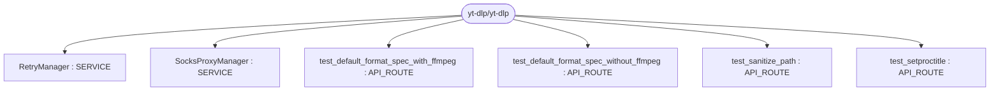
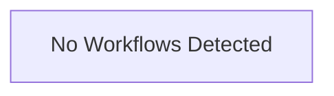

# Repository Architecture Analysis: yt-dlp/yt-dlp

## Metadata
- **SHA**: `412e7f0a4b0588fe884a02b344ac66a06538475b`
- **Primary Ecosystem**: Python

## Quality Metrics
- **avg_cyclomatic_complexity**: 4.39
- **component_count**: 6
- **files_analyzed**: 1124
- **framework**: Unknown
- **loc**: 247104
- **max_cyclomatic_complexity**: 205
- **sloc**: 216248

# Architecture: yt-dlp/yt-dlp

## Context
- **Repository**: `yt-dlp/yt-dlp`
- **SHA**: `412e7f0a4b0588fe884a02b344ac66a06538475b`
- **Ecosystem**: Python
- **Framework**: Unknown

## Building Block View

## Component Details
- **test_default_format_spec_without_ffmpeg** (`test/test_YoutubeDL.py`): API_ROUTE
- **test_default_format_spec_with_ffmpeg** (`test/test_YoutubeDL.py`): API_ROUTE
- **test_sanitize_path** (`test/test_utils.py`): API_ROUTE
- **test_setproctitle** (`test/test_utils.py`): API_ROUTE
- **SocksProxyManager** (`yt_dlp/networking/_requests.py`): SERVICE
- **RetryManager** (`yt_dlp/utils/_utils.py`): SERVICE

## CI/CD Pipeline Topology

