# Repository Architecture Analysis: yudaocode/SpringBoot-Labs

## Metadata
- **SHA**: `6c12efaed06d12907a0f40dd2ad1f7020aec8798`
- **Primary Ecosystem**: Java

## Quality Metrics
- **avg_cyclomatic_complexity**: 1.22
- **component_count**: 1675
- **files_analyzed**: 6563
- **framework**: Spring Boot
- **loc**: 201864
- **max_cyclomatic_complexity**: 21
- **sloc**: 133534

# Architecture: yudaocode/SpringBoot-Labs

## Context
- **Repository**: `yudaocode/SpringBoot-Labs`
- **SHA**: `6c12efaed06d12907a0f40dd2ad1f7020aec8798`
- **Ecosystem**: Java
- **Framework**: Unknown

## Building Block View

```mermaid
graph TD;
    repo_root(["yudaocode/SpringBoot-Labs (1675 components)"])
    dir_0_lab_68_spring_security_oauth["lab-68-spring-security-oauth (72)"]
    repo_root --> dir_0_lab_68_spring_security_oauth
    sub_0_0_lab_68_demo02_resource_server["lab-68-demo02-resource-server (8)"]
    dir_0_lab_68_spring_security_oauth --> sub_0_0_lab_68_demo02_resource_server
    sub_0_1_lab_68_demo01_authorization_code_server["lab-68-demo01-authorization-code-server (6)"]
    dir_0_lab_68_spring_security_oauth --> sub_0_1_lab_68_demo01_authorization_code_server
    sub_0_2_lab_68_demo01_implicit_server["lab-68-demo01-implicit-server (6)"]
    dir_0_lab_68_spring_security_oauth --> sub_0_2_lab_68_demo01_implicit_server
    sub_0_more["+13 more submodules (52)"]
    dir_0_lab_68_spring_security_oauth --> sub_0_more
    dir_1_lab_40["lab-40 (64)"]
    repo_root --> dir_1_lab_40
    sub_1_0_lab_40_zipkin_dubbo["lab-40-zipkin-dubbo (10)"]
    dir_1_lab_40 --> sub_1_0_lab_40_zipkin_dubbo
    sub_1_1_lab_40_demo["lab-40-demo (6)"]
    dir_1_lab_40 --> sub_1_1_lab_40_demo
    sub_1_2_lab_40_elasticsearch["lab-40-elasticsearch (5)"]
    dir_1_lab_40 --> sub_1_2_lab_40_elasticsearch
    sub_1_more["+10 more submodules (43)"]
    dir_1_lab_40 --> sub_1_more
    dir_2_labx_13["labx-13 (57)"]
    repo_root --> dir_2_labx_13
    sub_2_0_labx_13_sc_sleuth_dubbo["labx-13-sc-sleuth-dubbo (7)"]
    dir_2_labx_13 --> sub_2_0_labx_13_sc_sleuth_dubbo
    sub_2_1_labx_13_sc_sleuth_mq_kafka["labx-13-sc-sleuth-mq-kafka (6)"]
    dir_2_labx_13 --> sub_2_1_labx_13_sc_sleuth_mq_kafka
    sub_2_2_labx_13_sc_sleuth_mq_rabbitmq["labx-13-sc-sleuth-mq-rabbitmq (6)"]
    dir_2_labx_13 --> sub_2_2_labx_13_sc_sleuth_mq_rabbitmq
    sub_2_more["+13 more submodules (38)"]
    dir_2_labx_13 --> sub_2_more
    dir_3_lab_39["lab-39 (54)"]
    repo_root --> dir_3_lab_39
    sub_3_0_lab_39_skywalking_dubbo["lab-39-skywalking-dubbo (7)"]
    dir_3_lab_39 --> sub_3_0_lab_39_skywalking_dubbo
    sub_3_1_lab_39_rabbitmq_demo["lab-39-rabbitmq-demo (4)"]
    dir_3_lab_39 --> sub_3_1_lab_39_rabbitmq_demo
    sub_3_2_lab_39_activemq["lab-39-activemq (3)"]
    dir_3_lab_39 --> sub_3_2_lab_39_activemq
    sub_3_more["+14 more submodules (40)"]
    dir_3_lab_39 --> sub_3_more
    dir_4_labx_10_spring_cloud_stream_rabbitmq["labx-10-spring-cloud-stream-rabbitmq (45)"]
    repo_root --> dir_4_labx_10_spring_cloud_stream_rabbitmq
    sub_4_0_labx_10_sc_stream_rabbitmq_producer_transaction["labx-10-sc-stream-rabbitmq-producer-transaction (4)"]
    dir_4_labx_10_spring_cloud_stream_rabbitmq --> sub_4_0_labx_10_sc_stream_rabbitmq_producer_transaction
    sub_4_1_labx_10_sc_stream_rabbitmq_producer_actuator["labx-10-sc-stream-rabbitmq-producer-actuator (3)"]
    dir_4_labx_10_spring_cloud_stream_rabbitmq --> sub_4_1_labx_10_sc_stream_rabbitmq_producer_actuator
    sub_4_2_labx_10_sc_stream_rabbitmq_producer_batch["labx-10-sc-stream-rabbitmq-producer-batch (3)"]
    dir_4_labx_10_spring_cloud_stream_rabbitmq --> sub_4_2_labx_10_sc_stream_rabbitmq_producer_batch
    sub_4_more["+16 more submodules (35)"]
    dir_4_labx_10_spring_cloud_stream_rabbitmq --> sub_4_more
    dir_other_modules["+95 more modules (1383)"]
    repo_root --> dir_other_modules
    sub_0_more -.->|"59 deps"| dir_other_modules
    sub_0_0_lab_68_demo02_resource_server -.->|"20 deps"| dir_other_modules
    sub_0_more -.->|"4 deps"| sub_2_more
    sub_2_more -.->|"4 deps"| sub_0_more
    dir_other_modules -.->|"1 dep"| sub_1_1_lab_40_demo
    sub_0_more -.->|"1 dep"| sub_3_more
    sub_1_1_lab_40_demo -.->|"1 dep"| dir_other_modules
    sub_3_more -.->|"1 dep"| dir_other_modules
```

## Component Details

Showing top 60 representative components out of 1675 across 100 module group(s):

- **Module `lab-68-spring-security-oauth`** (72 components — CONFIG: 44, MODULE: 16, API_ROUTE: 12)
- **Module `lab-40`** (64 components — CONFIG: 36, MODULE: 16, API_ROUTE: 12)
- **Module `labx-13`** (57 components — MODULE: 23, CONFIG: 21, API_ROUTE: 13)
- **Module `lab-39`** (54 components — MODULE: 20, CONFIG: 17, API_ROUTE: 16)
- **Module `labx-10-spring-cloud-stream-rabbitmq`** (45 components — MODULE: 19, CONFIG: 19, API_ROUTE: 7)
- **Module `labx-07-spring-cloud-alibaba-dubbo`** (43 components — MODULE: 22, CONFIG: 12, API_ROUTE: 9)
- **Module `lab-04-rabbitmq`** (41 components — CONFIG: 23, MODULE: 18)
- **Module `labx-11-spring-cloud-stream-kafka`** (39 components — MODULE: 17, CONFIG: 17, API_ROUTE: 5)
- **Module `labx-03-spring-cloud-feign`** (38 components — MODULE: 14, CONFIG: 12, API_ROUTE: 12)
- **Module `lab-02-spring-security-oauth`** (37 components — CONFIG: 21, MODULE: 8, API_ROUTE: 8)
- **Module `labx-08-spring-cloud-gateway`** (35 components — CONFIG: 17, MODULE: 15, API_ROUTE: 3)
- **Module `labx-14`** (34 components — MODULE: 17, CONFIG: 11, API_ROUTE: 6)

- **OrderService** (`lab-17/lab-17-dynamic-datasource-baomidou-01/src/main/java/cn/iocoder/springboot/lab17/dynamicdatasource/service/OrderService.java`): SERVICE (deps: OrderDO, OrderMapper, UserDO, UserMapper)
- **OrderService** (`lab-17/lab-17-dynamic-datasource-jdbctemplate/src/main/java/cn/iocoder/springboot/lab17/dynamicdatasource/service/OrderService.java`): SERVICE (deps: OrderDO, OrderDao, UserDO, UserDao)
- **OrderService** (`lab-17/lab-17-dynamic-datasource-mybatis/src/main/java/cn/iocoder/springboot/lab17/dynamicdatasource/service/OrderService.java`): SERVICE (deps: OrderDO, OrderMapper, UserDO, UserMapper)
- **OrderService** (`lab-17/lab-17-dynamic-datasource-sharding-jdbc-01/src/main/java/cn/iocoder/springboot/lab17/dynamicdatasource/service/OrderService.java`): SERVICE (deps: OrderDO, OrderMapper, UserDO, UserMapper)
- **OrderServiceImpl** (`lab-52/lab-52-multiple-datasource/src/main/java/cn/iocoder/springboot/lab52/seatademo/service/impl/OrderServiceImpl.java`): SERVICE (deps: OrderDO, OrderDao, OrderService)
- **OrderServiceImpl** (`lab-52/lab-52-seata-at-httpclient-demo/lab-52-seata-at-httpclient-demo-order-service/src/main/java/cn/iocoder/springboot/lab52/orderservice/service/OrderServiceImpl.java`): SERVICE (deps: OrderDO, OrderDao, OrderService)
- **OrderServiceImpl** (`labx-17/labx-17-sc-seata-at-feign-demo/labx-17-sc-seata-at-feign-demo-order-service/src/main/java/cn/iocoder/springcloud/labx17/orderservice/service/impl/OrderServiceImpl.java`): SERVICE (deps: OrderDO, OrderDao, OrderService)
- **UserController** (`lab-42/lab-42-demo01/src/main/java/cn/iocoder/springboot/lab23/testdemo/controller/UserController.java`): API_ROUTE (deps: Controller, UserDO, UserService)
- **UserController** (`lab-42/lab-42-demo02/src/main/java/cn/iocoder/springboot/lab23/testdemo/controller/UserController.java`): API_ROUTE (deps: Controller, UserDO, UserService)
- **DemoConsumerApplication** (`labx-02-spring-cloud-netflix-ribbon/labx-02-scn-ribbon-demo01-consumer/src/main/java/cn/iocoder/springcloudnetflix/labx02/ribbondemo/consumer/DemoConsumerApplication.java`): CONFIG (deps: RestTemplateConfiguration, TestController)
- **DemoConsumerApplication** (`labx-02-spring-cloud-netflix-ribbon/labx-02-scn-ribbon-demo02A-consumer/src/main/java/cn/iocoder/springcloudnetflix/labx02/ribbondemo/consumer/DemoConsumerApplication.java`): CONFIG (deps: RestTemplateConfiguration, TestController)
- **DemoConsumerApplication** (`labx-02-spring-cloud-netflix-ribbon/labx-02-scn-ribbon-demo02B-consumer/src/main/java/cn/iocoder/springcloudnetflix/labx02/ribbondemo/consumer/DemoConsumerApplication.java`): CONFIG (deps: RestTemplateConfiguration, TestController)
- **DemoConsumerApplication** (`labx-02-spring-cloud-netflix-ribbon/labx-02-scn-ribbon-demo03-consumer/src/main/java/cn/iocoder/springcloudnetflix/labx02/ribbondemo/consumer/DemoConsumerApplication.java`): CONFIG (deps: RestTemplateConfiguration, TestController)
- **DemoConsumerApplication** (`labx-02-spring-cloud-netflix-ribbon/labx-02-scn-ribbon-demo04-consumer/src/main/java/cn/iocoder/springcloudnetflix/labx02/ribbondemo/consumer/DemoConsumerApplication.java`): CONFIG (deps: RestTemplateConfiguration, TestController)
- **DemoConsumerApplication** (`labx-02-spring-cloud-netflix-ribbon/labx-02-scn-ribbon-demo05-consumer/src/main/java/cn/iocoder/springcloudnetflix/labx02/ribbondemo/consumer/DemoConsumerApplication.java`): CONFIG (deps: RestTemplateConfiguration, TestController)
- **DemoConsumerApplication** (`labx-02-spring-cloud-netflix-ribbon/labx-02-scn-ribbon-demo06-consumer/src/main/java/cn/iocoder/springcloudnetflix/labx02/ribbondemo/consumer/DemoConsumerApplication.java`): CONFIG (deps: RestTemplateConfiguration, TestController)
- **OAuth2ResourceServerConfig** (`lab-68-spring-security-oauth/lab-68-demo01-authorization-code-server/src/main/java/cn/iocoder/springboot/lab68/resourceserverdemo/config/OAuth2ResourceServerConfig.java`): CONFIG (deps: OAuth2AuthorizationServer, OAuth2ResourceServer)
- **OAuth2ResourceServerConfig** (`lab-68-spring-security-oauth/lab-68-demo01-client-credentials-server/src/main/java/cn/iocoder/springboot/lab68/resourceserverdemo/config/OAuth2ResourceServerConfig.java`): CONFIG (deps: OAuth2AuthorizationServer, OAuth2ResourceServer)
- **OAuth2ResourceServerConfig** (`lab-68-spring-security-oauth/lab-68-demo01-implicit-server/src/main/java/cn/iocoder/springboot/lab68/resourceserverdemo/config/OAuth2ResourceServerConfig.java`): CONFIG (deps: OAuth2AuthorizationServer, OAuth2ResourceServer)
- **OAuth2ResourceServerConfig** (`lab-68-spring-security-oauth/lab-68-demo01-resource-owner-password-credentials-server/src/main/java/cn/iocoder/springboot/lab68/resourceserverdemo/config/OAuth2ResourceServerConfig.java`): CONFIG (deps: OAuth2AuthorizationServer, OAuth2ResourceServer)
- **OrderService** (`lab-17/lab-17-dynamic-datasource-baomidou-02/src/main/java/cn/iocoder/springboot/lab17/dynamicdatasource/service/OrderService.java`): SERVICE (deps: OrderDO, OrderMapper)
- **OrderService** (`lab-17/lab-17-dynamic-datasource-sharding-jdbc-02/src/main/java/cn/iocoder/springboot/lab17/dynamicdatasource/service/OrderService.java`): SERVICE (deps: OrderDO, OrderMapper)
- **OrderService** (`lab-17/lab-17-dynamic-datasource-springdatajpa/src/main/java/cn/iocoder/springboot/lab17/dynamicdatasource/service/OrderService.java`): SERVICE (deps: OrderDO, UserDO)
- **OrderService** (`lab-18/lab-18-sharding-datasource-02/src/main/java/cn/iocoder/springboot/lab18/shardingdatasource/service/OrderService.java`): SERVICE (deps: OrderDO, OrderMapper)
- **RestTemplateConfiguration** (`labx-01-spring-cloud-alibaba-nacos-discovery/labx-01-sca-nacos-discovery-demo01-consumer/src/main/java/cn/iocoder/springcloudalibaba/labx01/nacosdemo/consumer/DemoConsumerApplication.java`): CONFIG (deps: DemoConsumerApplication, TestController)
- **RestTemplateConfiguration** (`labx-01-spring-cloud-alibaba-nacos-discovery/labx-01-sca-nacos-discovery-demo02-consumer/src/main/java/cn/iocoder/springcloudalibaba/labx01/nacosdemo/consumer/DemoConsumerApplication.java`): CONFIG (deps: DemoConsumerApplication, TestController)
- **RestTemplateConfiguration** (`labx-01-spring-cloud-alibaba-nacos-discovery/labx-01-sca-nacos-discovery-demo03-consumer/src/main/java/cn/iocoder/springcloudalibaba/labx01/nacosdemo/consumer/DemoConsumerApplication.java`): CONFIG (deps: DemoConsumerApplication, TestController)
- **RestTemplateConfiguration** (`labx-02-spring-cloud-netflix-ribbon/labx-02-scn-ribbon-demo01-consumer/src/main/java/cn/iocoder/springcloudnetflix/labx02/ribbondemo/consumer/DemoConsumerApplication.java`): CONFIG (deps: DemoConsumerApplication, TestController)
- **RestTemplateConfiguration** (`labx-02-spring-cloud-netflix-ribbon/labx-02-scn-ribbon-demo02A-consumer/src/main/java/cn/iocoder/springcloudnetflix/labx02/ribbondemo/consumer/DemoConsumerApplication.java`): CONFIG (deps: DemoConsumerApplication, TestController)
- **RestTemplateConfiguration** (`labx-02-spring-cloud-netflix-ribbon/labx-02-scn-ribbon-demo02B-consumer/src/main/java/cn/iocoder/springcloudnetflix/labx02/ribbondemo/consumer/DemoConsumerApplication.java`): CONFIG (deps: DemoConsumerApplication, TestController)
- **RestTemplateConfiguration** (`labx-02-spring-cloud-netflix-ribbon/labx-02-scn-ribbon-demo03-consumer/src/main/java/cn/iocoder/springcloudnetflix/labx02/ribbondemo/consumer/DemoConsumerApplication.java`): CONFIG (deps: DemoConsumerApplication, TestController)
- **RestTemplateConfiguration** (`labx-02-spring-cloud-netflix-ribbon/labx-02-scn-ribbon-demo04-consumer/src/main/java/cn/iocoder/springcloudnetflix/labx02/ribbondemo/consumer/DemoConsumerApplication.java`): CONFIG (deps: DemoConsumerApplication, TestController)
- **RestTemplateConfiguration** (`labx-02-spring-cloud-netflix-ribbon/labx-02-scn-ribbon-demo05-consumer/src/main/java/cn/iocoder/springcloudnetflix/labx02/ribbondemo/consumer/DemoConsumerApplication.java`): CONFIG (deps: DemoConsumerApplication, TestController)
- **RestTemplateConfiguration** (`labx-02-spring-cloud-netflix-ribbon/labx-02-scn-ribbon-demo06-consumer/src/main/java/cn/iocoder/springcloudnetflix/labx02/ribbondemo/consumer/DemoConsumerApplication.java`): CONFIG (deps: DemoConsumerApplication, TestController)
- **RestTemplateConfiguration** (`labx-22/labx-22-scn-eureka-demo01-consumer/src/main/java/cn/iocoder/springcloudalibaba/labx22/consumerdemo/DemoConsumerApplication.java`): CONFIG (deps: DemoConsumerApplication, TestController)
- **RestTemplateConfiguration** (`labx-22/labx-22-scn-eureka-demo02-consumer/src/main/java/cn/iocoder/springcloudalibaba/labx22/consumerdemo/DemoConsumerApplication.java`): CONFIG (deps: DemoConsumerApplication, TestController)
- **RestTemplateConfiguration** (`labx-22/labx-22-scn-eureka-demo03-consumer/src/main/java/cn/iocoder/springcloudalibaba/labx22/consumerdemo/DemoConsumerApplication.java`): CONFIG (deps: DemoConsumerApplication, TestController)
- **RestTemplateConfiguration** (`labx-25/labx-25-sc-zookeeper-discovery-demo01-consumer/src/main/java/cn/iocoder/springcloud/labx25/zookeeperdemo/consumer/DemoConsumerApplication.java`): CONFIG (deps: DemoConsumerApplication, TestController)
- **RestTemplateConfiguration** (`labx-27/labx-27-sc-consul-discovery-demo01-consumer/src/main/java/cn/iocoder/springcloud/labx27/consuldemo/consumer/DemoConsumerApplication.java`): CONFIG (deps: DemoConsumerApplication, TestController)
- **UserController** (`lab-23/lab-springmvc-23-01/src/main/java/cn/iocoder/springboot/lab23/springmvc/controller/UserController.java`): API_ROUTE (deps: Controller, UserService)
- **UserController** (`lab-27/lab-27-webflux-01/src/main/java/cn/iocoder/springboot/lab27/springwebflux/controller/UserController.java`): API_ROUTE (deps: Controller, UserService)
- **UserController** (`lab-27/lab-27-webflux-elasticsearch/src/main/java/cn/iocoder/springboot/lab27/springwebflux/controller/UserController.java`): API_ROUTE (deps: Controller, UserDO)
- **UserController** (`lab-27/lab-27-webflux-mongodb/src/main/java/cn/iocoder/springboot/lab27/springwebflux/controller/UserController.java`): API_ROUTE (deps: Controller, UserDO)
- **UserController** (`lab-27/lab-27-webflux-r2dbc/src/main/java/cn/iocoder/springboot/lab27/springwebflux/controller/UserController.java`): API_ROUTE (deps: Controller, UserDO)
- **UserService** (`lab-12-mybatis/lab-12-mybatis-plus-tenant/src/main/java/cn/iocoder/springboot/lab12/mybatis/service/UserService.java`): SERVICE (deps: UserDO, UserMapper)
- **UserService** (`lab-42/lab-42-demo01/src/main/java/cn/iocoder/springboot/lab23/testdemo/service/UserService.java`): SERVICE (deps: UserDO, UserDao)
- **UserService** (`lab-42/lab-42-demo02/src/main/java/cn/iocoder/springboot/lab23/testdemo/service/UserService.java`): SERVICE (deps: UserDO, UserDao)
- **UserServiceImpl** (`lab-65/lab-65-cxf-ws-demo/lab-65-cxf-ws-demo-user-service/src/main/java/cn/iocoder/springboot/lab65/userservice/service/UserServiceImpl.java`): SERVICE (deps: CXFConfig, UserService)
- **AccountServiceImpl** (`lab-52/lab-52-multiple-datasource/src/main/java/cn/iocoder/springboot/lab52/seatademo/service/impl/AccountServiceImpl.java`): SERVICE (deps: AccountDao)
- **AccountServiceImpl** (`lab-52/lab-52-seata-at-httpclient-demo/lab-52-seata-at-httpclient-demo-account-service/src/main/java/cn/iocoder/springboot/lab52/accountservice/service/AccountServiceImpl.java`): SERVICE (deps: AccountDao)
- **AccountServiceImpl** (`labx-17/labx-17-sc-seata-at-feign-demo/labx-17-sc-seata-at-feign-demo-account-service/src/main/java/cn/iocoder/springcloud/labx17/accountservice/service/impl/AccountServiceImpl.java`): SERVICE (deps: AccountDao)
- **Application** (`lab-43/lab-43-demo/src/main/java/cn/iocoder/springboot/lab43/propertydemo/Application.java`): CONFIG (deps: OrderProperties)
- **Application02** (`lab-28/lab-28-task-quartz-jdbc/src/main/java/cn/iocoder/springboot/lab28/task/Application02.java`): CONFIG (deps: Application)
- **CXFConfig** (`lab-65/lab-65-cxf-ws-demo/lab-65-cxf-ws-demo-application/src/main/java/cn/iocoder/springboot/lab65/demo/config/CXFConfig.java`): CONFIG (deps: UserService)
- **CXFConfig** (`lab-65/lab-65-cxf-ws-demo/lab-65-cxf-ws-demo-user-service/src/main/java/cn/iocoder/springboot/lab65/userservice/config/CXFConfig.java`): CONFIG (deps: UserService)
- **CacheDemoController** (`labx-23/labx-23-scn-hystrix-actuator/src/main/java/cn/iocoder/springcloud/labx23/hystrixdemo/controller/CacheDemoController.java`): API_ROUTE (deps: CacheDemoService)
- **CacheDemoController** (`labx-23/labx-23-scn-hystrix-demo01-cluster/src/main/java/cn/iocoder/springcloud/labx23/hystrixdemo/controller/CacheDemoController.java`): API_ROUTE (deps: CacheDemoService)
- **CacheDemoController** (`labx-23/labx-23-scn-hystrix-demo01/src/main/java/cn/iocoder/springcloud/labx23/hystrixdemo/controller/CacheDemoController.java`): API_ROUTE (deps: CacheDemoService)
- **CollapserDemoController** (`labx-23/labx-23-scn-hystrix-actuator/src/main/java/cn/iocoder/springcloud/labx23/hystrixdemo/controller/CollapserDemoController.java`): API_ROUTE (deps: CollapserDemoService)
- **CollapserDemoController** (`labx-23/labx-23-scn-hystrix-demo01-cluster/src/main/java/cn/iocoder/springcloud/labx23/hystrixdemo/controller/CollapserDemoController.java`): API_ROUTE (deps: CollapserDemoService)

## CI/CD Pipeline Topology

