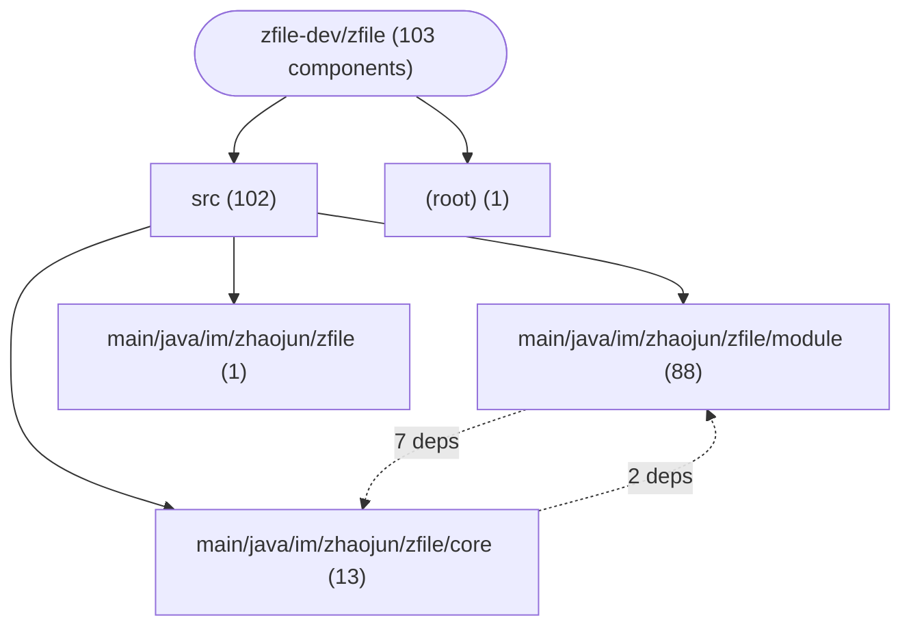
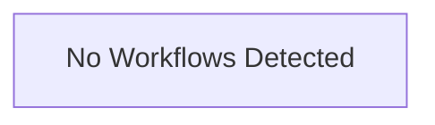

# Repository Architecture Analysis: zfile-dev/zfile

## Metadata
- **SHA**: `775b0172f3b1d3f68aabca727ef7e083e6bd5aa5`
- **Primary Ecosystem**: Java

## Quality Metrics
- **avg_cyclomatic_complexity**: 3.84
- **component_count**: 103
- **files_analyzed**: 417
- **framework**: Spring Boot
- **loc**: 33110
- **max_cyclomatic_complexity**: 46
- **sloc**: 20553

# Architecture: zfile-dev/zfile

## Context
- **Repository**: `zfile-dev/zfile`
- **SHA**: `775b0172f3b1d3f68aabca727ef7e083e6bd5aa5`
- **Ecosystem**: Java
- **Framework**: Unknown

## Building Block View

## Component Details

Showing top 60 representative components out of 103 across 2 module group(s):

- **Module `src`** (102 components — SERVICE: 51, API_ROUTE: 41, CONFIG: 10)
- **Module `(root)`** (1 components — MODULE: 1)

- **UserController** (`src/main/java/im/zhaojun/zfile/module/user/controller/UserController.java`): API_ROUTE (deps: DynamicLoginEntryService, ImgVerifyCodeService, LoginService, SystemConfigService, UserService, ZFileProperties)
- **FileChain** (`src/main/java/im/zhaojun/zfile/module/storage/chain/FileChain.java`): SERVICE (deps: FileAccessPermissionVerifyCommand, FileDownloadPermissionCommand, FileHiddenCommand, FileSortCommand, FolderPasswordVerifyCommand)
- **LinkDownloadService** (`src/main/java/im/zhaojun/zfile/module/link/service/LinkDownloadService.java`): SERVICE (deps: DownloadLogService, FilterConfigService, ShortLinkService, StorageSourceService, SystemConfigService)
- **OnlyOfficeController** (`src/main/java/im/zhaojun/zfile/module/onlyoffice/controller/OnlyOfficeController.java`): API_ROUTE (deps: OnlyOfficeConfigService, StorageSourceService, SystemConfigService, UserStorageSourceService)
- **ShareLinkService** (`src/main/java/im/zhaojun/zfile/module/share/service/ShareLinkService.java`): SERVICE (deps: StorageSourceService, SystemConfigService, UserService, UserStorageSourceService)
- **ShortLinkController** (`src/main/java/im/zhaojun/zfile/module/link/controller/ShortLinkController.java`): API_ROUTE (deps: LinkDownloadService, ShortLinkService, StorageSourceService, SystemConfigService)
- **ShortLinkManagerController** (`src/main/java/im/zhaojun/zfile/module/link/controller/ShortLinkManagerController.java`): API_ROUTE (deps: LinkRateLimiterCache, ShortLinkService, StorageSourceService, SystemConfigService)
- **StorageSourceService** (`src/main/java/im/zhaojun/zfile/module/storage/service/StorageSourceService.java`): SERVICE (deps: PasswordConfigService, ReadmeConfigService, StorageSourceConfigService, UserStorageSourceService)
- **DirectLinkController** (`src/main/java/im/zhaojun/zfile/module/link/controller/DirectLinkController.java`): API_ROUTE (deps: DynamicDirectLinkPrefixService, LinkDownloadService, SystemConfigService)
- **DownloadLogManagerController** (`src/main/java/im/zhaojun/zfile/module/log/controller/DownloadLogManagerController.java`): API_ROUTE (deps: DownloadLogService, StorageSourceService, SystemConfigService)
- **ImgCodeLoginVerifyService** (`src/main/java/im/zhaojun/zfile/module/user/service/login/verify/impl/ImgCodeLoginVerifyService.java`): SERVICE (deps: ImgVerifyCodeService, SystemConfigService, UserService)
- **ShareLinkController** (`src/main/java/im/zhaojun/zfile/module/share/controller/ShareLinkController.java`): API_ROUTE (deps: OnlyOfficeConfigService, ShareLinkFileService, ShareLinkService)
- **ShareLinkFileService** (`src/main/java/im/zhaojun/zfile/module/share/service/ShareLinkFileService.java`): SERVICE (deps: FileChain, ShareLinkService, UserStorageSourceService)
- **SiteController** (`src/main/java/im/zhaojun/zfile/module/config/controller/SiteController.java`): API_ROUTE (deps: StorageSourceService, SystemConfigService, ZFileProperties)
- **TwoFactorAuthLoginVerifyService** (`src/main/java/im/zhaojun/zfile/module/user/service/login/verify/impl/TwoFactorAuthLoginVerifyService.java`): SERVICE (deps: SystemConfigService, TwoFactorAuthenticatorVerifyService, UserService)
- **FileController** (`src/main/java/im/zhaojun/zfile/module/storage/controller/file/FileController.java`): API_ROUTE (deps: FileChain, StorageSourceService)
- **FolderPasswordVerifyCommand** (`src/main/java/im/zhaojun/zfile/module/storage/chain/command/FolderPasswordVerifyCommand.java`): SERVICE (deps: PasswordConfigService, UserStorageSourceService)
- **GlobalExceptionHandler** (`src/main/java/im/zhaojun/zfile/core/exception/GlobalExceptionHandler.java`): API_ROUTE (deps: FrontIndexController, SystemConfigService)
- **InstallService** (`src/main/java/im/zhaojun/zfile/module/install/service/InstallService.java`): SERVICE (deps: SystemConfigService, UserService)
- **Open115ServiceImpl** (`src/main/java/im/zhaojun/zfile/module/storage/service/impl/Open115ServiceImpl.java`): SERVICE (deps: Open115UrlController, StorageSourceConfigService)
- **SettingController** (`src/main/java/im/zhaojun/zfile/module/config/controller/SettingController.java`): API_ROUTE (deps: SystemConfigService, ZFileProperties)
- **SsoService** (`src/main/java/im/zhaojun/zfile/module/sso/service/SsoService.java`): SERVICE (deps: SystemConfigService, UserService)
- **AdminTwoFAController** (`src/main/java/im/zhaojun/zfile/module/user/controller/AdminTwoFAController.java`): API_ROUTE (deps: TwoFactorAuthenticatorVerifyService)
- **FileAccessPermissionVerifyCommand** (`src/main/java/im/zhaojun/zfile/module/storage/chain/command/FileAccessPermissionVerifyCommand.java`): SERVICE (deps: FilterConfigService)
- **FileDownloadPermissionCommand** (`src/main/java/im/zhaojun/zfile/module/storage/chain/command/FileDownloadPermissionCommand.java`): SERVICE (deps: UserStorageSourceService)
- **FileHiddenCommand** (`src/main/java/im/zhaojun/zfile/module/storage/chain/command/FileHiddenCommand.java`): SERVICE (deps: FilterConfigService)
- **FileOperatorController** (`src/main/java/im/zhaojun/zfile/module/storage/controller/file/FileOperatorController.java`): API_ROUTE (deps: PasswordConfigService)
- **FilterConfigService** (`src/main/java/im/zhaojun/zfile/module/filter/service/FilterConfigService.java`): SERVICE (deps: UserStorageSourceService)
- **FrontIndexController** (`src/main/java/im/zhaojun/zfile/core/controller/FrontIndexController.java`): API_ROUTE (deps: SystemConfigService)
- **GoogleDriveServiceImpl** (`src/main/java/im/zhaojun/zfile/module/storage/service/impl/GoogleDriveServiceImpl.java`): SERVICE (deps: StorageSourceConfigService)
- **InstallController** (`src/main/java/im/zhaojun/zfile/module/install/controller/InstallController.java`): API_ROUTE (deps: InstallService)
- **LoginLogController** (`src/main/java/im/zhaojun/zfile/module/log/controller/LoginLogController.java`): API_ROUTE (deps: LoginLogService)
- **OneDriveChinaServiceImpl** (`src/main/java/im/zhaojun/zfile/module/storage/service/impl/OneDriveChinaServiceImpl.java`): SERVICE (deps: ZFileProperties)
- **OneDriveServiceImpl** (`src/main/java/im/zhaojun/zfile/module/storage/service/impl/OneDriveServiceImpl.java`): SERVICE (deps: ZFileProperties)
- **OnlyOfficeConfigService** (`src/main/java/im/zhaojun/zfile/module/onlyoffice/service/OnlyOfficeConfigService.java`): SERVICE (deps: SystemConfigService)
- **Open115UrlController** (`src/main/java/im/zhaojun/zfile/module/storage/controller/proxy/Open115UrlController.java`): API_ROUTE (deps: Open115ServiceImpl)
- **PasswordConfigService** (`src/main/java/im/zhaojun/zfile/module/password/service/PasswordConfigService.java`): SERVICE (deps: UserStorageSourceService)
- **PasswordVerifyService** (`src/main/java/im/zhaojun/zfile/module/user/service/login/verify/impl/PasswordVerifyService.java`): SERVICE (deps: UserService)
- **ShareFileManagerController** (`src/main/java/im/zhaojun/zfile/module/share/controller/ShareFileManagerController.java`): API_ROUTE (deps: ShareLinkService)
- **SharePointChinaServiceImpl** (`src/main/java/im/zhaojun/zfile/module/storage/service/impl/SharePointChinaServiceImpl.java`): SERVICE (deps: ZFileProperties)
- **SharePointServiceImpl** (`src/main/java/im/zhaojun/zfile/module/storage/service/impl/SharePointServiceImpl.java`): SERVICE (deps: ZFileProperties)
- **ShortLinkService** (`src/main/java/im/zhaojun/zfile/module/link/service/ShortLinkService.java`): SERVICE (deps: SystemConfigService)
- **SsoAPIController** (`src/main/java/im/zhaojun/zfile/module/sso/controller/SsoAPIController.java`): API_ROUTE (deps: SsoService)
- **SsoController** (`src/main/java/im/zhaojun/zfile/module/sso/controller/SsoController.java`): API_ROUTE (deps: SsoService)
- **SsoManagerController** (`src/main/java/im/zhaojun/zfile/module/sso/controller/SsoManagerController.java`): API_ROUTE (deps: SsoService)
- **StorageSourceController** (`src/main/java/im/zhaojun/zfile/module/storage/controller/base/StorageSourceController.java`): API_ROUTE (deps: StorageSourceService)
- **StorageSourceFilterController** (`src/main/java/im/zhaojun/zfile/module/filter/controller/StorageSourceFilterController.java`): API_ROUTE (deps: FilterConfigService)
- **StorageSourcePasswordController** (`src/main/java/im/zhaojun/zfile/module/password/controller/StorageSourcePasswordController.java`): API_ROUTE (deps: PasswordConfigService)
- **StorageSourcePermissionController** (`src/main/java/im/zhaojun/zfile/module/permission/controller/StorageSourcePermissionController.java`): API_ROUTE (deps: PermissionConfigService)
- **StorageSourceReadmeController** (`src/main/java/im/zhaojun/zfile/module/readme/controller/StorageSourceReadmeController.java`): API_ROUTE (deps: ReadmeConfigService)
- **TotpAutoConfiguration** (`src/main/java/im/zhaojun/zfile/core/config/totp/TotpAutoConfiguration.java`): CONFIG (deps: TotpProperties)
- **TwoFactorAuthenticatorVerifyService** (`src/main/java/im/zhaojun/zfile/module/user/service/login/TwoFactorAuthenticatorVerifyService.java`): SERVICE (deps: SystemConfigService)
- **UserManagerController** (`src/main/java/im/zhaojun/zfile/module/user/controller/UserManagerController.java`): API_ROUTE (deps: UserService)
- **AliyunServiceImpl** (`src/main/java/im/zhaojun/zfile/module/storage/service/impl/AliyunServiceImpl.java`): SERVICE
- **CommonResultControllerAdvice** (`src/main/java/im/zhaojun/zfile/core/aspect/CommonResultControllerAdvice.java`): API_ROUTE
- **DogeCloudServiceImpl** (`src/main/java/im/zhaojun/zfile/module/storage/service/impl/DogeCloudServiceImpl.java`): SERVICE
- **DownloadLogService** (`src/main/java/im/zhaojun/zfile/module/log/service/DownloadLogService.java`): SERVICE
- **DynamicDirectLinkPrefixService** (`src/main/java/im/zhaojun/zfile/module/link/service/DynamicDirectLinkPrefixService.java`): SERVICE
- **DynamicLoginEntryService** (`src/main/java/im/zhaojun/zfile/module/user/service/DynamicLoginEntryService.java`): SERVICE
- **FileSortCommand** (`src/main/java/im/zhaojun/zfile/module/storage/chain/command/FileSortCommand.java`): SERVICE

## CI/CD Pipeline Topology

