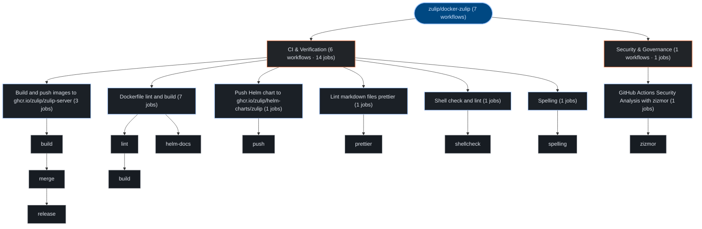

# Repository Architecture Analysis: zulip/docker-zulip

## Metadata
- **SHA**: `2c89f8f69dcae3fd0f998ffed91da22055e3a238`
- **Primary Ecosystem**: JavaScript/TypeScript

## Quality Metrics
- **ast_engine**: tree-sitter
- **avg_cognitive_complexity**: 0.5
- **avg_cyclomatic_complexity**: 1.5
- **component_count**: 19
- **dead_code_count**: 1
- **dead_code_symbols**: 1 entry(ies)
- **duplication_pct**: 8.76
- **file_complexities**: 1 entry(ies)
- **files_analyzed**: 19
- **fitness_passed**: True
- **fitness_violation_count**: 0
- **framework**: Unknown
- **import_edges**: 2 entry(ies)
- **loc**: 291
- **max_cognitive_complexity**: 1
- **max_cyclomatic_complexity**: 2
- **sloc**: 234
- **test_file_count**: 8

# Architecture: zulip/docker-zulip

## Context
- **Repository**: `zulip/docker-zulip`
- **SHA**: `2c89f8f69dcae3fd0f998ffed91da22055e3a238`
- **Ecosystem**: JavaScript/TypeScript
- **Framework**: Unknown

## Building Block View

```mermaid
graph TD;
  classDef atlasRoot fill:#004882,stroke:#a3c9ff,stroke-width:2px,color:#d3e4ff
  classDef atlasCategory fill:#212428,stroke:#E87A48,stroke-width:1.5px,color:#dfe3eb
  classDef atlasWorkflow fill:#1b2026,stroke:#a3c9ff,stroke-width:1.5px,color:#dfe3eb
  classDef atlasJob fill:#171c22,stroke:#8d9199,stroke-width:1px,color:#dfe3eb
  classDef atlasTarget fill:#005227,stroke:#8bd99b,stroke-width:1.5px,color:#a7f6b6
  classDef atlasAlert fill:#93000a,stroke:#ffb4ab,stroke-width:1.5px,color:#ffdad6
  classDef atlasMore fill:#252a31,stroke:#8d9199,stroke-dasharray:4 4,color:#c3c6cf
    e3dc750f_1c88_433b_811f_ede708058c9c["e3dc750f-1c88-433b-811f-ede708058c9c : MODULE"]:::atlasJob
    compose["compose : module"]:::atlasJob
    self_signed["self-signed : module"]:::atlasJob
    with_loadbalancer_ips["with-loadbalancer-ips : module"]:::atlasJob
    link_settings["link-settings : module"]:::atlasJob
    new_hostname["new-hostname : module"]:::atlasJob
    no_envs["no-envs : module"]:::atlasJob
    low_memory["low-memory : module"]:::atlasJob
    multiprocess["multiprocess : module"]:::atlasJob
    multithreaded["multithreaded : module"]:::atlasJob
    repo_root(["zulip/docker-zulip"]):::atlasRoot
    repo_root --> compose
    repo_root --> e3dc750f_1c88_433b_811f_ede708058c9c
    repo_root --> link_settings
    repo_root --> low_memory
    repo_root --> multiprocess
    repo_root --> multithreaded
    repo_root --> new_hostname
    repo_root --> no_envs
    repo_root --> self_signed
    repo_root --> with_loadbalancer_ips
```

## Component Details
- **e3dc750f-1c88-433b-811f-ede708058c9c** (`package.json`): MODULE
- **compose** (`ci/backup-restore/compose.yaml`): module
- **compose** (`ci/backup-restore-volume/compose.yaml`): module
- **compose** (`ci/basic/compose.yaml`): module
- **compose** (`ci/certbot/compose.yaml`): module
- **self-signed** (`ci/certbot/self-signed.yaml`): module
- **compose** (`ci/config/compose.yaml`): module
- **compose** (`ci/http-only/compose.yaml`): module
- **with-loadbalancer-ips** (`ci/http-only/with-loadbalancer-ips.yaml`): module
- **compose** (`ci/legacy-env/compose.yaml`): module
- **compose** (`ci/manual_configuration/compose.yaml`): module
- **link-settings** (`ci/manual_configuration/link-settings.yaml`): module
- **new-hostname** (`ci/manual_configuration/new-hostname.yaml`): module
- **no-envs** (`ci/manual_configuration/no-envs.yaml`): module
- **compose** (`ci/memory/compose.yaml`): module
- **low-memory** (`ci/memory/low-memory.yaml`): module
- **multiprocess** (`ci/memory/multiprocess.yaml`): module
- **multithreaded** (`ci/memory/multithreaded.yaml`): module
- **compose** (`ci/settings/compose.yaml`): module

## 6-Dimension Repository Scorecard

- **Overall Grade**: `D` (65.47/100)
- **Technical Debt Score**: 34.53
- **Estimated Remediation Effort**: 33.63h

| Dimension | Grade | Score | Weight | Details |
| :--- | :---: | :---: | :---: | :--- |
| Code Quality | `B` | 84.86 | 0.20 | avg_cc=1.50, max_cc=2, duplication=8.76%, dead_code=1 |
| Dependency Health | `A` | 100.00 | 0.15 | dependencies=46, outdated=0, vulnerable=0, has_lockfile=True |
| Maintainability | `A` | 100.00 | 0.15 | avg_cognitive=0.50, max_cognitive=1, fitness_violations=0, oversized_files=0 |
| Pipeline Health | `F` | 0.00 | 0.15 | workflows=7, operational_antipatterns=22, parallel_branches=True |
| Security | `F` | 40.00 | 0.20 | vulnerabilities=0, secrets=0, pipeline_security_findings=3 |
| Test Coverage | `C` | 70.00 | 0.15 | coverage=unavailable, ci_test_job=True, test_files_detected=True |

## Supply Chain Dependencies, Vulnerabilities & Secrets

- **Dependencies Parsed**: 46 | **Vulnerabilities**: 0 | **Secrets**: 0

### Inventory Sample
- `myst-parser` `*` (PyPI, `docs/pyproject.toml`)
- `myst-parser` `5.1.0` (PyPI, `docs/uv.lock`)
- `pyyaml` `6.0.3` (PyPI, `docs/pyproject.toml`)
- `pyyaml` `6.0.3` (PyPI, `docs/uv.lock`)
- `sphinx` `*` (PyPI, `docs/pyproject.toml`)
- `sphinx` `9.1.0` (PyPI, `docs/uv.lock`)
- `sphinx-autobuild` `2025.8.25` (PyPI, `docs/pyproject.toml`)
- `sphinx-autobuild` `2025.8.25` (PyPI, `docs/uv.lock`)
- `sphinx-copybutton` `*` (PyPI, `docs/pyproject.toml`)
- `sphinx-copybutton` `0.5.2` (PyPI, `docs/uv.lock`)
- `sphinx-rtd-theme` `*` (PyPI, `docs/pyproject.toml`)
- `sphinx-rtd-theme` `3.1.0` (PyPI, `docs/uv.lock`)
- `prettier` `3.8.4` (npm, `package.json`)
- `alabaster` `1.0.0` (PyPI, `docs/uv.lock`)
- `anyio` `4.12.1` (PyPI, `docs/uv.lock`)
- `babel` `2.18.0` (PyPI, `docs/uv.lock`)
- `certifi` `2026.1.4` (PyPI, `docs/uv.lock`)
- `charset-normalizer` `3.4.4` (PyPI, `docs/uv.lock`)
- `click` `8.3.1` (PyPI, `docs/uv.lock`)
- `colorama` `0.4.6` (PyPI, `docs/uv.lock`)
- `docutils` `0.22.4` (PyPI, `docs/uv.lock`)
- `h11` `0.16.0` (PyPI, `docs/uv.lock`)
- `idna` `3.11` (PyPI, `docs/uv.lock`)
- `imagesize` `1.4.1` (PyPI, `docs/uv.lock`)
- `jinja2` `3.1.6` (PyPI, `docs/uv.lock`)
- `markdown-it-py` `4.2.0` (PyPI, `docs/uv.lock`)
- `markupsafe` `3.0.3` (PyPI, `docs/uv.lock`)
- `mdit-py-plugins` `0.6.1` (PyPI, `docs/uv.lock`)
- `mdurl` `0.1.2` (PyPI, `docs/uv.lock`)
- `packaging` `26.0` (PyPI, `docs/uv.lock`)
- ... (+16 more dependencies)

## Section 7: Code-to-Cloud Deployment Traceability

```mermaid
flowchart LR
    classDef atlasCategory fill:#212428,stroke:#E87A48,stroke-width:1.5px,color:#dfe3eb
    classDef atlasWorkflow fill:#1b2026,stroke:#a3c9ff,stroke-width:1.5px,color:#dfe3eb
    classDef atlasJob fill:#171c22,stroke:#8d9199,stroke-width:1px,color:#dfe3eb
    classDef atlasTarget fill:#005227,stroke:#8bd99b,stroke-width:1.5px,color:#a7f6b6
    subgraph code_modules["Code Modules"]
        mod_ci_certbot["ci/certbot"]:::atlasCategory
        mod_ci_config["ci/config"]:::atlasCategory
        mod_ci_memory["ci/memory"]:::atlasCategory
        mod_ci_settings["ci/settings"]:::atlasCategory
        mod_docs["docs"]:::atlasCategory
        mod_e3dc750f_1c88_433b_811f_ede708058c9c["e3dc750f-1c88-433b-811f-ede708058c9c"]:::atlasCategory
        mod_helm_zulip["helm/zulip"]:::atlasCategory
    end
    subgraph build_artifacts["Build Artifacts / Containers"]
        art__github_workflows_dockerfile_yaml[".github/workflows/dockerfile.yaml"]:::atlasWorkflow
        art_Dockerfile["Dockerfile"]:::atlasWorkflow
        art_helm_zulip_Chart_yaml["helm/zulip/Chart.yaml"]:::atlasWorkflow
        art_helm_zulip_ci_certificates_values_yaml["helm/zulip/ci/certificates-values.yaml"]:::atlasWorkflow
        art_helm_zulip_ci_existing_pvc_values_yaml["helm/zulip/ci/existing-pvc-values.yaml"]:::atlasWorkflow
        art_helm_zulip_ci_existing_secrets_values_yaml["helm/zulip/ci/existing-secrets-values.yaml"]:::atlasWorkflow
        art_helm_zulip_ci_external_services_values_yaml["helm/zulip/ci/external-services-values.yaml"]:::atlasWorkflow
        art_helm_zulip_ci_external_valuefrom_values_yaml["helm/zulip/ci/external-valuefrom-values.yaml"]:::atlasWorkflow
        art_helm_zulip_ci_extra_objects_values_yaml["helm/zulip/ci/extra-objects-values.yaml"]:::atlasWorkflow
        art_helm_zulip_ci_ingress_values_yaml["helm/zulip/ci/ingress-values.yaml"]:::atlasWorkflow
        art_helm_zulip_ci_loadbalancer_values_yaml["helm/zulip/ci/loadbalancer-values.yaml"]:::atlasWorkflow
        art_helm_zulip_ci_metadata_values_yaml["helm/zulip/ci/metadata-values.yaml"]:::atlasWorkflow
        art_helm_zulip_ci_persistence_values_yaml["helm/zulip/ci/persistence-values.yaml"]:::atlasWorkflow
        art_helm_zulip_ci_post_setup_values_yaml["helm/zulip/ci/post-setup-values.yaml"]:::atlasWorkflow
        art_helm_zulip_ci_serviceaccount_values_yaml["helm/zulip/ci/serviceaccount-values.yaml"]:::atlasWorkflow
        art_helm_zulip_ci_sidecar_values_yaml["helm/zulip/ci/sidecar-values.yaml"]:::atlasWorkflow
        art_helm_zulip_ci_simple_values_yaml["helm/zulip/ci/simple-values.yaml"]:::atlasWorkflow
        art_helm_zulip_ci_valuefrom_values_yaml["helm/zulip/ci/valuefrom-values.yaml"]:::atlasWorkflow
        art_helm_zulip_templates_cm_post_setup_scripts_yaml["helm/zulip/templates/cm-post-setup-scripts.yaml"]:::atlasWorkflow
        art_helm_zulip_templates_extra_objects_yaml["helm/zulip/templates/extra-objects.yaml"]:::atlasWorkflow
        art_helm_zulip_templates_ingress_yaml["helm/zulip/templates/ingress.yaml"]:::atlasWorkflow
        art_helm_zulip_templates_pvc_yaml["helm/zulip/templates/pvc.yaml"]:::atlasWorkflow
        art_helm_zulip_templates_service_yaml["helm/zulip/templates/service.yaml"]:::atlasWorkflow
        art_helm_zulip_templates_serviceaccount_yaml["helm/zulip/templates/serviceaccount.yaml"]:::atlasWorkflow
        art_helm_zulip_templates_statefulset_yaml["helm/zulip/templates/statefulset.yaml"]:::atlasWorkflow
        art_helm_zulip_tests_configmap_test_yaml["helm/zulip/tests/configmap_test.yaml"]:::atlasWorkflow
        art_helm_zulip_tests_extra_objects_test_yaml["helm/zulip/tests/extra_objects_test.yaml"]:::atlasWorkflow
        art_helm_zulip_tests_ingress_test_yaml["helm/zulip/tests/ingress_test.yaml"]:::atlasWorkflow
        art_helm_zulip_tests_pvc_test_yaml["helm/zulip/tests/pvc_test.yaml"]:::atlasWorkflow
        art_helm_zulip_tests_service_test_yaml["helm/zulip/tests/service_test.yaml"]:::atlasWorkflow
        art_helm_zulip_tests_serviceaccount_test_yaml["helm/zulip/tests/serviceaccount_test.yaml"]:::atlasWorkflow
        art_helm_zulip_tests_statefulset_test_yaml["helm/zulip/tests/statefulset_test.yaml"]:::atlasWorkflow
        art_helm_zulip_tests_subchart_propagation_test_yaml["helm/zulip/tests/subchart_propagation_test.yaml"]:::atlasWorkflow
        art_helm_zulip_values_yaml["helm/zulip/values.yaml"]:::atlasWorkflow
    end
    subgraph ci_jobs["CI/CD Jobs"]
        job_dockerfile_build_yaml_build["dockerfile-build.yaml#build"]:::atlasJob
        job_dockerfile_yaml_build["dockerfile.yaml#build"]:::atlasJob
        job_dockerfile_yaml_helm_docs["dockerfile.yaml#helm-docs"]:::atlasJob
        job_dockerfile_yaml_helm_lint["dockerfile.yaml#helm-lint"]:::atlasJob
        job_dockerfile_yaml_helm_test["dockerfile.yaml#helm-test"]:::atlasJob
        job_helm_push_yaml_push["helm-push.yaml#push"]:::atlasJob
    end
    subgraph runtime_envs["Runtime Environments"]
        env_azure["azure"]:::atlasTarget
        env_kubernetes["kubernetes"]:::atlasTarget
    end
    job_dockerfile_yaml_helm_lint -->|DEPLOYS_TO| env_azure
    job_dockerfile_yaml_helm_lint -->|DEPLOYS_TO| env_kubernetes
    job_dockerfile_yaml_helm_test -->|DEPLOYS_TO| env_azure
    job_dockerfile_yaml_helm_test -->|DEPLOYS_TO| env_kubernetes
    job_helm_push_yaml_push -->|DEPLOYS_TO| env_kubernetes
    mod_ci_certbot -->|PACKAGED_BY| art_Dockerfile
    mod_ci_config -->|PACKAGED_BY| art__github_workflows_dockerfile_yaml
    mod_ci_config -->|PACKAGED_BY| art_helm_zulip_ci_external_services_values_yaml
    mod_ci_config -->|PACKAGED_BY| art_helm_zulip_ci_extra_objects_values_yaml
    mod_ci_config -->|PACKAGED_BY| art_helm_zulip_ci_persistence_values_yaml
    mod_ci_config -->|PACKAGED_BY| art_helm_zulip_ci_post_setup_values_yaml
    mod_ci_config -->|PACKAGED_BY| art_helm_zulip_templates_cm_post_setup_scripts_yaml
    mod_ci_config -->|PACKAGED_BY| art_helm_zulip_templates_statefulset_yaml
    mod_ci_config -->|PACKAGED_BY| art_helm_zulip_tests_configmap_test_yaml
    mod_ci_config -->|PACKAGED_BY| art_helm_zulip_tests_extra_objects_test_yaml
    mod_ci_config -->|PACKAGED_BY| art_helm_zulip_tests_statefulset_test_yaml
    mod_ci_config -->|PACKAGED_BY| art_helm_zulip_values_yaml
    mod_ci_memory -->|PACKAGED_BY| art_helm_zulip_values_yaml
    mod_ci_settings -->|PACKAGED_BY| art_Dockerfile
    mod_ci_settings -->|PACKAGED_BY| art_helm_zulip_tests_serviceaccount_test_yaml
    mod_ci_settings -->|PACKAGED_BY| art_helm_zulip_values_yaml
    mod_docs -->|PACKAGED_BY| art__github_workflows_dockerfile_yaml
    mod_docs -->|PACKAGED_BY| art_Dockerfile
    mod_docs -->|PACKAGED_BY| art_helm_zulip_values_yaml
    mod_e3dc750f_1c88_433b_811f_ede708058c9c -->|BUILT_BY| job_dockerfile_build_yaml_build
    mod_e3dc750f_1c88_433b_811f_ede708058c9c -->|BUILT_BY| job_dockerfile_yaml_build
    mod_e3dc750f_1c88_433b_811f_ede708058c9c -->|PACKAGED_BY| art_Dockerfile
    mod_helm_zulip -->|BUILT_BY| job_dockerfile_yaml_helm_docs
    mod_helm_zulip -->|BUILT_BY| job_helm_push_yaml_push
    mod_helm_zulip -->|DEPLOYED_BY| job_dockerfile_yaml_helm_lint
    mod_helm_zulip -->|DEPLOYED_BY| job_dockerfile_yaml_helm_test
    mod_helm_zulip -->|PACKAGED_BY| art__github_workflows_dockerfile_yaml
    mod_helm_zulip -->|PACKAGED_BY| art_Dockerfile
    mod_helm_zulip -->|PACKAGED_BY| art_helm_zulip_Chart_yaml
    mod_helm_zulip -->|PACKAGED_BY| art_helm_zulip_ci_certificates_values_yaml
    mod_helm_zulip -->|PACKAGED_BY| art_helm_zulip_ci_existing_pvc_values_yaml
    mod_helm_zulip -->|PACKAGED_BY| art_helm_zulip_ci_existing_secrets_values_yaml
    mod_helm_zulip -->|PACKAGED_BY| art_helm_zulip_ci_external_services_values_yaml
    mod_helm_zulip -->|PACKAGED_BY| art_helm_zulip_ci_external_valuefrom_values_yaml
    mod_helm_zulip -->|PACKAGED_BY| art_helm_zulip_ci_extra_objects_values_yaml
    mod_helm_zulip -->|PACKAGED_BY| art_helm_zulip_ci_ingress_values_yaml
    mod_helm_zulip -->|PACKAGED_BY| art_helm_zulip_ci_loadbalancer_values_yaml
    mod_helm_zulip -->|PACKAGED_BY| art_helm_zulip_ci_metadata_values_yaml
    mod_helm_zulip -->|PACKAGED_BY| art_helm_zulip_ci_persistence_values_yaml
    mod_helm_zulip -->|PACKAGED_BY| art_helm_zulip_ci_post_setup_values_yaml
    mod_helm_zulip -->|PACKAGED_BY| art_helm_zulip_ci_serviceaccount_values_yaml
    mod_helm_zulip -->|PACKAGED_BY| art_helm_zulip_ci_sidecar_values_yaml
    mod_helm_zulip -->|PACKAGED_BY| art_helm_zulip_ci_simple_values_yaml
    mod_helm_zulip -->|PACKAGED_BY| art_helm_zulip_ci_valuefrom_values_yaml
    mod_helm_zulip -->|PACKAGED_BY| art_helm_zulip_templates_cm_post_setup_scripts_yaml
    mod_helm_zulip -->|PACKAGED_BY| art_helm_zulip_templates_extra_objects_yaml
    mod_helm_zulip -->|PACKAGED_BY| art_helm_zulip_templates_ingress_yaml
    mod_helm_zulip -->|PACKAGED_BY| art_helm_zulip_templates_pvc_yaml
    mod_helm_zulip -->|PACKAGED_BY| art_helm_zulip_templates_service_yaml
    mod_helm_zulip -->|PACKAGED_BY| art_helm_zulip_templates_serviceaccount_yaml
    mod_helm_zulip -->|PACKAGED_BY| art_helm_zulip_templates_statefulset_yaml
    mod_helm_zulip -->|PACKAGED_BY| art_helm_zulip_tests_configmap_test_yaml
    mod_helm_zulip -->|PACKAGED_BY| art_helm_zulip_tests_extra_objects_test_yaml
    mod_helm_zulip -->|PACKAGED_BY| art_helm_zulip_tests_ingress_test_yaml
    mod_helm_zulip -->|PACKAGED_BY| art_helm_zulip_tests_pvc_test_yaml
    mod_helm_zulip -->|PACKAGED_BY| art_helm_zulip_tests_service_test_yaml
    mod_helm_zulip -->|PACKAGED_BY| art_helm_zulip_tests_serviceaccount_test_yaml
    mod_helm_zulip -->|PACKAGED_BY| art_helm_zulip_tests_statefulset_test_yaml
    mod_helm_zulip -->|PACKAGED_BY| art_helm_zulip_tests_subchart_propagation_test_yaml
    mod_helm_zulip -->|PACKAGED_BY| art_helm_zulip_values_yaml
    art_Dockerfile -->|BUILT_BY| job_dockerfile_build_yaml_build
    art_Dockerfile -->|BUILT_BY| job_dockerfile_yaml_build
    art_Dockerfile -->|PACKAGED_BY| art_helm_zulip_values_yaml
    art_helm_zulip_Chart_yaml -->|BUILT_BY| job_dockerfile_yaml_helm_docs
    art_helm_zulip_Chart_yaml -->|BUILT_BY| job_helm_push_yaml_push
    art_helm_zulip_Chart_yaml -->|DEPLOYED_BY| job_dockerfile_yaml_helm_lint
    art_helm_zulip_Chart_yaml -->|DEPLOYED_BY| job_dockerfile_yaml_helm_test
    art_helm_zulip_ci_certificates_values_yaml -->|DEPLOYED_BY| job_dockerfile_yaml_helm_lint
    art_helm_zulip_ci_certificates_values_yaml -->|DEPLOYED_BY| job_dockerfile_yaml_helm_test
    art_helm_zulip_ci_existing_pvc_values_yaml -->|DEPLOYED_BY| job_dockerfile_yaml_helm_lint
    art_helm_zulip_ci_existing_pvc_values_yaml -->|DEPLOYED_BY| job_dockerfile_yaml_helm_test
    art_helm_zulip_ci_existing_secrets_values_yaml -->|DEPLOYED_BY| job_dockerfile_yaml_helm_lint
    art_helm_zulip_ci_existing_secrets_values_yaml -->|DEPLOYED_BY| job_dockerfile_yaml_helm_test
    art_helm_zulip_ci_external_services_values_yaml -->|DEPLOYED_BY| job_dockerfile_yaml_helm_lint
    art_helm_zulip_ci_external_services_values_yaml -->|DEPLOYED_BY| job_dockerfile_yaml_helm_test
    art_helm_zulip_ci_external_valuefrom_values_yaml -->|DEPLOYED_BY| job_dockerfile_yaml_helm_lint
    art_helm_zulip_ci_external_valuefrom_values_yaml -->|DEPLOYED_BY| job_dockerfile_yaml_helm_test
    art_helm_zulip_ci_extra_objects_values_yaml -->|DEPLOYED_BY| job_dockerfile_yaml_helm_lint
    art_helm_zulip_ci_extra_objects_values_yaml -->|DEPLOYED_BY| job_dockerfile_yaml_helm_test
    art_helm_zulip_ci_ingress_values_yaml -->|DEPLOYED_BY| job_dockerfile_yaml_helm_lint
    art_helm_zulip_ci_ingress_values_yaml -->|DEPLOYED_BY| job_dockerfile_yaml_helm_test
    art_helm_zulip_ci_loadbalancer_values_yaml -->|DEPLOYED_BY| job_dockerfile_yaml_helm_lint
    art_helm_zulip_ci_loadbalancer_values_yaml -->|DEPLOYED_BY| job_dockerfile_yaml_helm_test
    art_helm_zulip_ci_metadata_values_yaml -->|DEPLOYED_BY| job_dockerfile_yaml_helm_lint
    art_helm_zulip_ci_metadata_values_yaml -->|DEPLOYED_BY| job_dockerfile_yaml_helm_test
    art_helm_zulip_ci_persistence_values_yaml -->|DEPLOYED_BY| job_dockerfile_yaml_helm_lint
    art_helm_zulip_ci_persistence_values_yaml -->|DEPLOYED_BY| job_dockerfile_yaml_helm_test
    art_helm_zulip_ci_post_setup_values_yaml -->|DEPLOYED_BY| job_dockerfile_yaml_helm_lint
    art_helm_zulip_ci_post_setup_values_yaml -->|DEPLOYED_BY| job_dockerfile_yaml_helm_test
    art_helm_zulip_ci_serviceaccount_values_yaml -->|DEPLOYED_BY| job_dockerfile_yaml_helm_lint
    art_helm_zulip_ci_serviceaccount_values_yaml -->|DEPLOYED_BY| job_dockerfile_yaml_helm_test
    art_helm_zulip_ci_sidecar_values_yaml -->|DEPLOYED_BY| job_dockerfile_yaml_helm_lint
    art_helm_zulip_ci_sidecar_values_yaml -->|DEPLOYED_BY| job_dockerfile_yaml_helm_test
    art_helm_zulip_ci_simple_values_yaml -->|DEPLOYED_BY| job_dockerfile_yaml_helm_lint
    art_helm_zulip_ci_simple_values_yaml -->|DEPLOYED_BY| job_dockerfile_yaml_helm_test
    art_helm_zulip_ci_valuefrom_values_yaml -->|DEPLOYED_BY| job_dockerfile_yaml_helm_lint
    art_helm_zulip_ci_valuefrom_values_yaml -->|DEPLOYED_BY| job_dockerfile_yaml_helm_test
    art_helm_zulip_values_yaml -->|BUILT_BY| job_dockerfile_yaml_helm_docs
    art_helm_zulip_values_yaml -->|BUILT_BY| job_helm_push_yaml_push
    art_helm_zulip_values_yaml -->|DEPLOYED_BY| job_dockerfile_yaml_helm_lint
    art_helm_zulip_values_yaml -->|DEPLOYED_BY| job_dockerfile_yaml_helm_test
```

- `dockerfile.yaml#helm-lint` (ci_job) --[DEPLOYS_TO]--> `azure` (environment)
- `dockerfile.yaml#helm-lint` (ci_job) --[DEPLOYS_TO]--> `kubernetes` (environment)
- `dockerfile.yaml#helm-test` (ci_job) --[DEPLOYS_TO]--> `azure` (environment)
- `dockerfile.yaml#helm-test` (ci_job) --[DEPLOYS_TO]--> `kubernetes` (environment)
- `helm-push.yaml#push` (ci_job) --[DEPLOYS_TO]--> `kubernetes` (environment)
- `ci/certbot` (code_module) --[PACKAGED_BY]--> `Dockerfile` (container)
- `ci/config` (code_module) --[PACKAGED_BY]--> `.github/workflows/dockerfile.yaml` (container)
- `ci/config` (code_module) --[PACKAGED_BY]--> `helm/zulip/ci/external-services-values.yaml` (iac)
- `ci/config` (code_module) --[PACKAGED_BY]--> `helm/zulip/ci/extra-objects-values.yaml` (iac)
- `ci/config` (code_module) --[PACKAGED_BY]--> `helm/zulip/ci/persistence-values.yaml` (iac)
- `ci/config` (code_module) --[PACKAGED_BY]--> `helm/zulip/ci/post-setup-values.yaml` (iac)
- `ci/config` (code_module) --[PACKAGED_BY]--> `helm/zulip/templates/cm-post-setup-scripts.yaml` (iac)
- `ci/config` (code_module) --[PACKAGED_BY]--> `helm/zulip/templates/statefulset.yaml` (iac)
- `ci/config` (code_module) --[PACKAGED_BY]--> `helm/zulip/tests/configmap_test.yaml` (iac)
- `ci/config` (code_module) --[PACKAGED_BY]--> `helm/zulip/tests/extra_objects_test.yaml` (iac)
- `ci/config` (code_module) --[PACKAGED_BY]--> `helm/zulip/tests/statefulset_test.yaml` (iac)
- `ci/config` (code_module) --[PACKAGED_BY]--> `helm/zulip/values.yaml` (iac)
- `ci/memory` (code_module) --[PACKAGED_BY]--> `helm/zulip/values.yaml` (iac)
- `ci/settings` (code_module) --[PACKAGED_BY]--> `Dockerfile` (container)
- `ci/settings` (code_module) --[PACKAGED_BY]--> `helm/zulip/tests/serviceaccount_test.yaml` (iac)
- `ci/settings` (code_module) --[PACKAGED_BY]--> `helm/zulip/values.yaml` (iac)
- `docs` (code_module) --[PACKAGED_BY]--> `.github/workflows/dockerfile.yaml` (container)
- `docs` (code_module) --[PACKAGED_BY]--> `Dockerfile` (container)
- `docs` (code_module) --[PACKAGED_BY]--> `helm/zulip/values.yaml` (iac)
- `e3dc750f-1c88-433b-811f-ede708058c9c` (code_module) --[BUILT_BY]--> `dockerfile-build.yaml#build` (ci_job)
- `e3dc750f-1c88-433b-811f-ede708058c9c` (code_module) --[BUILT_BY]--> `dockerfile.yaml#build` (ci_job)
- `e3dc750f-1c88-433b-811f-ede708058c9c` (code_module) --[PACKAGED_BY]--> `Dockerfile` (container)
- `helm/zulip` (code_module) --[BUILT_BY]--> `dockerfile.yaml#helm-docs` (ci_job)
- `helm/zulip` (code_module) --[BUILT_BY]--> `helm-push.yaml#push` (ci_job)
- `helm/zulip` (code_module) --[DEPLOYED_BY]--> `dockerfile.yaml#helm-lint` (ci_job)
- `helm/zulip` (code_module) --[DEPLOYED_BY]--> `dockerfile.yaml#helm-test` (ci_job)
- `helm/zulip` (code_module) --[PACKAGED_BY]--> `.github/workflows/dockerfile.yaml` (container)
- `helm/zulip` (code_module) --[PACKAGED_BY]--> `Dockerfile` (container)
- `helm/zulip` (code_module) --[PACKAGED_BY]--> `helm/zulip/Chart.yaml` (iac)
- `helm/zulip` (code_module) --[PACKAGED_BY]--> `helm/zulip/ci/certificates-values.yaml` (iac)
- `helm/zulip` (code_module) --[PACKAGED_BY]--> `helm/zulip/ci/existing-pvc-values.yaml` (iac)
- `helm/zulip` (code_module) --[PACKAGED_BY]--> `helm/zulip/ci/existing-secrets-values.yaml` (iac)
- `helm/zulip` (code_module) --[PACKAGED_BY]--> `helm/zulip/ci/external-services-values.yaml` (iac)
- `helm/zulip` (code_module) --[PACKAGED_BY]--> `helm/zulip/ci/external-valuefrom-values.yaml` (iac)
- `helm/zulip` (code_module) --[PACKAGED_BY]--> `helm/zulip/ci/extra-objects-values.yaml` (iac)

## CI/CD Pipeline Topology

