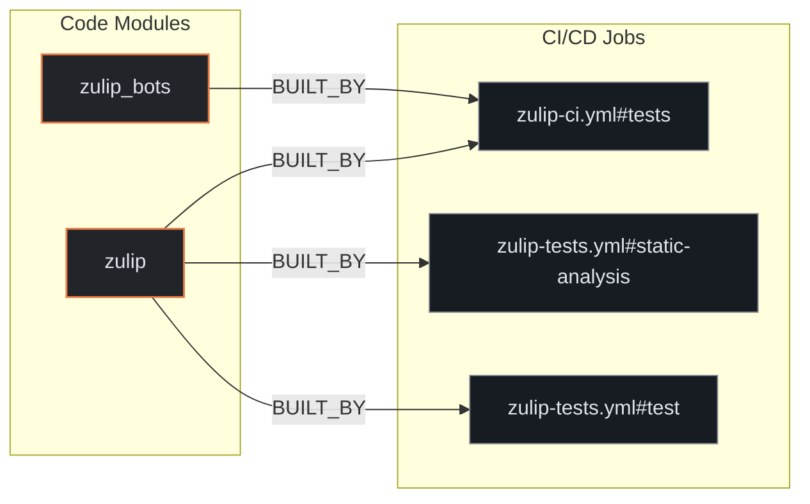
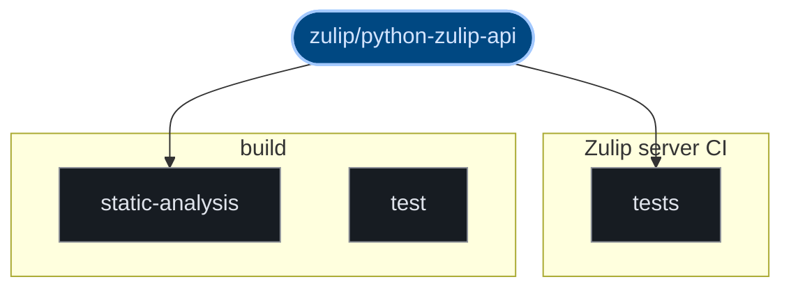

# Repository Architecture Analysis: zulip/python-zulip-api

## Metadata
- **SHA**: `b172347594a4634517f925f9e30522fe987dbb9c`
- **Primary Ecosystem**: Python

## Quality Metrics
- **ast_engine**: tree-sitter
- **avg_cognitive_complexity**: 2.31
- **avg_cyclomatic_complexity**: 2.42
- **component_count**: 10
- **dead_code_count**: 9
- **dead_code_symbols**: 9 entry(ies)
- **duplication_pct**: 70.71
- **file_complexities**: 25 entry(ies)
- **files_analyzed**: 208
- **fitness_passed**: False
- **fitness_violation_count**: 3
- **framework**: Unknown
- **import_edges**: 100 entry(ies)
- **loc**: 27210
- **max_cognitive_complexity**: 199
- **max_cyclomatic_complexity**: 84
- **sloc**: 21264
- **test_file_count**: 150

# Architecture: zulip/python-zulip-api

## Context
- **Repository**: `zulip/python-zulip-api`
- **SHA**: `b172347594a4634517f925f9e30522fe987dbb9c`
- **Ecosystem**: Python
- **Framework**: Unknown

## Building Block View

```mermaid
graph TD;
  classDef atlasRoot fill:#004882,stroke:#a3c9ff,stroke-width:2px,color:#d3e4ff
  classDef atlasCategory fill:#212428,stroke:#E87A48,stroke-width:1.5px,color:#dfe3eb
  classDef atlasWorkflow fill:#1b2026,stroke:#a3c9ff,stroke-width:1.5px,color:#dfe3eb
  classDef atlasJob fill:#171c22,stroke:#8d9199,stroke-width:1px,color:#dfe3eb
  classDef atlasTarget fill:#005227,stroke:#8bd99b,stroke-width:1.5px,color:#a7f6b6
  classDef atlasAlert fill:#93000a,stroke:#ffb4ab,stroke-width:1.5px,color:#ffdad6
  classDef atlasMore fill:#252a31,stroke:#8d9199,stroke-dasharray:4 4,color:#c3c6cf
    send_message["send_message : CLI_COMMAND"]:::atlasJob
    upload_file["upload_file : CLI_COMMAND"]:::atlasJob
    update_message["update_message : CLI_COMMAND"]:::atlasJob
    delete_message["delete_message : CLI_COMMAND"]:::atlasJob
    add_reaction["add_reaction : CLI_COMMAND"]:::atlasJob
    remove_reaction["remove_reaction : CLI_COMMAND"]:::atlasJob
    get_message_history["get_message_history : CLI_COMMAND"]:::atlasJob
    mark_all_as_read["mark_all_as_read : CLI_COMMAND"]:::atlasJob
    get_subscriptions["get_subscriptions : CLI_COMMAND"]:::atlasJob
    handle_bot["handle_bot : API_ROUTE"]:::atlasJob
    repo_root(["zulip/python-zulip-api"]):::atlasRoot
    repo_root --> add_reaction
    repo_root --> delete_message
    repo_root --> get_message_history
    repo_root --> get_subscriptions
    repo_root --> handle_bot
    repo_root --> mark_all_as_read
    repo_root --> remove_reaction
    repo_root --> send_message
    repo_root --> update_message
    repo_root --> upload_file
```

## Component Details
- **send_message** (`zulip/zulip/cli.py`): CLI_COMMAND
- **upload_file** (`zulip/zulip/cli.py`): CLI_COMMAND
- **update_message** (`zulip/zulip/cli.py`): CLI_COMMAND
- **delete_message** (`zulip/zulip/cli.py`): CLI_COMMAND
- **add_reaction** (`zulip/zulip/cli.py`): CLI_COMMAND
- **remove_reaction** (`zulip/zulip/cli.py`): CLI_COMMAND
- **get_message_history** (`zulip/zulip/cli.py`): CLI_COMMAND
- **mark_all_as_read** (`zulip/zulip/cli.py`): CLI_COMMAND
- **get_subscriptions** (`zulip/zulip/cli.py`): CLI_COMMAND
- **handle_bot** (`zulip_botserver/zulip_botserver/server.py`): API_ROUTE

## 6-Dimension Repository Scorecard

- **Overall Grade**: `F` (51.90/100)
- **Technical Debt Score**: 48.10
- **Estimated Remediation Effort**: 56.92h

| Dimension | Grade | Score | Weight | Details |
| :--- | :---: | :---: | :---: | :--- |
| Code Quality | `F` | 32.00 | 0.20 | avg_cc=2.42, max_cc=84, duplication=70.71%, dead_code=9 |
| Dependency Health | `B` | 85.00 | 0.15 | dependencies=38, outdated=0, vulnerable=0, has_lockfile=False |
| Maintainability | `F` | 37.00 | 0.15 | avg_cognitive=2.31, max_cognitive=199, fitness_violations=3, oversized_files=8 |
| Pipeline Health | `A` | 90.00 | 0.15 | workflows=2, operational_antipatterns=4, parallel_branches=True |
| Security | `F` | 16.00 | 0.20 | vulnerabilities=0, secrets=4, pipeline_security_findings=1 |
| Test Coverage | `C` | 70.00 | 0.15 | coverage=unavailable, ci_test_job=True, test_files_detected=True |

## Architecture Fitness & Workspace Boundaries

- **[MEDIUM] `ATRUSS-ARCH-005` (COMPLEXITY_THRESHOLD)**: Repository duplication_pct (70.71) exceeds policy threshold (15.0).
- **[MEDIUM] `ATRUSS-ARCH-005` (COMPLEXITY_THRESHOLD)**: Repository max_cognitive_complexity (199.0) exceeds policy threshold (25.0).
- **[MEDIUM] `ATRUSS-ARCH-005` (COMPLEXITY_THRESHOLD)**: Repository max_cyclomatic_complexity (84.0) exceeds policy threshold (20.0).

## Supply Chain Dependencies, Vulnerabilities & Secrets

- **Dependencies Parsed**: 38 | **Vulnerabilities**: 0 | **Secrets**: 4

### Secret Findings (Redacted)
- **[HIGH] `ATRUSS-SEC-005`** at `zulip_bots/zulip_bots/bots/twitpost/test_twitpost.py:13` (`"consumer_key": "abcd***REDACTED***",`)
- **[HIGH] `ATRUSS-SEC-005`** at `zulip_bots/zulip_bots/bots/twitpost/test_twitpost.py:14` (`"consumer_secret": "aabb***REDACTED***",`)
- **[HIGH] `ATRUSS-SEC-005`** at `zulip_bots/zulip_bots/bots/twitpost/test_twitpost.py:15` (`"access_token": "1234***REDACTED***",`)
- **[HIGH] `ATRUSS-SEC-005`** at `zulip_bots/zulip_bots/bots/twitpost/test_twitpost.py:16` (`"access_token_secret": "yf0S***REDACTED***",`)

### Inventory Sample
- `Trac` `1.2.2` (PyPI, `zulip/integrations/trac/requirements.txt`)
- `apiai` `*` (PyPI, `zulip_bots/zulip_bots/bots/dialogflow/requirements.txt`)
- `chess` `*` (PyPI, `zulip_bots/zulip_bots/bots/chessbot/requirements.txt`)
- `crayons` `*` (PyPI, `requirements.txt`)
- `dropbox` `*` (PyPI, `zulip_bots/zulip_bots/bots/dropbox_share/requirements.txt`)
- `feedparser` `6.0.10` (PyPI, `zulip/integrations/rss/requirements.txt`)
- `gitlint` `0.13.0` (PyPI, `requirements.txt`)
- `google-api-python-client` `1.7.9` (PyPI, `zulip/integrations/google/requirements.txt`)
- `google-auth-httplib2` `0.0.3` (PyPI, `zulip/integrations/google/requirements.txt`)
- `google-auth-oauthlib` `0.4.0` (PyPI, `zulip/integrations/google/requirements.txt`)
- `irc` `20.3` (PyPI, `zulip/integrations/bridge_with_irc/requirements.txt`)
- `litellm` `*` (PyPI, `zulip/integrations/litellm/requirements.txt`)
- `matrix-nio` `*` (PyPI, `zulip/integrations/bridge_with_matrix/requirements.txt`)
- `mercurial` `4.3.1` (PyPI, `zulip/integrations/hg/requirements.txt`)
- `mock` `*` (PyPI, `requirements.txt`)
- `mypy` `1.8.0` (PyPI, `requirements.txt`)
- `platformdirs` `*` (PyPI, `zulip/integrations/codebase/requirements.txt`)
- `platformdirs` `*` (PyPI, `zulip/integrations/log2zulip/requirements.txt`)
- `pysvn` `0.1.0` (PyPI, `zulip/integrations/svn/requirements.txt`)
- `pytest` `*` (PyPI, `requirements.txt`)
- `pytest-cov` `*` (PyPI, `requirements.txt`)
- `python-dateutil` `*` (PyPI, `zulip/integrations/google/requirements.txt`)
- `pytz` `*` (PyPI, `zulip/integrations/google/requirements.txt`)
- `ruff` `0.2.2` (PyPI, `requirements.txt`)
- `setuptools` `*` (PyPI, `requirements.txt`)
- `simple_salesforce` `*` (PyPI, `zulip_bots/zulip_bots/bots/salesforce/requirements.txt`)
- `slack-sdk` `3.11.2` (PyPI, `zulip/integrations/bridge_with_slack/requirements.txt`)
- `sleekxmpp` `1.3.2` (PyPI, `zulip/integrations/jabber/requirements.txt`)
- `tweepy` `*` (PyPI, `zulip_bots/zulip_bots/bots/twitpost/requirements.txt`)
- `twine` `*` (PyPI, `requirements.txt`)
- ... (+8 more dependencies)

## Section 7: Code-to-Cloud Deployment Traceability

- `zulip` (code_module) --[BUILT_BY]--> `zulip-ci.yml#tests` (ci_job)
- `zulip` (code_module) --[BUILT_BY]--> `zulip-tests.yml#static-analysis` (ci_job)
- `zulip` (code_module) --[BUILT_BY]--> `zulip-tests.yml#test` (ci_job)
- `zulip_bots` (code_module) --[BUILT_BY]--> `zulip-ci.yml#tests` (ci_job)

## CI/CD Pipeline Topology

