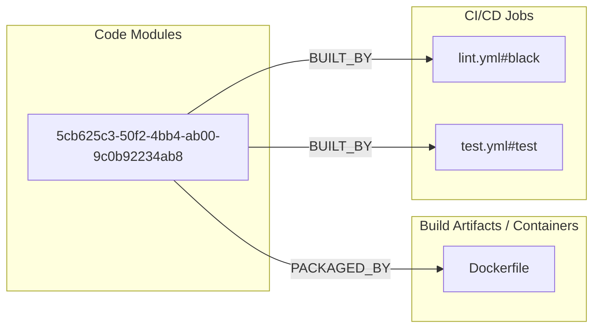
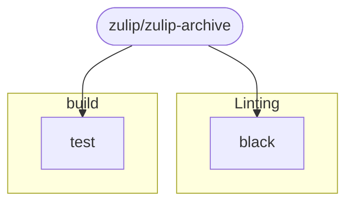

# Repository Architecture Analysis: zulip/zulip-archive

## Metadata
- **SHA**: `7546f0c850ea07bed6e18be18fb4a8ca6ac603df`
- **Primary Ecosystem**: Python

## Quality Metrics
- **ast_engine**: tree-sitter
- **avg_cognitive_complexity**: 1.54
- **avg_cyclomatic_complexity**: 2.07
- **component_count**: 0
- **dead_code_count**: 0
- **dead_code_symbols**: 0 entry(ies)
- **duplication_pct**: 47.02
- **file_complexities**: 14 entry(ies)
- **files_analyzed**: 14
- **fitness_passed**: False
- **fitness_violation_count**: 1
- **framework**: Unknown
- **import_edges**: 72 entry(ies)
- **loc**: 1607
- **max_cognitive_complexity**: 17
- **max_cyclomatic_complexity**: 13
- **sloc**: 1196
- **test_file_count**: 1

## 6-Dimension Repository Scorecard

- **Overall Grade**: `C` (78.35/100)
- **Technical Debt Score**: 21.65
- **Estimated Remediation Effort**: 22.82h

| Dimension | Grade | Score | Weight | Details |
| :--- | :---: | :---: | :---: | :--- |
| Code Quality | `C` | 75.00 | 0.20 | avg_cc=2.07, max_cc=13, duplication=47.02%, dead_code=0 |
| Dependency Health | `B` | 85.00 | 0.15 | dependencies=3, outdated=0, vulnerable=0, has_lockfile=False |
| Maintainability | `A` | 94.00 | 0.15 | avg_cognitive=1.54, max_cognitive=17, fitness_violations=1, oversized_files=0 |
| Pipeline Health | `B` | 88.00 | 0.15 | workflows=2, operational_antipatterns=3, parallel_branches=False |
| Security | `D` | 64.00 | 0.20 | vulnerabilities=0, secrets=0, pipeline_security_findings=3 |
| Test Coverage | `C` | 70.00 | 0.15 | coverage=unavailable, ci_test_job=True, test_files_detected=True |

## Architecture Fitness & Workspace Boundaries

- **[MEDIUM] `ATRUSS-ARCH-005` (COMPLEXITY_THRESHOLD)**: Repository duplication_pct (47.02) exceeds policy threshold (15.0).

## Supply Chain Dependencies, Vulnerabilities & Secrets

- **Dependencies Parsed**: 3 | **Vulnerabilities**: 0 | **Secrets**: 0

### Inventory Sample
- `pyyaml` `5.2` (PyPI, `requirements.txt`)
- `xml-sitemap-writer` `0.6.0` (PyPI, `requirements.txt`)
- `zulip` `0.8.2` (PyPI, `requirements.txt`)

## Section 7: Code-to-Cloud Deployment Traceability

- `5cb625c3-50f2-4bb4-ab00-9c0b92234ab8` (code_module) --[BUILT_BY]--> `lint.yml#black` (ci_job)
- `5cb625c3-50f2-4bb4-ab00-9c0b92234ab8` (code_module) --[BUILT_BY]--> `test.yml#test` (ci_job)
- `5cb625c3-50f2-4bb4-ab00-9c0b92234ab8` (code_module) --[PACKAGED_BY]--> `Dockerfile` (container)

## CI/CD Pipeline Topology

