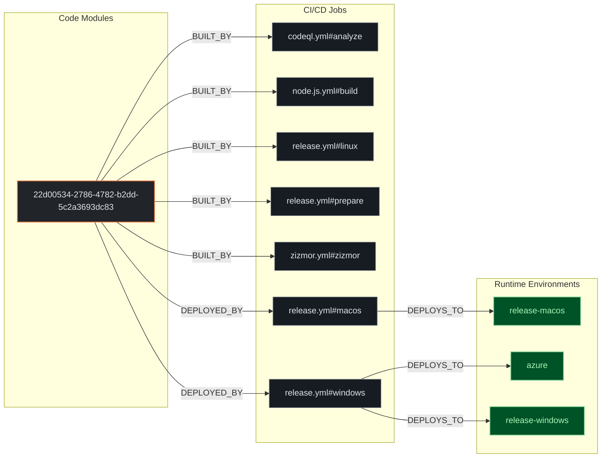
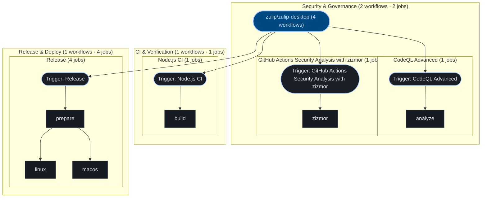

# Repository Architecture Analysis: zulip/zulip-desktop

## Metadata
- **SHA**: `308ea3b248badd4664d533afe08427022563536e`
- **Primary Ecosystem**: JavaScript/TypeScript

## Quality Metrics
- **ast_engine**: tree-sitter
- **avg_cognitive_complexity**: 3.0
- **avg_cyclomatic_complexity**: 2.25
- **component_count**: 1
- **dead_code_count**: 4
- **dead_code_symbols**: 4 entry(ies)
- **duplication_pct**: 61.75
- **file_complexities**: 25 entry(ies)
- **files_analyzed**: 64
- **fitness_passed**: False
- **fitness_violation_count**: 3
- **framework**: TypeScript
- **import_edges**: 100 entry(ies)
- **loc**: 7813
- **max_cognitive_complexity**: 69
- **max_cyclomatic_complexity**: 28
- **sloc**: 6719
- **test_file_count**: 4

# Architecture: zulip/zulip-desktop

## Context
- **Repository**: `zulip/zulip-desktop`
- **SHA**: `308ea3b248badd4664d533afe08427022563536e`
- **Ecosystem**: JavaScript/TypeScript
- **Framework**: TypeScript

## Building Block View

## Component Details
- **zulip** (`package.json`): MODULE

## 6-Dimension Repository Scorecard

- **Overall Grade**: `D` (67.60/100)
- **Technical Debt Score**: 32.40
- **Estimated Remediation Effort**: 37.45h

| Dimension | Grade | Score | Weight | Details |
| :--- | :---: | :---: | :---: | :--- |
| Code Quality | `F` | 47.50 | 0.20 | avg_cc=2.25, max_cc=28, duplication=61.75%, dead_code=4 |
| Dependency Health | `B` | 85.00 | 0.15 | dependencies=40, outdated=0, vulnerable=0, has_lockfile=False |
| Maintainability | `F` | 42.00 | 0.15 | avg_cognitive=3.00, max_cognitive=69, fitness_violations=3, oversized_files=3 |
| Pipeline Health | `F` | 57.00 | 0.15 | workflows=4, operational_antipatterns=8, parallel_branches=True |
| Security | `A` | 100.00 | 0.20 | vulnerabilities=0, secrets=0, pipeline_security_findings=0 |
| Test Coverage | `C` | 70.00 | 0.15 | coverage=unavailable, ci_test_job=False, test_files_detected=True |

## Architecture Fitness & Workspace Boundaries

- **[MEDIUM] `ATRUSS-ARCH-005` (COMPLEXITY_THRESHOLD)**: Repository duplication_pct (61.75) exceeds policy threshold (15.0).
- **[MEDIUM] `ATRUSS-ARCH-005` (COMPLEXITY_THRESHOLD)**: Repository max_cognitive_complexity (69.0) exceeds policy threshold (25.0).
- **[MEDIUM] `ATRUSS-ARCH-005` (COMPLEXITY_THRESHOLD)**: Repository max_cyclomatic_complexity (28.0) exceeds policy threshold (20.0).

## Supply Chain Dependencies, Vulnerabilities & Secrets

- **Dependencies Parsed**: 40 | **Vulnerabilities**: 0 | **Secrets**: 0

### Inventory Sample
- `@electron/remote` `2.0.8` (npm, `package.json`)
- `@sentry/core` `11.8.0` (npm, `package.json`)
- `@sentry/electron` `8.3.0` (npm, `package.json`)
- `@types/auto-launch` `5.0.2` (npm, `package.json`)
- `@types/backoff` `2.5.2` (npm, `package.json`)
- `@types/i18n` `0.13.1` (npm, `package.json`)
- `@types/minimalistic-assert` `1.0.3` (npm, `package.json`)
- `@types/node` `24.13.2` (npm, `package.json`)
- `@types/p-fifo` `1.0.2` (npm, `package.json`)
- `@types/semver` `7.5.8` (npm, `package.json`)
- `@types/yaireo__tagify` `4.3.2` (npm, `package.json`)
- `@typescript/native` `latest` (npm, `package.json`)
- `@yaireo/tagify` `4.5.0` (npm, `package.json`)
- `adm-zip` `0.6.1` (npm, `package.json`)
- `auto-launch` `5.0.5` (npm, `package.json`)
- `backoff` `2.5.0` (npm, `package.json`)
- `electron` `45.1.0` (npm, `package.json`)
- `electron-builder` `26.18.0` (npm, `package.json`)
- `electron-log` `5.0.3` (npm, `package.json`)
- `electron-updater` `6.3.4` (npm, `package.json`)
- `electron-vite` `6.0.0` (npm, `package.json`)
- `electron-window-state` `5.0.3` (npm, `package.json`)
- `escape-goat` `4.0.0` (npm, `package.json`)
- `gatemaker` `1.0.0` (npm, `package.json`)
- `htmlhint` `1.1.2` (npm, `package.json`)
- `i18n` `0.15.1` (npm, `package.json`)
- `i18next-cli` `1.2.1` (npm, `package.json`)
- `minimalistic-assert` `1.0.1` (npm, `package.json`)
- `node-json-db` `1.3.0` (npm, `package.json`)
- `p-fifo` `1.0.0` (npm, `package.json`)
- ... (+10 more dependencies)

## Section 7: Code-to-Cloud Deployment Traceability

- `release.yml#macos` (ci_job) --[DEPLOYS_TO]--> `release-macos` (environment)
- `release.yml#windows` (ci_job) --[DEPLOYS_TO]--> `azure` (environment)
- `release.yml#windows` (ci_job) --[DEPLOYS_TO]--> `release-windows` (environment)
- `22d00534-2786-4782-b2dd-5c2a3693dc83` (code_module) --[BUILT_BY]--> `codeql.yml#analyze` (ci_job)
- `22d00534-2786-4782-b2dd-5c2a3693dc83` (code_module) --[BUILT_BY]--> `node.js.yml#build` (ci_job)
- `22d00534-2786-4782-b2dd-5c2a3693dc83` (code_module) --[BUILT_BY]--> `release.yml#linux` (ci_job)
- `22d00534-2786-4782-b2dd-5c2a3693dc83` (code_module) --[BUILT_BY]--> `release.yml#prepare` (ci_job)
- `22d00534-2786-4782-b2dd-5c2a3693dc83` (code_module) --[BUILT_BY]--> `zizmor.yml#zizmor` (ci_job)
- `22d00534-2786-4782-b2dd-5c2a3693dc83` (code_module) --[DEPLOYED_BY]--> `release.yml#macos` (ci_job)
- `22d00534-2786-4782-b2dd-5c2a3693dc83` (code_module) --[DEPLOYED_BY]--> `release.yml#windows` (ci_job)

## CI/CD Pipeline Topology

