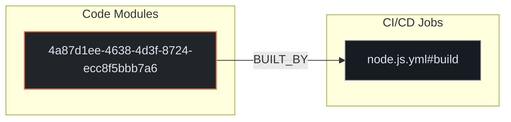
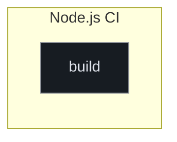

# Repository Architecture Analysis: zulip/zulip-js

## Metadata
- **SHA**: `3c6890e953edb6a36c672017741c4438a4a248ef`
- **Primary Ecosystem**: JavaScript/TypeScript

## Quality Metrics
- **ast_engine**: tree-sitter
- **avg_cognitive_complexity**: 0.78
- **avg_cyclomatic_complexity**: 1.36
- **component_count**: 1
- **dead_code_count**: 0
- **dead_code_symbols**: 0 entry(ies)
- **duplication_pct**: 85.64
- **file_complexities**: 25 entry(ies)
- **files_analyzed**: 48
- **fitness_passed**: False
- **fitness_violation_count**: 1
- **framework**: Express / Node API
- **import_edges**: 100 entry(ies)
- **loc**: 2118
- **max_cognitive_complexity**: 20
- **max_cyclomatic_complexity**: 7
- **sloc**: 1834
- **test_file_count**: 14

# Architecture: zulip/zulip-js

## Context
- **Repository**: `zulip/zulip-js`
- **SHA**: `3c6890e953edb6a36c672017741c4438a4a248ef`
- **Ecosystem**: JavaScript/TypeScript
- **Framework**: Express / Node API

## Building Block View

## Component Details
- **zulip-js** (`package.json`): MODULE

## 6-Dimension Repository Scorecard

- **Overall Grade**: `B` (88.25/100)
- **Technical Debt Score**: 11.75
- **Estimated Remediation Effort**: 23.07h

| Dimension | Grade | Score | Weight | Details |
| :--- | :---: | :---: | :---: | :--- |
| Code Quality | `C` | 75.00 | 0.20 | avg_cc=1.36, max_cc=7, duplication=85.64%, dead_code=0 |
| Dependency Health | `A` | 100.00 | 0.15 | dependencies=487, outdated=0, vulnerable=0, has_lockfile=True |
| Maintainability | `A` | 94.00 | 0.15 | avg_cognitive=0.78, max_cognitive=20, fitness_violations=1, oversized_files=0 |
| Pipeline Health | `A` | 91.00 | 0.15 | workflows=1, operational_antipatterns=2, parallel_branches=False |
| Security | `A` | 100.00 | 0.20 | vulnerabilities=0, secrets=0, pipeline_security_findings=0 |
| Test Coverage | `C` | 70.00 | 0.15 | coverage=unavailable, ci_test_job=True, test_files_detected=True |

## Architecture Fitness & Workspace Boundaries

- **[MEDIUM] `ATRUSS-ARCH-005` (COMPLEXITY_THRESHOLD)**: Repository duplication_pct (85.64) exceeds policy threshold (15.0).

## Supply Chain Dependencies, Vulnerabilities & Secrets

- **Dependencies Parsed**: 487 | **Vulnerabilities**: 0 | **Secrets**: 0

### Inventory Sample
- `@babel/cli` `7.25.7` (npm, `package-lock.json`)
- `@babel/cli` `7.25.7` (npm, `package.json`)
- `@babel/core` `7.25.8` (npm, `package-lock.json`)
- `@babel/core` `7.25.8` (npm, `package.json`)
- `@babel/plugin-transform-runtime` `7.25.7` (npm, `package-lock.json`)
- `@babel/plugin-transform-runtime` `7.25.7` (npm, `package.json`)
- `@babel/preset-env` `7.25.8` (npm, `package-lock.json`)
- `@babel/preset-env` `7.25.8` (npm, `package.json`)
- `@babel/runtime` `7.25.7` (npm, `package-lock.json`)
- `@babel/runtime` `7.25.7` (npm, `package.json`)
- `chai` `4.5.0` (npm, `package-lock.json`)
- `chai` `4.5.0` (npm, `package.json`)
- `eslint` `8.57.1` (npm, `package-lock.json`)
- `eslint` `8.57.1` (npm, `package.json`)
- `eslint-config-airbnb` `19.0.4` (npm, `package-lock.json`)
- `eslint-config-airbnb` `19.0.4` (npm, `package.json`)
- `eslint-config-prettier` `9.1.0` (npm, `package-lock.json`)
- `eslint-config-prettier` `9.1.0` (npm, `package.json`)
- `eslint-plugin-import` `2.31.0` (npm, `package-lock.json`)
- `eslint-plugin-import` `2.31.0` (npm, `package.json`)
- `eslint-plugin-jsx-a11y` `6.10.0` (npm, `package-lock.json`)
- `eslint-plugin-jsx-a11y` `6.10.0` (npm, `package.json`)
- `ini` `5.0.0` (npm, `package-lock.json`)
- `ini` `5.0.0` (npm, `package.json`)
- `isomorphic-fetch` `3.0.0` (npm, `package-lock.json`)
- `isomorphic-fetch` `3.0.0` (npm, `package.json`)
- `isomorphic-form-data` `2.0.0` (npm, `package-lock.json`)
- `isomorphic-form-data` `2.0.0` (npm, `package.json`)
- `mocha` `10.7.3` (npm, `package-lock.json`)
- `mocha` `10.7.3` (npm, `package.json`)
- ... (+457 more dependencies)

## Section 7: Code-to-Cloud Deployment Traceability

- `4a87d1ee-4638-4d3f-8724-ecc8f5bbb7a6` (code_module) --[BUILT_BY]--> `node.js.yml#build` (ci_job)

## CI/CD Pipeline Topology

