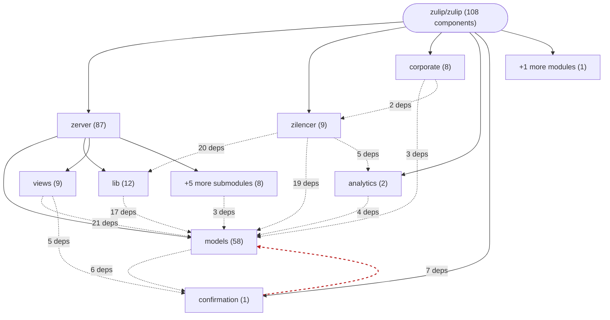
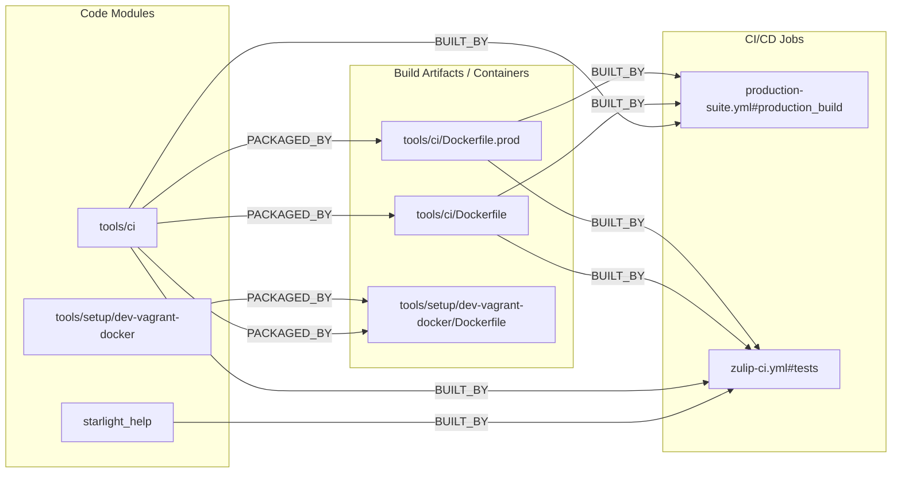
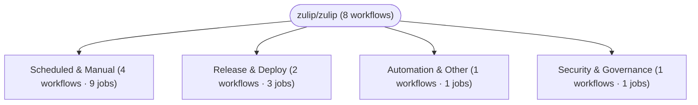

# Repository Architecture Analysis: zulip/zulip

## Metadata
- **SHA**: `0d59088c1d4d1741e6ec17074f0ede4d0c467044`
- **Primary Ecosystem**: Python

## Quality Metrics
- **ast_engine**: tree-sitter
- **avg_cognitive_complexity**: 2.91
- **avg_cyclomatic_complexity**: 2.7
- **component_count**: 108
- **dead_code_count**: 236
- **dead_code_symbols**: 50 entry(ies)
- **duplication_pct**: 91.04
- **file_complexities**: 25 entry(ies)
- **files_analyzed**: 2053
- **fitness_passed**: False
- **fitness_violation_count**: 11
- **framework**: Django
- **import_edges**: 100 entry(ies)
- **loc**: 430796
- **max_cognitive_complexity**: 955
- **max_cyclomatic_complexity**: 347
- **sloc**: 342337
- **test_file_count**: 2297

# Architecture: zulip/zulip

## Context
- **Repository**: `zulip/zulip`
- **SHA**: `0d59088c1d4d1741e6ec17074f0ede4d0c467044`
- **Ecosystem**: Python
- **Framework**: Django

## Building Block View

## Component Details

Showing top 60 representative components out of 108 across 6 module group(s):

- **Module `zerver`** (87 components — DATA_ACCESS_LAYER: 82, SERVICE: 5)
- **Module `zilencer`** (9 components — DATA_ACCESS_LAYER: 9)
- **Module `corporate`** (8 components — DATA_ACCESS_LAYER: 8)
- **Module `analytics`** (2 components — DATA_ACCESS_LAYER: 2)
- **Module `confirmation`** (1 components — DATA_ACCESS_LAYER: 1)
- **Module `starlight_help`** (1 components — MODULE: 1)

- **PushRegistration** (`zilencer/views.py`): DATA_ACCESS_LAYER (deps: AdvertiseRealmData, InstallationCountDataForAnalytics, Realm, RealmAuditLogDataForAnalytics, RealmCountDataForAnalytics, RealmDataForAnalytics (+3 more))
- **RemoteServerNotificationPayload** (`zilencer/views.py`): DATA_ACCESS_LAYER (deps: AdvertiseRealmData, InstallationCountDataForAnalytics, Realm, RealmAuditLogDataForAnalytics, RealmCountDataForAnalytics, RealmDataForAnalytics (+3 more))
- **SendE2EEPushNotificationPayload** (`zilencer/views.py`): DATA_ACCESS_LAYER (deps: AdvertiseRealmData, InstallationCountDataForAnalytics, Realm, RealmAuditLogDataForAnalytics, RealmCountDataForAnalytics, RealmDataForAnalytics (+3 more))
- **TestNotificationPayload** (`zilencer/views.py`): DATA_ACCESS_LAYER (deps: AdvertiseRealmData, InstallationCountDataForAnalytics, Realm, RealmAuditLogDataForAnalytics, RealmCountDataForAnalytics, RealmDataForAnalytics (+3 more))
- **Confirmation** (`confirmation/models.py`): DATA_ACCESS_LAYER (deps: EmailChangeStatus, MultiuseInvite, PreregistrationRealm, PreregistrationUser, Realm, RealmCreationStatus (+1 more))
- **NarrowParameter** (`zerver/lib/narrow.py`): DATA_ACCESS_LAYER (deps: DirectMessageGroup, Realm, Recipient, Stream, Subscription)
- **AbstractRemoteRealmBillingUser** (`zilencer/models.py`): DATA_ACCESS_LAYER (deps: AbstractPushDeviceToken, AbstractRealmAuditLog, BaseCount, Realm)
- **AbstractRemoteServerBillingUser** (`zilencer/models.py`): DATA_ACCESS_LAYER (deps: AbstractPushDeviceToken, AbstractRealmAuditLog, BaseCount, Realm)
- **AbstractScheduledJob** (`zerver/models/scheduled_jobs.py`): DATA_ACCESS_LAYER (deps: Client, Realm, Recipient, Stream)
- **AddSubscriptionData** (`zerver/views/streams.py`): DATA_ACCESS_LAYER (deps: ChannelFolder, Stream, UserGroup, UserTopic)
- **ChannelEmailAddress** (`zerver/models/streams.py`): DATA_ACCESS_LAYER (deps: ChannelFolder, Realm, Recipient, UserGroup)
- **DefaultStream** (`zerver/models/streams.py`): DATA_ACCESS_LAYER (deps: ChannelFolder, Realm, Recipient, UserGroup)
- **DefaultStreamGroup** (`zerver/models/streams.py`): DATA_ACCESS_LAYER (deps: ChannelFolder, Realm, Recipient, UserGroup)
- **MissedMessageEmailAddress** (`zerver/models/scheduled_jobs.py`): DATA_ACCESS_LAYER (deps: Client, Realm, Recipient, Stream)
- **ProfileDataElement** (`zerver/views/users.py`): DATA_ACCESS_LAYER (deps: DeactivateUserActions, Realm, Service, Stream)
- **RemotePushDevice** (`zilencer/models.py`): DATA_ACCESS_LAYER (deps: AbstractPushDeviceToken, AbstractRealmAuditLog, BaseCount, Realm)
- **RemoteRealm** (`zilencer/models.py`): DATA_ACCESS_LAYER (deps: AbstractPushDeviceToken, AbstractRealmAuditLog, BaseCount, Realm)
- **RemoteZulipServer** (`zilencer/models.py`): DATA_ACCESS_LAYER (deps: AbstractPushDeviceToken, AbstractRealmAuditLog, BaseCount, Realm)
- **ScheduledMessage** (`zerver/models/scheduled_jobs.py`): DATA_ACCESS_LAYER (deps: Client, Realm, Recipient, Stream)
- **ScheduledMessageNotificationEmail** (`zerver/models/scheduled_jobs.py`): DATA_ACCESS_LAYER (deps: Client, Realm, Recipient, Stream)
- **Stream** (`zerver/models/streams.py`): DATA_ACCESS_LAYER (deps: ChannelFolder, Realm, Recipient, UserGroup)
- **Subscription** (`zerver/models/streams.py`): DATA_ACCESS_LAYER (deps: ChannelFolder, Realm, Recipient, UserGroup)
- **SubscriptionPropertyChangeRequest** (`zerver/views/streams.py`): DATA_ACCESS_LAYER (deps: ChannelFolder, Stream, UserGroup, UserTopic)
- **AbstractAttachment** (`zerver/models/messages.py`): DATA_ACCESS_LAYER (deps: Client, Realm, Recipient)
- **AbstractCustomerPlan** (`corporate/models/plans.py`): DATA_ACCESS_LAYER (deps: Customer, LicenseLedger, Realm)
- **AbstractEmoji** (`zerver/models/messages.py`): DATA_ACCESS_LAYER (deps: Client, Realm, Recipient)
- **AbstractMessage** (`zerver/models/messages.py`): DATA_ACCESS_LAYER (deps: Client, Realm, Recipient)
- **AbstractRealmAuditLog** (`zerver/models/realm_audit_logs.py`): DATA_ACCESS_LAYER (deps: ChannelFolder, Realm, Stream)
- **AbstractSubMessage** (`zerver/models/messages.py`): DATA_ACCESS_LAYER (deps: Client, Realm, Recipient)
- **AbstractUserMessage** (`zerver/models/messages.py`): DATA_ACCESS_LAYER (deps: Client, Realm, Recipient)
- **ArchiveTransaction** (`zerver/models/messages.py`): DATA_ACCESS_LAYER (deps: Client, Realm, Recipient)
- **Customer** (`corporate/models/customers.py`): DATA_ACCESS_LAYER (deps: Realm, RemoteRealm, RemoteZulipServer)
- **DeactivateUserActions** (`zerver/actions/message_delete.py`): DATA_ACCESS_LAYER (deps: Realm, Recipient, Stream)
- **ImageAttachment** (`zerver/models/messages.py`): DATA_ACCESS_LAYER (deps: Client, Realm, Recipient)
- **OnboardingUserMessage** (`zerver/models/messages.py`): DATA_ACCESS_LAYER (deps: Client, Realm, Recipient)
- **PresenceSequence** (`zerver/models/presence.py`): DATA_ACCESS_LAYER (deps: AbstractEmoji, Client, Realm)
- **TargetUsersData** (`zerver/views/user_settings.py`): DATA_ACCESS_LAYER (deps: Confirmation, EmailChangeStatus, UserBaseSettings)
- **TusEvent** (`zerver/views/tusd.py`): DATA_ACCESS_LAYER (deps: Confirmation, PreregistrationRealm, Realm)
- **TusHTTPRequest** (`zerver/views/tusd.py`): DATA_ACCESS_LAYER (deps: Confirmation, PreregistrationRealm, Realm)
- **TusHook** (`zerver/views/tusd.py`): DATA_ACCESS_LAYER (deps: Confirmation, PreregistrationRealm, Realm)
- **TusUpload** (`zerver/views/tusd.py`): DATA_ACCESS_LAYER (deps: Confirmation, PreregistrationRealm, Realm)
- **UserPresence** (`zerver/models/presence.py`): DATA_ACCESS_LAYER (deps: AbstractEmoji, Client, Realm)
- **BaseCount** (`analytics/models.py`): DATA_ACCESS_LAYER (deps: Realm, Stream)
- **DirectMessageGroup** (`zerver/models/recipients.py`): DATA_ACCESS_LAYER (deps: Stream, Subscription)
- **EmailChangeStatus** (`zerver/models/prereg_users.py`): DATA_ACCESS_LAYER (deps: Confirmation, Realm)
- **ExternalAuthID** (`zerver/models/users.py`): DATA_ACCESS_LAYER (deps: CustomProfileFieldValue, Realm)
- **FillState** (`analytics/models.py`): DATA_ACCESS_LAYER (deps: Realm, Stream)
- **GenericOutgoingWebhookService** (`zerver/lib/outgoing_webhook.py`): SERVICE (deps: Realm, Service)
- **MultiuseInvite** (`zerver/models/prereg_users.py`): DATA_ACCESS_LAYER (deps: Confirmation, Realm)
- **PreregistrationRealm** (`zerver/models/prereg_users.py`): DATA_ACCESS_LAYER (deps: Confirmation, Realm)
- **PreregistrationUser** (`zerver/models/prereg_users.py`): DATA_ACCESS_LAYER (deps: Confirmation, Realm)
- **RealmCreationStatus** (`zerver/models/prereg_users.py`): DATA_ACCESS_LAYER (deps: Confirmation, Realm)
- **RealmReactivationStatus** (`zerver/models/prereg_users.py`): DATA_ACCESS_LAYER (deps: Confirmation, Realm)
- **Recipient** (`zerver/models/recipients.py`): DATA_ACCESS_LAYER (deps: Stream, Subscription)
- **SlackOutgoingWebhookService** (`zerver/lib/outgoing_webhook.py`): SERVICE (deps: Realm, Service)
- **UserBaseSettings** (`zerver/models/users.py`): DATA_ACCESS_LAYER (deps: CustomProfileFieldValue, Realm)
- **UserTopic** (`zerver/models/user_topics.py`): DATA_ACCESS_LAYER (deps: Recipient, Stream)
- **ZulipSponsorshipRequest** (`corporate/models/sponsorships.py`): DATA_ACCESS_LAYER (deps: Customer, Realm)
- **AdvertiseRealmData** (`zerver/lib/remote_server.py`): DATA_ACCESS_LAYER (deps: Realm)
- **AlertWord** (`zerver/models/alert_words.py`): DATA_ACCESS_LAYER (deps: Realm)

## 6-Dimension Repository Scorecard

- **Overall Grade**: `D` (60.95/100)
- **Technical Debt Score**: 39.05
- **Estimated Remediation Effort**: 155.97h

| Dimension | Grade | Score | Weight | Details |
| :--- | :---: | :---: | :---: | :--- |
| Code Quality | `F` | 30.00 | 0.20 | avg_cc=2.70, max_cc=347, duplication=91.04%, dead_code=236 |
| Dependency Health | `A` | 100.00 | 0.15 | dependencies=660, outdated=0, vulnerable=0, has_lockfile=True |
| Maintainability | `F` | 0.00 | 0.15 | avg_cognitive=2.91, max_cognitive=955, fitness_violations=11, oversized_files=25 |
| Pipeline Health | `D` | 63.00 | 0.15 | workflows=8, operational_antipatterns=14, parallel_branches=True |
| Security | `A` | 100.00 | 0.20 | vulnerabilities=0, secrets=0, pipeline_security_findings=0 |
| Test Coverage | `C` | 70.00 | 0.15 | coverage=unavailable, ci_test_job=True, test_files_detected=True |

## Architecture Fitness & Workspace Boundaries

- **[HIGH] `ATRUSS-ARCH-004` (CIRCULAR_DEPENDENCY)**: Circular dependency detected between architectural components. (Confirmation -> EmailChangeStatus -> Confirmation)
- **[HIGH] `ATRUSS-ARCH-004` (CIRCULAR_DEPENDENCY)**: Circular dependency detected between architectural components. (Confirmation -> MultiuseInvite -> Confirmation)
- **[HIGH] `ATRUSS-ARCH-004` (CIRCULAR_DEPENDENCY)**: Circular dependency detected between architectural components. (Confirmation -> PreregistrationRealm -> Confirmation)
- **[HIGH] `ATRUSS-ARCH-004` (CIRCULAR_DEPENDENCY)**: Circular dependency detected between architectural components. (Confirmation -> PreregistrationUser -> Confirmation)
- **[HIGH] `ATRUSS-ARCH-004` (CIRCULAR_DEPENDENCY)**: Circular dependency detected between architectural components. (Confirmation -> RealmCreationStatus -> Confirmation)
- **[HIGH] `ATRUSS-ARCH-004` (CIRCULAR_DEPENDENCY)**: Circular dependency detected between architectural components. (Confirmation -> RealmReactivationStatus -> Confirmation)
- **[HIGH] `ATRUSS-ARCH-004` (CIRCULAR_DEPENDENCY)**: Circular dependency detected between architectural components. (Recipient -> Stream -> Recipient)
- **[HIGH] `ATRUSS-ARCH-004` (CIRCULAR_DEPENDENCY)**: Circular dependency detected between architectural components. (Recipient -> Subscription -> Recipient)
- **[MEDIUM] `ATRUSS-ARCH-005` (COMPLEXITY_THRESHOLD)**: Repository duplication_pct (91.04) exceeds policy threshold (15.0).
- **[MEDIUM] `ATRUSS-ARCH-005` (COMPLEXITY_THRESHOLD)**: Repository max_cognitive_complexity (955.0) exceeds policy threshold (25.0).
- **[MEDIUM] `ATRUSS-ARCH-005` (COMPLEXITY_THRESHOLD)**: Repository max_cyclomatic_complexity (347.0) exceeds policy threshold (20.0).

### Workspace Packages
- **starlight_help** (`starlight_help`, react_ts_js, pnpm)

## Supply Chain Dependencies, Vulnerabilities & Secrets

- **Dependencies Parsed**: 660 | **Vulnerabilities**: 0 | **Secrets**: 0

### Inventory Sample
- `PyGithub` `*` (PyPI, `pyproject.toml`)
- `aioapns` `*` (PyPI, `pyproject.toml`)
- `aioapns` `4.0` (PyPI, `uv.lock`)
- `aiohttp` `*` (PyPI, `pyproject.toml`)
- `aiohttp` `3.14.5` (PyPI, `uv.lock`)
- `aiosmtpd` `1.4.6` (PyPI, `pyproject.toml`)
- `aiosmtpd` `1.4.6` (PyPI, `uv.lock`)
- `altcha` `*` (PyPI, `pyproject.toml`)
- `altcha` `2.3.0` (PyPI, `uv.lock`)
- `annotated-types` `*` (PyPI, `pyproject.toml`)
- `annotated-types` `0.8.0` (PyPI, `uv.lock`)
- `asgiref` `*` (PyPI, `pyproject.toml`)
- `asgiref` `3.12.1` (PyPI, `uv.lock`)
- `atpublic` `8.0.1` (PyPI, `uv.lock`)
- `atpublic` `9.0.0` (PyPI, `pyproject.toml`)
- `backports-datetime-fromisoformat` `*` (PyPI, `pyproject.toml`)
- `backports-datetime-fromisoformat` `2.0.3` (PyPI, `uv.lock`)
- `beautifulsoup4` `*` (PyPI, `pyproject.toml`)
- `beautifulsoup4` `4.15.0` (PyPI, `uv.lock`)
- `black` `*` (PyPI, `pyproject.toml`)
- `black` `26.10.1` (PyPI, `uv.lock`)
- `boto3` `*` (PyPI, `pyproject.toml`)
- `boto3` `1.43.115` (PyPI, `uv.lock`)
- `boto3-stubs` `*` (PyPI, `pyproject.toml`)
- `boto3-stubs` `1.43.115` (PyPI, `uv.lock`)
- `certifi` `*` (PyPI, `pyproject.toml`)
- `certifi` `2026.10.19` (PyPI, `uv.lock`)
- `chardet` `*` (PyPI, `pyproject.toml`)
- `chardet` `7.7.0` (PyPI, `uv.lock`)
- `codespell` `*` (PyPI, `pyproject.toml`)
- ... (+630 more dependencies)

## Section 7: Code-to-Cloud Deployment Traceability

- `starlight_help` (code_module) --[BUILT_BY]--> `zulip-ci.yml#tests` (ci_job)
- `tools/ci` (code_module) --[BUILT_BY]--> `production-suite.yml#production_build` (ci_job)
- `tools/ci` (code_module) --[BUILT_BY]--> `zulip-ci.yml#tests` (ci_job)
- `tools/ci` (code_module) --[PACKAGED_BY]--> `tools/ci/Dockerfile` (container)
- `tools/ci` (code_module) --[PACKAGED_BY]--> `tools/ci/Dockerfile.prod` (container)
- `tools/ci` (code_module) --[PACKAGED_BY]--> `tools/setup/dev-vagrant-docker/Dockerfile` (container)
- `tools/setup/dev-vagrant-docker` (code_module) --[PACKAGED_BY]--> `tools/setup/dev-vagrant-docker/Dockerfile` (container)
- `tools/ci/Dockerfile` (container) --[BUILT_BY]--> `production-suite.yml#production_build` (ci_job)
- `tools/ci/Dockerfile` (container) --[BUILT_BY]--> `zulip-ci.yml#tests` (ci_job)
- `tools/ci/Dockerfile.prod` (container) --[BUILT_BY]--> `production-suite.yml#production_build` (ci_job)
- `tools/ci/Dockerfile.prod` (container) --[BUILT_BY]--> `zulip-ci.yml#tests` (ci_job)

## CI/CD Pipeline Topology

