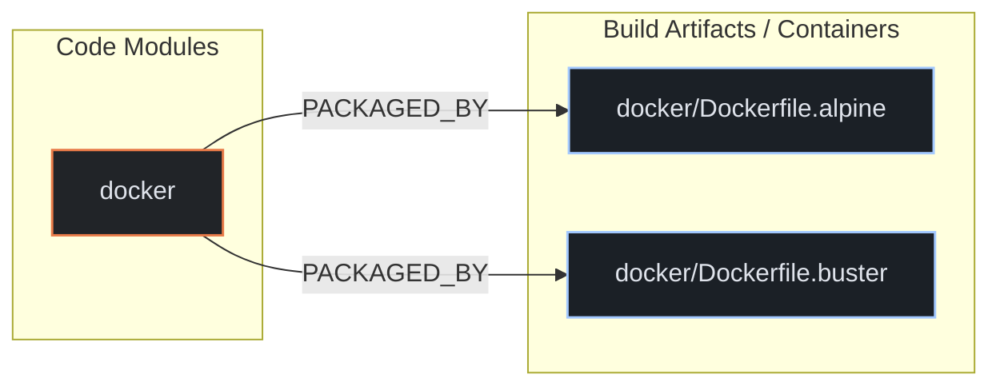
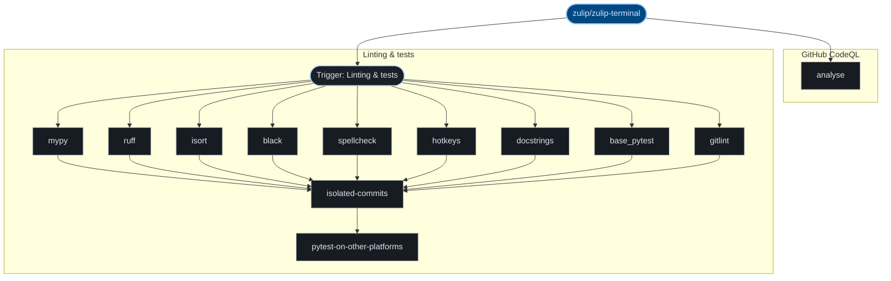

# Repository Architecture Analysis: zulip/zulip-terminal

## Metadata
- **SHA**: `dedc62d6b96a0302b3b084b0c60abc029e6066ae`
- **Primary Ecosystem**: Python

## Quality Metrics
- **ast_engine**: tree-sitter
- **avg_cognitive_complexity**: 2.37
- **avg_cyclomatic_complexity**: 2.45
- **component_count**: 0
- **dead_code_count**: 1
- **dead_code_symbols**: 1 entry(ies)
- **duplication_pct**: 80.65
- **file_complexities**: 25 entry(ies)
- **files_analyzed**: 69
- **fitness_passed**: False
- **fitness_violation_count**: 3
- **framework**: Unknown
- **import_edges**: 100 entry(ies)
- **loc**: 34321
- **max_cognitive_complexity**: 142
- **max_cyclomatic_complexity**: 61
- **sloc**: 29682
- **test_file_count**: 26

## 6-Dimension Repository Scorecard

- **Overall Grade**: `F` (53.40/100)
- **Technical Debt Score**: 46.60
- **Estimated Remediation Effort**: 72.03h

| Dimension | Grade | Score | Weight | Details |
| :--- | :---: | :---: | :---: | :--- |
| Code Quality | `F` | 48.00 | 0.20 | avg_cc=2.45, max_cc=61, duplication=80.65%, dead_code=1 |
| Dependency Health | `A` | 90.00 | 0.15 | dependencies=0 (no manifests parsed) |
| Maintainability | `F` | 37.00 | 0.15 | avg_cognitive=2.37, max_cognitive=142, fitness_violations=3, oversized_files=16 |
| Pipeline Health | `D` | 63.00 | 0.15 | workflows=2, operational_antipatterns=13, parallel_branches=True |
| Security | `F` | 24.00 | 0.20 | vulnerabilities=0, secrets=0, pipeline_security_findings=5 |
| Test Coverage | `C` | 70.00 | 0.15 | coverage=unavailable, ci_test_job=True, test_files_detected=True |

## Architecture Fitness & Workspace Boundaries

- **[MEDIUM] `ATRUSS-ARCH-005` (COMPLEXITY_THRESHOLD)**: Repository duplication_pct (80.65) exceeds policy threshold (15.0).
- **[MEDIUM] `ATRUSS-ARCH-005` (COMPLEXITY_THRESHOLD)**: Repository max_cognitive_complexity (142.0) exceeds policy threshold (25.0).
- **[MEDIUM] `ATRUSS-ARCH-005` (COMPLEXITY_THRESHOLD)**: Repository max_cyclomatic_complexity (61.0) exceeds policy threshold (20.0).

## Section 7: Code-to-Cloud Deployment Traceability

- `docker` (code_module) --[PACKAGED_BY]--> `docker/Dockerfile.alpine` (container)
- `docker` (code_module) --[PACKAGED_BY]--> `docker/Dockerfile.buster` (container)

## CI/CD Pipeline Topology

