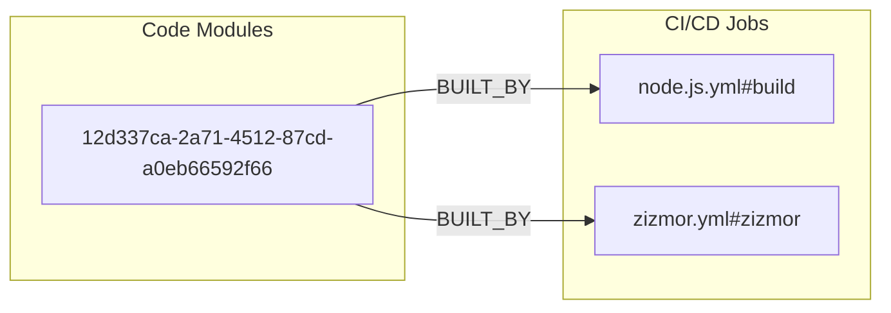
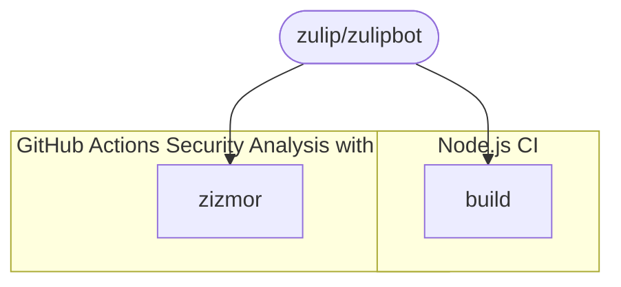

# Repository Architecture Analysis: zulip/zulipbot

## Metadata
- **SHA**: `2e42a6b2f334734f28efbbef428e8bbf0c8a7344`
- **Primary Ecosystem**: JavaScript/TypeScript

## Quality Metrics
- **ast_engine**: tree-sitter
- **avg_cognitive_complexity**: 4.58
- **avg_cyclomatic_complexity**: 4.65
- **component_count**: 2
- **dead_code_count**: 0
- **dead_code_symbols**: 0 entry(ies)
- **duplication_pct**: 79.71
- **file_complexities**: 25 entry(ies)
- **files_analyzed**: 33
- **fitness_passed**: False
- **fitness_violation_count**: 2
- **framework**: Express / Node API
- **import_edges**: 100 entry(ies)
- **loc**: 3637
- **max_cognitive_complexity**: 26
- **max_cyclomatic_complexity**: 19
- **sloc**: 3036
- **test_file_count**: 9

# Architecture: zulip/zulipbot

## Context
- **Repository**: `zulip/zulipbot`
- **SHA**: `2e42a6b2f334734f28efbbef428e8bbf0c8a7344`
- **Ecosystem**: JavaScript/TypeScript
- **Framework**: Express / Node API

## Building Block View

## Component Details
- **zulipbot** (`package.json`): MODULE
- **GET_root** (`src/index.ts`): API_ROUTE

## 6-Dimension Repository Scorecard

- **Overall Grade**: `C` (74.48/100)
- **Technical Debt Score**: 25.52
- **Estimated Remediation Effort**: 30.82h

| Dimension | Grade | Score | Weight | Details |
| :--- | :---: | :---: | :---: | :--- |
| Code Quality | `D` | 62.40 | 0.20 | avg_cc=4.65, max_cc=19, duplication=79.71%, dead_code=0 |
| Dependency Health | `B` | 85.00 | 0.15 | dependencies=20, outdated=0, vulnerable=0, has_lockfile=False |
| Maintainability | `C` | 79.00 | 0.15 | avg_cognitive=4.58, max_cognitive=26, fitness_violations=2, oversized_files=0 |
| Pipeline Health | `A` | 94.00 | 0.15 | workflows=2, operational_antipatterns=2, parallel_branches=False |
| Security | `D` | 64.00 | 0.20 | vulnerabilities=0, secrets=0, pipeline_security_findings=3 |
| Test Coverage | `C` | 70.00 | 0.15 | coverage=unavailable, ci_test_job=True, test_files_detected=True |

## Architecture Fitness & Workspace Boundaries

- **[MEDIUM] `ATRUSS-ARCH-005` (COMPLEXITY_THRESHOLD)**: Repository duplication_pct (79.71) exceeds policy threshold (15.0).
- **[MEDIUM] `ATRUSS-ARCH-005` (COMPLEXITY_THRESHOLD)**: Repository max_cognitive_complexity (26.0) exceeds policy threshold (25.0).

## Supply Chain Dependencies, Vulnerabilities & Secrets

- **Dependencies Parsed**: 20 | **Vulnerabilities**: 0 | **Secrets**: 0

### Inventory Sample
- `@octokit/plugin-retry` `8.1.1` (npm, `package.json`)
- `@octokit/plugin-throttling` `11.0.5` (npm, `package.json`)
- `@octokit/request-error` `7.1.2` (npm, `package.json`)
- `@octokit/rest` `22.0.1` (npm, `package.json`)
- `@octokit/webhooks` `14.2.0` (npm, `package.json`)
- `@types/express` `5.0.6` (npm, `package.json`)
- `@types/lodash` `4.17.27` (npm, `package.json`)
- `@types/node` `22.20.5` (npm, `package.json`)
- `@typescript/native` `7.0.2` (npm, `package.json`)
- `eslint` `10.14.0` (npm, `package.json`)
- `eslint-config-prettier` `10.1.8` (npm, `package.json`)
- `eslint-config-xo` `7.0.0` (npm, `package.json`)
- `express` `5.3.0` (npm, `package.json`)
- `lodash` `4.18.1` (npm, `package.json`)
- `nock` `15.0.6` (npm, `package.json`)
- `partial-mock` `1.1.0` (npm, `package.json`)
- `prettier` `3.9.10` (npm, `package.json`)
- `ts-extras` `2.0.0` (npm, `package.json`)
- `type-fest` `5.10.0` (npm, `package.json`)
- `typescript` `6.0.2` (npm, `package.json`)

## Section 7: Code-to-Cloud Deployment Traceability

- `12d337ca-2a71-4512-87cd-a0eb66592f66` (code_module) --[BUILT_BY]--> `node.js.yml#build` (ci_job)
- `12d337ca-2a71-4512-87cd-a0eb66592f66` (code_module) --[BUILT_BY]--> `zizmor.yml#zizmor` (ci_job)

## CI/CD Pipeline Topology

