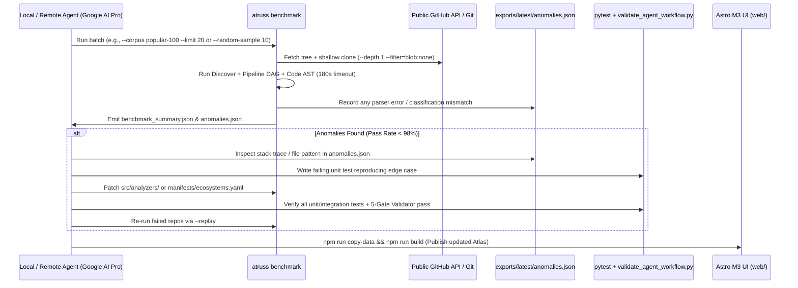

# Implementation Plan: 100 Popular + Randomized Public GitHub Benchmark & Self-Healing Agent Loop

**Branch**: `008-public-github-100-benchmark` | **Date**: 2026-11-12 | **Spec**: [spec.md](./spec.md)  
**Input**: Feature specification from `/specs/008-public-github-100-benchmark/spec.md`

---

## 1. Summary

Build the scale-testing and autonomous iteration harness (`atruss benchmark`) to validate Atruss Code Atlas across **100 popular public GitHub repositories** (`tests/fixtures/popular_100_corpus.json`) as well as **stratified randomized GitHub repositories** (`--random-sample N --seed S`). Includes fault-isolated 180s circuit breakers, immediate shallow-clone disk cleanup, an `anomalies.json` diagnostic ledger, and a self-healing agent skill (`.agent/skills/benchmark-self-heal/SKILL.md`) designed to run either locally or on **Google AI Pro Remote Agents**.

---

## 2. Technical Context

- **Language/Version**: Python 3.12+ (`asyncio`, `httpx`, `typer`, `pydantic`)
- **Git Strategy**: Shallow blobless clones (`git clone --depth 1 --filter=blob:none --single-branch`) with `TemporaryDirectory` auto-cleanup per repository.
- **Concurrency & Circuit Breakers**: `asyncio.Semaphore(max_concurrent)` + `asyncio.wait_for(..., timeout=180.0)`.
- **Outputs**: Populates `exports/latest/` (consumed directly by Astro M3 UI) + `benchmark_summary.{json,md}` + `anomalies.json` + `benchmark_manifest.json`.
- **Agent Execution**: Compatible with local background tasks (`run_command` / `/schedule` / `/goal`) and **Google AI Pro Remote Agents** connected via GitHub.

---

## 3. Constitution Check

- **I. Policy-as-Code**: **PASS**. Benchmark evaluates accuracy of `manifests/ecosystems.yaml` against expected ecosystem ground truth.
- **III. Security & Privacy First**: **PASS**. Uses optional `GH_TOKEN` strictly via masked headers; only public GitHub repositories are cloned in the benchmark.
- **IV. Performance & Scalability**: **PASS**. Enforces `< 180s` timeout per repo and bounded concurrency.
- **VII. Strict SDD & TDD**: **PASS**. Every anomaly found in `anomalies.json` is converted into a unit test before fixing the analyzer.

---

## 4. Project Structure & Target Modifications

```text
tests/
├── fixtures/
│   └── popular_100_corpus.json                  # [NEW] 100 stratified popular repos (25 Python, 25 .NET, 25 React/TS, 25 Java)
├── unit/
│   └── test_benchmark_runner.py                 # [NEW] Unit tests for corpus loading, random sampling, circuit breaker & anomaly logging
└── integration/
    └── test_benchmark_e2e.py                    # [NEW] End-to-end benchmark slice test (popular + random replay)

scripts/
├── curate_corpus.py                             # [NEW] Validates and refreshes popular_100_corpus.json
└── run_benchmark_loop.py                        # [NEW] Batch orchestrator for local / Remote Agent self-healing runs

src/
├── models/
│   └── benchmark.py                             # [NEW] CorpusEntry, BenchmarkResult, AnomalyRecord, BenchmarkSummary models
├── core/
│   └── utils/
│       └── git_cloner.py                        # [MODIFY] Add shallow blobless clone flags (--depth 1 --filter=blob:none)
└── cli/
    ├── main.py                                  # [MODIFY] Register `atruss benchmark` subcommand
    └── commands/
        └── benchmark.py                         # [NEW] CLI command implementing --corpus, --random-sample, --seed, --replay

.agent/
└── skills/
    └── benchmark-self-heal/
        └── SKILL.md                             # [NEW] Agent skill instructions for autonomous anomaly triage & test-first repair
```

---

## 5. Self-Healing Agent Loop Architecture


