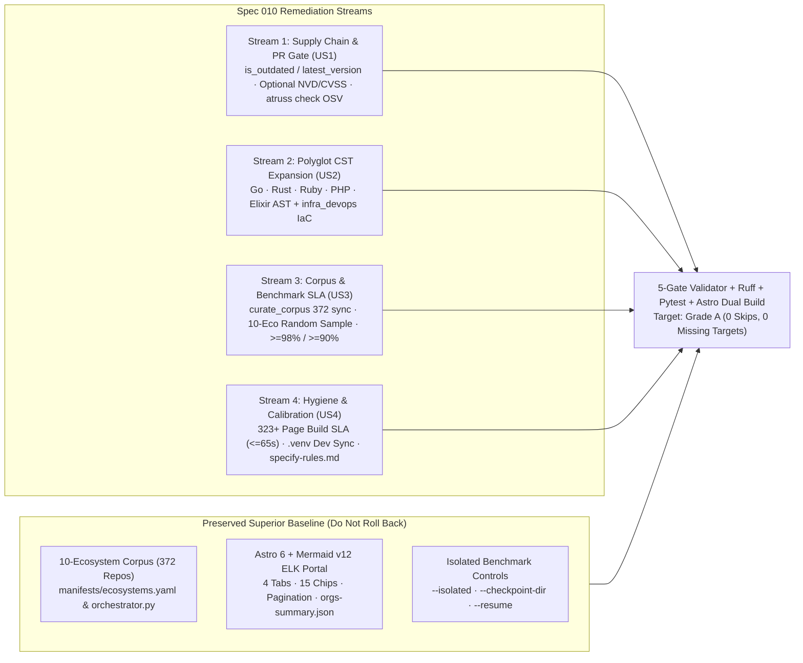

# Implementation Plan: Post-Release Parity, Polyglot Depth & Benchmark SLA Hardening

**Branch**: `010-parity-and-hardening` *(planned from `docs/sync-docs-and-specs`)* | **Date**: 2026-11-15 | **Spec**: [spec.md](./spec.md)  
**Input**: Feature specification from [`specs/010-parity-and-hardening/spec.md`](./spec.md)

---

## 1. Summary

Spec `010-parity-and-hardening` closes the remaining functional, empirical, and specification gaps discovered during the `2026-11-15` post-release audit while **preserving and ratifying every area where existing code surpasses earlier Spec `007`–`009` baselines** (10-ecosystem / 372-repo corpus via dedicated manifests/orchestrator/fixture files, 4-tab `RepoTabs.astro`, 15 filter chips + pagination, CSS `.m3-*` styling, Astro 6 + Mermaid v12 ELK, `orgs-summary.json`, `reports/{org}/{repo}.mdx`, and `pipeline_architecture.md`).

---

## 2. Technical Context

- **Language/Version**: Python 3.11+ (`.venv` via `uv pip install -e ".[dev]"`), Node.js v22+ via `fnm` (`web/`)
- **Primary Dependencies**: `typer`, `httpx`, `pydantic`, `pyyaml`, `networkx`, `radon`, `bandit`, `tree-sitter` + polyglot grammar wheels (`tree-sitter-python`, `tree-sitter-c-sharp`, `tree-sitter-typescript`, `tree-sitter-javascript`, `tree-sitter-java`, plus planned Go/Rust/Ruby/PHP/Elixir grammar bindings), Astro 6 + `@astrojs/starlight` + `mermaid` v12 (`@mermaid-js/layout-elk`)
- **Storage**: Stateless local filesystem (`exports/{timestamp}/` + `exports/latest/`), optional local cache directory for OSV/NVD/outdated metadata (never committed as unpinned volatile state during determinism checks), declarative manifests in `manifests/*.yaml`
- **Testing**: `pytest --strict-markers` (`tests/unit/`, `tests/integration/`), `ruff check`, Node 22 native test runner (`node src/tests/AtlasSummary.test.ts && node src/tests/schema.test.ts`), and 5-Gate Validator (`scripts/validate_agent_workflow.py --spec specs/010-parity-and-hardening`)
- **Performance & Scale Goals**: `<= 65s` Astro static portal build across `323+` generated pages (with Pagefind), `< 180s` per-repo deep scan circuit breaker across 372-repo monorepos, `>= 98%` crash-free benchmark rate, `>= 90%` classification accuracy, byte-for-byte SHA-256 offline determinism

---

## 3. Constitution Check

*GATE: Evaluated before Phase 0 execution and verified continuously via `scripts/validate_agent_workflow.py`.*

- **I. Policy-as-Code & Extensibility**: **PASS** — Classification refinements for `Container / Helm / IaC` and multi-language tie-breakers live strictly in [`manifests/ecosystems.yaml`](../../manifests/ecosystems.yaml), with zero hardcoded repo rules in Python.
- **II. Single Source of Truth for Reports**: **PASS** — Outdated dependencies, CVSS enrichment, and extended polyglot metrics write to canonical `PortableArtifact` JSON in `exports/latest/` before SARIF, Markdown, and Astro rendering.
- **III. Security & Privacy First**: **PASS** — Optional registry outdated lookups, live OSV queries (`atruss check --live-osv`), and optional NVD enrichment respect masked credentials (`src/core/auth.py`), offline fallback, and deterministic `httpx.MockTransport` tests.
- **IV. Performance & Scalability**: **PASS** — Monorepo path pruning and timeout tuning strengthen the `<= 180s` circuit breaker to restore `>= 98%` crash-free completion across 372+ repos.
- **V. Auditability & Determinism**: **PASS** — Offline/default runs skip volatile network lookups so Gate 5 SHA-256 digests match byte-for-byte across repeated invocations.
- **VI. Pipeline Visualization as a First-Class Feature**: **PASS** — Pipeline DAG, `cross_workflow` edges, `pipeline_architecture.md`, and `PipelineView.astro` remain intact alongside the ratified 4-tab M3 layout.
- **VII. Strict SDD & TDD**: **PASS** — Every requirement (`FR-001`–`FR-010`) maps 1:1 to testable tasks in [`tasks.md`](./tasks.md) with failing-first unit tests (`pytest --strict-markers`, 0 skips).
- **VIII. Standardized WSL / Linux Execution**: **PASS** — Verified via root `.venv` and Node v22 (`fnm`).

---

## 4. Project Structure

### Documentation (this feature)

```text
specs/010-parity-and-hardening/
├── spec.md              # Feature specification & ratified code-baseline table
├── plan.md              # This implementation plan
├── tasks.md             # Unchecked implementation roadmap (T001-T020) mapped 1:1 to FR-001..010
└── checklists/
    └── requirements.md  # Spec quality & completeness checklist
```

### Target Modules & Tests (repository root)

```text
manifests/
└── ecosystems.yaml                             # [MODIFY] Refine IaC/multi-lang signals & tie-breakers

src/
├── models/
│   └── artifacts.py                            # [PRESERVE/VERIFY] DependencyRecord (is_outdated, latest_version)
├── analyzers/
│   ├── scorecard.py                            # [VERIFY] Consume populated is_outdated / CVSS fields
│   ├── dependencies/
│   │   ├── manifest_parser.py                  # [MODIFY] Add cached/opt-in registry freshness lookup
│   │   └── osv_client.py                       # [MODIFY] Optional CVSS/NVD enrichment & cached offline check helper
│   └── code/
│       ├── treesitter_engine.py                # [MODIFY] Add Go, Rust, Ruby, PHP, Elixir grammar analyzers
│       └── orchestrator.py                     # [MODIFY] Route extra code langs via AST while keeping infra_devops fallback
├── core/
│   └── exporters/
│       └── markdown_exporter.py                # [PRESERVE] Canonical reports/pipeline_architecture.md output
└── cli/
    └── commands/
        ├── check.py                            # [MODIFY] Consume cached/live OSV & outdated checks in PR gate
        └── benchmark.py                        # [MODIFY] Expand ECOSYSTEM_SEARCH_LANG + monorepo timeout optimization

scripts/
├── curate_corpus.py                            # [MODIFY] Sync CURATED_CATALOG to 372 repos / 10 ecosystems
├── generate-org-summary.py                     # [PRESERVE] Precomputes exports/latest/orgs-summary.json
├── generate-report-stubs.py                    # [PRESERVE] Emits reports/{org}/{repo}.mdx across 4 tabs
└── validate_agent_workflow.py                  # [VERIFY] Gate 1-5 evaluation on specs/010-parity-and-hardening

web/
├── package.json                                # [PRESERVE] Astro 6 + Starlight + Mermaid v12 ELK + copy-data
├── src/components/
│   ├── RepoTabs.astro                          # [PRESERVE] 4 M3 Primary Tabs
│   ├── RepoGrid.astro                          # [PRESERVE] 15 Filter Chips + 24-card pagination
│   ├── OrgComparisonTable.astro                # [PRESERVE] 20-row org pagination + orgs-summary.json
│   └── ScorecardHeatmap.astro                  # [PRESERVE] Tab 4 heatmap & risk telemetry
└── src/styles/
    └── material-theme.css                      # [PRESERVE] Pure .m3-* CSS classes & print styles

tests/
├── fixtures/
│   └── popular_100_corpus.json                 # [PRESERVE/VERIFY] 372-repo / 10-ecosystem corpus dataset
├── unit/
│   ├── test_dependencies_osv_sbom.py           # [MODIFY] Tests for is_outdated, NVD/CVSS mock, check offline OSV
│   ├── test_drift_sarif_mcp.py                 # [MODIFY] SARIF vulnerability findings in atruss check
│   ├── test_treesitter_engine.py               # [MODIFY] Go/Rust/Ruby/PHP/Elixir AST complexity & import tests
│   ├── test_multi_ecosystem_support.py         # [MODIFY] Verify AST vs infra_devops structural retention
│   └── test_benchmark_runner.py                # [MODIFY] 372-repo curate_corpus & expanded --random-sample tests
└── integration/
    ├── test_benchmark_e2e.py                   # [MODIFY] Monorepo timeout guard & SLA verification
    └── test_horizon2_e2e.py                    # [VERIFY] End-to-end SARIF, SBOM, Scorecard, determinacy
```

---

## 5. Remediation & Ratification Architecture



---

## 6. Complexity Tracking

> No Constitution violations expected; optional grammar wheels and opt-in advisory/registry queries preserve zero-database offline-first compliance via deterministic fallbacks.

| Consideration | Design Choice | Rationale |
| :--- | :--- | :--- |
| Optional registry & NVD network calls (`FR-001`, `FR-002`) | Offline-by-default; opt-in CLI flags (`--live-osv`, `--live-nvd`, `--check-outdated`) + local cache lookup | Preserves zero-network CI determinism (`NFR-DET-01`) and offline portability |
| Extra Tree-sitter language wheels (`FR-004`, `FR-005`) | Declarative grammar registry inside `treesitter_engine.py` with `"fallback"` structural safety | Adds deep AST telemetry for Go, Rust, Ruby, PHP, and Elixir without brittle native toolchains |
